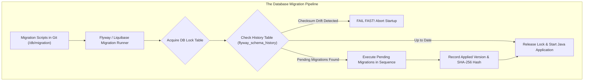
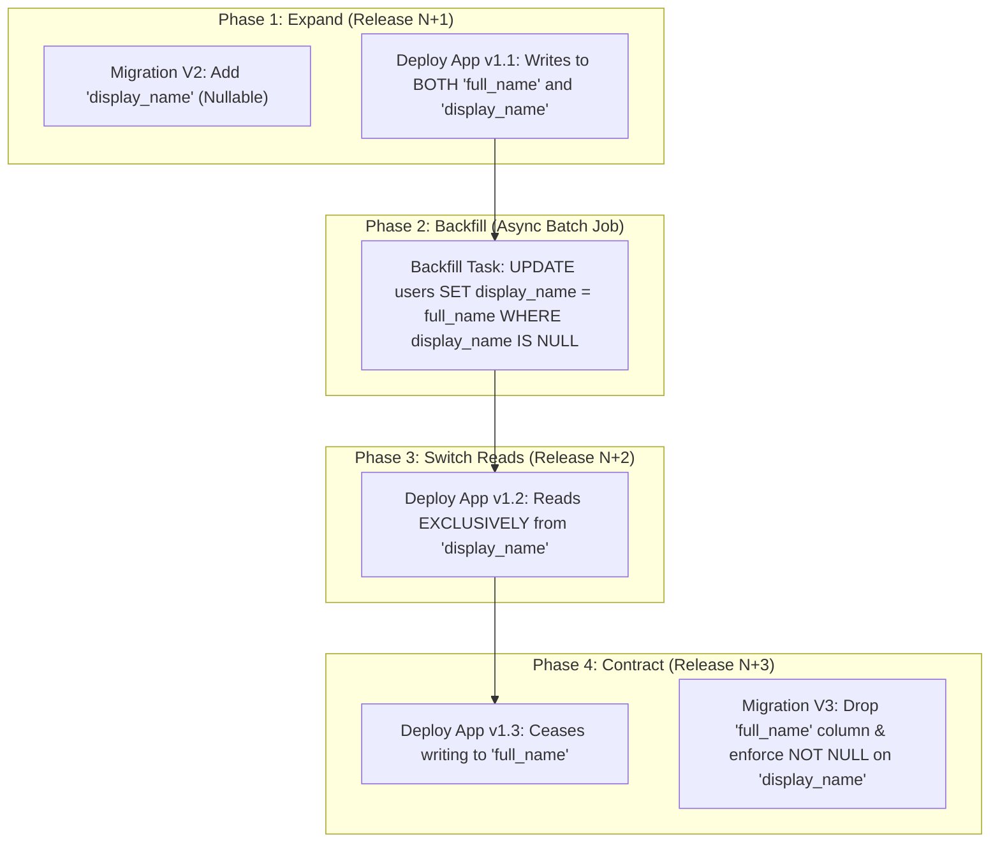
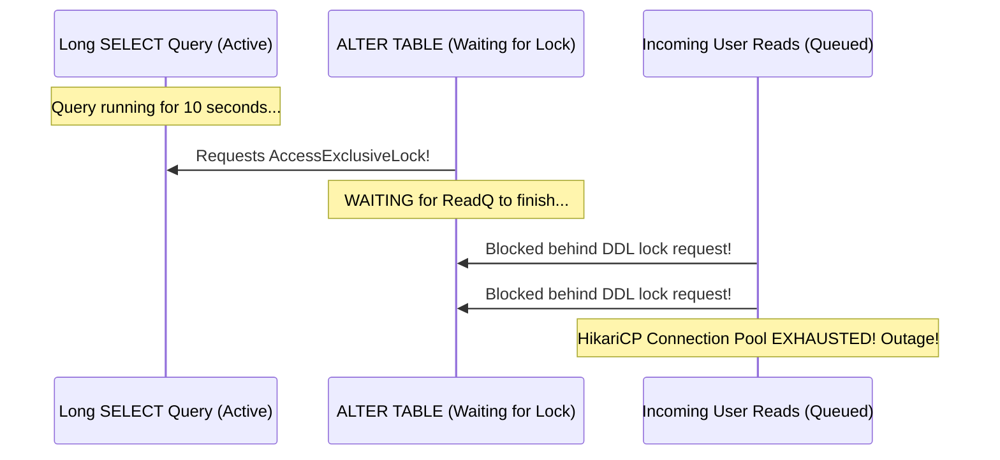

Imagine this production scenario: It is 10:00 AM on a Tuesday. A developer pushes a pull request that renames the `email` column to `email_address` in the `users` table. The pull request includes a single database migration script:

```sql
ALTER TABLE users RENAME COLUMN email TO email_address;
```

The migration runs as part of the CI/CD deployment pipeline. In Kubernetes, a rolling update begins: Pod 1 of the new version starts, while Pods 2, 3, and 4 are still running the previous version of your application.

Immediately, your alerting system explodes:
- Existing running pods (Pods 2, 3, and 4) fail on every login with `org.postgresql.util.PSQLException: ERROR: column "email" does not exist`.
- New pods fail because background workers are still trying to read the old column name.
- 500 Internal Server Errors spike across the entire platform.

Your application code lives in version control, with pull requests, code reviews, and automated test pipelines. **Your database schema must be managed with the exact same rigor.** 

Database migration frameworks—primarily **Flyway** and **Liquibase**—bring schema evolution into Git, providing automated, reproducible, and verifiable transitions across local machines, staging environments, and production clusters.



---

## Flyway: The SQL-First Standard

Flyway is the industry standard for Java developers who prefer direct, clean SQL. It prioritizes simplicity and readability over complex abstraction layers.

### The Flyway Naming Convention

Flyway locates migration scripts inside `src/main/resources/db/migration/`. File names must follow a strict naming convention:

```
V<Version>__<Description>.sql
```

1. **Prefix**:
   - `V`: **Versioned Migration**. Runs exactly once in numerical order (e.g., `V1__create_users.sql`, `V2.1__add_phone.sql`).
   - `U`: **Undo Migration** (Commercial Flyway feature). Reverses a versioned migration.
   - `R`: **Repeatable Migration**. Has no version number. Re-runs whenever its SHA-256 checksum changes (e.g., `R__user_summary_view.sql`).
2. **Version**: Dot or underscore-separated numerical hierarchy (`V1_0_1` or `V1.0.1`).
3. **Separator**: Two consecutive underscores (`__`).
4. **Description**: Human-readable text with words separated by underscores or spaces.
5. **Extension**: `.sql`.

```text
src/main/resources/db/migration/
  ├── V1__initial_schema.sql
  ├── V2__add_orders_table.sql
  ├── V3__create_customer_indexes.sql
  └── R__recreate_order_reporting_view.sql
```

### The flyway_schema_history Table

When Flyway runs, it automatically creates a metadata table named `flyway_schema_history` in your database:

| installed_rank | version | description | type | script | checksum | installed_by | installed_on | success |
| :--- | :--- | :--- | :--- | :--- | :--- | :--- | :--- | :--- |
| 1 | 1 | initial schema | SQL | V1__initial_schema.sql | -142857291 | app_user | 2026-10-29 10:00:00 | true |
| 2 | 2 | add orders table | SQL | V2__add_orders_table.sql | 849201948 | app_user | 2026-10-29 10:05:00 | true |

Flyway computes a **SHA-256 checksum** of every file. On every application boot, Flyway compares the checksum of the local migration file against the checksum stored in `flyway_schema_history`.

> [!CAUTION]
> **Never modify an already-applied migration file!**
> If you edit `V1__initial_schema.sql` after it has run in staging or production, Flyway will detect a checksum mismatch on the next boot and throw:
> `FlywayException: Validate failed: Migration checksum mismatch for migration version 1`.
> To fix a mistake in an existing migration, **always create a new forward migration** (e.g., `V3__fix_user_table.sql`).

---

## Liquibase: The Multi-Format Enterprise Alternative

While Flyway focuses on raw SQL, **Liquibase** takes a declarative, database-agnostic approach. It allows developers to define migrations using XML, YAML, JSON, or SQL formats.

### The Liquibase Changelog Structure

A Liquibase configuration consists of a **Changelog** containing ordered **Changesets**:

```xml
<?xml version="1.0" encoding="UTF-8"?>
<databaseChangeLog
    xmlns="http://www.liquibase.org/xml/ns/dbchangelog"
    xmlns:xsi="http://www.w3.org/2001/XMLSchema-instance"
    xsi:schemaLocation="http://www.liquibase.org/xml/ns/dbchangelog
        http://www.liquibase.org/xml/ns/dbchangelog/dbchangelog-latest.xsd">

    <changeSet id="1" author="alice">
        <createTable tableName="customers">
            <column name="id" type="BIGINT" autoIncrement="true">
                <constraints primaryKey="true" nullable="false"/>
            </column>
            <column name="email" type="VARCHAR(255)">
                <constraints nullable="false" unique="true"/>
            </column>
        </createTable>
        <rollback>
            <dropTable tableName="customers"/>
        </rollback>
    </changeSet>

</databaseChangeLog>
```

### Flyway vs Liquibase Comparison

| Feature | Flyway | Liquibase |
| :--- | :--- | :--- |
| **Primary Philosophy** | SQL-First, pragmatic, simple. | Declarative, database-agnostic, enterprise. |
| **File Formats** | Raw SQL (Java classes for data migrations). | XML, YAML, JSON, SQL. |
| **Ordering Mechanism** | Strictly by Version number in file name. | Top-to-bottom order in Master Changelog. |
| **Rollback Support** | Forward migrations preferred (Undo in Teams edition). | Built-in `<rollback>` tags in changesets. |
| **Preconditions** | Limited. | Extensive (check table existence, row counts). |
| **Best Used For** | 90% of modern Spring Boot & cloud microservices. | Large enterprise suites targeting multiple DB engines (Oracle, DB2, Postgres). |

---

## The Expand-and-Contract Pattern for Zero-Downtime Deployments

In a cloud-native Kubernetes environment, deployments are **rolling**: for 5 to 15 minutes, old pods (Version N) and new pods (Version N+1) run simultaneously, processing live traffic against the **exact same database**.

If Version N+1 renames, drops, or alters a column destructively, Version N crashes.

To achieve true zero-downtime deployments, senior architects execute breaking schema changes using the **Expand-and-Contract (Parallel Run) Pattern** across multiple deployments:



### Walkthrough: Renaming `full_name` to `display_name`

1. **Phase 1: Expand (Release N+1)**:
   - Run a migration adding `display_name` as a **nullable** column:
     ```sql
     ALTER TABLE users ADD COLUMN display_name text;
     ```
   - Deploy Application Version 1.1:
     - **Reads**: Read from `display_name` if present; fall back to `full_name`.
     - **Writes**: Write identical values to **both** `full_name` and `display_name` (Dual-Write).
2. **Phase 2: Backfill**:
   - Run an asynchronous background script to populate `display_name = full_name` for all existing historical rows in small batches.
3. **Phase 3: Switch (Release N+2)**:
   - Verify 100% of rows have `display_name`.
   - Deploy Application Version 1.2: The application now reads exclusively from `display_name`.
4. **Phase 4: Contract (Release N+3)**:
   - Once all old pods are decommissioned and verified:
   - Run a migration to drop `full_name` and add a `NOT NULL` constraint to `display_name`:
     ```sql
     ALTER TABLE users DROP COLUMN full_name;
     ALTER TABLE users ALTER COLUMN display_name SET NOT NULL;
     ```

---

## Dangerous DDL: Table Locks in Production PostgreSQL

Executing an innocent-looking DDL statement on a production table containing 50 million rows can bring down your entire company.

In PostgreSQL, every DDL command acquires a lock on the target table.

### The Lock Hierarchy and AccessExclusiveLock

- `ALTER TABLE ... ADD CONSTRAINT`
- `ALTER TABLE ... DROP COLUMN`
- `CREATE INDEX` (without `CONCURRENTLY`)
- `VACUUM FULL`

All of the above statements acquire an **`AccessExclusiveLock`**. 

An `AccessExclusiveLock` blocks **ALL reads (`SELECT`) and ALL writes (`INSERT`, `UPDATE`, `DELETE`)** on the table.

Even worse, if a long-running reporting query is currently reading the table, the `ALTER TABLE` statement waits in line behind it. While it waits, **every subsequent incoming read and write is queued behind the ALTER TABLE lock request**, exhausting the connection pool in seconds!



### Production Rule: Setting Lock Timeouts

Never run DDL in production without a strict lock timeout! If the lock cannot be acquired within 2 seconds, fail immediately rather than queueing the entire application:

```sql
SET lock_timeout = '2s';
ALTER TABLE orders ADD COLUMN fulfillment_center text;
```

### Creating Indexes Safely: CREATE INDEX CONCURRENTLY

A standard `CREATE INDEX` scans the entire table while holding a `ShareLock`, blocking all writes (`INSERT`, `UPDATE`, `DELETE`) for minutes or hours.

Always use **`CREATE INDEX CONCURRENTLY`** in production:

```sql
CREATE INDEX CONCURRENTLY idx_users_email_active 
    ON users (email) 
    WHERE status = 'ACTIVE';
```

`CONCURRENTLY` performs two table scans and acquires only a weak `ShareUpdateExclusiveLock`. It allows reads and writes to continue unimpeded throughout the entire index creation process.

> [!WARNING]
> In PostgreSQL, **`CREATE INDEX CONCURRENTLY` cannot execute inside an active transaction block** (`BEGIN ... COMMIT`).
> In Flyway, you must disable transactionality for that migration by adding the configuration header at the top of your SQL file:
> ```sql
> -- In Flyway migration file:
> -- Tag to disable automatic transaction block:
> -- executeInTransaction=false
> 
> CREATE INDEX CONCURRENTLY idx_users_email ON users(email);
> ```

### Adding NOT NULL Constraints Without Table Rewrites

Prior to PostgreSQL 11, adding `ALTER TABLE users ADD COLUMN active boolean NOT NULL DEFAULT true;` caused PostgreSQL to rewrite the entire physical table on disk, holding an exclusive lock for minutes.

In modern PostgreSQL, adding a column with a constant default is instantaneous (stored in system metadata). However, adding a `NOT NULL` constraint to an *existing* column still requires scanning every row under an exclusive lock.

The zero-downtime solution:
```sql
-- Step 1: Add a CHECK constraint marked NOT VALID (Instantaneous metadata lock!)
ALTER TABLE orders 
    ADD CONSTRAINT check_orders_total_not_null 
    CHECK (total_amount IS NOT NULL) NOT VALID;

-- Step 2: Validate the constraint asynchronously (Acquires only a weak lock, reads concurrently!)
ALTER TABLE orders 
    VALIDATE CONSTRAINT check_orders_total_not_null;
```

---

## Transactional DDL: PostgreSQL vs MySQL

One of the greatest architectural advantages of PostgreSQL is **Transactional DDL**.

In PostgreSQL, DDL statements (`CREATE TABLE`, `ALTER TABLE`, `DROP TABLE`) participate fully in transactions:

```sql
BEGIN;
ALTER TABLE accounts ADD COLUMN tier text;
INSERT INTO accounts (id, tier) VALUES ('A-1', 'GOLD');
-- Simulated failure:
UPDATE accounts SET invalid_syntax_error...;
ROLLBACK;
```

If any statement in the migration fails, PostgreSQL **rolls back the entire transaction**. The column `tier` is never created, the insert is aborted, and your database remains in a completely clean, uncorrupted state.

### The MySQL Non-Transactional DDL Hazard

In MySQL (and Oracle), DDL statements trigger an **implicit, unpreventable commit**.

If a migration contains:
1. `ALTER TABLE accounts ADD COLUMN tier VARCHAR(20);` (Implicitly commits!).
2. `UPDATE accounts SET tier = 'STANDARD';` (Throws syntax error!).

In MySQL, Statement 1 remains committed on disk, while Statement 2 fails! 

The migration is marked as failed in the schema history, but the physical column was already added. If you attempt to re-run the corrected migration, MySQL crashes with `Error: Duplicate column name 'tier'`. Recovering in MySQL requires manual DBA intervention to undo the partial DDL.

---

## Senior Engineer Interview Crucible

### How does the Expand-and-Contract pattern enable zero-downtime schema evolution during rolling Kubernetes pod deployments?
During rolling Kubernetes deployments, old application pods (Version N) and new pods (Version N+1) execute concurrently against the same shared database. 

A single destructive change (such as dropping or renaming a column) breaks Version N pods that still query the old column. 

The Expand-and-Contract pattern decouples schema evolution into distinct, backward-compatible phases:
1. **Expand**: Add the new column as nullable or with a default value so existing code continues operating undisturbed.
2. **Dual-Write**: Deploy application code that writes to both columns and reads with fallback.
3. **Backfill**: Asynchronously populate historical data into the new column in batches.
4. **Switch**: Deploy code that relies exclusively on the new column.
5. **Contract**: Once all old pods are eliminated and traffic is 100% migrated, execute a final migration to drop the obsolete column and enforce constraints.

### Why should CREATE INDEX CONCURRENTLY be used in production PostgreSQL migrations, and how does it affect Flyway's transactional execution?
Standard `CREATE INDEX` acquires a `ShareLock` on the target table, which blocks all concurrent writes (`INSERT`, `UPDATE`, `DELETE`) until the index build finishes, potentially freezing production for minutes on large tables. 

`CREATE INDEX CONCURRENTLY` builds the index using two separate table scans under a weak `ShareUpdateExclusiveLock`, allowing concurrent reads and writes to proceed without interruption.

Because PostgreSQL forbids `CREATE INDEX CONCURRENTLY` from running inside an active transaction block (`BEGIN ... COMMIT`), Flyway's default behavior of wrapping each migration script in an ACID transaction will fail with `ERROR: CREATE INDEX CONCURRENTLY cannot run inside a transaction block`. To resolve this, you must configure Flyway to execute the script outside a transaction using `-- executeInTransaction=false` in the script header.

### What happens when a migration script fails in PostgreSQL versus MySQL, and how does transactional DDL affect recovery?
PostgreSQL supports **Transactional DDL**. When a migration fails, PostgreSQL rolls back the entire transaction, including created tables, altered columns, and data updates. The database state reverts cleanly to the exact state before the migration started, allowing developers to fix the script and re-run Flyway without manual schema cleanup.

MySQL does not support Transactional DDL; any DDL statement forces an **implicit commit**. If a multi-statement migration fails on a subsequent step, earlier DDL changes remain committed in the database, while Flyway marks the migration as failed. Re-running the script will fail because the initial changes already exist, requiring manual DBA intervention to remove partially applied columns or tables and repair Flyway history.

### If a developer modifies a Flyway migration file that has already run in production, what error occurs, and how do you resolve it safely?
Flyway computes a SHA-256 checksum for every migration file and records it in `flyway_schema_history`. 

If an already-applied file is modified, Flyway's startup validation detects that the local file's hash differs from the stored database hash. It aborts application startup with a `FlywayException: Validate failed: Migration checksum mismatch`.

To resolve this safely:
1. **The Correct Forward Path**: Revert the local file to its exact original state so the checksum matches, and write a brand-new forward migration file (e.g., `V4__patch_previous_mistake.sql`) to apply the desired change.
2. **If the change was a harmless comment or whitespace edit**: Run Flyway's repair command (`flyway repair` or `mvn flyway:repair`), which recomputes the checksum of the modified file and updates the `flyway_schema_history` table to match the new hash.
