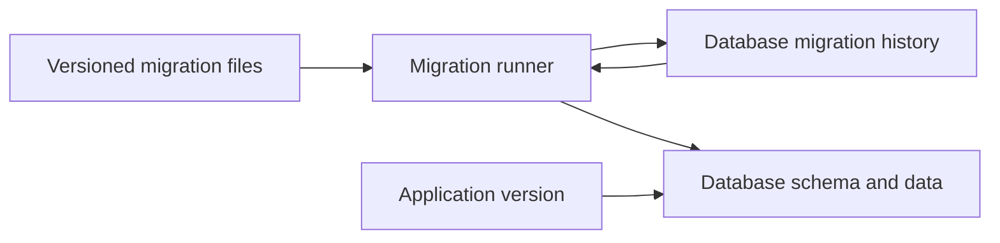
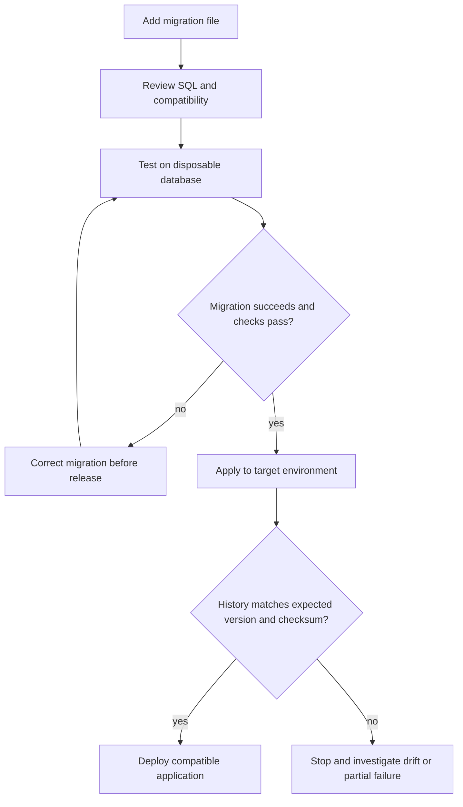
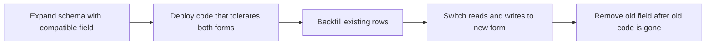

A database schema is part of an application's runtime contract. When a release adds a column, changes a constraint, or transforms stored data, changing only the Java code leaves deployed databases behind. A **database migration** is a reviewed, version-controlled change that moves a database from one known schema state to the next.

This lesson introduces the migration workflow, then compares Flyway and Liquibase. Their syntax differs, but both keep a database-side record of applied changes and coordinate future updates with that record. Examples focus on SQL migrations and PostgreSQL where database behavior matters; verify DDL transactionality and locking for your database engine.

## Why use schema migrations?

Without migrations, schema setup and changes tend to drift into undocumented manual steps. One developer's database has a column that staging lacks; a production hotfix is not reflected in source control; a newly created test database follows different setup instructions than a real deployment.

Migrations address this by recording the sequence of intended changes in the same version control workflow as application code. A tool checks its history table, applies pending changes in order, and records the result. A new environment can be built from the same migration history instead of relying on a copied database.



The runner consults the history before changing the schema, rather than blindly replaying every file. The application and schema still need a compatible deployment plan: a successful migration alone does not guarantee every running application version can use the result.

## Versioned SQL migrations with Flyway

Flyway's common SQL migration convention uses a version, a double-underscore separator, a description, and a `.sql` suffix. For example:

```text
src/main/resources/db/migration/
  V001__create_customer.sql
  V002__add_customer_status.sql
  V003__backfill_customer_status.sql
  R__refresh_customer_summary.sql
```

Versioned migrations are applied once, in version order. Flyway records applied versions and checksums in its schema history table. Treat an applied migration as immutable: changing its contents after a shared environment has run it creates a history/checksum mismatch and makes it unclear which database state is authoritative. Add a new migration to correct or extend an already-applied change.

`V001__create_customer.sql`:

```sql
CREATE TABLE customer (
    customer_id bigint GENERATED ALWAYS AS IDENTITY PRIMARY KEY,
    email text NOT NULL UNIQUE
);
```

`V002__add_customer_status.sql` for an existing `customer` table:

```sql
ALTER TABLE customer
    ADD COLUMN status text;
```

`V003__backfill_customer_status.sql`:

```sql
UPDATE customer
SET status = 'ACTIVE'
WHERE status IS NULL;
```

`V004__require_customer_status.sql`:

```sql
ALTER TABLE customer
    ALTER COLUMN status SET DEFAULT 'ACTIVE';

ALTER TABLE customer
    ALTER COLUMN status SET NOT NULL;
```

The separate add, backfill, and constraint steps can make the rollout compatible with old and new application versions. Add a default and a `NOT NULL` constraint only after considering the existing row count, database behavior, and whether old application instances can continue inserting rows. One large update may hold locks or generate substantial write-ahead log; for a large table, use a measured batching/backfill plan and verify the database-specific operational impact.

Flyway also supports **repeatable migrations**, commonly used for definitions such as views or procedures that should be reapplied when their contents change. They have no version and run after pending versioned migrations. Use them only when the script is safe to apply repeatedly, such as a database-supported `CREATE OR REPLACE` definition; they are not a way to make one-time data changes repeat automatically.

## Liquibase changelogs and changesets

Liquibase describes database changes in a changelog containing ordered **changesets**. A changeset is identified by its `id`, `author`, and changelog path; an integer ID is not a global ordering mechanism by itself. The changelog's order determines execution order. Liquibase records executed changesets and checksums in its database changelog tables.

An XML changelog can express the same schema change declaratively:

```xml
<?xml version="1.0" encoding="UTF-8"?>
<databaseChangeLog
    xmlns="http://www.liquibase.org/xml/ns/dbchangelog"
    xmlns:xsi="http://www.w3.org/2001/XMLSchema-instance"
    xsi:schemaLocation="http://www.liquibase.org/xml/ns/dbchangelog
        http://www.liquibase.org/xml/ns/dbchangelog/dbchangelog-latest.xsd">

    <changeSet id="001-create-customer" author="team">
        <createTable tableName="customer">
            <column name="customer_id" type="BIGINT" autoIncrement="true">
                <constraints primaryKey="true" nullable="false"/>
            </column>
            <column name="email" type="VARCHAR(320)">
                <constraints nullable="false" unique="true"/>
            </column>
            <column name="status" type="VARCHAR(16)" defaultValue="ACTIVE">
                <constraints nullable="false"/>
            </column>
        </createTable>
    </changeSet>

    <changeSet id="002-customer-status-index" author="team">
        <createIndex tableName="customer" indexName="customer_status_idx">
            <column name="status"/>
        </createIndex>
    </changeSet>
</databaseChangeLog>
```

The XML schema version and exact generated SQL should be validated against the Liquibase version and target database used by the project. Database-specific behavior can require native SQL even when a tool offers database-independent change types. Keep each changeset focused on a logical change; a changeset is not a promise that every database can roll back all of its effects automatically.

## Choosing a tool

| Concern | Flyway | Liquibase |
|---|---|---|
| Change definition | Commonly ordered SQL files; Java migrations are also available | Changelogs in XML, YAML, JSON, or SQL formats |
| Applied-change identity | Version for versioned migrations; checksum recorded in history | `id`, `author`, and changelog path; checksum recorded in database history |
| Typical strength | Direct, SQL-first workflow with explicit migration scripts | Structured change types, preconditions, and changelog metadata |
| Key discipline | Do not edit a versioned migration after it has run in a shared environment | Keep changesets stable after deployment; use supported checksum/identity procedures when moving files |

Neither tool eliminates the need to understand SQL or production deployment. Choose based on team conventions, supported database engines, desired changelog style, licensing and operational needs, and how the migration tool integrates with build and release pipelines. Avoid running two independent tools against the same schema unless ownership and ordering are deliberately designed.

## Applying migrations safely

The normal workflow is a controlled progression from source change through verification and deployment:



For each migration:

1. **Review the SQL and data impact.** Estimate affected rows, lock duration, table rewrite or index build behavior, disk space, replication lag, and recovery options for the actual database.
2. **Test from a clean database.** Also test the migration against a representative older schema with realistic data; a clean install alone will not reveal every backfill or constraint issue.
3. **Validate history before deployment.** Check that the target has the expected previous migrations and no unexplained checksum drift.
4. **Back up and monitor where warranted.** A rollback script is not a backup, and restoring a backup may have its own data-loss window and recovery-time cost.
5. **Observe the rollout.** Inspect migration output, application errors, lock waits, and the final schema/history state.

Migration runners commonly serialize access to a particular database while applying changes, but that does not make risky DDL instantaneous or compatible with live application traffic. Coordinate schema rollout with application rollout and database-specific operational constraints.

## Backward-compatible schema changes

An application deployment can be rolling: old and new application instances may run at the same time. A migration that immediately renames or drops a column can make one of those versions fail. The **expand-and-contract** approach makes the transition in stages:



For example, to replace `full_name` with `display_name`:

1. Add `display_name` while leaving `full_name` intact.
2. Deploy application code that can read the new field and, during transition if necessary, keep both representations consistent.
3. Backfill existing rows and verify the data.
4. Move all application instances to the new field; monitor that no old version still depends on `full_name`.
5. Remove the old field in a later migration.

“Add nullable column” is not automatically safe: application assumptions, write paths, triggers, and indexes still matter. The sequence must be tailored to the database and application. A destructive **contract** step should happen only after the old application version and all consumers are retired.

## Existing databases, failure recovery, and rollback

When introducing migrations to a database that already contains schema and data, do not simply run every initial `CREATE TABLE` migration against it. First compare the real schema with the desired baseline, take an appropriate backup, and deliberately establish the tool's starting history using its documented baseline or changelog synchronization procedure. A baseline is an assertion about existing state, not a substitute for verifying that state.

If a migration fails, first determine whether the database rolled back the operation. DDL transaction support differs between database engines and even between specific statements. A failed migration can leave partial schema changes or data effects, especially when an operation cannot be run transactionally. Do not edit the applied script or blindly run a repair command to make the status look clean:

- Inspect the migration tool's failure report and database history.
- Inspect the actual schema and data for partial effects.
- Recover using a tested database-specific cleanup, a corrected forward migration, or a restore plan.
- Use a tool's `repair` or checksum-management command only after correcting the underlying mismatch and understanding exactly what history it will change.

Rollback scripts are useful when the database operation is genuinely reversible and the reverse preserves data. Dropping a newly added column can discard values written after deployment, and restoring the previous schema does not restore deleted or transformed data. For many production changes, a forward corrective migration is safer than an attempted rollback.

## Practical rules

- Commit migration files with the application changes that require them, and review them like production code.
- Give each one-time change a unique, stable identity and preserve applied history; fix old mistakes with new migrations.
- Test upgrades from an existing schema as well as creation of a fresh schema.
- Plan for concurrent application versions, data backfills, and DDL locks.
- Do not assume rollback is possible, DDL is transactional, or every database engine behaves the same.
- Use the framework's status, validation, and generated-SQL checks in CI, but do not treat them as a replacement for exercising the migration against the target database.
- Treat credentials and production database access as deployment configuration, never as values committed into migration files.

## Further reading

- Redgate Flyway, [Migrations](https://documentation.red-gate.com/flyway/flyway-concepts/migrations)
- Redgate Flyway, [Versioned migrations](https://documentation.red-gate.com/flyway/flyway-concepts/migrations/versioned-migrations)
- Redgate Flyway, [Repeatable migrations](https://documentation.red-gate.com/flyway/flyway-concepts/migrations/repeatable-migrations)
- Redgate Flyway, [Transactional execution](https://documentation.red-gate.com/fd/transactional-execution-273973399.html)
- Liquibase, [What is a changelog?](https://docs.liquibase.com/secure/user-guide-5-2-1/what-is-a-changelog)
- Liquibase, [XML changelog example](https://docs.liquibase.com/secure/user-guide-5-2-1/xml-changelog-example)
- [Relational Database Fundamentals & Advanced SQL](./relational-database-fundamentals-advanced-sql)
