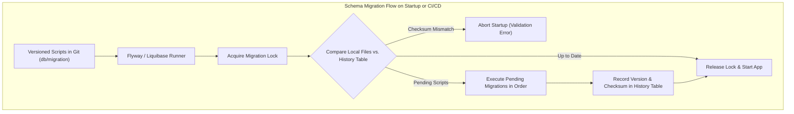
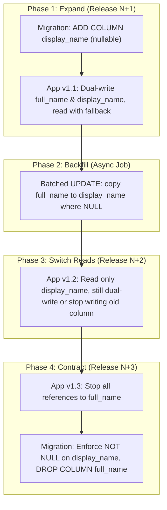
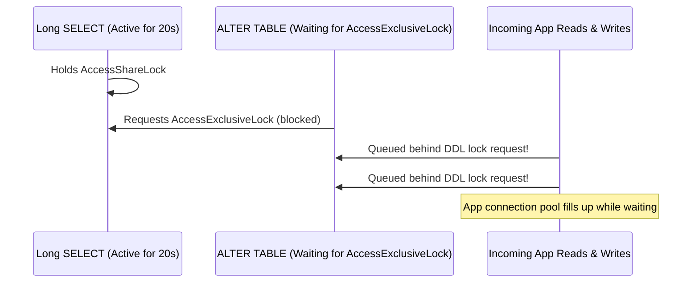

Application code goes through Git, pull requests, automated tests, and repeatable deployments. Yet on many teams, database changes still start as ad-hoc `ALTER TABLE` scripts pasted into a SQL console or rely on `spring.jpa.hibernate.ddl-auto=update`.

Both shortcuts break down quickly in production. Manual SQL causes schema drift between local machines, staging, and production until nobody is sure which columns or indexes actually exist. Hibernate's `ddl-auto=update` is even riskier: it cannot safely rename columns, backfill data, create indexes concurrently, or handle non-trivial constraints, and it can execute blocking DDL unexpectedly during application startup.

Schema migration tools (most commonly **Flyway** and **Liquibase** in the Java ecosystem) bring database evolution into version control. Every schema change becomes an ordered, reviewable artifact tracked in a metadata table inside the database itself.



## Why Schema Migrations Matter

Treating schema changes as versioned code solves four everyday operational problems:

- **Reproducibility**: Spinning up a fresh local container, a Testcontainers integration test, or a new staging environment replays the exact same sequence of migrations from `V1` to current.
- **Auditability**: You have a permanent record of what changed, when it ran, who authored it in Git, and whether it succeeded.
- **Coordinated deployments**: Running migrations as a controlled step (either at application startup for single-instance services or as a dedicated CI/CD / Kubernetes init job for multi-replica services) keeps schema state aligned with code releases.
- **Safety checks**: Checksum verification catches accidental edits to already-applied scripts before environments silently diverge.

> [!TIP]
> Once Flyway or Liquibase owns your schema, set `spring.jpa.hibernate.ddl-auto=validate` in Spring Boot. Hibernate will still verify on startup that your `@Entity` mappings match the database tables, without ever attempting to alter the schema itself.

## Flyway Setup and Syntax

Flyway takes a SQL-first approach. You write plain SQL files in your database's native dialect, and Flyway tracks which scripts have already run.

### Spring Boot Setup

In Spring Boot 3.3+ (which ships with Flyway 10+), database support is split into modular artifacts. For PostgreSQL, include both `flyway-core` and `flyway-database-postgresql`:

```xml
<dependency>
    <groupId>org.flywaydb</groupId>
    <artifactId>flyway-core</artifactId>
</dependency>
<dependency>
    <groupId>org.flywaydb</groupId>
    <artifactId>flyway-database-postgresql</artifactId>
</dependency>
```

Configure Flyway in `application.yml`:

```yaml
spring:
  jpa:
    hibernate:
      ddl-auto: validate
  flyway:
    enabled: true
    locations: classpath:db/migration
    baseline-on-migrate: false   # Set true only when adopting Flyway on an existing legacy DB
    validate-on-migrate: true
```

### Naming Conventions and Migration Types

By default, Flyway scans `src/main/resources/db/migration/` for files matching this pattern:

```text
<Prefix><Version>__<Description>.sql
```

Notice the **double underscore (`__`)** between the version and the description. A single underscore is one of the most common reasons Flyway silently skips a new file.

- **`V` (Versioned)**: Runs once in version order (`V1__initial_schema.sql`, `V2__add_orders_table.sql`, `V2.1__add_order_status_index.sql`).
- **`R` (Repeatable)**: Has no version number (`R__order_summary_view.sql`). Runs after all versioned migrations whenever its checksum changes, making it useful for `CREATE OR REPLACE VIEW`, SQL functions, or stored procedures.
- **`U` (Undo)**: Reverses a versioned migration (available only in paid Flyway editions; most teams rely on forward-fix migrations instead).

```text
src/main/resources/db/migration/
  ├── V1__create_users_table.sql
  ├── V2__create_orders_table.sql
  ├── V3__add_orders_tenant_idx.sql
  ├── V3__add_orders_tenant_idx.sql.conf
  └── R__active_orders_view.sql
```

### `flyway_schema_history` and CRC32 Checksum Drift

When Flyway runs for the first time, it creates a `flyway_schema_history` table to track applied migrations:

| installed_rank | version | description | type | script | checksum | installed_by | success |
| :--- | :--- | :--- | :--- | :--- | :--- | :--- | :--- |
| 1 | 1 | create users table | SQL | V1__create_users_table.sql | -142857291 | app_user | true |
| 2 | 2 | create orders table | SQL | V2__create_orders_table.sql | 849201948 | app_user | true |

Flyway calculates a **CRC32 checksum** (stored as a signed 32-bit integer) for each migration script. On every subsequent run, Flyway recalculates the local file's CRC32 checksum and compares it against the stored value.

> [!CAUTION]
> Never edit a versioned migration file after it has been applied to a shared environment. Modifying `V1__create_users_table.sql` triggers `FlywayValidateException: Validate failed: Migration checksum mismatch for migration version 1` on the next deployment. Always write a new forward migration (for example, `V4__fix_users_column_length.sql`) to change the schema. Reserve `flyway repair` strictly for cleaning up failed migration rows or benign whitespace/comment edits when you know the database state already matches.

## Liquibase Basics

While Flyway focuses on raw SQL, **Liquibase** uses a structured changelog model supporting XML, YAML, JSON, and formatted SQL. It tracks applied changes in `DATABASECHANGELOG` and prevents concurrent runners from colliding using `DATABASECHANGELOGLOCK`.

In Spring Boot, adding `org.liquibase:liquibase-core` enables Liquibase automatically and points it to `classpath:/db/changelog/db.changelog-master.yaml` (or `.xml`). Most teams organize a master changelog that includes individual changeset files:

```yaml
# src/main/resources/db/changelog/db.changelog-master.yaml
databaseChangeLog:
  - include:
      file: db/changelog/changes/001-create-customers.yaml
  - include:
      file: db/changelog/changes/002-add-email-index.sql
```

Each change inside a file is wrapped in a **changeSet** uniquely identified by `(id, author, filepath)`. Liquibase stores an MD5 checksum per changeset and supports built-in preconditions and rollback definitions:

```xml
<?xml version="1.0" encoding="UTF-8"?>
<databaseChangeLog
    xmlns="http://www.liquibase.org/xml/ns/dbchangelog"
    xmlns:xsi="http://www.w3.org/2001/XMLSchema-instance"
    xsi:schemaLocation="http://www.liquibase.org/xml/ns/dbchangelog
        http://www.liquibase.org/xml/ns/dbchangelog/dbchangelog-latest.xsd">

    <changeSet id="001-create-customers" author="alice">
        <preConditions onFail="MARK_RAN">
            <not>
                <tableExists tableName="customers"/>
            </not>
        </preConditions>

        <createTable tableName="customers">
            <column name="id" type="BIGINT" autoIncrement="true">
                <constraints primaryKey="true" nullable="false"/>
            </column>
            <column name="email" type="VARCHAR(255)">
                <constraints nullable="false" unique="true"/>
            </column>
        </createTable>

        <rollback>
            <dropTable tableName="customers"/>
        </rollback>
    </changeSet>

</databaseChangeLog>
```

Liquibase also supports formatted SQL if you prefer writing SQL directly while keeping Liquibase's metadata and `runInTransaction:false` controls:

```sql
--liquibase formatted sql
--changeset alice:002-add-email-index runInTransaction:false
CREATE INDEX CONCURRENTLY idx_customers_email ON customers (email);
--rollback DROP INDEX CONCURRENTLY idx_customers_email;
```

### Choosing Between Flyway and Liquibase

| Dimension | Flyway | Liquibase |
| :--- | :--- | :--- |
| **Authoring style** | Plain SQL (plus Java-based migrations when needed) | XML, YAML, JSON, or formatted SQL |
| **Execution order** | Version number in filename (`V1`, `V2`, `V202610291430`) | Order declared in the master changelog |
| **Checksum algorithm** | CRC32 (32-bit integer) | MD5 (with internal format version prefix) |
| **Rollbacks** | Forward migrations by default (`U` scripts require paid tier) | Explicit `<rollback>` blocks in open-source edition |
| **Preconditions** | Limited in community edition | Rich built-in checks (`tableExists`, `columnExists`, custom SQL) |
| **Typical fit** | Services targeting one database engine (for example, PostgreSQL) | Multi-database products or strict enterprise compliance/rollback workflows |

Both tools are mature and widely deployed in production. If your team writes PostgreSQL or MySQL directly and values minimal ceremony, Flyway is usually faster to work with. If you ship software that must run across Oracle, SQL Server, and PostgreSQL, or need declarative preconditions and rollbacks out of the box, Liquibase earns its extra configuration.

## Versioning Database Changes Across a Team

Once more than two developers work on the same service, **version numbering collisions** become a regular annoyance. Suppose Branch A creates `V14__add_phone_column.sql` and Branch B creates `V14__add_audit_table.sql`. Whichever branch merges second breaks the build unless someone renames their file, or worse, someone enables `outOfOrder=true` and accidentally changes the dependency order between migrations.

Two practical conventions keep teams out of trouble:

1. **Timestamp-based versions**: Instead of `V14`, name files `V202610291430__add_phone_column.sql` (`YYYYMMDDHHmm`). Two branches created on the same day almost never collide. If you allow out-of-order merges across short-lived feature branches, remember that a branch merged later might have an earlier timestamp than an already-deployed migration; either rebase/bump the timestamp before merging or keep `outOfOrder=false` so CI catches it immediately.
2. **Separate schema changes from heavy data backfills**: A migration that runs `UPDATE orders SET region = 'US'` on 40 million rows will hold locks, generate gigabytes of WAL, and stall application startup until Kubernetes kills the pod for failing its readiness probe. Keep migrations fast (DDL and small metadata inserts), and run large data backfills asynchronously in bounded batches (for example, 5,000 rows per transaction) using a dedicated job or Spring Batch.

## Zero-Downtime Schema Changes: Expand and Contract

In a rolling Kubernetes deployment, old pods (Version N) and new pods (Version N+1) run side by side for several minutes against the **same database**. A single migration like:

```sql
ALTER TABLE users RENAME COLUMN email TO email_address;
```

breaks every running Version N pod immediately with `ERROR: column "email" does not exist`. Dropping a column, changing a column's type incompatibly, or adding a `NOT NULL` constraint before old code writes the column causes the exact same failure.

The standard way to ship breaking schema changes without downtime is the **Expand-and-Contract** (parallel change) pattern, spread across multiple backward-compatible releases:



### Walkthrough: Renaming `full_name` to `display_name`

1. **Expand (Release N+1)**: Add the new column as nullable so existing pods continue working untouched:
   ```sql
   -- V10__add_display_name_to_users.sql
   SET lock_timeout = '2s';
   ALTER TABLE users ADD COLUMN display_name text;
   ```
   Deploy App v1.1 so writes populate *both* `full_name` and `display_name` (dual-write), while reads check `display_name` first and fall back to `full_name` if it is null.
2. **Backfill**: Run a throttled batch job outside Flyway to fill historical rows in chunks:
   ```sql
   UPDATE users
   SET display_name = full_name
   WHERE id IN (
       SELECT id FROM users
       WHERE display_name IS NULL
       LIMIT 5000
   );
   ```
   Repeat until zero rows have `display_name IS NULL`.
3. **Switch Reads (Release N+2)**: Deploy App v1.2 reading exclusively from `display_name`. Once all v1.1 pods are gone, you can also stop writing to `full_name` in v1.3 (keeping `full_name` nullable first if it previously had a `NOT NULL` constraint).
4. **Contract (Release N+3)**: Verify no running code or analytics query references `full_name`, enforce `NOT NULL` on `display_name` safely (using `NOT VALID` + `VALIDATE CONSTRAINT`, shown below), and drop `full_name`:
   ```sql
   -- V11__drop_full_name_from_users.sql
   SET lock_timeout = '2s';
   ALTER TABLE users DROP COLUMN full_name;
   ```

Yes, it takes three small deployments instead of one. In exchange, every release is safe to roll back and users never see a 500 error during rollout.

## Avoiding Production Table Locks in PostgreSQL

Even backward-compatible DDL can cause an outage if you ignore PostgreSQL's lock queue. Statements like `ALTER TABLE` and `DROP COLUMN` require an **`AccessExclusiveLock`**, which conflicts with *all* reads (`SELECT`) and writes (`INSERT`, `UPDATE`, `DELETE`).

The danger is not just how long `ALTER TABLE` runs, but how long it **waits to acquire the lock**:



PostgreSQL grants locks in FIFO queue order so writers do not starve. If a 20-second reporting query is running on `orders`, your quick metadata-only `ALTER TABLE orders ADD COLUMN ...` queues behind it, and every subsequent `SELECT` from your web tier queues behind the `ALTER TABLE`. Within seconds, HikariCP runs out of connections.

### Always Set `lock_timeout`

Guard DDL migrations with a short `lock_timeout`. If the lock is not acquired within two seconds, the migration fails fast instead of piling up live traffic, and your deployment pipeline can retry safely:

```sql
SET lock_timeout = '2s';
ALTER TABLE orders ADD COLUMN fulfillment_center text;
```

### Building Indexes with `CREATE INDEX CONCURRENTLY`

A standard `CREATE INDEX` acquires a `ShareLock`, allowing reads (`SELECT`) to continue while blocking all writes (`INSERT`, `UPDATE`, `DELETE`) until the full table scan finishes. On a large table, that stalls writes for minutes.

Use `CREATE INDEX CONCURRENTLY` instead. It performs two table scans under a weaker `ShareUpdateExclusiveLock`, letting reads and writes continue normally:

```sql
-- V12__add_active_users_email_idx.sql
CREATE INDEX CONCURRENTLY IF NOT EXISTS idx_users_email_active
    ON users (email)
    WHERE status = 'ACTIVE';
```

Because PostgreSQL forbids running `CREATE INDEX CONCURRENTLY` inside a transaction block (`BEGIN ... COMMIT`), you must tell Flyway not to wrap that script in a transaction. (Recent Flyway versions auto-detect `CREATE INDEX CONCURRENTLY` in many cases, but declaring it explicitly avoids surprises.) In Flyway Community, place a companion `.sql.conf` file next to the script:

```properties
# V12__add_active_users_email_idx.sql.conf
executeInTransaction=false
```

(Flyway Teams/Enterprise also supports an inline `-- flyway:executeInTransaction=false` header, and Liquibase uses `runInTransaction="false"` on the changeset.)

> [!WARNING]
> If `CREATE INDEX CONCURRENTLY` fails partway through (for example, due to a duplicate value in a `UNIQUE` index), PostgreSQL leaves behind an `INVALID` index that still incurs write overhead without helping queries. Check `pg_index.indisvalid` and run `DROP INDEX CONCURRENTLY` before retrying.

### Adding `NOT NULL` and `CHECK` Constraints Without Long Locks

Since PostgreSQL 11, adding a new column with a constant default (`ADD COLUMN active boolean NOT NULL DEFAULT true`) is fast and stores the default in catalog metadata rather than rewriting the table. Adding a `NOT NULL` or `CHECK` constraint to an *existing* column, however, forces a full table scan under `AccessExclusiveLock`.

Split it into two steps so the table scan runs under a weaker `ShareUpdateExclusiveLock`:

```sql
-- Step 1: Enforces rule for all NEW writes immediately, skips scanning old rows (brief lock)
SET lock_timeout = '2s';
ALTER TABLE orders
    ADD CONSTRAINT chk_orders_total_not_null
    CHECK (total_amount IS NOT NULL) NOT VALID;

-- Step 2: Scans existing rows without blocking concurrent reads or writes
ALTER TABLE orders
    VALIDATE CONSTRAINT chk_orders_total_not_null;
```

On PostgreSQL 12+, once that `CHECK (total_amount IS NOT NULL)` constraint is validated, you can follow up with `ALTER TABLE orders ALTER COLUMN total_amount SET NOT NULL;` and PostgreSQL skips the full table scan because the validated constraint already proves no nulls exist, after which you can drop the redundant `CHECK` constraint.

## Transactional DDL: PostgreSQL vs. MySQL

One practical difference between database engines shows up the moment a multi-statement migration fails halfway through:

- **PostgreSQL supports transactional DDL**: `CREATE TABLE`, `ALTER TABLE`, and `DROP TABLE` participate in normal `BEGIN ... ROLLBACK` transactions. If statement 3 in a Flyway script fails, statements 1 and 2 roll back cleanly. You fix the SQL bug and re-run Flyway with no manual cleanup.
- **MySQL (and Oracle) trigger implicit commits on DDL**: Every `ALTER TABLE` or `CREATE TABLE` commits immediately and cannot be rolled back. If statement 1 adds a column and statement 2 fails with a syntax or constraint error, the column stays in the database while Flyway marks the migration as failed. Re-running fails with `Duplicate column name`, forcing manual cleanup and `flyway repair`.

When targeting MySQL, keep each migration file focused on a **single DDL statement** whenever possible so partial-failure states are much easier to recover from.

## Interview Questions

### Why does Flyway fail on startup if someone edits an already-applied migration script, and how should you fix it?

Flyway calculates a CRC32 checksum for every script and records it in `flyway_schema_history`. On startup, it recomputes local checksums and compares them against the history table; if any applied script changed, Flyway aborts with a validation mismatch so environments do not silently drift out of sync. The right fix is to revert the edited file to its original content and create a new forward migration (e.g., `V15__...`) for the change. Only run `flyway repair` if the edit was non-functional (such as formatting or a comment) or after manually fixing a failed non-transactional migration.

### Why can a fast, metadata-only `ALTER TABLE` still cause a production outage in PostgreSQL?

`ALTER TABLE` requests an `AccessExclusiveLock`. Even if the DDL itself takes 5 milliseconds once acquired, it must wait for any currently running query on that table (such as a 30-second analytics `SELECT`) to finish. While `ALTER TABLE` sits waiting in PostgreSQL's lock queue, every new incoming `SELECT`, `INSERT`, and `UPDATE` queues behind it, rapidly exhausting the application's connection pool. Setting a short `SET lock_timeout = '2s';` prevents the DDL from blocking traffic while waiting.

### How does Expand-and-Contract allow renaming a column during a rolling deployment?

During a rolling deployment, old and new application versions query the same database simultaneously, so renaming a column in place breaks old instances immediately. Expand-and-Contract splits the change across phases: first add the new column as nullable (Expand) and ship code that dual-writes both columns and reads with fallback; next backfill historical rows in small batches; then deploy code reading only the new column; finally stop writing to the old column and drop it in a separate release (Contract).

### What do you need to configure when running `CREATE INDEX CONCURRENTLY` in Flyway or Liquibase?

PostgreSQL does not allow `CREATE INDEX CONCURRENTLY` inside a transaction block, whereas both Flyway and Liquibase wrap each migration in a transaction by default. In Flyway Community, add a companion `<script>.sql.conf` file containing `executeInTransaction=false` (or `-- flyway:executeInTransaction=false` in paid editions). In Liquibase, set `runInTransaction="false"` on the changeset.
