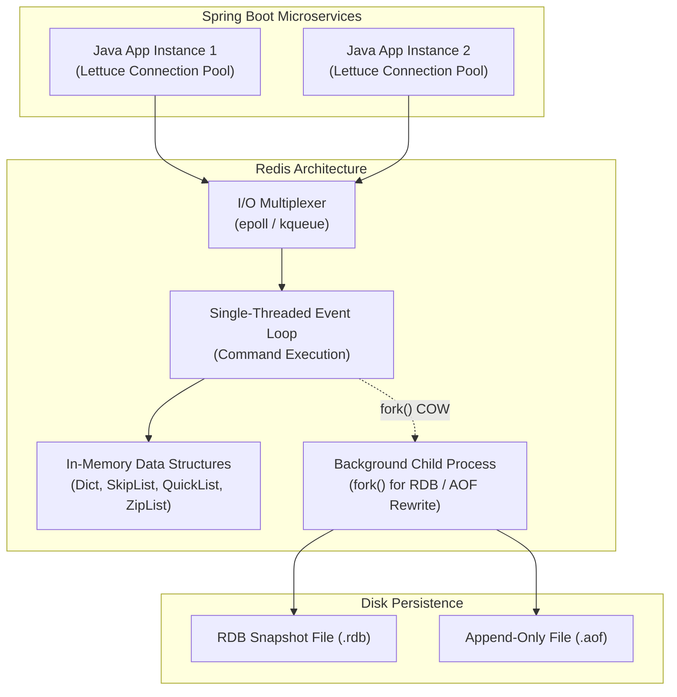
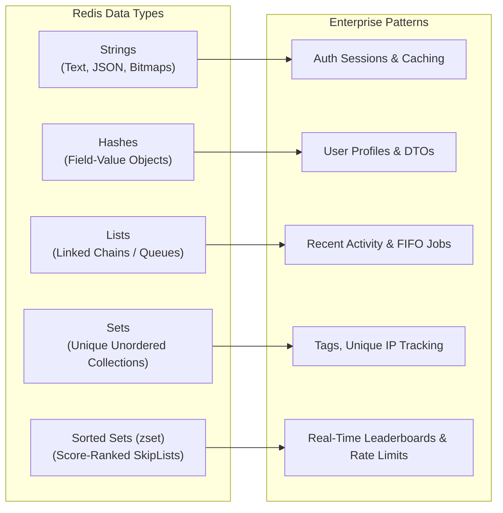
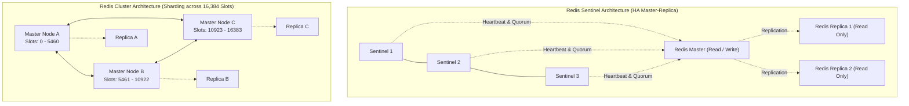

When your Java application scales from a few hundred users to hundreds of thousands of concurrent requests, relational databases like PostgreSQL and MySQL quickly become the primary performance bottleneck. Even with optimal B+ Tree indexes and connection pooling via HikariCP, disk I/O and row-level locking inevitably impose a latency floor of several milliseconds.

To achieve sub-millisecond response times, enterprise architectures introduce an in-memory distributed cache: **Redis (Remote Dictionary Server)**.

Redis is not merely a key-value cache like Memcached; it is a versatile in-memory data structures server. By holding the entire working dataset in RAM and executing operations via an optimized, non-blocking event loop, a single Redis node can comfortably process over 100,000 operations per second with microsecond latency.



---

## The Redis Execution Model: Why It Is Blazing Fast

A common question among senior developers is: *If Redis runs command execution on a single CPU thread, how can it outperform multi-threaded database systems?*

Redis achieves its extreme throughput through three fundamental engineering choices:

### In-Memory Data Access
Main memory (RAM) access latency is roughly 50 to 100 nanoseconds, compared to 50 to 150 microseconds for modern NVMe SSDs and 5 to 10 milliseconds for spinning disks. Because all primary lookups, modifications, and range scans occur directly in RAM, the CPU never waits for disk seek operations during command execution.

### The Non-Blocking I/O Multiplexer
Redis leverages operating system event notification mechanisms (such as `epoll` on Linux and `kqueue` on macOS/BSD). A single thread monitors thousands of connected client sockets simultaneously. When a socket has data ready to read or is ready to receive an answer, the I/O multiplexer pushes the event into an internal dispatch queue.

### Zero Lock Contention
Because command processing occurs sequentially on a single thread:
- There are no mutexes, synchronized blocks, or spinlocks around the core hash table.
- There are no race conditions or deadlocks between concurrent client threads.
- There is zero context-switching overhead between worker threads.

> **Crucial Production Rule**: Because command execution is single-threaded, any command with a time complexity of O(N)—such as `KEYS *`, `FLUSHALL`, or sorting a 1-million-element set—will **freeze the entire Redis server**. While that command runs, all incoming requests from every microservice are queued, leading to cascading timeouts across your Java application cluster.

---

## Core Data Structures and Real-World Java Use Cases

Redis provides specialized in-memory data structures tailored for high-scale enterprise workflows:



### Strings: Raw Values, Distributed Locks, and Atomic Counters
The foundational Redis type, binary-safe up to 512 MB.
- **Java Use Case**: Storing serialized JSON DTOs, tracking user sessions, and implementing atomic rate-limit counters via `INCR` / `INCRBY`.
- **Atomic Operations**: `SET customer:1001 '{"id":1001}' EX 3600 NX` atomically sets the key with a 1-hour Time-To-Live (TTL) *only if it does not already exist*, forming the primitive for distributed mutual exclusion.

### Hashes: Compact Object Representations
A mapping between string field names and string values, representing objects without serializing the entire structure to JSON.
- **Java Use Case**: User profile entities, shopping cart contents.
- **Internal Optimization**: When a hash has few fields and small values, Redis encodes it as a memory-compact `ziplist` (or `listpack`), drastically reducing pointer overhead compared to storing individual string keys.
- **Selective Mutability**: You can update a single field with `HSET user:1001 status "ACTIVE"` without retrieving, deserializing, modifying, and re-uploading the entire object.

### Lists: Linked Chains and Queues
Ordered collections of strings implemented internally as two-way linked lists (`quicklist`).
- **Java Use Case**: Audit logs, lightweight job queues with `LPUSH` and blocking `BRPOP`.
- **Sliding Window Caching**: Capping user search history to the last 10 items via `LPUSH user:1001:history "query"` followed immediately by `LTRIM user:1001:history 0 9`.

### Sets: Unordered Unique Collections
Unordered collections of unique strings supporting fast set operations (unions, intersections, differences).
- **Java Use Case**: Social following lists, unique daily visitor tracking, tag associations.
- **Fast Membership Checking**: `SISMEMBER user:1001:permissions "ROLE_ADMIN"` evaluates in O(1) constant time.

### Sorted Sets (zsets): Priority Queues and Range Indexes
Collections of unique elements, where each member is associated with a floating-point numeric **score**. Elements are maintained in sorted order by score using a composite **Hash Table + SkipList** structure.
- **Java Use Case**: Gaming leaderboards, background task scheduling by timestamp, and sliding window rate limiting.
- **Range Queries**: `ZRANGEBYSCORE tasks -inf 1700000000 LIMIT 0 10` retrieves the top 10 due scheduled tasks in O(log N + M) time.

---

## Persistence Mechanics: RDB Snapshots vs Append-Only File (AOF)

Because RAM is volatile, Redis provides two complementary persistence mechanisms to rebuild data following a server restart.

### RDB (Redis Database) Snapshots
RDB generates compact, single-file point-in-time binary snapshots of the entire dataset at specified intervals (e.g., every 15 minutes if at least 1 key changed).

**The Copy-On-Write (COW) Fork**:
To avoid blocking the main server thread while writing gigabytes of data to disk, Redis invokes the Linux system call `fork()`:
1. The operating system creates a child process sharing the parent's virtual memory address space.
2. The child process writes the serialized dataset to a temporary `.rdb` file.
3. The parent process continues serving incoming write requests. When the parent modifies a memory page, the OS kernel transparently duplicates that specific page (Copy-On-Write).
4. Once written, the temporary file atomically replaces the old dump file.

*Trade-off*: RDB provides fast startup times and minimal disk footprint, but any data written between the last snapshot and a sudden crash is permanently lost.

### AOF (Append-Only File)
AOF logs every write command received by the server in an append-only file. Upon restart, Redis replays the log commands sequentially to reconstruct the dataset.

**AOF Fsync Policies**:
- `appendfsync always`: Calls `fsync()` after every single write command. Guarantees near-zero data loss, but drops throughput to disk speed.
- `appendfsync everysec` (**Default & Recommended**): Asynchronously flushes the AOF buffer to disk once every second. Provides high performance while bounding data loss to at most 1 second of transactions.
- `appendfsync no`: Delegates disk flushing entirely to the operating system kernel buffer flusher.

### AOF Rewrite
Over time, AOF files grow large with redundant operations (e.g., 1,000 `INCR counter` commands can be expressed as a single `SET counter 1000`). When AOF size doubles, a background child process performs an **AOF Rewrite**, scanning the in-memory dataset to produce the shortest possible sequence of commands required to recreate the current state.

---

## Memory Management and Eviction Policies

Because Redis stores data in RAM, allocating more data than physical memory allows will cause the operating system's OOM Killer (Out-Of-Memory Killer) to terminate the Redis process.

To prevent this, production configurations specify `maxmemory` (e.g., `maxmemory 8gb`) and choose an **eviction policy**:

```
+------------------+------------------------------------------------------------------+
| Eviction Policy  | Description                                                      |
+------------------+------------------------------------------------------------------+
| noeviction       | Returns an out-of-memory error on writes when limit is reached.   |
| allkeys-lru      | Evicts the Least Recently Used keys across the entire dataset.   |
| volatile-lru     | Evicts the Least Recently Used keys with an explicit TTL set.    |
| allkeys-lfu      | Evicts the Least Frequently Used keys (tracks access frequency). |
| volatile-lfu     | Evicts keys with an explicit TTL that are accessed least often.  |
| allkeys-random   | Evicts random keys to make room for new writes.                  |
| volatile-ttl     | Evicts keys with an active TTL, prioritizing shortest time-to-live.|
+------------------+------------------------------------------------------------------+
```

### Recommendation for Application Caching
For standard web caches, choose **`allkeys-lru`** or **`allkeys-lfu`**:
- **LRU (Least Recently Used)** works best when recently requested items are most likely to be requested again.
- **LFU (Least Frequently Used)** works best when historical access counts matter (e.g., popular product catalogs), preventing a sudden burst of new, rarely-requested keys from evicting established hot data.

---

## High Availability & Scaling: Sentinel vs Redis Cluster

A standalone Redis instance represents a single point of failure and is bound by the memory and network limits of a single machine. High-scale enterprise deployments scale horizontally using **Sentinel** or **Redis Cluster**.



### Redis Sentinel (High Availability)
Sentinel monitors standalone Master-Replica topologies:
- **Monitoring**: Three or more Sentinel daemon processes continuously send `PING` heartbeats to the Master and Replicas.
- **Automatic Failover**: If the Master fails to respond, Sentinels reach a **quorum vote** declaring the Master dead (`ODOWN`). A designated Replica is elected and promoted to Master.
- **Configuration Provider**: Java clients (Lettuce) connect to the Sentinels to discover the current Master's IP address. If failover occurs, Sentinels publish the new Master address to all connected clients.
- *Limitation*: Sentinel does not partition data. The entire dataset must fit within the RAM of a single Master node.

### Redis Cluster (Horizontal Partitioning)
When your dataset exceeds the RAM of a single machine (e.g., hundreds of gigabytes), **Redis Cluster** provides automatic sharding across multiple master nodes.

**The 16,384 Hash Slot Algorithm**:
1. Every Redis Cluster consists of exactly **16,384 logical hash slots**.
2. Master nodes divide these slots among themselves:
   - Master A: Slots `0` to `5460`
   - Master B: Slots `5461` to `10922`
   - Master C: Slots `10923` to `16383`
3. When writing a key `user:1001`:
   - Redis calculates `CRC16("user:1001") % 16384 = Slot 4210`.
   - The key is routed directly to Master A.

**The Multi-Key Limitation and Hash Tags**:
In Redis Cluster, commands operating on multiple keys (such as `MGET`, transactions, or Lua scripts) require that all referenced keys belong to the **same hash slot**.
If you attempt `MGET user:1001:orders user:1002:orders`, Redis Cluster returns a `CROSSSLOT Keys in request don't hash to the same slot` error.

To solve this, use **Hash Tags** with curly braces `{}`:
```
user:{1001}:profile
user:{1001}:orders
user:{1001}:cart
```
Redis calculates the CRC16 hash exclusively on the text enclosed in `{}` (`1001`), guaranteeing that all keys for customer 1001 reside on the exact same master node!

---

## Production Java Integration with Spring Boot & Lettuce

In modern Spring Boot applications, the default Redis driver is **Lettuce**, a thread-safe, non-blocking client built on top of Netty.

```java
@Configuration
@EnableCaching
public class RedisConfig {

    @Bean
    public RedisConnectionFactory redisConnectionFactory() {
        // Production connection pool tuning
        GenericObjectPoolConfig<Object> poolConfig = new GenericObjectPoolConfig<>();
        poolConfig.setMaxTotal(64);
        poolConfig.setMaxIdle(32);
        poolConfig.setMinIdle(8);
        poolConfig.setMaxWait(Duration.ofMillis(500));

        LettucePoolingClientConfiguration clientConfig = LettucePoolingClientConfiguration.builder()
                .poolConfig(poolConfig)
                .commandTimeout(Duration.ofMillis(200)) // Strict timeout to prevent thread starvation
                .build();

        RedisStandaloneConfiguration serverConfig = new RedisStandaloneConfiguration("redis-prod.internal", 6379);
        return new LettuceConnectionFactory(serverConfig, clientConfig);
    }

    @Bean
    public RedisTemplate<String, Object> redisTemplate(RedisConnectionFactory connectionFactory) {
        RedisTemplate<String, Object> template = new RedisTemplate<>();
        template.setConnectionFactory(connectionFactory);

        // ALWAYS configure explicit serializers. The default JdkSerializationRedisSerializer
        // produces unreadable binary strings and exposes remote code execution vulnerabilities!
        StringRedisSerializer keySerializer = new StringRedisSerializer();
        GenericJackson2JsonRedisSerializer valueSerializer = new GenericJackson2JsonRedisSerializer();

        template.setKeySerializer(keySerializer);
        template.setHashKeySerializer(keySerializer);
        template.setValueSerializer(valueSerializer);
        template.setHashValueSerializer(valueSerializer);

        template.afterPropertiesSet();
        return template;
    }
}
```

---

## Production Outage War Stories

### The Copy-On-Write Memory Exhaustion Crash

**The Incident**: A Redis instance configured with `maxmemory 28GB` on a 32 GB cloud VM abruptly crashed under heavy midday traffic. System logs reported the Linux kernel OOM Killer terminated the process with `Out of memory: Kill process (redis-server)`.

**The Mechanical Failure**:
Redis was configured with background RDB snapshots (`save 900 1`).
At peak traffic, when memory usage reached 26 GB, Redis initiated a background snapshot by executing `fork()`.
While the child process was slowly writing the 26 GB dump file to disk, the main thread was receiving 15,000 updates per second.
The Linux kernel Copy-On-Write mechanism had to allocate fresh 4 KB memory pages for every modified key in the parent process.
Within two minutes, combined memory usage exceeded physical RAM (26 GB parent + 7 GB COW pages = 33 GB). With swap disabled, the OS kernel executed the OOM killer.

**The Fix**:
- Never set `maxmemory` above **65% to 70%** of physical machine RAM on nodes configured for RDB or AOF rewrites (e.g., set `maxmemory 20GB` on a 32 GB box).
- Set Linux kernel memory overcommit parameter: `vm.overcommit_memory = 1` in `/etc/sysctl.conf`.

---

### The Unbounded Collection Stalling Event

**The Incident**: A microservice started reporting Redis connection timeouts (`RedisCommandTimeoutException`). Pings to Redis went from 0.5 ms to 4,500 ms, triggering cascading connection pool exhaustion across 20 Spring Boot instances.

**The Mechanical Failure**:
A developer used a single Redis `Set` to track all unique user interaction events for a marketing promotion: `SADD promo:interactions user_id`.
Over six months, the set grew to 8 million members.
A new scheduled report executed `SMEMBERS promo:interactions` to process the user list.
Because `SMEMBERS` is an O(N) operation, retrieving and serializing 8 million string entries over the network blocked the single-threaded event loop for 4.2 seconds.
Every other microservice attempting simple `GET` or `SET` commands was blocked behind the `SMEMBERS` execution in the event loop queue.

**The Fix**:
- Never call `SMEMBERS` or `HGETALL` on unbounded collections in production. Use cursor-based iterations via **`SSCAN`** or **`HSCAN`** in batches of 500 items.
- Run `redis-cli --bigkeys` in CI/CD or staging environments to detect and eliminate massive multi-megabyte keys.

---

## Senior Engineer Interview Crucible

### Question 1: How does Redis achieve high concurrency on a single execution thread, and what are the specific architectural constraints this imposes on Java developers?
**Answer:** Redis avoids thread synchronization overhead by delegating network socket readiness to non-blocking OS I/O multiplexers (`epoll`/`kqueue`) and processing all read/write commands sequentially on a single thread. Because RAM access latency is on the order of tens of nanoseconds, simple commands execute in microseconds without thread contention or CPU context switching. The primary constraint this imposes on Java developers is that **no command must ever block the event loop**. Operations with O(N) complexity (such as `KEYS *`, large `SMEMBERS`, or unbounded Lua scripts) stall the single thread, preventing all other connected clients from executing any commands. Developers must use cursor-based scanners (`SCAN`, `SSCAN`) and set strict connection command timeouts (e.g., 200 ms) in the Lettuce client configuration.

### Question 2: What is the mechanical difference between RDB snapshots and AOF persistence, and why do enterprise systems run both concurrently?
**Answer:** RDB (Redis Database) creates periodic, compact binary point-in-time snapshots by calling `fork()` to let a child process write memory to disk. RDB yields fast server restarts and small backups, but risks losing all data written since the last snapshot. AOF (Append-Only File) logs every modifying command sequentially to an append-only stream, typically flushed to disk once per second via `appendfsync everysec`. AOF bounds potential data loss to at most 1 second of transactions, but produces larger files and slower recovery times. Running both concurrently gives enterprise systems the best of both worlds: RDB snapshots provide fast baseline restorations, while the AOF log replays the recent delta transactions occurring after the snapshot was taken.

### Question 3: How does Redis Cluster route keys to nodes without a centralized master proxy, and how do Hash Tags resolve the `CROSSSLOT` multi-key error?
**Answer:** Redis Cluster distributes data across 16,384 logical hash slots partitioned among master nodes. When a client performs an operation on key `K`, it hashes the key using `CRC16(K) % 16384` to determine the target slot. Smart clients like Lettuce cache the slot-to-node topology mapping locally, dispatching queries directly to the correct master node without intermediate proxy hops. If a slot is migrating, the node replies with a `MOVED` or `ASK` redirection, updating the client's routing cache. When a command references multiple keys (e.g., multi-get or transactions), all keys must map to the same slot. By enclosing a shared identifier in curly braces—such as `order:{user_1001}:items` and `order:{user_1001}:billing`—Redis hashes only the substring inside the braces (`user_1001`), ensuring that all related customer keys hash to the identical slot.

### Question 4: Under what conditions can Redis trigger the Linux Out-Of-Memory (OOM) Killer even when `maxmemory` is configured below physical RAM?
**Answer:** The primary cause is the Copy-On-Write (COW) memory amplification during background persistence (`BGSAVE` or AOF Rewrite). When Redis invokes `fork()`, the parent and child share physical pages. However, as write traffic modifies keys in the parent process, the Linux kernel creates private copies of each modified 4 KB memory page. Under write-heavy workloads, this Copy-On-Write overhead can demand an additional 50% to 100% of the original memory footprint. If `maxmemory` is set to 28 GB on a 32 GB machine, 26 GB of baseline data plus 7 GB of COW modified pages exceeds physical RAM, triggering the OS kernel OOM killer to terminate the Redis process. To prevent this, `maxmemory` should not exceed 65% to 70% of total physical RAM on persisting nodes.
