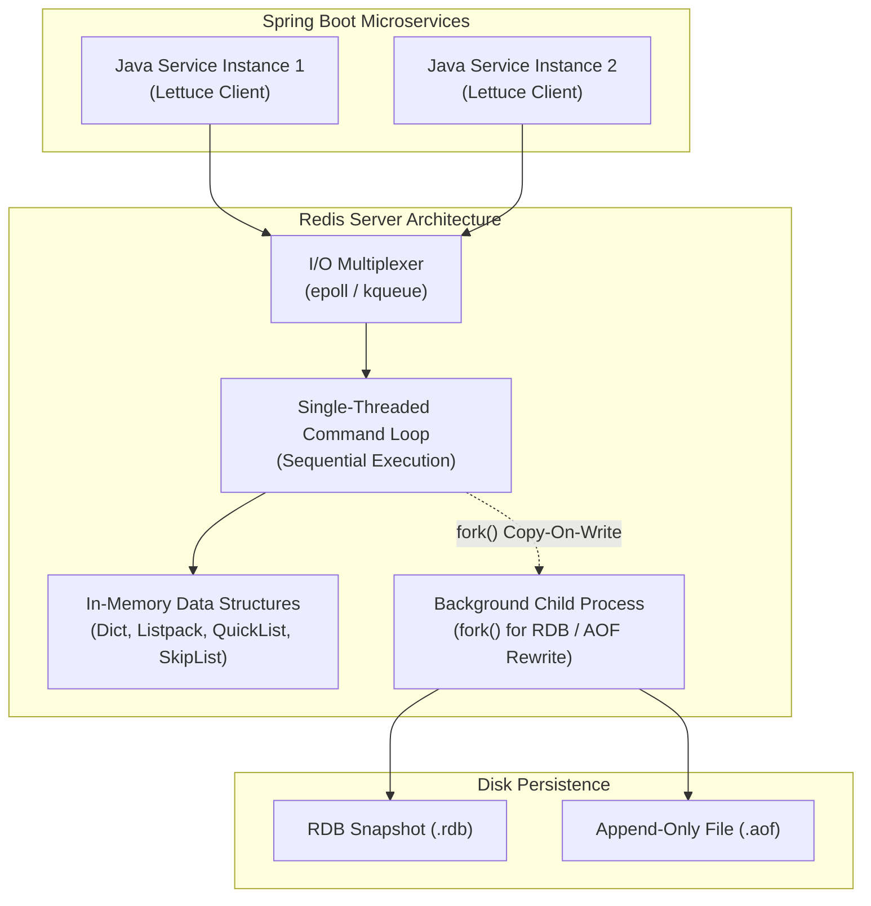
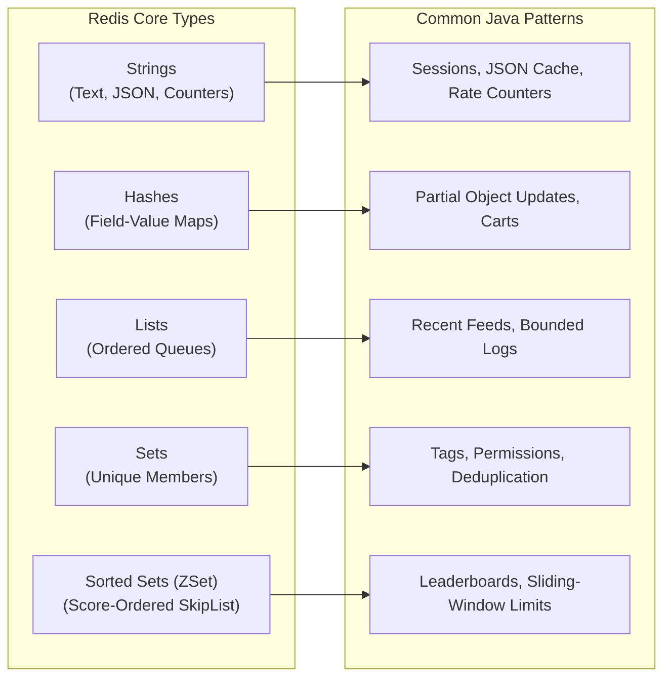
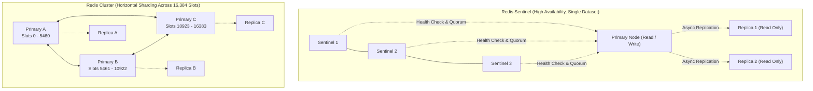

Even a well-indexed PostgreSQL or MySQL instance backed by HikariCP hits a practical latency floor of a few milliseconds once queries contend for disk I/O, MVCC visibility checks, and row locks under high concurrency. When thousands of requests ask for the same product catalog entry, user session, or rate-limit counter every second, hitting the primary relational database for every read wastes capacity that should be reserved for transactional writes.

**Redis** (Remote Dictionary Server) sits in front of your database as an in-memory distributed data store. Unlike a simple key-value byte cache, Redis understands structured data types natively (strings, hashes, lists, sets, sorted sets, streams) and supports atomic server-side operations on them. Because the active dataset lives in RAM, a single Redis node routinely handles tens to hundreds of thousands of operations per second at sub-millisecond latency.



## Redis In-Memory Architecture

Developers often wonder how Redis can sustain high throughput while executing commands on a single thread. Three design choices explain it:

1. **In-Memory Data Access**: Main memory access runs in tens of nanoseconds, orders of magnitude faster than NVMe SSD reads (tens of microseconds) or network-attached storage. Commands operate directly on compact C data structures in RAM without waiting on disk seeks.
2. **Non-Blocking I/O Multiplexing**: Redis monitors thousands of concurrent TCP client sockets with OS event loops (`epoll` on Linux, `kqueue` on BSD/macOS). Since Redis 6, you can also enable threaded I/O (`io-threads`) to parallelize reading and writing socket buffers across cores, while **command execution itself stays single-threaded**.
3. **No Lock Contention**: Executing commands sequentially on one thread means Redis needs no mutexes, read-write locks, or context switches around its core dictionaries and skip lists. Every individual command is atomic by design.

That single-threaded command loop comes with one strict operational rule: **never run slow `O(N)` commands on large datasets in production**. A single `KEYS *`, `FLUSHALL`, or `SMEMBERS` over millions of entries blocks the event loop until it finishes. Every other microservice waiting on a simple `GET` piles up behind it and starts timing out. Always prefer incremental cursor commands (`SCAN`, `HSCAN`, `SSCAN`, `ZSCAN`) in production.

## Core Data Structures and CLI Examples

Choosing the right Redis data structure avoids unnecessary serialization overhead and lets you run atomic updates directly on the server.



### Strings

Strings are binary-safe byte sequences up to 512 MB. They work well for cached JSON payloads, session tokens, atomic counters, and simple lock keys.

```bash
# Cache a JSON payload with a 1-hour TTL (3600 seconds)
SET product:1001 '{"id":1001,"name":"Mechanical Keyboard","price":149.00}' EX 3600
GET product:1001

# Atomic rate-limit counter with expiry
INCR ratelimit:user:42:minute:202610291015
EXPIRE ratelimit:user:42:minute:202610291015 60

# Atomic conditional set (NX = only if key does not exist, PX = ms TTL)
SET lock:order:9001 "instance-a-uuid" NX PX 10000
```

### Hashes

Hashes map string field names to string values inside a single key. Unlike storing a serialized JSON string, a hash lets you read or update one field without fetching, deserializing, and rewriting the entire object. For small hashes, Redis uses a compact `listpack` memory layout (replacing the older `ziplist` in Redis 7+) that keeps memory overhead low.

```bash
# Store and partially update a user profile
HSET user:1001 name "Maya Patel" tier "GOLD" loginCount 14
HGET user:1001 tier
HINCRBY user:1001 loginCount 1
HGETALL user:1001
```

### Lists

Lists are ordered sequences of strings backed internally by a `quicklist` (a linked list of `listpack` nodes). Pushing and popping from either end runs in `O(1)` time, making lists useful for bounded activity feeds or lightweight work queues.

```bash
# Keep only the 10 most recent searches per user
LPUSH user:1001:recent_searches "spring boot virtual threads"
LTRIM user:1001:recent_searches 0 9
LRANGE user:1001:recent_searches 0 9

# Lightweight FIFO queue producer and blocking consumer (timeout 5s)
LPUSH jobs:email '{"to":"maya@example.com","template":"welcome"}'
BRPOP jobs:email 5
```

### Sets

Sets store unordered, unique strings with `O(1)` insertion, deletion, and membership tests, plus server-side set algebra (`SINTER`, `SUNION`, `SDIFF`).

```bash
# Track user roles or unique tags
SADD user:1001:roles "ROLE_USER" "ROLE_EDITOR"
SISMEMBER user:1001:roles "ROLE_ADMIN"   # Returns 0 (false) in O(1)
SADD post:501:tags "java" "hibernate" "redis"
SADD post:502:tags "java" "spring" "redis"
SINTER post:501:tags post:502:tags       # Common tags: "java", "redis"
```

### Sorted Sets (ZSets)

Sorted sets store unique members paired with a floating-point **score**, backed by both a hash table (for `O(1)` score lookup by member) and a skip list (for `O(log N + M)` range queries). They are ideal for real-time leaderboards, delayed job queues ordered by epoch timestamp, and sliding-window rate limiters.

```bash
# Maintain a leaderboard ordered by score
ZADD leaderboard:weekly 1520 "player:alex" 1890 "player:priya" 1640 "player:sam"
ZINCRBY leaderboard:weekly 300 "player:alex"

# Fetch top 3 players with scores (highest first)
ZRANGE leaderboard:weekly 0 2 REV WITHSCORES

# Fetch due scheduled jobs up to current epoch timestamp
ZRANGEBYSCORE scheduled:jobs -inf 1730200000 LIMIT 0 20
```

## Persistence Models: RDB vs AOF

Because RAM clears on restart or power loss, Redis offers two persistence mechanisms (which can run independently or together).

### RDB (Redis Database Snapshots)

RDB writes a compact point-in-time binary snapshot (`dump.rdb`) to disk on a schedule or when you invoke `BGSAVE`. To avoid stalling client requests while serializing gigabytes to disk, Redis calls the OS `fork()` system call. The child process writes the snapshot using the shared memory pages present at fork time, while the parent keeps serving traffic. Whenever the parent modifies a memory page, the OS duplicates only that 4 KB page via **Copy-On-Write (COW)**.

RDB produces small files and restarts quickly, which makes it convenient for backups and disaster recovery. Its downside is durability: if Redis crashes five minutes after the last snapshot, those five minutes of writes are gone.

### AOF (Append-Only File)

AOF logs every write command to an append-only file. On restart, Redis replays the log to rebuild memory state. Durability depends on `appendfsync`:

- `appendfsync always`: Calls `fsync()` after every write command. Minimal data loss, heavy disk latency penalty.
- `appendfsync everysec`: Flushes the AOF buffer to disk once per second in a background thread. Good default balance: high throughput with at most roughly one second of potential data loss.
- `appendfsync no`: Leaves flushing timing up to the OS page cache.

Because an append-only log grows indefinitely (1,000 `INCR` commands take far more space than one `SET`), Redis periodically forks a child process to run an **AOF Rewrite**, generating a minimal file that represents the current in-memory state. In modern Redis (Redis 5+ and default in Redis 7), enabling `aof-use-rdb-preamble yes` writes an RDB binary header at the start of the rewritten AOF file followed by incremental AOF commands, giving you fast RDB-like startup speed with AOF's one-second durability window.

```ini
# redis.conf — Production hybrid persistence (RDB + AOF) and memory guardrails

# RDB snapshot schedule: save after N seconds if at least M keys changed
save 900 1
save 300 10
save 60 10000
rdbcompression yes

# Enable AOF with 1-second fsync and hybrid RDB preamble
appendonly yes
appendfsync everysec
aof-use-rdb-preamble yes
auto-aof-rewrite-percentage 100
auto-aof-rewrite-min-size 64mb

# Memory cap and cache eviction policy (keep headroom for fork() COW)
maxmemory 8gb
maxmemory-policy allkeys-lfu
```

## Memory Management and Eviction Policies

If Redis runs out of memory without a cap, the Linux OOM killer will terminate the process. Always configure `maxmemory` and pick a `maxmemory-policy` that matches whether Redis is acting as a pure cache or a stateful store:

| Eviction Policy | Behavior When `maxmemory` Is Reached | Typical Use |
| :--- | :--- | :--- |
| `noeviction` | Rejects write commands with an OOM error; reads still work. | Primary state, queues, locks (data you cannot drop). |
| `allkeys-lru` | Evicts least recently used keys across all keys. | General-purpose application cache. |
| `allkeys-lfu` | Evicts least frequently used keys across all keys. | Hot-catalog caches where scan bursts should not evict popular items. |
| `volatile-lru` | Evicts least recently used keys *only among keys with a TTL*. | Mixed cache + persistent keys in one instance. |
| `volatile-lfu` | Evicts least frequently used keys *only among keys with a TTL*. | Mixed workload favoring hot cached keys. |
| `volatile-ttl` | Evicts keys with the shortest remaining TTL. | Short-lived session or token caches. |
| `allkeys-random` | Evicts keys at random. | Uniform access distributions where recency does not matter. |

## High Availability and Scaling: Sentinel vs Redis Cluster

A single Redis instance is both a single point of failure and limited to one machine's RAM. Production deployments typically choose between **Redis Sentinel** and **Redis Cluster**.



### Redis Sentinel (High Availability)

Sentinel monitors a Primary-Replica topology using an odd number of Sentinel processes (at least three) so they can hold quorum votes without split-brain ties. When a quorum of Sentinels agrees that the primary is unreachable (`ODOWN`), they elect one Sentinel to promote a healthy replica to primary and reconfigure the remaining replicas. Java clients like Lettuce query Sentinel to discover the current primary automatically during failover.

Sentinel gives you automatic failover and read scaling via replicas, but it does **not** shard data. Your entire dataset still has to fit inside one primary node's RAM.

### Redis Cluster and the 16,384 Hash Slots

When your dataset outgrows a single machine's memory or write throughput, **Redis Cluster** partitions keys across multiple primary nodes using **16,384 logical hash slots** (`0` through `16383`).

Each primary owns a subset of those slots (for example, `0–5460`, `5461–10922`, `10923–16383`) and maintains one or more replicas for failover. To locate a key, both Redis and cluster-aware Java clients compute:

```text
slot = CRC16(key) mod 16384
```

Smart clients like Lettuce cache the slot-to-node map locally and send commands directly to the right primary without a proxy hop. If slots are migrating during a rebalance, the server replies with a `MOVED` or `ASK` redirection so the client refreshes its routing table.

#### Multi-Key Commands and Hash Tags

In Redis Cluster, any operation touching multiple keys (`MGET`, `SINTER`, `MULTI/EXEC` transactions, or Lua scripts) requires all involved keys to land in the **same hash slot**. Otherwise Redis rejects the request with `CROSSSLOT Keys in request don't hash to the same slot`.

Wrapping a shared substring in curly braces `{...}` creates a **Hash Tag**: Redis computes `CRC16` exclusively on the text inside the first `{...}` pair, forcing related keys onto the same slot and primary node:

```bash
# Both keys hash only "1001" -> guaranteed same slot in Redis Cluster
SET user:{1001}:profile '{"name":"Maya"}'
SET user:{1001}:cart '{"items":3}'
MGET user:{1001}:profile user:{1001}:cart
```

Use hash tags sparingly. Putting too many keys under a single coarse tag (such as `{global}`) creates hot shards and defeats horizontal partitioning.

## Spring Data Redis Integration with Lettuce

Spring Boot uses **Lettuce** as its default Redis client. Lettuce is built on Netty and shares a single thread-safe, multiplexed TCP connection across threads by default, so you often do not even need a traditional connection pool unless you use blocking commands (`BLPOP`/`BRPOP`) or Redis transactions (`MULTI`).

### Configuring RedisCacheManager with JSON Serialization and TTL

Never leave Spring Data Redis on its default `JdkSerializationRedisSerializer`. Java serialization produces opaque binary blobs tied to exact class versions, makes debugging via `redis-cli` painful, and introduces deserialization security risks. Configure explicit `String` keys and Jackson JSON values with sensible default and per-cache TTLs:

```java
import java.time.Duration;
import java.util.Map;
import org.springframework.cache.annotation.EnableCaching;
import org.springframework.context.annotation.Bean;
import org.springframework.context.annotation.Configuration;
import org.springframework.data.redis.cache.RedisCacheConfiguration;
import org.springframework.data.redis.cache.RedisCacheManager;
import org.springframework.data.redis.connection.RedisConnectionFactory;
import org.springframework.data.redis.serializer.GenericJackson2JsonRedisSerializer;
import org.springframework.data.redis.serializer.RedisSerializationContext;
import org.springframework.data.redis.serializer.StringRedisSerializer;

@Configuration
@EnableCaching
public class RedisCacheConfig {

    @Bean
    public RedisCacheManager cacheManager(RedisConnectionFactory connectionFactory) {
        RedisCacheConfiguration defaultConfig = RedisCacheConfiguration.defaultCacheConfig()
            .entryTtl(Duration.ofMinutes(15))
            .disableCachingNullValues()
            .prefixCacheNameWith("catalog:")
            .serializeKeysWith(
                RedisSerializationContext.SerializationPair.fromSerializer(new StringRedisSerializer())
            )
            .serializeValuesWith(
                RedisSerializationContext.SerializationPair.fromSerializer(new GenericJackson2JsonRedisSerializer())
            );

        Map<String, RedisCacheConfiguration> perCacheConfigs = Map.of(
            "products", defaultConfig.entryTtl(Duration.ofMinutes(30)),
            "exchangeRates", defaultConfig.entryTtl(Duration.ofMinutes(2))
        );

        return RedisCacheManager.builder(connectionFactory)
            .cacheDefaults(defaultConfig)
            .withInitialCacheConfigurations(perCacheConfigs)
            .build();
    }
}
```

And configure strict command timeouts in `application.yml` so a Redis hiccup fails fast instead of hanging Tomcat or virtual-thread handlers:

```yaml
spring:
  data:
    redis:
      host: redis-prod.internal
      port: 6379
      timeout: 200ms
      lettuce:
        shutdown-timeout: 100ms
```

### Using StringRedisTemplate for Direct Data Structure Operations

For counters, sorted sets, hashes, or custom TTL logic that goes beyond `@Cacheable`, inject Spring's auto-configured `StringRedisTemplate`. It uses UTF-8 string serializers for both keys and values, keeping everything readable in `redis-cli`:

```java
import java.time.Duration;
import java.util.Set;
import org.springframework.data.redis.core.StringRedisTemplate;
import org.springframework.data.redis.core.ZSetOperations;
import org.springframework.stereotype.Service;

@Service
public class LeaderboardAndRateLimitService {

    private final StringRedisTemplate redis;

    public LeaderboardAndRateLimitService(StringRedisTemplate redis) {
        this.redis = redis;
    }

    public boolean allowRequest(String userId, long maxRequestsPerMinute) {
        String key = "ratelimit:" + userId;
        Long count = redis.opsForValue().increment(key);
        if (count != null && count == 1L) {
            redis.expire(key, Duration.ofMinutes(1));
        }
        return count != null && count <= maxRequestsPerMinute;
    }

    public void recordScore(String boardKey, String playerId, double delta) {
        redis.opsForZSet().incrementScore(boardKey, playerId, delta);
    }

    public Set<ZSetOperations.TypedTuple<String>> topPlayers(String boardKey, int limit) {
        return redis.opsForZSet().reverseRangeWithScores(boardKey, 0, limit - 1);
    }
}
```

## Common Production Failure Modes

### Copy-On-Write Memory Exhaustion During Snapshots

Setting `maxmemory` to 28 GB on a 32 GB server looks safe until a background `BGSAVE` or AOF rewrite runs during peak write traffic. Because the Linux kernel duplicates every 4 KB page modified by the parent while the forked child writes to disk, heavy writes can temporarily add 50% to 100% extra memory usage, pushing total RAM past 32 GB and triggering the OS OOM killer.

Keep `maxmemory` at roughly **65% to 70%** of physical RAM on nodes that run RDB or AOF rewrites, monitor `used_memory_rss` alongside `used_memory`, and configure `vm.overcommit_memory = 1` on Linux hosts running Redis.

### Event-Loop Stalls From Big Keys

A single unbounded `Set`, `Hash`, or `List` that quietly grows to millions of elements will stall Redis whenever a job calls `SMEMBERS`, `HGETALL`, or `DEL` on it. Use `UNLINK` instead of `DEL` (so freeing large keys happens asynchronously on a background thread), replace `SMEMBERS`/`HGETALL` with `SSCAN`/`HSCAN`, and run `redis-cli --bigkeys` or `MEMORY USAGE <key>` periodically against staging or replicas to spot oversized keys early.

## Practical Questions

### How does Redis stay fast on a single command-execution thread, and what trade-off does that create?
Redis keeps all active data in RAM, uses non-blocking OS I/O multiplexing (`epoll`/`kqueue`) to watch thousands of sockets simultaneously, and executes commands sequentially without lock contention or thread context switching. The trade-off is that any slow `O(N)` command (`KEYS *`, huge `SMEMBERS`, or heavy Lua scripts) blocks the event loop for every connected client until it finishes, causing widespread latency spikes and client timeouts.

### What is the difference between RDB and AOF persistence, and why combine them?
RDB writes periodic, compact binary snapshots via a `fork()`ed child process; it restarts fast and produces small backup files, but loses writes that happened after the last snapshot. AOF logs every write command (typically `fsync`ed once per second with `appendfsync everysec`), bounding data loss to roughly one second at the cost of larger files and slower replay. Enabling both with `aof-use-rdb-preamble yes` stores a compact RDB base inside the rewritten AOF file plus recent incremental commands, giving fast restarts and strong durability.

### How does Redis Cluster route keys across nodes, and how do Hash Tags fix CROSSSLOT errors?
Redis Cluster divides the keyspace into 16,384 hash slots distributed among primary nodes and routes each key via `CRC16(key) mod 16384`. Smart clients like Lettuce cache the slot table locally and talk directly to the owning primary. Multi-key commands require all keys to reside in the same slot; enclosing a common tag in curly braces (such as `user:{1001}:profile` and `user:{1001}:cart`) makes Redis hash only the substring inside `{...}`, placing those keys in the same slot.

### Why can Redis still get killed by the Linux OOM killer when maxmemory is below total system RAM?
During `BGSAVE` or AOF rewrites, Redis forks a child process that initially shares memory pages with the parent. As write traffic modifies keys in the parent, Linux Copy-On-Write allocates private copies of every touched 4 KB page. Under heavy writes, combined parent plus COW memory can exceed physical RAM even though `maxmemory` is lower than total memory, so persisting nodes need 30% to 35% RAM headroom.
