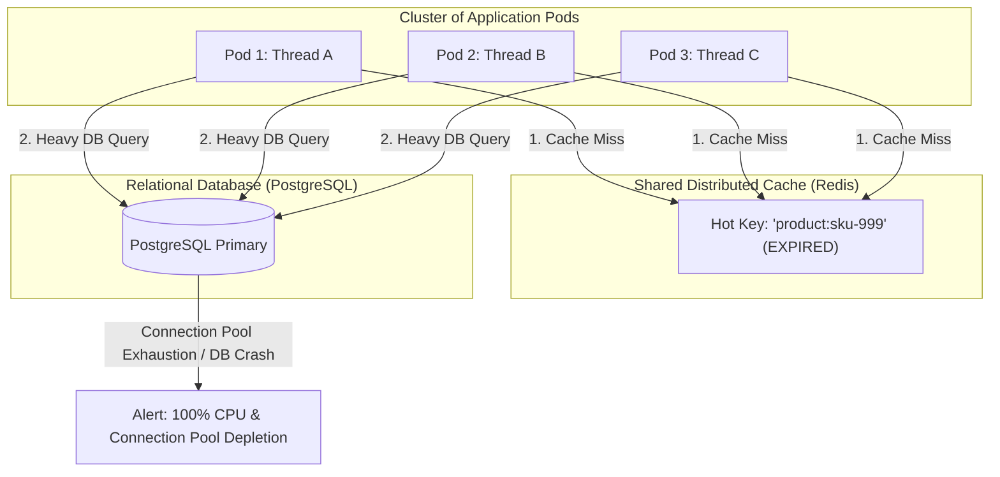
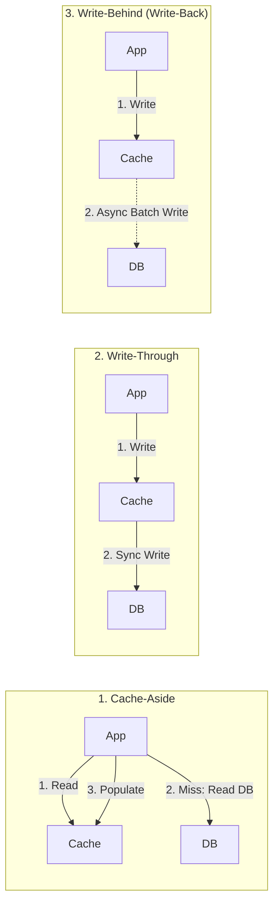
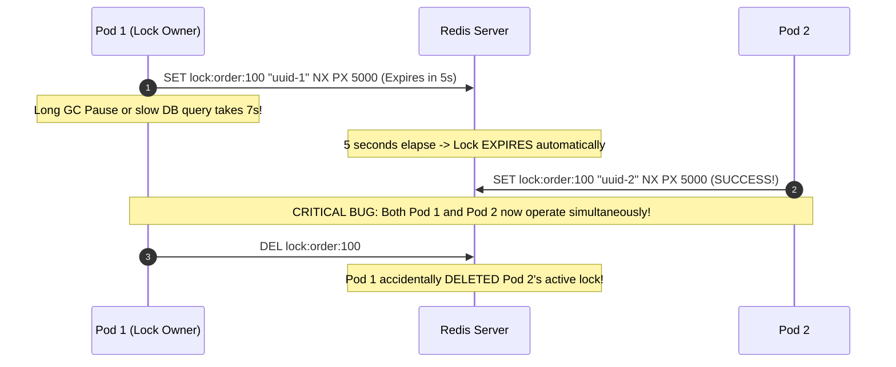
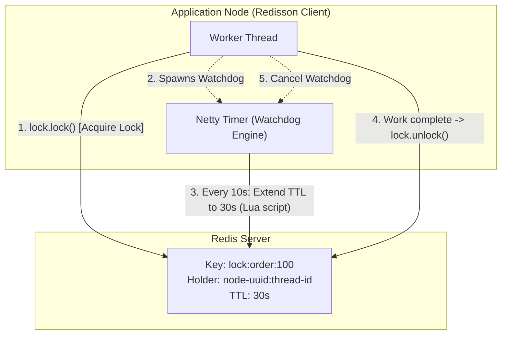
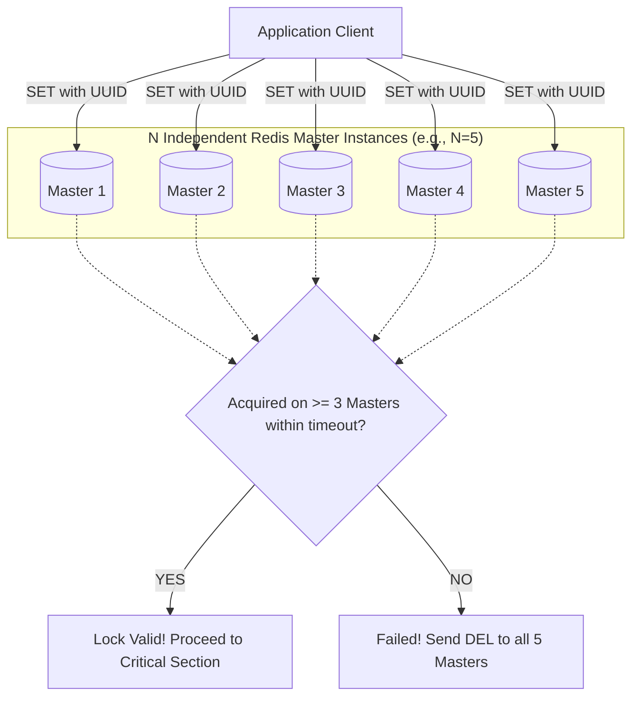

# Distributed Locking and Cache Patterns

In monolithic systems running on a single JVM, synchronizing access to shared resources is relatively straightforward: you use `synchronized` blocks, `ReentrantLock`, or concurrent data structures from `java.util.concurrent`. But once you scale your application across dozens of Kubernetes pods or microservice instances, JVM memory boundaries no longer protect you. Two threads running on separate physical nodes can read the database, find a stale cache entry, and overwrite each other's updates simultaneously.

Worse, high-throughput caching introduces subtle concurrency failure modes: the **Cache Stampede** (Thundering Herd), **Cache Penetration**, and **Cache Avalanche**. When misconfigured, a caching tier that was intended to protect your database can actually coordinate its total collapse during traffic spikes.

In this deep dive, we will unpack enterprise caching topologies, dissect production failure patterns, and explore battle-tested distributed synchronization using Redis, Lua scripts, and Redisson.

---

## Beyond Simple Caching: The Concurrency Reality

Adding a cache looks deceptively simple in tutorials: check if the key exists in Redis; if yes, return it; if no, query the database, write to Redis, and return. 

In production systems serving tens of thousands of requests per second, this naive logic breaks down immediately. Under concurrency, caching ceases to be a simple storage optimization and becomes a distributed consistency challenge.



When a heavily requested key expires, every incoming thread experiences a cache miss simultaneously. Instead of Redis shielding the database, hundreds of concurrent threads execute identical expensive SQL queries against PostgreSQL at the exact same millisecond. The database's connection pool saturates, CPU spikes to 100%, query latency increases from 5ms to 30,000ms, and cascading timeouts bring down the entire system.

Understanding how to structure cache access patterns and synchronize concurrent workloads is essential for building resilient backend architectures.

---

## Classic Cache Access Topologies

Choosing the right caching topology determines your application's read latency, write latency, and tolerance for stale data. There is no single "best" pattern; each represents a different compromise between consistency and performance.



### Cache-Aside (Lazy Loading)

Cache-Aside is the most widely adopted pattern in Spring Boot applications. The application orchestrates all reads and writes directly:

- **Read Flow:** The application queries the cache. If found (cache hit), it returns immediately. If missing (cache miss), it queries the database, writes the result into the cache with a Time-To-Live (TTL), and returns the response.
- **Write Flow:** When updating an entity, the application writes directly to the database and then **evicts (deletes)** the corresponding cache key from Redis.
- **Why Evict instead of Update?** Updating the cache directly creates race conditions. If Thread 1 updates the DB to value A and Thread 2 updates the DB to value B, network latency could cause Thread 2 to write to Redis before Thread 1, leaving the cache permanently holding stale value A. Evicting the key forces the next reader to pull the authoritative database state.

### Write-Through

In a Write-Through topology, the cache sits between the application and the persistent store:

- The application writes directly to the cache.
- The cache provider synchronously writes the updated state to the underlying database before returning success to the application.
- **Trade-off:** High write latency (the application waits for both cache and database round-trips), but guaranteed read consistency and no stale data windows.

### Write-Behind (Write-Back)

In a Write-Behind architecture, the application writes only to the cache, which acknowledges immediately:

- The cache layer buffers the writes in memory and asynchronously batches them to the relational database in the background (e.g., every 5 seconds or when the buffer reaches 1,000 writes).
- **Advantages:** Extreme write throughput and sub-millisecond write latency. Downstream databases are shielded from sudden write spikes because the cache acts as a shock absorber.
- **Dangers:** High risk of data loss. If the Redis node crashes before dirty cache blocks are flushed to disk or PostgreSQL, those transactions are permanently lost. Strictly avoid this pattern for financial ledgers, billing systems, or compliance audits.

### Refresh-Ahead

In Refresh-Ahead caching, the caching infrastructure monitors access frequency. If a key is configured with a 60-second TTL and the system observes consistent reads at second 50, a background thread asynchronously re-queries the database and refreshes the cache *before* the TTL expires. End users experience near-zero cache misses for hot data.

---

## The Three Concurrency Disasters

When operating at scale, caches fail in three classic ways. High-level engineers design defensively against all three.

| Failure Mode | Root Cause | Impact | Architectural Remedy |
| :--- | :--- | :--- | :--- |
| **Cache Penetration** | Queries for non-existent IDs bypass cache completely. | Every request hits RDBMS; attackers can DoS the DB with random UUIDs. | Bloom Filters or caching Null objects with short TTLs. |
| **Cache Breakdown (Stampede)** | A single ultra-hot key expires under heavy load. | Thousands of threads query RDBMS concurrently for the same row. | Distributed Mutex Locking or Probabilistic Early Expiration (XFetch). |
| **Cache Avalanche** | Millions of keys expire at the exact same second (e.g., midnight batch). | Massive sudden traffic wave hits database at TTL boundary. | Jittered TTLs: add random variance to base expiration duration. |

### Defending Against Cache Penetration

If a malicious client requests `GET /api/v1/orders/random-non-existent-uuid-999999`, Redis has no entry. The application queries PostgreSQL, finds nothing (`null`), and returns 404 without writing to Redis. If the attacker fires 20,000 requests per second with random UUIDs, 100% of the traffic hits your relational database.

#### Remedy A: Cache Null Values with Short Expiration

When a database query returns empty, cache a sentinel value (`"NULL"` or empty JSON) with a short TTL (e.g., 60 seconds):

```java
public Order getOrder(String orderId) {
    String cacheKey = "order:" + orderId;
    String cached = redisTemplate.opsForValue().get(cacheKey);

    if ("__NULL__".equals(cached)) {
        return null; // Known non-existent record, bypass DB
    }
    if (cached != null) {
        return deserialize(cached);
    }

    Order order = orderRepository.findById(orderId).orElse(null);
    if (order == null) {
        // Cache null object for 60 seconds to stop penetration
        redisTemplate.opsForValue().set(cacheKey, "__NULL__", Duration.ofSeconds(60));
        return null;
    }

    redisTemplate.opsForValue().set(cacheKey, serialize(order), Duration.ofHours(2));
    return order;
}
```

#### Remedy B: Bloom Filters

A Bloom Filter is a space-efficient probabilistic data structure that can tell you with 100% certainty if an element **does not exist**, or with a small configurable false-positive rate if an element **might exist**.

Before touching Redis or PostgreSQL, query a Redis Bloom Filter (`BF.EXISTS`). If it returns `0`, the entity definitely does not exist in your database; return a 404 immediately.

### Defending Against Cache Avalanche

If your application writes 500,000 product catalog entries during a nightly batch job at 02:00:00 with a uniform TTL of `Duration.ofHours(24)`, every single key will expire at precisely 02:00:00 tomorrow. The resulting avalanche of cache misses will knock over your database.

**Remedy: Randomized TTL Jitter**

Always inject a pseudo-random delta into your cache expiration calculations:

```java
public Duration calculateJitteredTtl(Duration baseTtl, int maxJitterSeconds) {
    int jitter = ThreadLocalRandom.current().nextInt(0, maxJitterSeconds + 1);
    return baseTtl.plusSeconds(jitter);
}

// Usage: 24 hours base TTL + random jitter between 0 and 600 seconds (10 minutes)
Duration ttl = calculateJitteredTtl(Duration.ofHours(24), 600);
redisTemplate.opsForValue().set(key, payload, ttl);
```

---

## Why JVM-Local Locking Fails in Distributed Systems

To solve the Cache Stampede (Breakdown), you might be tempted to use Java's standard concurrency primitives:

```java
// DANGEROUS: Fails in multi-node production environments!
public synchronized Product getProduct(String sku) {
    Product p = cache.get(sku);
    if (p == null) {
        p = database.find(sku);
        cache.put(sku, p);
    }
    return p;
}
```

This works if you have exactly **one** JVM instance. However, if your service runs 20 pods in Kubernetes, each pod has its own independent heap, monitor locks, and thread scheduler. While only one thread runs inside Pod 1's critical section, Pods 2 through 20 are executing their own critical sections simultaneously. Twenty concurrent heavy queries still pound your database.

Furthermore, `synchronized` creates an unnecessary bottleneck across all keys: a request for `sku-1` blocks an unrelated request for `sku-2`.

You need a **Distributed Lock**: a mutual exclusion mechanism maintained in a shared, external consensus store like Redis.

---

## The Evolution of Redis Distributed Locks

Implementing a distributed lock correctly is difficult. Looking at naive approaches highlights why standard libraries like Redisson are required.

### Flaw 1: Non-Atomic Acquisition (`SETNX` + `EXPIRE`)

In early Redis architectures, engineers used two separate commands:

```text
1. SETNX lock:product:123 "node-1"
2. EXPIRE lock:product:123 10
```

**The Fatal Failure:** If Pod 1 crashes, gets killed by Kubernetes OOMKilled, or loses network connectivity between step 1 and step 2, the lock never receives an expiration time. The lock becomes an immortal ghost key, causing all future requests to hang indefinitely.

### Flaw 2: The Native Atomic `SET key value NX PX`

Redis 2.6.12 resolved Flaw 1 by making acquisition atomic:

```text
SET lock:product:123 "unique-pod-uuid" NX PX 10000
```

- `NX`: Set only if the key does not exist.
- `PX 10000`: Set an automatic expiration of 10,000 milliseconds (10 seconds).

While atomic, this introduces another severe failure mode: **Premature Expiration and Lock Hijacking**.



1. Pod 1 acquires the lock with a 5-second TTL.
2. Pod 1 undergoes a Stop-The-World (STW) garbage collection pause or encounters an unusually slow database transaction lasting 7 seconds.
3. At second 5, Redis expires the lock key.
4. Pod 2 requests the lock, finds it empty, acquires it, and enters the critical section.
5. Pod 1 recovers from its pause, finishes its database write, and calls `DEL lock:order:100`.
6. Pod 1 has just deleted Pod 2's valid lock, allowing Pod 3 to acquire it. Now multiple nodes are executing concurrent writes against the same record without protection.

### Flaw 3: Non-Atomic Release

To ensure a node only deletes its own lock, the lock value must be a cryptographically random UUID unique to that specific thread. Before releasing the lock, the thread must verify that the stored UUID matches its own token.

In standard Java code:

```java
// BROKEN: Check-then-act race condition!
if (uniqueToken.equals(redis.get("lock:order:100"))) {
    // What if a GC pause occurs right here?
    redis.del("lock:order:100");
}
```

If a GC pause strikes between the `GET` check and the `DEL` execution, the lock can expire, another node can acquire it, and the resuming thread will delete the newcomer's lock.

The check and deletion must be executed as a single, atomic operation using a Redis Lua script:

```lua
-- Atomically compare token and delete only if matched
if redis.call("get", KEYS[1]) == ARGV[1] then
    return redis.call("del", KEYS[1])
else
    return 0
end
```

---

## Production Distributed Locking with Redisson

Writing custom Lua scripts, managing exponential backoff retries, and handling thread interruptions is error-prone. The production standard for distributed synchronization in the Java ecosystem is **Redisson**.

Redisson solves the premature expiration problem through its **Lock Watchdog** mechanism.



### How the Redisson Watchdog Works

1. When a thread invokes `lock.lock()` without specifying an explicit `leaseTime`, Redisson sets a default lock lease time of 30 seconds.
2. Upon successful acquisition, Redisson schedules a recurring background task using a Netty `Timeout` timer.
3. Every 10 seconds (one-third of the watchdog timeout), the Watchdog runs an atomic Lua script that checks if the lock is still held by the same thread. If it is, the TTL is reset back to 30 seconds.
4. If the application pod crashes or suffers a catastrophic power failure, the Watchdog timer stops firing. Redis automatically expires the lock after the remaining 30 seconds elapse, preventing infinite deadlocks.

### Implementing Redisson in Spring Boot

#### Step 1: Maven Dependency

```xml
<dependency>
    <groupId>org.redisson</groupId>
    <artifactId>redisson-spring-boot-starter</artifactId>
    <version>3.37.0</version>
</dependency>
```

#### Step 2: Redisson Configuration

```java
package com.javahub.infrastructure.config;

import org.redisson.Redisson;
import org.redisson.api.RedissonClient;
import org.redisson.config.Config;
import org.springframework.beans.factory.annotation.Value;
import org.springframework.context.annotation.Bean;
import org.springframework.context.annotation.Configuration;

@Configuration
public class RedissonConfig {

    @Value("${spring.data.redis.host:localhost}")
    private String redisHost;

    @Value("${spring.data.redis.port:6379}")
    private int redisPort;

    @Bean(destroyMethod = "shutdown")
    public RedissonClient redissonClient() {
        Config config = new Config();
        config.useSingleServer()
              .setAddress(String.format("redis://%s:%d", redisHost, redisPort))
              .setConnectionPoolSize(64)
              .setConnectionMinimumIdleSize(16)
              .setConnectTimeout(3000)
              .setRetryAttempts(3)
              .setRetryInterval(1500);

        // Sets the watchdog interval (default: 30,000ms)
        config.setLockWatchdogTimeout(30000L);

        return Redisson.create(config);
    }
}
```

#### Step 3: Resilient Distributed Mutex Implementation

Here is how to combine Redisson with Cache-Aside to solve the Cache Stampede (Thundering Herd) problem:

```java
package com.javahub.service;

import com.javahub.model.Product;
import com.javahub.repository.ProductRepository;
import org.redisson.api.RLock;
import org.redisson.api.RedissonClient;
import org.slf4j.Logger;
import org.slf4j.LoggerFactory;
import org.springframework.data.redis.core.RedisTemplate;
import org.springframework.stereotype.Service;

import java.time.Duration;
import java.util.concurrent.TimeUnit;

@Service
public class ProductCatalogService {

    private static final Logger log = LoggerFactory.getLogger(ProductCatalogService.class);
    private static final String CACHE_PREFIX = "product:cache:";
    private static final String LOCK_PREFIX = "product:lock:";

    private final ProductRepository productRepository;
    private final RedisTemplate<String, Object> redisTemplate;
    private final RedissonClient redissonClient;

    public ProductCatalogService(ProductRepository productRepository,
                                 RedisTemplate<String, Object> redisTemplate,
                                 RedissonClient redissonClient) {
        this.productRepository = productRepository;
        this.redisTemplate = redisTemplate;
        this.redissonClient = redissonClient;
    }

    public Product getProductWithStampedeProtection(String sku) {
        String cacheKey = CACHE_PREFIX + sku;

        // 1. Fast Path: Read from Cache
        Product cachedProduct = (Product) redisTemplate.opsForValue().get(cacheKey);
        if (cachedProduct != null) {
            return cachedProduct;
        }

        // 2. Cache Miss: Acquire Distributed Lock for THIS SPECIFIC SKU
        String lockKey = LOCK_PREFIX + sku;
        RLock lock = redissonClient.getLock(lockKey);

        try {
            // Wait up to 5 seconds to acquire; hold lock safely with Watchdog
            boolean acquired = lock.tryLock(5, TimeUnit.SECONDS);

            if (!acquired) {
                log.warn("Could not acquire lock for SKU: {} within timeout window", sku);
                // Fallback: Query read-replica or return graceful degradation state
                return productRepository.findBySku(sku).orElse(null);
            }

            // 3. Double-Check Lock idiom: Re-check cache in case earlier lock holder populated it
            cachedProduct = (Product) redisTemplate.opsForValue().get(cacheKey);
            if (cachedProduct != null) {
                return cachedProduct;
            }

            log.info("Cache miss confirmed under lock for SKU: {}. Querying primary database.", sku);
            Product productFromDb = productRepository.findBySku(sku)
                    .orElseThrow(() -> new IllegalArgumentException("Product not found: " + sku));

            // 4. Populate cache with jittered TTL (1 hour + up to 5 minutes)
            long jitterSeconds = (long) (Math.random() * 300);
            Duration ttl = Duration.ofHours(1).plusSeconds(jitterSeconds);
            redisTemplate.opsForValue().set(cacheKey, productFromDb, ttl);

            return productFromDb;

        } catch (InterruptedException e) {
            Thread.currentThread().interrupt();
            throw new IllegalStateException("Thread interrupted while waiting for distributed lock", e);
        } finally {
            // 5. Always release lock safely in finally block, verifying current thread ownership
            if (lock.isHeldByCurrentThread()) {
                lock.unlock();
            }
        }
    }
}
```

### Notice the Critical Details:

1. **Granular Lock Scope:** We lock on `product:lock:sku-100`, not a global lock. Requests for other SKUs continue concurrently without blocking.
2. **Double-Checked Locking:** Once the thread acquires the lock, it checks the cache a second time. While this thread was blocked waiting for the lock, the preceding thread likely queried the database and repopulated Redis. Skipping this check wastes database queries.
3. **Safe Release:** Always call `lock.isHeldByCurrentThread()` before calling `lock.unlock()` to avoid throwing `IllegalMonitorStateException`.

---

## The Redlock Algorithm: Architecture and Debates

What happens if the Redis master node crashes immediately after granting a lock, before that lock key replicates asynchronously to its replica?

1. Pod 1 acquires a lock on the Redis Master.
2. The Redis Master crashes before replicating the new key to Redis Replica 1.
3. Sentinel or Redis Cluster promotes Replica 1 to be the new Master.
4. Pod 2 attempts to acquire the exact same lock. The new Master doesn't have the key, so it grants the lock to Pod 2.
5. **Split-Brain Execution:** Both Pod 1 and Pod 2 now believe they hold the lock.

To solve this, Redis creator Salvatore Sanfilippo designed the **Redlock Algorithm**:



### The Algorithm Steps:

1. Deploy `N` completely independent Redis masters (typically 5) without replication links between them.
2. The client records the current timestamp.
3. The client attempts to acquire the lock across all `N` instances sequentially using identical key names and random UUID values, using a small network timeout (e.g., 50ms) per node.
4. The client calculates the total elapsed time. If the client acquired the lock on a strict majority (`(N / 2) + 1`, or 3 of 5 instances) **and** the elapsed time is less than the lock validity time, the lock is acquired.
5. The effective lock validity time equals the original TTL minus the time spent acquiring it.
6. If the client fails to obtain a majority, it sends a release script (`DEL`) to **all** instances.

### The Martin Kleppmann vs. Salvatore Sanfilippo Debate

In 2016, distributed systems researcher Martin Kleppmann published a critique of Redlock titled *"How to do distributed locking"*. His argument centered on real-world timing assumptions:

- Redlock relies on **physical clock synchronization** (NTP) across nodes. If an NTP server drifts backwards or jumps forward on one Redis instance, TTL expirations accelerate unpredictably.
- A long Stop-The-World (STW) JVM pause can pause a thread after it acquires the lock. By the time the thread wakes up, its lease has expired, yet it proceeds to write to shared storage, causing data corruption.

**Kleppmann's Rule of Thumb:**
- If you need distributed locking purely for **efficiency** (e.g., avoiding redundant computations, saving CPU/bandwidth, preventing cache stampedes), a single Redis instance or standard Redisson lock is sufficient. If a rare failure grants the lock twice, the worst outcome is duplicate work.
- If you need distributed locking for **correctness** (e.g., preventing double-spending in financial transactions, inventory deduping, medical record writes), you cannot rely on Redis or Redlock without fencing tokens. You should use a strongly consistent distributed consensus system like **Apache ZooKeeper**, **etcd**, or **Consul** backed by the Raft or Zab consensus algorithms.

---

## Senior Engineer Interview Crucible

### Why is using `SET key uuid NX PX 30000` insufficient for bulletproof distributed locking under long GC pauses, and how does Redisson address it?

The `SET key uuid NX PX 30000` command sets an absolute TTL of 30 seconds. If the thread holding the lock experiences a Stop-The-World (STW) garbage collection pause, thread starvation, or a slow database query lasting longer than 30 seconds, Redis automatically evicts the lock key. 

Another node can then acquire the lock, leading to concurrent execution in the critical section. Redisson resolves this with its **Watchdog** pattern: upon acquiring a lock without an explicit lease time, Redisson starts a background Netty timer that renews the lock's expiration every 10 seconds (one-third of the watchdog timeout) as long as the holding thread remains alive. If the holding node crashes, the timer stops, allowing the lock to naturally expire without causing permanent deadlocks.

---

### How do you prevent the Cache Stampede (Thundering Herd) problem without stalling incoming traffic?

A Cache Stampede occurs when a hot key expires and hundreds of concurrent requests simultaneously attempt to recompute the value against the database. There are two primary architectural solutions:

1. **Distributed Mutex with Double-Checked Locking:** When a cache miss occurs, threads contend for a distributed lock (e.g., via Redisson) keyed specifically to that entity ID. Exactly one thread acquires the lock and queries the database; all other threads wait. Once the lock is released, the waiting threads check the cache a second time, finding the newly populated value without hitting the database.
2. **Probabilistic Early Expiration (XFetch Algorithm):** Instead of waiting for an absolute TTL expiration, reading threads evaluate an algorithm based on read latency and remaining TTL:

```text
Δ - β * ln(random()) > TTL - now
```

As the key approaches expiration, the probability of a background thread triggering an asynchronous cache refresh scales up. Under high traffic, the key is refreshed transparently in the background before it ever expires, achieving zero reader latency spikes.

---

### Compare Write-Through vs Write-Behind caching. In what financial or audit scenarios is Write-Behind strictly forbidden?

In **Write-Through** caching, the application writes to the cache, and the cache synchronously persists the data to the database before returning success. Write latency includes both operations, but strong consistency is maintained.

In **Write-Behind (Write-Back)** caching, the application writes only to the cache, which acknowledges immediately. The cache layer asynchronously flushes updates to the database in batches. While this delivers extreme write throughput and shields the database from write spikes, it introduces a window of vulnerability: if the cache node suffers an unrecoverable failure or power loss before dirty pages are flushed, transactions are permanently lost.

Write-Behind is strictly forbidden in financial ledgers, banking transfers, payment processing, regulatory audit trails, and inventory reservations where transactional durability (the 'D' in ACID) is legally mandated and data loss translates to financial loss.

---

### When should an architect choose Redis distributed locking over a dedicated consensus system like ZooKeeper or Raft (etcd)?

The decision depends on the consequence of a lock violation:

- **Choose Redis (Redisson):** When locking is used for **resource optimization and efficiency**. Examples include preventing redundant video encoding jobs, deduplicating push notifications, or shielding downstream databases from cache stampedes. In these scenarios, a split-brain condition caused by an asynchronous master-replica failover or an NTP clock jump results in minor wasted compute, not corrupted business state. Redis delivers lower latency and higher throughput.
- **Choose ZooKeeper or etcd:** When locking is used for **correctness and state integrity**. Examples include leader election in distributed orchestrators, preventing split-brain writes in database engines, and managing shared physical storage allocations. ZooKeeper and etcd use formal consensus protocols (Zab and Raft) that reject writes if a network partition prevents a true quorum. They support ephemeral sequential nodes, automatic session heartbeats tied directly to client TCP sockets, and strict monotonic transaction IDs (zxid), guaranteeing that split-brain locks cannot be granted.
