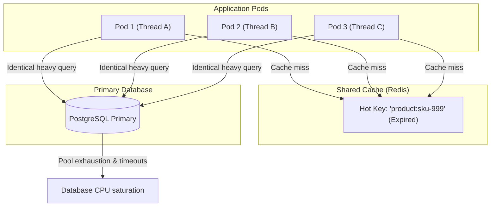
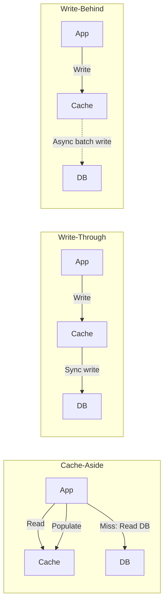
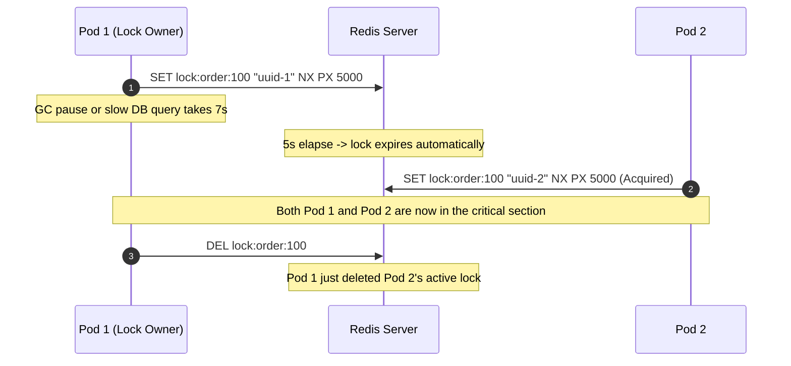
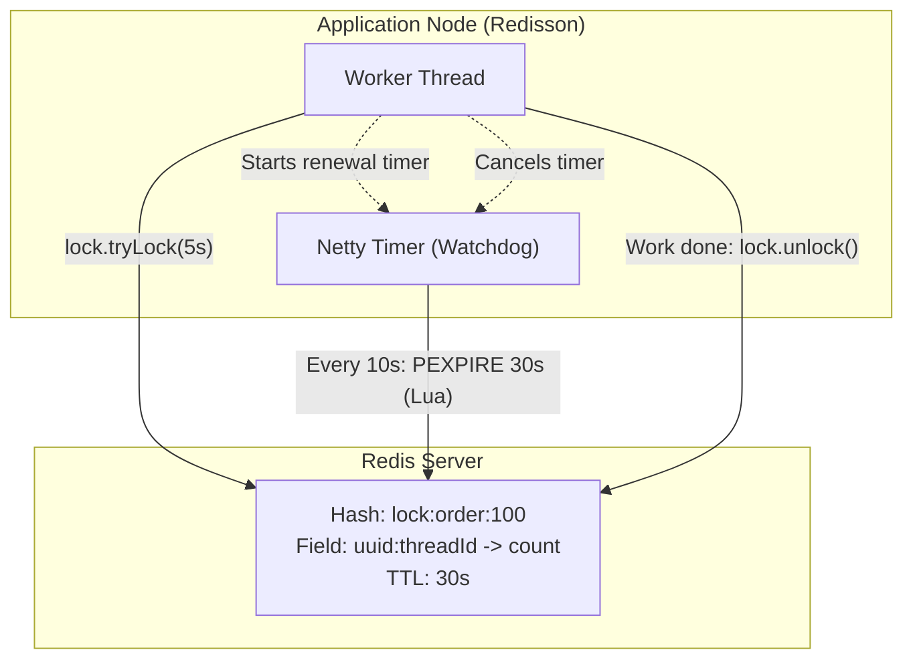
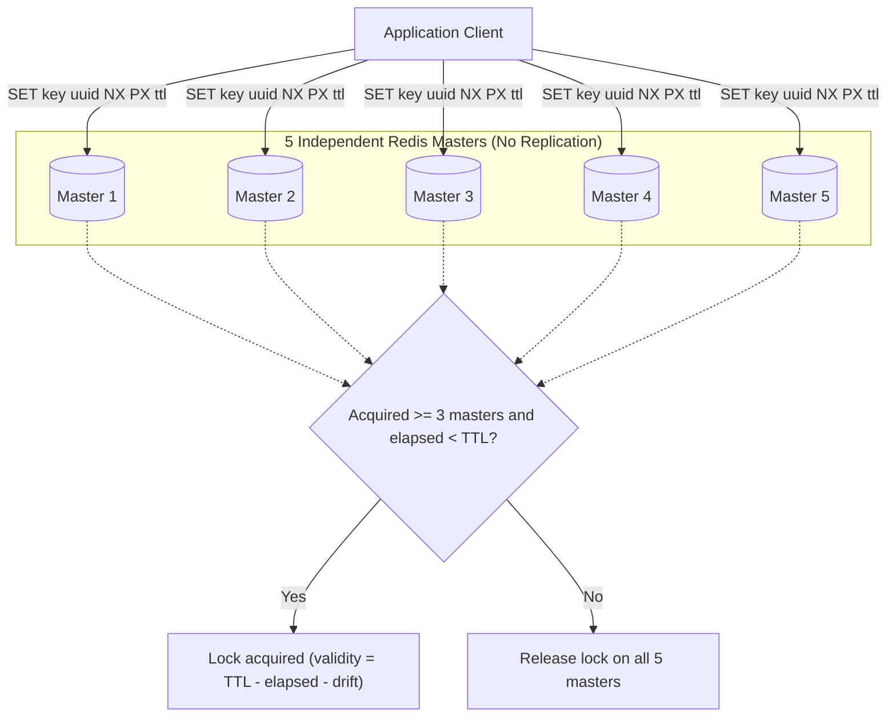
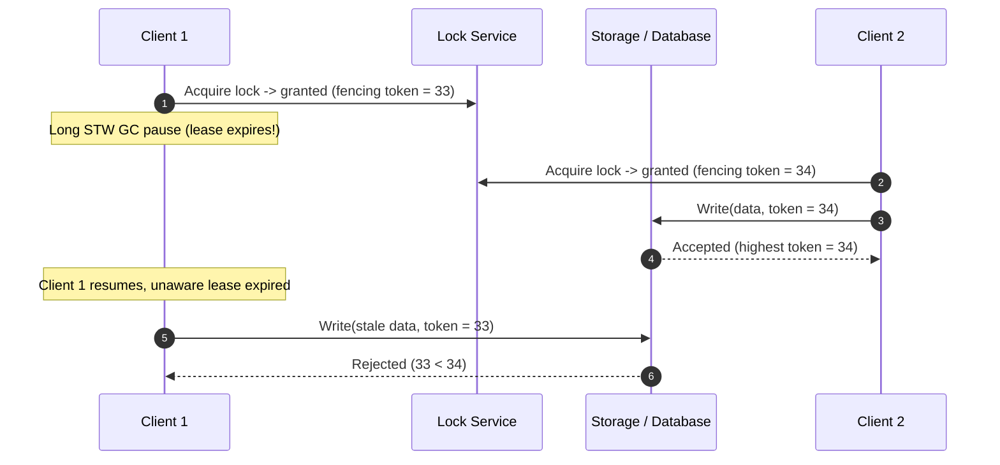

On a single JVM, coordinating access to shared state is straightforward: `synchronized`, `ReentrantLock`, and `ConcurrentHashMap` all operate inside one heap with one thread scheduler. Once you deploy a Spring Boot service across ten Kubernetes pods, those primitives only guard threads inside their own pod. Two requests hitting different pods can read a missing cache entry at the same millisecond, run the same expensive SQL query, and race to write stale data back into Redis.

Caching also introduces failure modes that rarely show up in local testing. Under heavy load, a single expired key, a wave of missing IDs, or a batch of synchronized expirations can turn a cache that was supposed to protect PostgreSQL into the exact mechanism that knocks it over. This lesson walks through the main caching topologies, how to defend against cache penetration, stampedes, and avalanches, and how distributed locking works in Redis, including where Redisson and Redlock stop being enough and fencing tokens take over.

## Why Naive Caching Breaks Under Concurrency

The textbook cache flow looks clean: look up a key in Redis; if it is there, return it; if not, query the database, store the result in Redis, and return it. That works fine at a few dozen requests per second.

At several thousand requests per second on a shared hot key, expiration becomes a synchronization hazard. When the key drops out of Redis, every pod sees a miss simultaneously and sends the same query to the primary database.



Once the connection pool fills up, queries queue, latency climbs from single-digit milliseconds to seconds, and upstream timeouts trigger retries that make the load worse. Avoiding that cascade starts with picking a caching topology that matches your read/write profile.

## Caching Topologies

Each caching topology trades read latency, write latency, consistency, and durability differently.



### Cache-Aside (Lazy Loading)

Cache-Aside is the default pattern in most Java services because the application stays in full control and the cache only holds data that is actually requested.

On reads, the service checks Redis first. On a hit, it returns immediately. On a miss, it queries PostgreSQL, writes the result to Redis with a TTL, and returns it.

On writes, the service updates PostgreSQL and then **deletes (evicts)** the cache key rather than updating the cached value in place. Updating the cache directly creates an ordering race: if Thread 1 writes value A to PostgreSQL and Thread 2 writes value B shortly after, network jitter can cause Thread 1's Redis `SET` to land after Thread 2's, leaving Redis stuck with stale value A until the TTL expires. Evicting the key avoids overwriting fresher state in most cases, though a narrow race still exists between a concurrent reader repopulating from a stale read and a writer invalidating. Keeping sensible TTLs acts as the backstop so stale entries never live forever.

### Write-Through

In Write-Through caching, the application treats the cache as its primary write interface. Every write goes to the cache layer, which synchronously persists the change to the underlying database before acknowledging the caller.

Writes pay the latency of both the cache and the database, and the cache ends up storing records that may never be read again unless you enforce strict eviction policies. The upside is that cached data stays fresh on every write, which pairs well with read-heavy workloads that cannot tolerate a cold cache right after an update.

### Write-Behind (Write-Back)

In Write-Behind caching, the application writes to the cache and gets an immediate acknowledgment. A background worker batches dirty entries and flushes them to the database asynchronously (for example, every few seconds or per batch of 1,000 updates).

Write-Behind absorbs heavy write bursts, such as view counters, analytics events, or telemetry ingestion, because multiple writes to the same key can be coalesced in memory before touching disk. The trade-off is durability: if the cache node crashes or loses power before the dirty buffer flushes, those writes are gone. Do not use Write-Behind for payments, account balances, order state, or audit trails.

### Refresh-Ahead

With Refresh-Ahead, the cache tracks access on hot keys and refreshes them asynchronously shortly before their TTL expires. For example, if a key has a 60-second TTL and gets hit at second 52, the service returns the current cached value immediately while triggering a background refresh. Readers rarely observe a miss on hot keys, though you need careful tuning so you do not waste database queries refreshing keys that have gone cold.

## Preventing Cache Penetration, Breakdown, and Avalanche

Production caches tend to fail in three distinct ways. People often mix up the terms, so it helps to separate them by root cause.

| Failure Mode | What Happens | Database Impact | Primary Defenses |
| :--- | :--- | :--- | :--- |
| **Cache Penetration** | Requests ask for IDs that do not exist in the cache or the database. | Every request misses Redis and hits PostgreSQL. | Cache null sentinels with short TTLs; Bloom filters. |
| **Cache Breakdown (Stampede)** | One heavily requested key expires while traffic is high. | Hundreds or thousands of concurrent queries fetch the same row. | Single-flight / distributed mutex lock; probabilistic early expiration. |
| **Cache Avalanche** | A large batch of keys expires at the same instant (or the cache restarts cold). | Sudden traffic cliff hits PostgreSQL across many keys at once. | Randomized TTL jitter; staggered cache warming; circuit breakers. |

### Defending Against Cache Penetration

Suppose a buggy client or an attacker requests `GET /api/v1/orders/{id}` with random UUIDs that do not exist in PostgreSQL. Redis has no entry, so every request falls through to the database, finds nothing, and returns 404. Because nothing gets written to Redis, the next request for the same bad ID hits PostgreSQL again.

#### Caching Null Sentinels

The simplest fix is to cache negative lookups using a short-lived sentinel value (say, 30 to 60 seconds). Keep the TTL short so that if the ID is legitimately created shortly after, the negative cache does not hide it for long, and make sure a real write invalidates the sentinel key.

```java
public Order getOrder(String orderId) {
    String cacheKey = "order:" + orderId;
    String cached = redisTemplate.opsForValue().get(cacheKey);

    if ("__NULL__".equals(cached)) {
        return null; // Known miss; skip the database
    }
    if (cached != null) {
        return deserialize(cached);
    }

    Order order = orderRepository.findById(orderId).orElse(null);
    if (order == null) {
        redisTemplate.opsForValue().set(cacheKey, "__NULL__", Duration.ofSeconds(60));
        return null;
    }

    redisTemplate.opsForValue().set(cacheKey, serialize(order), Duration.ofHours(2));
    return order;
}
```

Negative caching handles repeated requests for the same non-existent IDs well, but it does not stop an attack that sends millions of distinct random UUIDs. Those will still miss once each and fill Redis memory with junk sentinels.

#### Bloom Filters

When you need to reject completely unseen random keys before touching PostgreSQL, put a **Bloom filter** in front of the lookup (via Redisson's `RBloomFilter` or the RedisBloom module). A Bloom filter is a compact bit array with multiple hash functions. It has an asymmetric guarantee:

- If `mightContain(id)` returns `false`, the ID is **definitely not** in the dataset. Return 404 immediately.
- If `mightContain(id)` returns `true`, the ID **probably** exists (with a configurable false-positive rate, often 1% or 0.1%). Proceed to Redis and PostgreSQL as normal.

```java
public Order getOrderWithBloomFilter(String orderId) {
    RBloomFilter<String> orderIds = redissonClient.getBloomFilter("bloom:orders");
    if (!orderIds.contains(orderId)) {
        return null; // Guaranteed not to exist
    }
    return getOrder(orderId);
}
```

Keep two operational caveats in mind with standard Bloom filters: you have to populate them when records are created (and warm them on startup or via batch jobs), and standard Bloom filters do not support item deletion, so you rebuild them periodically or use a counting/cuckoo filter if deletions are frequent.

### Defending Against Cache Avalanche

If a nightly job loads 500,000 catalog items at 02:00 with a fixed 24-hour TTL, all 500,000 keys expire together at 02:00 the next day. Adding random jitter spreads the expiration across a window so background misses stay flat.

```java
public Duration jitteredTtl(Duration baseTtl, int maxJitterSeconds) {
    int jitter = ThreadLocalRandom.current().nextInt(0, maxJitterSeconds + 1);
    return baseTtl.plusSeconds(jitter);
}

// 24 hours + random 0 to 10 minutes
Duration ttl = jitteredTtl(Duration.ofHours(24), 600);
redisTemplate.opsForValue().set(key, payload, ttl);
```

### Defending Against Cache Breakdown (Stampede)

When a single hot key expires under heavy traffic, jitter does not help because there is only one key. There are three common defenses:

1. **Per-key mutex (single-flight / distributed lock)**: Only one caller is allowed to rebuild the key from the database while other callers wait briefly and re-read the cache. On a single JVM you can coalesce in-flight requests per key using `ConcurrentHashMap<String, CompletableFuture<Product>>`; across a cluster, you use a per-key distributed lock in Redis.
2. **Probabilistic Early Expiration (XFetch)**: Readers check whether the key is close to expiring using a formula based on the time it took to recompute the value (`delta`) and remaining TTL: `now - delta * beta * ln(random()) >= expiry`. The closer the key gets to expiry, the more likely one reader triggers a refresh early while other readers keep receiving the still-valid value.
3. **Never-expiring logical TTL**: Store a logical `refreshAfter` timestamp inside the cached payload while setting a much longer physical Redis TTL (or no TTL). Readers still get the slightly stale value while a single background thread acquires a lock and refreshes it.

## Why JVM Locks Fail Across Multiple Nodes

A common first attempt at fixing a cache stampede is adding `synchronized` around the cache-miss loader:

```java
// Only coordinates threads inside a single JVM instance
public synchronized Product getProduct(String sku) {
    Product p = cache.get(sku);
    if (p == null) {
        p = database.find(sku);
        cache.put(sku, p);
    }
    return p;
}
```

This fails in two ways in production. First, it synchronizes on the service singleton, so a miss on `sku-1` blocks an unrelated read for `sku-2`. Second, if you run 20 Kubernetes pods, each pod has its own monitor lock, so 20 threads still hit the database simultaneously. To coordinate across nodes, the lock state has to live in a shared external store such as Redis.

## Building a Redis Distributed Lock: Step-by-Step Pitfalls

Writing a Redis lock from scratch looks like three lines of code until you trace every failure mode. Walking through the broken versions explains why production teams reach for libraries like Redisson.

### Pitfall: Non-Atomic `SETNX` and `EXPIRE`

Early Redis code acquired a lock with two commands:

```text
SETNX lock:product:123 "node-1"
EXPIRE lock:product:123 10
```

If the client process crashes or gets OOM-killed between `SETNX` and `EXPIRE`, the key has no TTL and stays locked forever until someone manually deletes it.

### Pitfall: Premature Expiration and Accidental Lock Deletion

Redis 2.6.12 added atomic acquire-with-expiry:

```text
SET lock:product:123 "a9f2b1c4-..." NX PX 10000
```

`NX` creates the key only if it does not already exist, and `PX 10000` attaches a 10-second millisecond TTL in the same atomic command. Even with atomic acquisition, a slow operation or a Stop-The-World garbage collection pause can outlive the TTL.



If Pod 1 simply runs `DEL lock:order:100` when it wakes up, it deletes Pod 2's active lock, letting Pod 3 enter as well.

### Pitfall: Non-Atomic Check-Then-Delete

Storing a unique per-thread token as the lock value lets you verify ownership before deleting, but doing it in two network calls still has a race:

```java
// Still unsafe: a pause between GET and DEL lets another pod acquire the lock
if (uniqueToken.equals(redis.get("lock:order:100"))) {
    redis.del("lock:order:100");
}
```

Because Redis executes Lua scripts atomically on its single command thread, you must combine the ownership check and deletion into a single Lua script:

```lua
-- KEYS[1] = lock key, ARGV[1] = owner token
if redis.call("get", KEYS[1]) == ARGV[1] then
    return redis.call("del", KEYS[1])
else
    return 0
end
```

That fixes accidental deletion of another caller's lock, but it still leaves a hard question: what TTL should you pick when you cannot predict how long a database call or GC pause might take?

## Production Distributed Locking with Redisson

**Redisson** is the standard Java client for Redis-backed distributed locks and concurrency primitives. Under the hood, Redisson stores locks as Redis hashes keyed by `clientUuid:threadId` with a reentrancy counter, runs acquisition and release via Lua scripts, subscribes to a pub/sub channel so waiting threads do not spin-poll Redis, and solves fixed-TTL expiry with a **Watchdog**.



### How the Redisson Watchdog Works

When you acquire a Redisson `RLock` without passing an explicit `leaseTime` (or by passing `-1`), Redisson assigns a default TTL equal to `lockWatchdogTimeout` (30 seconds by default) and schedules a renewal task on a Netty `HashedWheelTimer`.

Every `lockWatchdogTimeout / 3` (10 seconds by default), the timer runs a Lua script checking whether this thread still holds the hash entry in Redis. If it does, the script extends the TTL back to 30 seconds. If the pod crashes, the Netty timer dies with the JVM, and Redis expires the lock after the remaining lease time instead of deadlocking forever.

> [!IMPORTANT]
> The Redisson Watchdog is **disabled** if you pass an explicit positive `leaseTime` (such as `lock.tryLock(5, 30, TimeUnit.SECONDS)`). Call `lock.tryLock(5, TimeUnit.SECONDS)` or `lock.tryLock(5, -1, TimeUnit.SECONDS)` when you want automatic lease renewal.

### Configuring Redisson in Spring Boot

Add the Redisson starter dependency (version 3.37+ works with Spring Boot 3.3+):

```xml
<dependency>
    <groupId>org.redisson</groupId>
    <artifactId>redisson-spring-boot-starter</artifactId>
    <version>3.37.0</version>
</dependency>
```

Configure a `RedissonClient` bean (or configure it via `application.yml` if you prefer auto-configuration):

```java
package com.javahub.infrastructure.config;

import org.redisson.Redisson;
import org.redisson.api.RedissonClient;
import org.redisson.config.Config;
import org.springframework.beans.factory.annotation.Value;
import org.springframework.context.annotation.Bean;
import org.springframework.context.annotation.Configuration;

@Configuration
public class RedissonConfig {

    @Value("${spring.data.redis.host:localhost}")
    private String redisHost;

    @Value("${spring.data.redis.port:6379}")
    private int redisPort;

    @Bean(destroyMethod = "shutdown")
    public RedissonClient redissonClient() {
        Config config = new Config();
        config.useSingleServer()
              .setAddress(String.format("redis://%s:%d", redisHost, redisPort))
              .setConnectionPoolSize(64)
              .setConnectionMinimumIdleSize(16)
              .setConnectTimeout(3000)
              .setRetryAttempts(3)
              .setRetryInterval(1500);

        // Watchdog renews every 10s (one-third of 30,000ms)
        config.setLockWatchdogTimeout(30_000L);

        return Redisson.create(config);
    }
}
```

### Combining Cache-Aside with a Per-Key Redisson Lock

Here is a practical implementation of Cache-Aside with stampede protection, double-checked locking, and jittered TTLs:

```java
package com.javahub.service;

import com.javahub.model.Product;
import com.javahub.repository.ProductRepository;
import org.redisson.api.RLock;
import org.redisson.api.RedissonClient;
import org.slf4j.Logger;
import org.slf4j.LoggerFactory;
import org.springframework.data.redis.core.RedisTemplate;
import org.springframework.stereotype.Service;

import java.time.Duration;
import java.util.concurrent.ThreadLocalRandom;
import java.util.concurrent.TimeUnit;

@Service
public class ProductCatalogService {

    private static final Logger log = LoggerFactory.getLogger(ProductCatalogService.class);
    private static final String CACHE_PREFIX = "product:cache:";
    private static final String LOCK_PREFIX = "product:lock:";

    private final ProductRepository productRepository;
    private final RedisTemplate<String, Product> redisTemplate;
    private final RedissonClient redissonClient;

    public ProductCatalogService(ProductRepository productRepository,
                                 RedisTemplate<String, Product> redisTemplate,
                                 RedissonClient redissonClient) {
        this.productRepository = productRepository;
        this.redisTemplate = redisTemplate;
        this.redissonClient = redissonClient;
    }

    public Product getProduct(String sku) {
        String cacheKey = CACHE_PREFIX + sku;

        // 1. Fast path: return cached value without locking
        Product cached = redisTemplate.opsForValue().get(cacheKey);
        if (cached != null) {
            return cached;
        }

        // 2. Miss: lock only this SKU so unrelated SKUs proceed concurrently
        RLock lock = redissonClient.getLock(LOCK_PREFIX + sku);
        try {
            // Wait up to 5s; omit leaseTime so the Redisson Watchdog renews automatically
            boolean acquired = lock.tryLock(5, TimeUnit.SECONDS);
            if (!acquired) {
                log.warn("Timed out waiting for lock on SKU {}", sku);
                return productRepository.findBySku(sku).orElse(null);
            }

            // 3. Double-check cache in case the previous lock holder just populated it
            cached = redisTemplate.opsForValue().get(cacheKey);
            if (cached != null) {
                return cached;
            }

            Product product = productRepository.findBySku(sku)
                    .orElseThrow(() -> new IllegalArgumentException("Product not found: " + sku));

            long jitterSeconds = ThreadLocalRandom.current().nextLong(0, 301);
            Duration ttl = Duration.ofHours(1).plusSeconds(jitterSeconds);
            redisTemplate.opsForValue().set(cacheKey, product, ttl);

            return product;
        } catch (InterruptedException e) {
            Thread.currentThread().interrupt();
            throw new IllegalStateException("Interrupted while waiting for distributed lock", e);
        } finally {
            if (lock.isHeldByCurrentThread()) {
                lock.unlock();
            }
        }
    }
}
```

Three small details make this behave well in production:

- **Per-SKU lock keys** keep contention isolated to the single hot item that just expired.
- **Double-checked locking** ensures that the 50 threads queued behind the first thread read from Redis once the lock releases instead of querying PostgreSQL 50 times in a row.
- **`lock.isHeldByCurrentThread()`** guards `unlock()` so a thread that timed out on `tryLock` (or lost its lease during a network partition) does not throw `IllegalMonitorStateException` in `finally`.

## The Redlock Algorithm

Standard Redis deployments use a primary node with asynchronous replication to one or more replicas. That creates a failover gap for locks:

1. Pod 1 acquires `lock:job:42` on the Redis primary.
2. Before that write replicates to the replica, the primary crashes.
3. Redis Sentinel or Redis Cluster promotes the replica to primary.
4. Pod 2 asks the new primary for `lock:job:42`, sees nothing, and acquires the lock while Pod 1 is still running.

To address single-primary failover without switching away from Redis, Salvatore Sanfilippo proposed the **Redlock** algorithm.



The steps are:

1. Run `N` completely independent Redis primary nodes (typically `N = 5`) with no replication between them.
2. Record the current monotonic start time.
3. Try to acquire the same lock key and random token on all `N` nodes sequentially, using a short per-node network timeout (for example, 50 ms) so one dead node does not stall the whole attempt.
4. Measure total elapsed time. The lock is considered acquired only if the client holds it on a strict majority (`(N / 2) + 1`, so 3 of 5) **and** the elapsed time is smaller than the lock validity time.
5. Subtract the elapsed acquisition time and an allowance for clock drift from the TTL to compute the remaining validity time.
6. If the client fails to win a majority, it sends the Lua release script to all `N` nodes to clean up any partial locks.

## Martin Kleppmann's Critique and Why Fencing Tokens Matter

In 2016, Martin Kleppmann published a widely cited analysis of Redlock (*"How to do distributed locking"*) that changed how many teams think about Redis locks. Two points from his critique matter for every backend engineer.

### Clock Jumps Break Timing Assumptions

Redlock assumes that clocks across the 5 Redis nodes advance at roughly the same rate and that TTLs do not jump. In practice, virtual machines experience NTP step adjustments, VM live-migration pauses, and clock skew. If one Redis node's wall clock jumps forward, it can expire a lock early and allow a second client to assemble a majority quorum while the first client still thinks its validity window is open.

### GC Pauses Break Every Lease-Based Lock

Even if Redlock's clocks were perfect, **a lock lease alone cannot stop a paused client from corrupting shared storage**. Picture what happens when a Java service writes to a storage system or database after acquiring a lock:



Notice what happens **without** the fencing token in steps 6 and 7: Client 1 wakes up from a 35-second Stop-The-World GC pause (or OS scheduling freeze or network packet delay). Even Redisson's Watchdog cannot run while the JVM is frozen in a full STW pause, so the lock expires in Redis and Client 2 acquires it. When Client 1 resumes, it has already passed the `lock.tryLock()` line in code and issues its database write anyway, silently overwriting Client 2's work.

### Solving Stale Writes with Fencing Tokens

A **fencing token** is a strictly monotonically increasing number issued by the lock service every time a lock is granted (33, then 34, then 35). Every write to the downstream resource includes the token, and the storage engine itself rejects any request whose token is smaller than a token it has already processed.

In PostgreSQL, that check is a simple conditional update:

```sql
UPDATE inventory_reservations
SET reserved_qty = reserved_qty + :qty,
    fencing_token = :token
WHERE sku = :sku
  AND fencing_token < :token;
```

If `UPDATE` affects 0 rows, the caller knows a newer lock holder already moved the state forward and aborts instead of corrupting the record.

The catch with Redlock is that 5 independent Redis nodes have no shared consensus log, so they cannot safely generate a globally monotonic fencing token. Systems built on Raft or Zab (such as **etcd** revisions or **Apache ZooKeeper** `zxid` / sequential znodes) generate monotonic tokens natively as part of consensus.

### Efficiency vs. Correctness

Kleppmann's distinction gives a clean rule for choosing a locking mechanism:

- **Locking for efficiency**: You want to avoid duplicate work (preventing a cache stampede, deduplicating a scheduled notification, avoiding running the same video transcode twice). If a rare failover or GC pause lets two pods run at once, you waste some CPU or send an extra query, not corrupt financial state. A single-primary Redis cluster with Redisson is fast, simple, and usually the right choice.
- **Locking for correctness**: Concurrent execution would corrupt business state (double-charging a ledger, overselling constrained inventory, split-brain leader writes). Do not rely on Redis or Redlock alone. Use a consensus-backed lock service (etcd, ZooKeeper) paired with fencing tokens checked by the storage layer, or move the mutual exclusion into the database itself using transactions, `SELECT ... FOR UPDATE`, or optimistic locking (`@Version`).

> [!NOTE]
> In Redisson, `RedissonRedLock` was deprecated in favor of `RedissonMultiLock` and standard `RLock` backed by Redis Cluster or Sentinel with `WAIT` semantics, largely because operating 5 independent non-replicated Redis instances adds operational complexity without solving the fencing-token problem.

## Practical Questions

### If Redisson's Watchdog renews the lock every 10 seconds, can a long GC pause still cause two pods to execute the critical section at once?

Yes. The Watchdog runs on a Netty timer thread inside the same JVM. If the JVM hits a 40-second Stop-The-World garbage collection pause (longer than the 30-second `lockWatchdogTimeout`), the Watchdog thread freezes along with the worker thread, fails to send `PEXPIRE`, and Redis expires the lock. Another pod can then acquire the lock while the first pod resumes and finishes its write. That is why lease-based locks need fencing tokens (or database-level optimistic/pessimistic checks) whenever overlapping writes would cause data corruption.

### Why does Cache-Aside usually evict the cache key on writes instead of updating the cached value?

Updating the cache on writes creates a race between concurrent writers. If Request A updates PostgreSQL to `v1` and Request B updates PostgreSQL to `v2`, Request A's cache write can still arrive at Redis after Request B's due to scheduling or network delay, leaving Redis stuck with `v1` while the database holds `v2`. Deleting the key after committing to PostgreSQL forces the next read to reload the latest committed row, and keeping a bounded TTL ensures any rare read/write race clears itself automatically.

### How would you handle a cache penetration attack sending random non-existent UUIDs at 10,000 requests per second?

Caching `"__NULL__"` sentinels helps if the caller repeats the same invalid IDs, but with fresh random UUIDs on every request it still hits PostgreSQL once per UUID and bloats Redis memory. Put a Bloom filter (populated with valid IDs) in front of the cache lookup so requests for IDs that definitely do not exist return 404 in memory without touching PostgreSQL. Pair that with API-gateway rate limiting and strict input validation (rejecting malformed IDs before hitting storage).

### When is a PostgreSQL row lock or optimistic `@Version` check better than a Redis distributed lock?

Whenever the state you are protecting already lives in PostgreSQL and correctness matters. A database transaction with optimistic locking (`@Version` / `WHERE version = ?`) or `SELECT ... FOR UPDATE` enforces mutual exclusion at the exact storage boundary where writes commit, immune to GC pauses and Redis failover gaps, and avoids adding a separate distributed lock dependency for transactional integrity.
