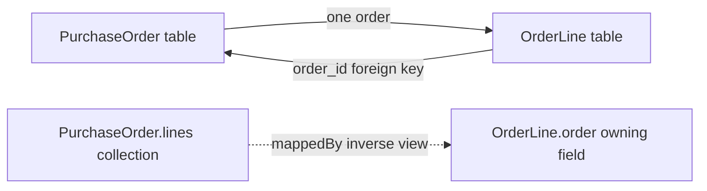
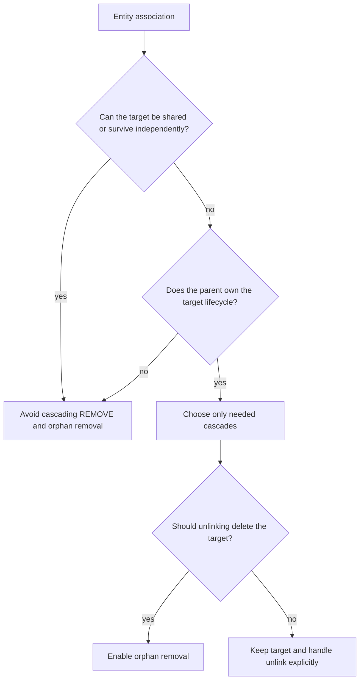

Relational relationships are stored with foreign keys and join tables; Java applications often want to navigate them as object references and collections. Jakarta Persistence associations connect those models, but the annotations do not remove the need to understand which table stores the foreign key or which side writes it.

Examples use Jakarta Persistence 3.2 and Hibernate ORM 7.2.25.Final, compatible with Java 17 or 21 according to the Hibernate ORM guide. The snippets illustrate mappings; the repository does not include these Java dependencies or a database schema.

## Foreign keys and the owning side

The **owning side** is the association mapping that controls updates to the foreign key or join table. For a common bidirectional one-to-many relationship, the foreign key is in the many-side table, so the `@ManyToOne` field owns it:



In this diagram, the collection is an object-navigation view. Setting only that collection does not update the owning relationship field, so keep both sides synchronized in Java:

```java
import jakarta.persistence.CascadeType;
import jakarta.persistence.Column;
import jakarta.persistence.Entity;
import jakarta.persistence.GeneratedValue;
import jakarta.persistence.GenerationType;
import jakarta.persistence.Id;
import jakarta.persistence.JoinColumn;
import jakarta.persistence.ManyToOne;
import jakarta.persistence.OneToMany;
import jakarta.persistence.Table;
import java.util.ArrayList;
import java.util.List;
import java.util.Objects;

@Entity
@Table(name = "purchase_order")
public class PurchaseOrder {
    @Id
    @GeneratedValue(strategy = GenerationType.IDENTITY)
    private Long id;

    @OneToMany(mappedBy = "order", cascade = CascadeType.ALL, orphanRemoval = true)
    private List<OrderLine> lines = new ArrayList<>();

    protected PurchaseOrder() {
    }

    public void addLine(String sku, int quantity) {
        OrderLine line = new OrderLine(sku, quantity, this);
        lines.add(line);
    }

    public void removeLine(OrderLine line) {
        if (lines.remove(line)) {
            line.detachFromOrder();
        }
    }

    public List<OrderLine> lines() {
        return List.copyOf(lines);
    }
}

@Entity
@Table(name = "order_line")
class OrderLine {
    @Id
    @GeneratedValue(strategy = GenerationType.IDENTITY)
    private Long id;

    @Column(nullable = false)
    private String sku;

    @Column(nullable = false)
    private int quantity;

    @ManyToOne(optional = false)
    @JoinColumn(name = "order_id", nullable = false)
    private PurchaseOrder order;

    protected OrderLine() {
    }

    OrderLine(String sku, int quantity, PurchaseOrder order) {
        this.sku = Objects.requireNonNull(sku);
        if (sku.isBlank() || quantity <= 0) {
            throw new IllegalArgumentException("Invalid order line");
        }
        this.quantity = quantity;
        this.order = Objects.requireNonNull(order);
    }

    void detachFromOrder() {
        order = null;
    }
}
```

`mappedBy = "order"` names the Java field on `OrderLine`, not a database column. The foreign key column is `order_id`, declared by `@JoinColumn` on the owning `@ManyToOne`.

The helper methods update the collection and the owning reference as one operation. Bypassing them can leave an inconsistent in-memory graph: the order may list a line whose `order` field is null or points to a different order. The inverse collection alone is not the source of truth for writing the foreign key.

Because `order_line.order_id` is non-null, clearing the Java reference during removal is only safe when the same persistence operation removes that orphan row. Do not expose a general-purpose setter that allows application code to detach a line from its required order without either reassigning it or removing it.

## Unidirectional and bidirectional mappings

A **unidirectional** association exposes navigation in one direction. For example, `OrderLine` can reference its `PurchaseOrder` without the order keeping a collection. This is often simpler when the application only needs to navigate from line to order.

A **bidirectional** association exposes navigation on both sides. It does not create two database relationships; the sides represent one relationship, with an owner and an inverse side. The inverse side must identify the owning field using `mappedBy`.

Choose direction based on actual navigation and use cases. A collection on every parent can load large object graphs or encourage code to fetch data it does not need. Bidirectional mappings also require helper methods and equality semantics that behave safely with mutable identifiers and lazy proxies.

## The four cardinalities

| Mapping | Typical relational representation | Common use |
|---|---|---|
| `@ManyToOne` | Foreign key on this entity's table | Many order lines reference one order |
| `@OneToMany` | Inverse view of a foreign key on the target table, or an explicit join column/table | One order exposes its lines |
| `@OneToOne` | Unique foreign key, shared primary key, or join table | One user has one profile record |
| `@ManyToMany` | Join table with foreign keys to both entity tables | Students enroll in courses |

For `@OneToOne`, enforce uniqueness in the database with a unique foreign key or shared-primary-key mapping; the Java annotation alone does not ensure an existing production schema has the required constraint. For many-to-many, the join table represents each pair and should usually have a composite unique key so the same pair cannot be inserted twice.

## When many-to-many needs an entity

If the relationship itself has attributes—such as enrollment date, grade, membership role, or status—model the join table as an entity instead of a bare `@ManyToMany`. Then the relationship can have its own identity, constraints, lifecycle, and audit fields:

```text
Student 1 --- * Enrollment * --- 1 Course
```

The `Enrollment` entity would own foreign keys to both `Student` and `Course`, and hold relationship attributes such as `enrolled_at` or `grade`. This also avoids treating a shared `Course` as a child whose lifecycle belongs to one `Student`.

## Cascade operations and orphan removal

JPA does not cascade persistence operations by default. A `cascade` setting propagates selected entity manager operations from one associated entity to another. `CascadeType.ALL` includes `PERSIST`, `MERGE`, `REMOVE`, `REFRESH`, and `DETACH`; it is appropriate only when the target's lifecycle is genuinely owned by the source aggregate.

`orphanRemoval = true` means removing a target from the relationship causes the provider to apply remove semantics to that target. In the example, an `OrderLine` has no meaning outside its owning order, so this may express the domain correctly. It is unsafe for shared entities such as `Course`, `Product`, or `Role`; removing a relationship from one parent must not delete an object still used elsewhere.

Think of the decision in terms of lifecycle ownership:



Avoid adding `CascadeType.ALL` reflexively. For example, cascading removal from an order to its lines may be correct, but cascading removal from a student to shared courses can delete data belonging to other students. Database foreign-key delete actions and JPA cascades are separate mechanisms; make sure both match the intended lifecycle.

## Fetch behavior and hidden queries

Fetch defaults differ by association kind in Jakarta Persistence: to-one associations default to `EAGER`, while to-many associations default to `LAZY`. `EAGER` is a requirement that the provider fetch the association eagerly; `LAZY` is generally a hint and may not be honored in every situation.

Avoid marking every association eager to prevent a later lazy-load exception. It can cause large queries, duplicate rows, or extra round trips. Prefer a query-specific fetch plan for the use case and inspect generated SQL. The [Hibernate Performance Tuning](./hibernate-performance-tuning) lesson covers N+1 queries, fetch joins, entity graphs, and caching in detail.

## Practical rules

- Identify which table contains the foreign key before choosing the owning side.
- In a bidirectional mapping, set both Java references in one helper; `mappedBy` is not a second write path.
- Use `mappedBy` with the exact owning Java attribute name.
- Choose cascade and orphan-removal behavior from domain lifecycle ownership, not convenience.
- Model a many-to-many join as an entity when the relationship has data or an independent lifecycle.
- Add database constraints through reviewed migrations; annotations do not retrofit production schemas by themselves.
- Treat lazy/eager behavior as a query design decision and verify the SQL generated by the provider.

## Further reading

- Jakarta Persistence 3.2 API, [`ManyToOne`](https://jakarta.ee/specifications/persistence/3.2/apidocs/jakarta.persistence/jakarta/persistence/ManyToOne.html)
- Jakarta Persistence 3.2 API, [`OneToMany`](https://jakarta.ee/specifications/persistence/3.2/apidocs/jakarta.persistence/jakarta/persistence/OneToMany.html)
- Jakarta Persistence 3.2 API, [`OneToOne`](https://jakarta.ee/specifications/persistence/3.2/apidocs/jakarta.persistence/jakarta/persistence/OneToOne.html)
- Jakarta Persistence 3.2 API, [`ManyToMany`](https://jakarta.ee/specifications/persistence/3.2/apidocs/jakarta.persistence/jakarta/persistence/ManyToMany.html)
- Jakarta Persistence 3.2 API, [`JoinColumn`](https://jakarta.ee/specifications/persistence/3.2/apidocs/jakarta.persistence/jakarta/persistence/JoinColumn.html)
- [JPA and Hibernate Basics](./jpa-and-hibernate-basics)
