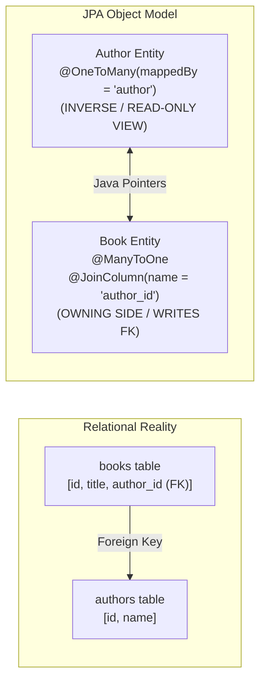
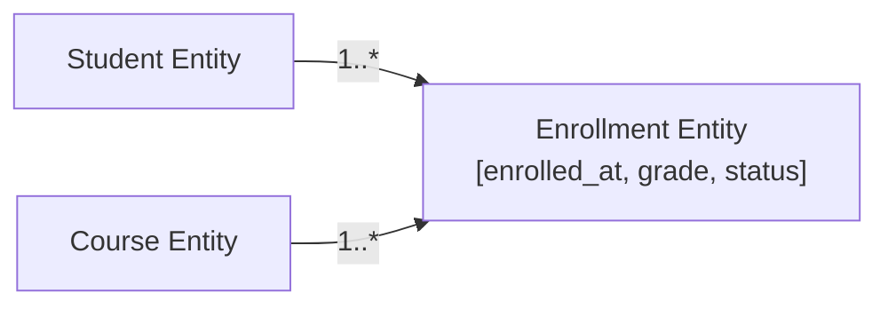

In pure Java, modeling an association between two classes feels effortless:

```java
public class Author {
    private List<Book> books = new ArrayList<>();
}

public class Book {
    private Author author;
}
```

In memory, navigating from `author.getBooks()` and navigating from `book.getAuthor()` feels completely symmetrical.

**In a relational database, symmetry does not exist.**

A relational database knows nothing about bidirectional object pointers. There is only a `books` table containing an `author_id` foreign key column pointing to the `authors` table. 

When developers attempt to map bidirectional object graphs onto relational schemas without understanding JPA's **Owning Side Contract**, severe production bugs emerge: foreign keys are saved as `NULL`, ghost update queries thrash the database, and deleting a customer accidentally wipes out half the database through improper cascade rules.



---

## The Owning Side Contract: The Rule of mappedBy

In JPA, every bidirectional association has two sides:
1. **The Owning Side**: The entity that physically owns the foreign key column in the database table. It is annotated with `@ManyToOne` or `@JoinColumn`. **Hibernate inspects ONLY the owning side to determine which foreign key values to write to disk.**
2. **The Inverse (Referenced) Side**: The entity that contains the `mappedBy` attribute. It is purely a read-only mirror used for object traversal in Java. Hibernate completely ignores the inverse collection when generating SQL `INSERT` and `UPDATE` statements!

### The Silent NULL Foreign Key Bug

Consider this widespread rookie mistake:

```java
// BUGGY PRODUCTION CODE:
Author author = new Author("George Orwell");
Book book = new Book("1984");

// Developer adds the book to the author's list:
author.getBooks().add(book);

em.persist(author);
em.persist(book);
```

When this transaction commits, Hibernate executes two `INSERT` statements:
1. `INSERT INTO authors (id, name) VALUES (1, 'George Orwell')`
2. `INSERT INTO books (id, title, author_id) VALUES (101, '1984', NULL)`

The `author_id` is written as **`NULL`**! 

Why? Because the developer mutated only the `author.getBooks()` collection on the inverse side. Because that collection has `mappedBy = "author"`, Hibernate ignored it! The `book.author` reference on the owning side remained `null`, so Hibernate faithfully wrote `NULL` into the foreign key column.

### The Remedy: Defensive Bidirectional Synchronization Helpers

Never expose raw mutable collection getters that allow callers to mutate one side of a relationship without updating the other. Always encapsulate synchronization inside defensive helper methods:

```java
import jakarta.persistence.*;
import java.util.ArrayList;
import java.util.Collections;
import java.util.List;
import java.util.Objects;

@Entity
@Table(name = "authors")
public class Author {
    @Id
    @GeneratedValue(strategy = GenerationType.SEQUENCE, generator = "author_seq")
    @SequenceGenerator(name = "author_seq", sequenceName = "authors_seq", allocationSize = 50)
    private Long id;

    @Column(nullable = false)
    private String name;

    // INVERSE SIDE: mappedBy points to the 'author' field in Book.java
    @OneToMany(mappedBy = "author", cascade = CascadeType.ALL, orphanRemoval = true)
    private List<Book> books = new ArrayList<>();

    protected Author() {}

    public Author(String name) {
        this.name = Objects.requireNonNull(name);
    }

    // MANDATORY BIDIRECTIONAL HELPER: Keeps both memory pointers in sync!
    public void addBook(Book book) {
        books.add(book);
        book.setAuthor(this); // Updates the OWNING side!
    }

    public void removeBook(Book book) {
        books.remove(book);
        book.setAuthor(null); // Updates the OWNING side!
    }

    public Long getId() { return id; }
    public String getName() { return name; }
    
    // Return unmodifiable list to prevent direct collection modification!
    public List<Book> getBooks() { 
        return Collections.unmodifiableList(books); 
    }
}

@Entity
@Table(name = "books")
public class Book {
    @Id
    @GeneratedValue(strategy = GenerationType.SEQUENCE, generator = "book_seq")
    @SequenceGenerator(name = "book_seq", sequenceName = "books_seq", allocationSize = 50)
    private Long id;

    @Column(nullable = false)
    private String title;

    // OWNING SIDE: Owns the 'author_id' foreign key in the database
    @ManyToOne(fetch = FetchType.LAZY, optional = false)
    @JoinColumn(name = "author_id", nullable = false)
    private Author author;

    protected Book() {}

    public Book(String title) {
        this.title = Objects.requireNonNull(title);
    }

    // Package-private setter accessed by Author.addBook()
    void setAuthor(Author author) {
        this.author = author;
    }

    public Long getId() { return id; }
    public String getTitle() { return title; }
    public Author getAuthor() { return author; }
}
```

---

## Why Unidirectional @OneToMany Is an Antipattern

If you do not want a `book.getAuthor()` reference in your code, you might be tempted to create a **unidirectional `@OneToMany`**:

```java
// ANTIPATTERN: Unidirectional @OneToMany
@Entity
public class Order {
    @Id private Long id;

    @OneToMany(cascade = CascadeType.ALL)
    @JoinColumn(name = "order_id") // Foreign key in order_items table
    private List<OrderItem> items = new ArrayList<>();
}
```

While this compiles and maps cleanly, observe the terrible SQL that Hibernate executes when saving an order with two items:

```sql
-- 1. Insert parent order
INSERT INTO orders (id) VALUES (1);

-- 2. Insert items with NULL foreign key!
INSERT INTO order_items (id, product) VALUES (10, 'Book');
INSERT INTO order_items (id, product) VALUES (11, 'Pen');

-- 3. Additional UPDATE statements to backfill the foreign keys!
UPDATE order_items SET order_id = 1 WHERE id = 10;
UPDATE order_items SET order_id = 1 WHERE id = 11;
```

Because `OrderItem` has no reference to its parent `Order`, Hibernate cannot know the `order_id` foreign key when inserting the item rows. It is forced to insert them with `NULL`, and then execute an extra round of `UPDATE` statements to fix the foreign keys!

If the `order_id` column has a database `NOT NULL` constraint, the initial insert fails immediately.

> [!TIP]
> **Golden Architecture Rule**: Avoid unidirectional `@OneToMany`. Always prefer either a **bidirectional `@OneToMany` / `@ManyToOne`**, or a **unidirectional `@ManyToOne`** from the child pointing to the parent.

---

## The Four Relationship Cardinalities

| Cardinality | Default Fetch | Recommended Fetch | Storage Mechanism |
| :--- | :--- | :--- | :--- |
| **`@ManyToOne`** | **`EAGER`** | **`LAZY`** (Always override!) | Foreign key column in this entity's table. |
| **`@OneToMany`** | **`LAZY`** | **`LAZY`** | Foreign key in child table (mappedBy) or join table. |
| **`@OneToOne`** | **`EAGER`** | **`LAZY`** | Unique foreign key or shared primary key (`@MapsId`). |
| **`@ManyToMany`** | **`LAZY`** | **`LAZY`** | Intermediate join table containing two foreign keys. |

> [!CAUTION]
> In the JPA specification, **`@ManyToOne` and `@OneToOne` default to `FetchType.EAGER`**!
> Eager fetching is the primary cause of catastrophic N+1 query floods and memory starvation. **Always explicitly override to `fetch = FetchType.LAZY` on every single `@ManyToOne` and `@OneToOne` mapping in your application.**

---

## The @OneToOne Lazy Loading Trap

A famous trap in Hibernate architecture involves lazy loading on bidirectional `@OneToOne` associations:

```java
@Entity
public class User {
    @Id private Long id;

    // Owning side: stores profile_id
    @OneToOne(fetch = FetchType.LAZY)
    @JoinColumn(name = "profile_id")
    private UserProfile profile;
}

@Entity
public class UserProfile {
    @Id private Long id;

    // INVERSE SIDE:
    @OneToOne(mappedBy = "profile", fetch = FetchType.LAZY)
    private User user;
}
```

If you query `em.find(UserProfile.class, 1L)`, Hibernate **ignores `fetch = FetchType.LAZY` on the inverse side and executes an immediate eager SQL query for the `User`!**

### Why Hibernate Breaks Lazy Loading on Inverse @OneToOne

To implement lazy loading in Java, Hibernate replaces the associated object with a runtime bytecode proxy (via ByteBuddy).

When loading `UserProfile`, Hibernate must decide whether `user` is:
1. A valid proxy pointing to an existing `User`.
2. `null` (because this profile has no associated user).

In the database, the foreign key column lives on the `users` table. The `user_profiles` table contains zero columns referencing `users`. 

To know whether `user` is `null` or an object, Hibernate **has no choice but to query the `users` table immediately**. It cannot assign a proxy because in Java, a proxy cannot magically become `null` later!

### The Solution: Shared Primary Key with @MapsId

Instead of maintaining a separate foreign key, make the child entity share the exact primary key of the parent using `@MapsId`:

```java
@Entity
public class UserProfile {
    @Id
    private Long id; // Matches User id!

    @OneToOne(fetch = FetchType.LAZY)
    @MapsId // Copies the primary key from User
    @JoinColumn(name = "user_id")
    private User user;
}
```

---

## Rich Many-to-Many: Why Intermediate Entities Are Mandatory

In textbooks, many-to-many relationships are mapped using raw `@ManyToMany`:

```java
// TEXTBOOK MANY-TO-MANY (FLAWED FOR REAL BUSINESSES):
@ManyToMany
@JoinTable(name = "student_courses",
    joinColumns = @JoinColumn(name = "student_id"),
    inverseJoinColumns = @JoinColumn(name = "course_id"))
private Set<Course> courses = new HashSet<>();
```

This works until your product manager asks a simple question:
- *"When did the student enroll in the course?"*
- *"What grade did the student receive?"*
- *"Is their enrollment active, audited, or dropped?"*

A raw `@ManyToMany` join table cannot store attributes. It can only store two foreign key IDs.

In enterprise systems, **always promote many-to-many relationships to an explicit intermediate entity**:



```java
import jakarta.persistence.*;
import java.time.Instant;
import java.util.Objects;

@Entity
@Table(name = "enrollments")
public class Enrollment {
    @EmbeddedId
    private EnrollmentId id;

    @ManyToOne(fetch = FetchType.LAZY)
    @MapsId("studentId")
    @JoinColumn(name = "student_id")
    private Student student;

    @ManyToOne(fetch = FetchType.LAZY)
    @MapsId("courseId")
    @JoinColumn(name = "course_id")
    private Course course;

    @Column(name = "enrolled_at", nullable = false)
    private Instant enrolledAt;

    @Column(name = "grade")
    private String grade;

    protected Enrollment() {}

    public Enrollment(Student student, Course course) {
        this.student = Objects.requireNonNull(student);
        this.course = Objects.requireNonNull(course);
        this.id = new EnrollmentId(student.getId(), course.getId());
        this.enrolledAt = Instant.now();
    }

    // Getters and Business Logic
}

@Embeddable
public record EnrollmentId(Long studentId, Long courseId) implements java.io.Serializable {}
```

---

## Cascades and Orphan Removal: Understanding Ownership

A cascade propagates an `EntityManager` operation (`PERSIST`, `MERGE`, `REMOVE`) across associations.

- **`CascadeType.ALL`**: Propagates all operations. Appropriate **only** when the child entity's lifecycle is completely owned by the parent (e.g., an `Order` owns its `OrderItems`).
- **`orphanRemoval = true`**: If a child entity is removed from the parent's collection (`order.getItems().remove(item)`), Hibernate automatically generates a SQL `DELETE` statement to remove the row from the database.

### The Catastrophic CascadeType.REMOVE Bug

```java
// SEVERE ARCHITECTURAL DEFECT:
@Entity
public class User {
    // Shared lookup table!
    @ManyToOne(cascade = CascadeType.ALL) // DANGEROUS!
    private UserRole role; 
}
```

If you delete a `User` entity from the database via `em.remove(user)`, `CascadeType.ALL` propagates the `REMOVE` operation to `UserRole`. 

Hibernate executes:
```sql
DELETE FROM users WHERE id = 42;
DELETE FROM roles WHERE id = 1; -- DELETED THE 'ADMIN' ROLE FOR THE ENTIRE COMPANY!
```

> [!CAUTION]
> **Never cascade `REMOVE` across shared entities, lookups, or many-to-one parents.** Cascades should flow strictly downward from aggregate roots to private child components.

---

## The equals() and hashCode() Contract in JPA Entities

Implementing `equals()` and `hashCode()` for JPA entities is notoriously tricky because entities are **mutable, identity-driven objects whose IDs change during their lifecycle**:

1. When instantiated via `new User()`, `id` is `null`.
2. When saved via `em.persist()`, `id` is populated with a generated number (e.g., 42).
3. If `hashCode()` is calculated using `id`, the hash code of the object **changes after persistence**!

If the entity was placed in a `HashSet` while transient, changing its hash code corrupts the `HashSet` bucket structure. Calling `set.contains(user)` will return `false`, even though the object is sitting right inside the set!

### The Best Practice: Natural Business Key or Stable ID Equality

```java
@Entity
@Table(name = "customers")
public class Customer {
    @Id
    @GeneratedValue(strategy = GenerationType.SEQUENCE)
    private Long id;

    // Natural Business Key (Immutable & Unique)
    @Column(nullable = false, unique = true)
    private String email;

    @Override
    public boolean equals(Object o) {
        if (this == o) return true;
        if (!(o instanceof Customer other)) return false;
        
        // If natural key is present, compare by business identity
        return email != null && email.equalsIgnoreCase(other.email);
    }

    @Override
    public int hashCode() {
        // Must use constant or immutable business key to prevent bucket corruption
        return Objects.hash(email != null ? email.toLowerCase() : 0);
    }
}
```

If no natural business key exists, Vlad Mihalcea's canonical recommendation is to compare by class equality and persistent ID, while returning a fixed constant integer for `hashCode()` (ensuring the object remains in the same hash bucket before and after database generation).

---

## Senior Engineer Interview Crucible

### What is the exact purpose of the mappedBy attribute, and what happens if you add an entity to an inverse collection without setting the owning side reference?
In a bidirectional JPA association, the `mappedBy` attribute designates the **inverse (non-owning) side** of the relationship. It informs Hibernate: *"The database foreign key is owned and managed by the field named in `mappedBy` on the target entity class; do not inspect this collection when generating SQL write statements."*

If an application adds a child entity to an inverse collection (`parent.getChildren().add(child)`) but fails to set the child's reference (`child.setParent(parent)`), Hibernate generates SQL `INSERT` statements with `NULL` in the child's foreign key column. The relationship is never persisted in the database, even though it appears connected in Java memory.

### Why is unidirectional @OneToMany considered an antipattern in Hibernate, and how does bidirectional mapping fix it?
In a unidirectional `@OneToMany`, the parent entity holds a collection of children, but the child has no reference back to the parent. 

Because the child has no knowledge of its parent during instantiation, Hibernate cannot supply the parent's foreign key when executing the child's initial SQL `INSERT`. As a result, Hibernate is forced to:
1. Insert the child rows with `NULL` foreign keys.
2. Execute additional, separate SQL `UPDATE` statements for each child to backfill the parent foreign key ID.

This doubles network query overhead and fails if the foreign key column is marked `NOT NULL`. A bidirectional mapping fixes this because the child's `@ManyToOne` owning reference provides the foreign key directly during the initial `INSERT`, eliminating the extra `UPDATE` queries.

### Why does @OneToOne lazy loading fail on the non-owning (inverse) side in standard Hibernate, forcing eager SQL queries?
To implement lazy loading, Hibernate substitutes associations with bytecode proxy instances. A proxy can only be created if Hibernate knows that the target entity actually exists in the database.

On the inverse side of a `@OneToOne` association (the side with `mappedBy`), the foreign key does not live in that entity's table. When loading the inverse entity, Hibernate cannot know from its local table row whether the associated entity exists or is `null`. 

Because a Java reference cannot be lazily initialized from a proxy into `null` without throwing a `NullPointerException` on access, Hibernate is forced to execute an immediate SQL query to check if the foreign record exists, completely breaking the `FetchType.LAZY` directive.

### How should equals() and hashCode() be implemented for JPA entities to prevent hash-collision bugs in collections when entities are persisted?
Entities must maintain a stable hash code across all four lifecycle states (Transient, Managed, Detached, Removed). 

If `hashCode()` is computed using an auto-generated database `@Id`, the hash code changes from `null` to a number upon `em.persist()`. If the entity was stored in a `HashSet` prior to persistence, the mutated hash code corrupts the bucket position, causing `set.contains(entity)` to fail.

The recommended approaches:
1. **Natural Business Key**: Base `equals()` and `hashCode()` on an immutable, unique business identifier (such as `email`, `isbn`, or `uuid`).
2. **Fixed HashCode Pattern**: If no natural key exists, use `id` for `equals()` (handling nulls safely via `other.getId() != null && this.id.equals(other.getId())`), and return a **constant static integer** (e.g., `return getClass().hashCode();`) from `hashCode()`. Returning a constant ensures all instances share a single hash bucket, maintaining collection contract stability before and after database identity generation.
