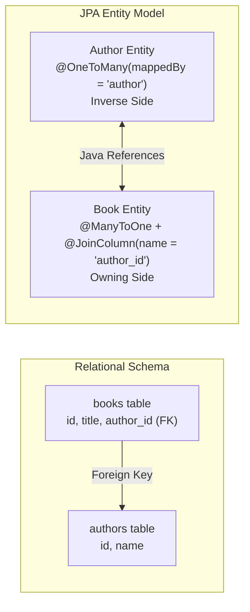
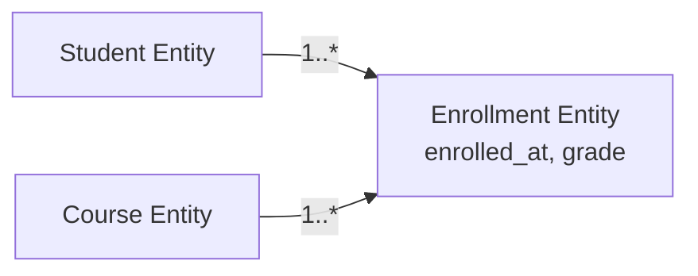

In plain Java, modeling a relationship between two classes looks symmetrical: an `Author` holds a `List<Book>`, and each `Book` holds a reference to its `Author`. You can navigate in either direction just by following object references.

Relational databases do not work that way. There are no bidirectional pointers between rows. Instead, there is a single foreign key column, `author_id`, sitting on the `books` table and pointing to `authors.id`.

Most JPA relationship bugs happen when Java object graphs drift out of sync with that underlying foreign key model. Foreign keys get saved as `NULL`, Hibernate quietly creates extra join tables or fires unnecessary `UPDATE` statements, or a misplaced `CascadeType.REMOVE` deletes shared reference rows when you only meant to delete one record.



## The Four Relationship Cardinalities

JPA provides four annotations corresponding to relational cardinalities. Every association also carries a default fetch type defined by the Jakarta Persistence specification:

| Annotation | Default Fetch Type | Recommended Fetch Type | Relational Mapping |
| :--- | :--- | :--- | :--- |
| `@ManyToOne` | `EAGER` | `LAZY` | Foreign key column on the current entity's table. |
| `@OneToMany` | `LAZY` | `LAZY` | Foreign key on the child table (`mappedBy`) or a join table. |
| `@OneToOne` | `EAGER` | `LAZY` | Unique foreign key column, or shared primary key via `@MapsId`. |
| `@ManyToMany` | `LAZY` | `LAZY` | Join table with two foreign keys. |

Because `@ManyToOne` and `@OneToOne` default to `FetchType.EAGER`, forgetting to override them causes Hibernate to load associated rows even when your use case never touches them. Explicitly specify `fetch = FetchType.LAZY` on every `@ManyToOne` and `@OneToOne` association, then fetch associations deliberately per query when you need them.

## Unidirectional vs Bidirectional Mapping and mappedBy

A **unidirectional** association exists on only one entity (for example, `Book` has an `Author` field, while `Author` has no `books` field). Start with unidirectional mappings by default. Add the second direction only when your domain logic genuinely needs to navigate from the other side.

When you do map a **bidirectional** association, JPA splits responsibility into two sides:

- **The Owning Side** maps the physical foreign key column (or join table). In a one-to-many / many-to-one pair, the `@ManyToOne` side is almost always the owning side because the child table holds the foreign key. Hibernate reads *only* the owning side when writing foreign key values to the database.
- **The Inverse Side** declares the `mappedBy` attribute, naming the Java field on the owning entity that manages the foreign key. Hibernate uses the inverse side for querying and traversal, but ignores changes made exclusively to the inverse collection during `INSERT` and `UPDATE`.

### The Silent NULL Foreign Key Mistake

Consider what happens if you mutate only the inverse collection:

```java
// Bug: only the inverse side (Author.books) is updated
Author author = new Author("George Orwell");
Book book = new Book("1984");

author.getBooks().add(book);
em.persist(author);
em.persist(book);
```

Hibernate executes:

```sql
INSERT INTO authors (id, name) VALUES (1, 'George Orwell');
INSERT INTO books (id, title, author_id) VALUES (101, '1984', NULL);
```

Because `author.books` has `mappedBy = "author"`, Hibernate ignores it when setting `author_id`. The owning field `book.author` is still `null`, so `author_id` is written as `NULL` (or fails with a constraint violation if the column is `NOT NULL`).

### Keeping Both Sides Synchronized with Helper Methods

The standard way to prevent this drift is to encapsulate relationship mutations inside helper methods on the parent entity, and avoid exposing a raw mutable collection getter:

```java
import jakarta.persistence.CascadeType;
import jakarta.persistence.Column;
import jakarta.persistence.Entity;
import jakarta.persistence.FetchType;
import jakarta.persistence.GeneratedValue;
import jakarta.persistence.GenerationType;
import jakarta.persistence.Id;
import jakarta.persistence.JoinColumn;
import jakarta.persistence.ManyToOne;
import jakarta.persistence.OneToMany;
import jakarta.persistence.SequenceGenerator;
import jakarta.persistence.Table;
import java.util.ArrayList;
import java.util.Collections;
import java.util.List;
import java.util.Objects;

@Entity
@Table(name = "authors")
public class Author {

    @Id
    @GeneratedValue(strategy = GenerationType.SEQUENCE, generator = "author_seq")
    @SequenceGenerator(name = "author_seq", sequenceName = "authors_seq", allocationSize = 50)
    private Long id;

    @Column(nullable = false)
    private String name;

    // Inverse side: points to the 'author' field on Book
    @OneToMany(mappedBy = "author", cascade = CascadeType.ALL, orphanRemoval = true)
    private List<Book> books = new ArrayList<>();

    protected Author() {}

    public Author(String name) {
        this.name = Objects.requireNonNull(name);
    }

    public void addBook(Book book) {
        Objects.requireNonNull(book);
        books.add(book);
        book.setAuthor(this); // Keep the owning side in sync
    }

    public void removeBook(Book book) {
        Objects.requireNonNull(book);
        books.remove(book);
        book.setAuthor(null); // Clear the owning side
    }

    public Long getId() { return id; }
    public String getName() { return name; }

    public List<Book> getBooks() {
        return Collections.unmodifiableList(books);
    }
}

@Entity
@Table(name = "books")
public class Book {

    @Id
    @GeneratedValue(strategy = GenerationType.SEQUENCE, generator = "book_seq")
    @SequenceGenerator(name = "book_seq", sequenceName = "books_seq", allocationSize = 50)
    private Long id;

    @Column(nullable = false)
    private String title;

    // Owning side: controls the author_id foreign key column
    @ManyToOne(fetch = FetchType.LAZY, optional = false)
    @JoinColumn(name = "author_id", nullable = false)
    private Author author;

    protected Book() {}

    public Book(String title) {
        this.title = Objects.requireNonNull(title);
    }

    void setAuthor(Author author) {
        this.author = author;
    }

    public Long getId() { return id; }
    public String getTitle() { return title; }
    public Author getAuthor() { return author; }
}
```

Calling `author.addBook(book)` updates both the in-memory list and the owning `book.author` reference in one place, so the object graph stays consistent within the current transaction and the foreign key is written cleanly on the initial `INSERT`.

## Why Unidirectional @OneToMany Causes Extra SQL

Sometimes developers omit the `@ManyToOne` field on the child entity and put `@OneToMany` on the parent by itself. Depending on how you annotate it, Hibernate falls into one of two inefficient SQL patterns:

1. **Without `@JoinColumn` (default)**: Hibernate assumes you want a third **join table** (for example, `orders_order_items`) to store `(order_id, items_id)`. Every insert and delete now touches an extra table, and queries require an extra join.
2. **With `@JoinColumn(name = "order_id")`**: Hibernate places the foreign key on `order_items`, but because `OrderItem` has no `order` reference, Hibernate cannot supply `order_id` when inserting the child row.

```java
// Unidirectional @OneToMany with @JoinColumn
@Entity
@Table(name = "orders")
public class Order {
    @Id
    private Long id;

    @OneToMany(cascade = CascadeType.ALL, orphanRemoval = true)
    @JoinColumn(name = "order_id")
    private List<OrderItem> items = new ArrayList<>();
}
```

Persisting an order with two items generates four writes instead of three:

```sql
INSERT INTO orders (id) VALUES (1);
INSERT INTO order_items (id, product) VALUES (10, 'Book');
INSERT INTO order_items (id, product) VALUES (11, 'Pen');
UPDATE order_items SET order_id = 1 WHERE id = 10;
UPDATE order_items SET order_id = 1 WHERE id = 11;
```

If `order_items.order_id` has a `NOT NULL` constraint in the database, those initial `INSERT` statements fail outright.

In almost every case, prefer either a **unidirectional `@ManyToOne`** on the child (querying children by parent ID via a repository when needed) or a **bidirectional `@OneToMany(mappedBy = ...)` / `@ManyToOne`** pair.

## @OneToOne Mapping and @MapsId

A `@OneToOne` association has a well-known lazy-loading quirk in Hibernate when mapped bidirectionally with a regular foreign key:

```java
@Entity
@Table(name = "users")
public class User {
    @Id
    private Long id;

    @OneToOne(fetch = FetchType.LAZY)
    @JoinColumn(name = "profile_id")
    private UserProfile profile;
}

@Entity
@Table(name = "user_profiles")
public class UserProfile {
    @Id
    private Long id;

    // Inverse side: Hibernate ignores FetchType.LAZY here!
    @OneToOne(mappedBy = "profile", fetch = FetchType.LAZY)
    private User user;
}
```

When you load a `UserProfile`, Hibernate has to populate its `user` field with either `null` (if no `User` points to this profile) or a ByteBuddy proxy (if one does). Because `user_profiles` has no foreign key column pointing to `users`, Hibernate cannot tell from the `user_profiles` row alone whether a matching `User` exists. A proxy cannot later turn into `null` in Java, so Hibernate has to execute an immediate `SELECT` against `users` anyway, defeating `FetchType.LAZY`.

### Sharing the Primary Key with @MapsId

If the child cannot exist without the parent, the cleanest solution is a **unidirectional `@OneToOne` on the child using `@MapsId`**. The child's primary key is also its foreign key to the parent:

```java
@Entity
@Table(name = "user_profiles")
public class UserProfile {

    @Id
    private Long id; // Shares the exact same value as User.id

    @OneToOne(fetch = FetchType.LAZY, optional = false)
    @MapsId
    @JoinColumn(name = "user_id")
    private User user;

    @Column(name = "bio", length = 500)
    private String bio;

    protected UserProfile() {}

    public UserProfile(User user, String bio) {
        this.user = Objects.requireNonNull(user);
        this.bio = bio;
    }

    public Long getId() { return id; }
    public User getUser() { return user; }
    public String getBio() { return bio; }
}
```

Using `@MapsId` gives you three immediate benefits:

- You do not need a second unique index on a separate `user_id` column because the primary key index already enforces uniqueness.
- Loading `User` never triggers a query against `user_profiles` because `User` does not even need an inverse `@OneToOne` field.
- When you do need the profile for a given user, you can fetch it directly by primary key with `em.find(UserProfile.class, user.getId())`.

## @ManyToMany: Set vs List and Explicit Join Entities

A `@ManyToMany` relationship maps through an intermediate join table containing two foreign keys.

### Why Set Beats List on @ManyToMany

If you map a `@ManyToMany` association using a `List` (an unordered bag in Hibernate), removing a single element triggers surprisingly wasteful SQL:

```java
// Avoid List on @ManyToMany
@ManyToMany(cascade = {CascadeType.PERSIST, CascadeType.MERGE})
@JoinTable(
    name = "post_tags",
    joinColumns = @JoinColumn(name = "post_id"),
    inverseJoinColumns = @JoinColumn(name = "tag_id")
)
private List<Tag> tags = new ArrayList<>();
```

Because a `List` without an order column can hold duplicates and has no unique element identity in the join table, calling `post.removeTag(tag)` causes Hibernate to **delete every row for that post from `post_tags` and re-insert all remaining tags**:

```sql
-- Removing 1 tag from a post that has 5 tags:
DELETE FROM post_tags WHERE post_id = 10;
INSERT INTO post_tags (post_id, tag_id) VALUES (10, 1);
INSERT INTO post_tags (post_id, tag_id) VALUES (10, 2);
INSERT INTO post_tags (post_id, tag_id) VALUES (10, 3);
INSERT INTO post_tags (post_id, tag_id) VALUES (10, 4);
```

Switching the collection type to a `Set<Tag>` (with proper `equals()` and `hashCode()` on `Tag`) lets Hibernate issue a single targeted delete:

```sql
DELETE FROM post_tags WHERE post_id = 10 AND tag_id = 5;
```

```java
@Entity
@Table(name = "posts")
public class Post {

    @Id
    @GeneratedValue(strategy = GenerationType.SEQUENCE, generator = "post_seq")
    @SequenceGenerator(name = "post_seq", sequenceName = "posts_seq", allocationSize = 50)
    private Long id;

    // Set ensures targeted DELETEs; avoid CascadeType.REMOVE on shared Tags
    @ManyToMany(cascade = {CascadeType.PERSIST, CascadeType.MERGE})
    @JoinTable(
        name = "post_tags",
        joinColumns = @JoinColumn(name = "post_id"),
        inverseJoinColumns = @JoinColumn(name = "tag_id")
    )
    private Set<Tag> tags = new HashSet<>();

    public void addTag(Tag tag) {
        tags.add(tag);
        tag.getPostsInternal().add(this);
    }

    public void removeTag(Tag tag) {
        tags.remove(tag);
        tag.getPostsInternal().remove(this);
    }
}
```

### Promoting @ManyToMany to an Intermediate Entity

A raw `@ManyToMany` works for simple tagging where the join table only holds two IDs. As soon as the relationship needs its own attributes (when a student enrolled, what grade they earned, who granted a role), replace `@ManyToMany` with an explicit join entity connected by two `@ManyToOne` associations.



```java
import jakarta.persistence.Column;
import jakarta.persistence.Embeddable;
import jakarta.persistence.EmbeddedId;
import jakarta.persistence.Entity;
import jakarta.persistence.FetchType;
import jakarta.persistence.JoinColumn;
import jakarta.persistence.ManyToOne;
import jakarta.persistence.MapsId;
import jakarta.persistence.Table;
import java.io.Serializable;
import java.time.Instant;
import java.util.Objects;

@Embeddable
public class EnrollmentId implements Serializable {
    private Long studentId;
    private Long courseId;

    protected EnrollmentId() {}

    public EnrollmentId(Long studentId, Long courseId) {
        this.studentId = studentId;
        this.courseId = courseId;
    }

    @Override
    public boolean equals(Object o) {
        if (this == o) return true;
        if (!(o instanceof EnrollmentId that)) return false;
        return Objects.equals(studentId, that.studentId)
            && Objects.equals(courseId, that.courseId);
    }

    @Override
    public int hashCode() {
        return Objects.hash(studentId, courseId);
    }
}

@Entity
@Table(name = "enrollments")
public class Enrollment {

    @EmbeddedId
    private EnrollmentId id;

    @ManyToOne(fetch = FetchType.LAZY, optional = false)
    @MapsId("studentId")
    @JoinColumn(name = "student_id")
    private Student student;

    @ManyToOne(fetch = FetchType.LAZY, optional = false)
    @MapsId("courseId")
    @JoinColumn(name = "course_id")
    private Course course;

    @Column(name = "enrolled_at", nullable = false, updatable = false)
    private Instant enrolledAt;

    @Column(name = "grade", length = 8)
    private String grade;

    protected Enrollment() {}

    public Enrollment(Student student, Course course) {
        this.student = Objects.requireNonNull(student);
        this.course = Objects.requireNonNull(course);
        this.id = new EnrollmentId(student.getId(), course.getId());
        this.enrolledAt = Instant.now();
    }

    public void assignGrade(String grade) {
        this.grade = grade;
    }
}
```

## Cascade Types and Orphan Removal

By default, JPA cascades **nothing**. Persisting or deleting a parent does not automatically persist or delete associated entities unless you configure `cascade`.

JPA defines six cascade options:

- `CascadeType.PERSIST`: Saving the parent via `em.persist()` also persists new associated children.
- `CascadeType.MERGE`: Merging a detached parent merges its associated children.
- `CascadeType.REMOVE`: Deleting the parent via `em.remove()` also deletes associated children.
- `CascadeType.REFRESH`: Refreshing the parent from the database refreshes its children.
- `CascadeType.DETACH`: Detaching the parent detaches its children.
- `CascadeType.ALL`: Shorthand for all five options above.

### CascadeType.REMOVE vs orphanRemoval = true

These two settings are related but trigger on different actions:

- **`CascadeType.REMOVE`** deletes child rows when the **parent itself is deleted** (`em.remove(order)`).
- **`orphanRemoval = true`** (available on `@OneToMany` and `@OneToOne`) *also* deletes a child row when you **remove the child from the parent's collection or clear the reference** (`order.removeItem(item)`), even though the parent still exists.

For true parent-child aggregates like `Order` and `OrderItem`, combining `cascade = CascadeType.ALL` with `orphanRemoval = true` on `@OneToMany` makes sense because an `OrderItem` has no meaning outside its `Order`.

### Where CascadeType.REMOVE Causes Data Loss

Never put `CascadeType.REMOVE` or `CascadeType.ALL` on `@ManyToOne` or `@ManyToMany` associations.

```java
// Dangerous: deleting one User attempts to delete the shared Role!
@Entity
@Table(name = "users")
public class User {
    @Id
    private Long id;

    @ManyToOne(fetch = FetchType.LAZY, cascade = CascadeType.ALL) // Wrong!
    @JoinColumn(name = "role_id")
    private Role role;
}
```

If you call `em.remove(user)` here, Hibernate propagates the delete to `Role`, attempting to delete a shared row (such as `ADMIN`) referenced by other users. On a `@ManyToMany` association like `Post` and `Tag`, `CascadeType.REMOVE` deletes the `Tag` rows themselves rather than just removing entries from the `post_tags` join table. On `@ManyToMany`, restrict cascades to `{CascadeType.PERSIST, CascadeType.MERGE}` at most, and leave `@ManyToOne` without `REMOVE`.

> [!CAUTION]
> Cascades should flow strictly from a parent aggregate root down to child entities whose lifecycle it exclusively owns, never upward from child to parent and never across shared entities.

## Practical Questions

### What does mappedBy do, and what happens if you only add to the inverse collection?
`mappedBy` marks the inverse (non-owning) side of a bidirectional association and tells Hibernate which field on the target entity owns the foreign key. Hibernate ignores the inverse collection when writing foreign keys to the database. If you call `author.getBooks().add(book)` without also setting `book.setAuthor(author)`, Hibernate inserts the `books` row with `author_id = NULL` (or throws a constraint error if the column is `NOT NULL`).

### Why does a unidirectional @OneToMany generate extra SQL statements?
Without `@JoinColumn`, Hibernate creates an extra join table to manage the relationship. With `@JoinColumn`, the foreign key lives in the child table, but the child entity has no reference to the parent, so Hibernate inserts child rows with a `NULL` foreign key and then issues a separate `UPDATE` per child to populate it. Making the child side the `@ManyToOne` owner lets Hibernate write the foreign key during the initial `INSERT`.

### Why should @ManyToMany collections use Set instead of List?
When `@ManyToMany` is mapped as an unordered `List`, Hibernate cannot identify a specific row in the join table to delete when an element is removed. Instead, it deletes all join-table rows for the parent entity and re-inserts the remaining ones. Using a `Set` (with proper `equals()` and `hashCode()`) allows Hibernate to execute a single `DELETE` for the removed association.

### How does @MapsId solve the @OneToOne lazy-loading issue?
On the inverse side of a regular `@OneToOne`, Hibernate ignores `FetchType.LAZY` because the local table lacks the foreign key column, forcing an immediate query to check whether the reference should be `null` or a proxy. With `@MapsId`, the child entity shares the parent's primary key as its own `@Id` and `@JoinColumn`, removing the need for an inverse `@OneToOne` field on the parent altogether.
