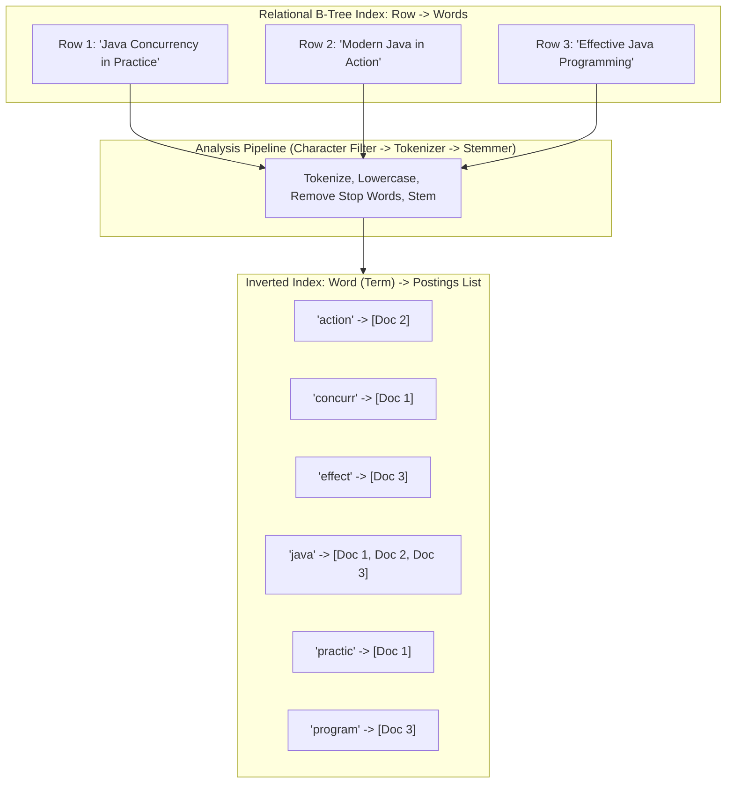
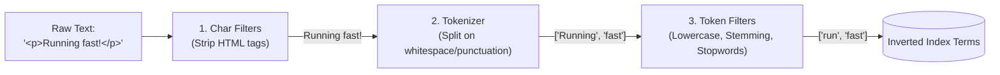
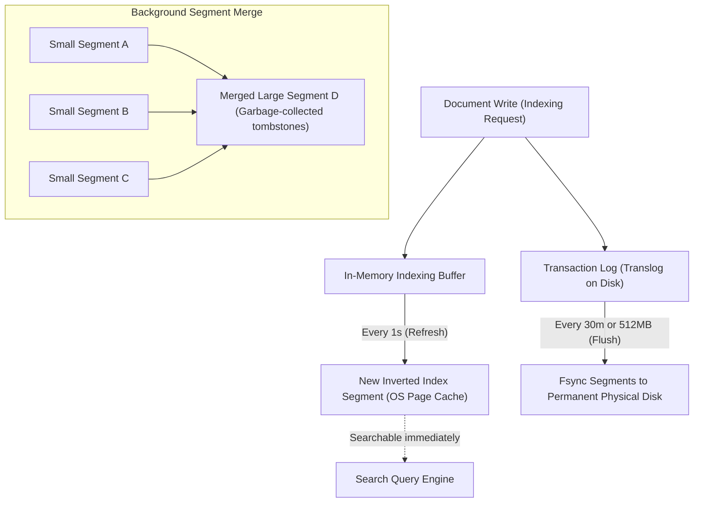
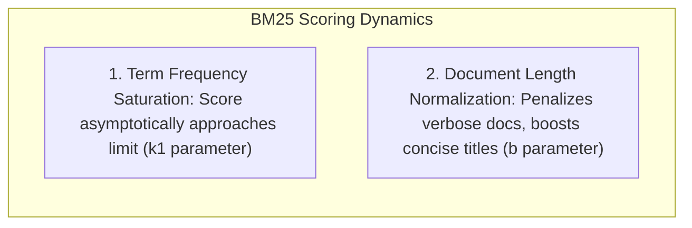

# Full-Text Search with Elasticsearch

Every backend engineer eventually encounters this ticket: *"Users need to search products by typing partial names, typos, brand names, or descriptions, sorted by relevance."*

The naive first instinct is almost always an SQL query:
```sql
SELECT * FROM products 
WHERE description ILIKE '%ergonomic chair%' 
   OR name ILIKE '%ergonomic chair%';
```

In staging with 500 rows, this query runs in 4 milliseconds. In production with 25 million rows, it triggers a catastrophic full-table scan. Because the pattern starts with a leading wildcard (`%`), standard B-Tree indexes are completely useless. Every single disk block must be read into memory, pinning the database CPU at 100% and causing query latency to explode to tens of seconds.

Relational databases were engineered for transactional integrity (ACID) and precise row lookups, not linguistic relevance. When your system requires linguistic stemming, typo tolerance, synonyms, multi-field relevance scoring, and sub-50ms query times across millions of records, you need a dedicated search engine built on **inverted indexes**: **Apache Lucene** and **Elasticsearch**.

---

## Why B-Trees Fail and Inverted Indexes Triumph

To understand why Elasticsearch dominates search, compare how a relational B-Tree index and an inverted index store textual data.



In a relational database, the table organizes rows by their Primary Key. Even if you place an index on `description`, the B-Tree organizes keys alphabetically by their prefix. It cannot answer questions like: *"Which documents contain the word 'concurrency' anywhere in their text?"* without checking every entry.

An **Inverted Index** flips the relationship upside down:
- It decomposes every document into distinct linguistic **terms** (tokens).
- For each term, it maintains a **Postings List**: a sorted list of Document IDs where that term appears, along with the term's frequency and positional offsets within each document.

When a user searches for `"Java Concurrency"`, Elasticsearch looks up `"java"` in memory (finding `[Doc 1, Doc 2, Doc 3]`) and `"concurr"` (finding `[Doc 1]`). It performs a rapid set intersection (`AND`) on the integer postings lists in microseconds, immediately identifying `Doc 1` as the primary match.

---

## The Text Analysis Pipeline: Under the Hood

When a document is indexed in Elasticsearch, its raw text passes through an **Analyzer**. An analyzer is a pipeline composed of three sequential stages:



### Stage 1: Character Filters

Character filters preprocess the raw character stream before tokenization. They can strip HTML tags (`html_strip`), convert specific characters (e.g., mapping `&` to `and`), or apply regex pattern replacements.

### Stage 2: Tokenizer

The tokenizer breaks the character stream into individual tokens.
- **Standard Tokenizer:** Splits text on word boundaries according to Unicode text segmentation rules, discarding punctuation.
- **Whitespace Tokenizer:** Splits purely on whitespace.
- **Edge N-Gram Tokenizer:** Breaks words into progressive prefixes (e.g., `"java"` becomes `["j", "ja", "jav", "java"]`). This enables lightning-fast auto-complete search-as-you-type queries without expensive wildcard scans.

### Stage 3: Token Filters

Token filters modify, add, or eliminate tokens produced by the tokenizer:
- **Lowercase Filter:** Normalizes all tokens to lowercase so that `"JAVA"`, `"Java"`, and `"java"` resolve to the same index entry.
- **Stop Token Filter:** Strips common function words with little semantic search value (e.g., `"the"`, `"is"`, `"at"`, `"which"`).
- **Stemmer Filter (e.g., Porter or Snowball):** Reduces words to their linguistic root stem. `"running"`, `"runs"`, and `"ran"` all collapse into the common term `"run"`. A search for `"run"` matches a document discussing `"running shoes"`.
- **Synonym Filter:** Injects alternative terms during indexing or querying (e.g., mapping `"laptop"` to also match `"notebook"`).

---

## Lucene Segments, Immutability, and the Refresh Cycle

Elasticsearch does not write directly to a single monolithic disk file. Under the hood, an Elasticsearch index is partitioned into physical **shards**, and each shard is an instance of an **Apache Lucene engine**.

Lucene organizes shards into smaller physical sub-indexes called **Segments**.



### The Power of Segment Immutability

Once written, a Lucene segment is **strictly immutable**. It is never modified on disk.

- **Lock-Free Reads:** Because segments never change, search queries do not require read locks. Thousands of concurrent reader threads can query the same segment without contention.
- **Filesystem Page Cache Friendly:** Because segment files remain static, the operating system caches them in RAM indefinitely without cache invalidation overhead.
- **Simpler Inverted Indexes:** An immutable index eliminates complex in-place block allocation and defragmentation algorithms.

### How Updates and Deletes Actually Work

If segments are immutable, how does Elasticsearch update a record?

- **Deletions:** When you delete document 42, Elasticsearch does not erase bytes from the segment. It writes document ID 42 into a separate **`.del` tombstone bitmap file**. During search execution, Lucene matches the term in the segment, checks the `.del` bitmap, and filters out document 42 before returning results.
- **Updates:** An update is an atomic two-step operation: Elasticsearch flags the old document ID in the `.del` bitmap file and indexes the updated document as a brand-new entry in a newly created segment.

### The Background Segment Merge Process

Over time, frequent indexing produces hundreds of tiny segments, and `.del` tombstones consume disk space. To maintain high search performance, Lucene runs an automated **Segment Merge** thread in the background:
1. It selects several smaller segments and merges them into one larger segment.
2. During the merge, any documents flagged in the `.del` bitmap are physically purged and excluded from the new segment.
3. Once the merged segment is committed to disk, the old segments are deleted.

---

## Relevance Scoring: From TF-IDF to Okapi BM25

When a search query matches 10,000 documents, how does Elasticsearch decide which 10 appear on page one?

In older versions of Elasticsearch, relevance scoring used **TF-IDF** (Term Frequency - Inverse Document Frequency). Today, Elasticsearch uses **Okapi BM25** (Best Matching 25) as its default scoring engine.

### The Problem with Traditional TF-IDF

TF-IDF assumes that the more times a query term appears in a document, the more relevant that document is. If document A mentions `"docker"` 5 times, and document B mentions `"docker"` 50 times, document B receives a massively higher score.

In reality, relevance exhibits diminishing marginal returns: mentioning `"docker"` 50 times instead of 5 times usually indicates keyword stuffing or a repetitive manual, not a 10x increase in relevance.

### How BM25 Improves Scoring

BM25 introduces two critical refinements:



1. **Term Frequency Saturation:** In BM25, the contribution of term frequency approaches an asymptote controlled by a parameter `k1` (typically set to `1.2`). Once a term appears a handful of times, additional occurrences have negligible impact on the overall score.
2. **Document Length Normalization:** A 200-word blog post mentioning `"Kubernetes"` twice is statistically much more focused on Kubernetes than a 100,000-word textbook mentioning `"Kubernetes"` twice in passing. BM25 divides the term frequency by the relative document length, controlled by parameter `b` (typically `0.75`). Concise documents receive a healthy relevance boost.

---

## Spring Data Elasticsearch: Architecture and Mapping

In a Spring Boot microservice, we integrate with Elasticsearch using **Spring Data Elasticsearch** and the official Java client.

### Step 1: Maven Dependencies

```xml
<dependency>
    <groupId>org.springframework.boot</groupId>
    <artifactId>spring-boot-starter-data-elasticsearch</artifactId>
</dependency>
```

### Step 2: The Critical Distinction: `Text` vs `Keyword`

The most common architectural bug in Elasticsearch integration is confusing `FieldType.Text` and `FieldType.Keyword`:

- **`FieldType.Text`:** The field passes through the full analysis pipeline (tokenized, lowercased, stemmed). It is optimized for **full-text search** (e.g., product descriptions, blog posts). You cannot perform sorting or exact aggregations on pure `text` fields without expensive fielddata loading.
- **`FieldType.Keyword`:** The field is indexed as an unbroken, exact literal string without tokenization. It is optimized for **exact matching, filtering, sorting, and aggregations** (e.g., status codes, email addresses, tags, SKU codes).

For rich search domains, use **multi-fields** (`@MultiField`) to index a field as both `text` (for search) and `keyword` (for sorting and faceting).

```java
package com.javahub.search.entity;

import org.springframework.data.annotation.Id;
import org.springframework.data.elasticsearch.annotations.Document;
import org.springframework.data.elasticsearch.annotations.Field;
import org.springframework.data.elasticsearch.annotations.FieldType;
import org.springframework.data.elasticsearch.annotations.InnerField;
import org.springframework.data.elasticsearch.annotations.MultiField;
import org.springframework.data.elasticsearch.annotations.Setting;

import java.math.BigDecimal;
import java.time.Instant;
import java.util.List;

@Document(indexName = "products_v1")
@Setting(shards = 3, replicas = 1)
public class ProductIndexDocument {

    @Id
    private String id;

    // Multi-field: Analyzed for full-text search, raw keyword for alphabetical sorting
    @MultiField(
        mainField = @Field(type = FieldType.Text, analyzer = "standard"),
        otherFields = {
            @InnerField(suffix = "raw", type = FieldType.Keyword)
        }
    )
    private String title;

    @Field(type = FieldType.Text, analyzer = "english")
    private String description;

    @Field(type = FieldType.Keyword)
    private String sku;

    @Field(type = FieldType.Keyword)
    private String category;

    @Field(type = FieldType.Double)
    private BigDecimal price;

    @Field(type = FieldType.Keyword)
    private List<String> tags;

    @Field(type = FieldType.Boolean)
    private boolean inStock;

    @Field(type = FieldType.Date)
    private Instant createdAt;

    // Constructors, Getters, and Setters
    public ProductIndexDocument() {}

    public String getId() { return id; }
    public void setId(String id) { this.id = id; }

    public String getTitle() { return title; }
    public void setTitle(String title) { this.title = title; }

    public String getDescription() { return description; }
    public void setDescription(String description) { this.description = description; }

    public String getSku() { return sku; }
    public void setSku(String sku) { this.sku = sku; }

    public String getCategory() { return category; }
    public void setCategory(String category) { this.category = category; }

    public BigDecimal getPrice() { return price; }
    public void setPrice(BigDecimal price) { this.price = price; }

    public List<String> getTags() { return tags; }
    public void setTags(List<String> tags) { this.tags = tags; }

    public boolean isInStock() { return inStock; }
    public void setInStock(boolean inStock) { this.inStock = inStock; }

    public Instant getCreatedAt() { return createdAt; }
    public void setCreatedAt(Instant createdAt) { this.createdAt = createdAt; }
}
```

### Step 3: High-Performance Search Service with Native Queries

While `ElasticsearchRepository` provides standard CRUD methods, enterprise search requires constructing complex multi-match, fuzzy, and filtered queries with aggregations using `ElasticsearchOperations`:

```java
package com.javahub.search.service;

import co.elastic.clients.elasticsearch._types.query_dsl.BoolQuery;
import co.elastic.clients.elasticsearch._types.query_dsl.MultiMatchQuery;
import co.elastic.clients.elasticsearch._types.query_dsl.Operator;
import co.elastic.clients.elasticsearch._types.query_dsl.TextQueryType;
import com.javahub.search.entity.ProductIndexDocument;
import org.springframework.data.domain.PageRequest;
import org.springframework.data.elasticsearch.client.elc.NativeQuery;
import org.springframework.data.elasticsearch.client.elc.NativeQueryBuilder;
import org.springframework.data.elasticsearch.core.ElasticsearchOperations;
import org.springframework.data.elasticsearch.core.SearchHit;
import org.springframework.data.elasticsearch.core.SearchHits;
import org.springframework.stereotype.Service;

import java.math.BigDecimal;
import java.util.List;
import java.util.stream.Collectors;

@Service
public class ProductSearchService {

    private final ElasticsearchOperations elasticsearchOperations;

    public ProductSearchService(ElasticsearchOperations elasticsearchOperations) {
        this.elasticsearchOperations = elasticsearchOperations;
    }

    public List<ProductIndexDocument> searchCatalog(String userQuery, String categoryFilter, BigDecimal maxPrice, int page, int size) {
        // Construct the Bool Query
        BoolQuery.Builder boolQuery = new BoolQuery.Builder();

        // 1. MUST: Full-text relevance match across multiple fields with boosting and typo tolerance
        if (userQuery != null && !userQuery.isBlank()) {
            boolQuery.must(m -> m.multiMatch(MultiMatchQuery.of(mm -> mm
                    .query(userQuery)
                    .fields("title^3.0", "description^1.0", "tags^2.0") // Boost title matches by 3x
                    .type(TextQueryType.BestFields)
                    .operator(Operator.Or)
                    .fuzziness("AUTO") // Automatically permits Levenshtein distance 1 or 2 for typos
            )));
        } else {
            boolQuery.must(m -> m.matchAll(ma -> ma));
        }

        // 2. FILTER: Exact structured filters (does NOT affect relevance score, uses bitset caching)
        if (categoryFilter != null && !categoryFilter.isBlank()) {
            boolQuery.filter(f -> f.term(t -> t.field("category").value(categoryFilter)));
        }

        if (maxPrice != null) {
            boolQuery.filter(f -> f.range(r -> r.number(n -> n.field("price").lte(maxPrice.doubleValue()))));
        }

        // Must be in stock
        boolQuery.filter(f -> f.term(t -> t.field("inStock").value(true)));

        // 3. Assemble Native Spring Data Query
        NativeQuery query = new NativeQueryBuilder()
                .withQuery(boolQuery.build()._toQuery())
                .withPageable(PageRequest.of(page, size))
                .build();

        // 4. Execute Search
        SearchHits<ProductIndexDocument> hits = elasticsearchOperations.search(query, ProductIndexDocument.class);

        return hits.getSearchHits().stream()
                .map(SearchHit::getContent)
                .collect(Collectors.toList());
    }
}
```

### Notice the Filter vs Query Optimization:

In the query above, notice the distinction between `must` and `filter`:
- **`must` (Relevance scoring):** Calculates BM25 score for the search terms. Every hit receives a score indicating how closely its title and description match the query.
- **`filter` (Binary inclusion):** Checks whether `inStock == true` and `price <= maxPrice`. Filter clauses do not calculate relevance scores. Elasticsearch caches filter results as reusable in-memory bitsets, accelerating subsequent queries.

---

## Data Synchronization: The Dual-Write Hazard

In production, your relational database (PostgreSQL/MySQL) remains the **Single Source of Truth (SSOT)** for transactional data, while Elasticsearch acts as a read-optimized **Derived Data Store**.

How do you keep them synchronized?

### The Naive Anti-Pattern: Application Dual-Writes

```java
// DANGEROUS: Dual-Write Anti-Pattern!
@Transactional
public Product createProduct(ProductDto dto) {
    Product entity = productRepository.save(new Product(dto));
    
    // What happens if Elasticsearch throws an exception or network drops right here?
    // Or what happens if the DB transaction fails to commit after this line?
    elasticsearchTemplate.save(toIndexDocument(entity));
    
    return entity;
}
```

This naive pattern fails under real-world conditions:
1. **Partial Failures:** If the database commit succeeds but the network connection to Elasticsearch times out, the search index is permanently missing records.
2. **Rollback Desynchronization:** If Elasticsearch writes successfully but a subsequent Spring transaction step triggers a database rollback, Elasticsearch retains ghost documents that do not exist in the database.
3. **Out-of-Order Concurrent Updates:** Thread A updates a product to price 100. Thread B updates the same product to price 120. If Thread B's database commit lands second, but Thread A's Elasticsearch HTTP request arrives after Thread B's due to network jitter, Elasticsearch ends up storing stale price 100 while PostgreSQL holds 120.

### The Production Remedy: Change Data Capture (CDC) with Debezium

To maintain consistency without distributed two-phase locking, adopt **Change Data Capture (CDC)** using the database's native Write-Ahead Log (WAL):

```mermaid
flowchart LR
    App["Spring Boot Service"] -->|"1. Single Write (ACID)"| Postgres[(PostgreSQL Primary DB)]
    Postgres -->|"2. Native Write-Ahead Log (WAL)"| Debezium["Debezium CDC Connector"]
    Debezium -->|"3. Stream Row Deltas"| Kafka["Apache Kafka Topic: 'db.products'"]
    Kafka -->|"4. Consume & Index"| Indexer["Elasticsearch Consumer Worker"]
    Indexer -->|"5. Bulk Index Request"| ES[("Elasticsearch Cluster")]
```



1. The Spring Boot application writes strictly to PostgreSQL within a standard ACID transaction.
2. PostgreSQL writes the row modifications to its append-only **Write-Ahead Log (WAL)**.
3. **Debezium** tails the PostgreSQL WAL stream asynchronously and publishes change events (insert, update, delete) to an **Apache Kafka** topic.
4. An Elasticsearch indexer worker consumes from Kafka and batches updates directly into Elasticsearch via the `_bulk` API.
5. If Elasticsearch or the worker crashes, Kafka retains the offset. Once recovered, the worker resumes exactly where it left off, ensuring eventual consistency without data loss.

---

## Senior Engineer Interview Crucible

### What is the fundamental difference between `text` and `keyword` field types in Elasticsearch, and what happens under the hood if you run an aggregation on a `text` field?

The `text` field type is designed for full-text search. During ingestion, its contents pass through the text analysis pipeline (character filters, tokenizer, token filters) to produce individual stemmed terms stored in an inverted index. Because the text is split into terms, you cannot perform exact matching or range comparisons.

The `keyword` field type bypasses analysis. It is stored as an exact, unsegmented string in both the inverted index and **Doc Values** (a columnar, disk-backed data structure). It is optimized for exact filtering, sorting, and aggregations.

If you attempt to run an aggregation on a `text` field, Elasticsearch by default throws an exception: `Fielddata is disabled on text fields by default`. Because `text` fields lack doc values, computing aggregations requires loading the entire inverted index into heap memory as an un-inverted data structure called **Fielddata**. In production, enabling fielddata on large text fields causes severe JVM heap exhaustion, massive garbage collection pauses, and cluster instability.

---

### Explain why Lucene segments are immutable. How does Elasticsearch perform document updates or deletions, and what is segment merging?

Lucene segments are immutable to enable lock-free concurrent searches and leverage the operating system's filesystem page cache without invalidation overhead.

Because segments cannot be changed:
- **Deletions** are handled by writing the document ID to a separate `.del` tombstone bitmap file. During searches, matching documents that exist in the `.del` bitmap are filtered out of the results.
- **Updates** are implemented as a soft delete followed by an insert: the existing document is flagged in the `.del` bitmap, and the updated version is indexed as a new document in a newly created segment.

As small segments and deleted tombstones accumulate, Lucene's background **Segment Merge** process automatically merges multiple small segments into a single larger segment. During this merge, documents marked as deleted are permanently discarded, reclaiming disk space and reducing the number of segments queried during searches.

---

### Why is the dual-write pattern (`save` to DB then `save` to Elasticsearch) an anti-pattern in distributed systems, and what is the standard production remedy?

Dual-writing lacks atomic distributed transaction guarantees. If the database transaction commits but the network call to Elasticsearch fails, the two stores diverge permanently. Conversely, if Elasticsearch succeeds and a downstream exception rolls back the database transaction, Elasticsearch contains a phantom record. Furthermore, concurrent updates can arrive out of order at Elasticsearch due to network latency, overwriting fresher data with stale data.

The production remedy is **Change Data Capture (CDC)** or the **Transactional Outbox Pattern**:
1. The application writes only to the database, ensuring ACID atomicity.
2. Changes are captured directly from the database's Write-Ahead Log (WAL) via tools like **Debezium**, or by polling a dedicated outbox table.
3. Change events are published to an event streaming platform (e.g., Apache Kafka), where dedicated consumer workers batch updates into Elasticsearch using idempotent operations. This decouples the operational database from the search engine and guarantees eventual consistency.

---

### Walk through the BM25 algorithm. How does it improve upon traditional TF-IDF, particularly regarding term saturation and document length?

Traditional TF-IDF multiplies Term Frequency (how often a term appears in a document) by Inverse Document Frequency (how rare the term is across the entire index). Its primary flaw is that Term Frequency grows linearly: a document containing a term 100 times scores substantially higher than one containing it 10 times, making it vulnerable to keyword stuffing.

Okapi BM25 introduces two major improvements:

1. **Term Frequency Saturation:** BM25 uses a hyperbolic curve with a configurable parameter `k1` (usually 1.2). As term frequency increases, the score gain diminishes and asymptotically approaches a ceiling. An occurrence count of 20 yields roughly the same relevance contribution as an occurrence count of 100.
2. **Document Length Normalization:** Long documents naturally contain more words and thus have a higher probability of matching query terms by chance. BM25 divides the term frequency by a factor proportional to the document's length relative to the average document length in the index, controlled by parameter `b` (usually 0.75). Shorter, more focused documents receive higher scores than long, rambling documents with the same term count.

