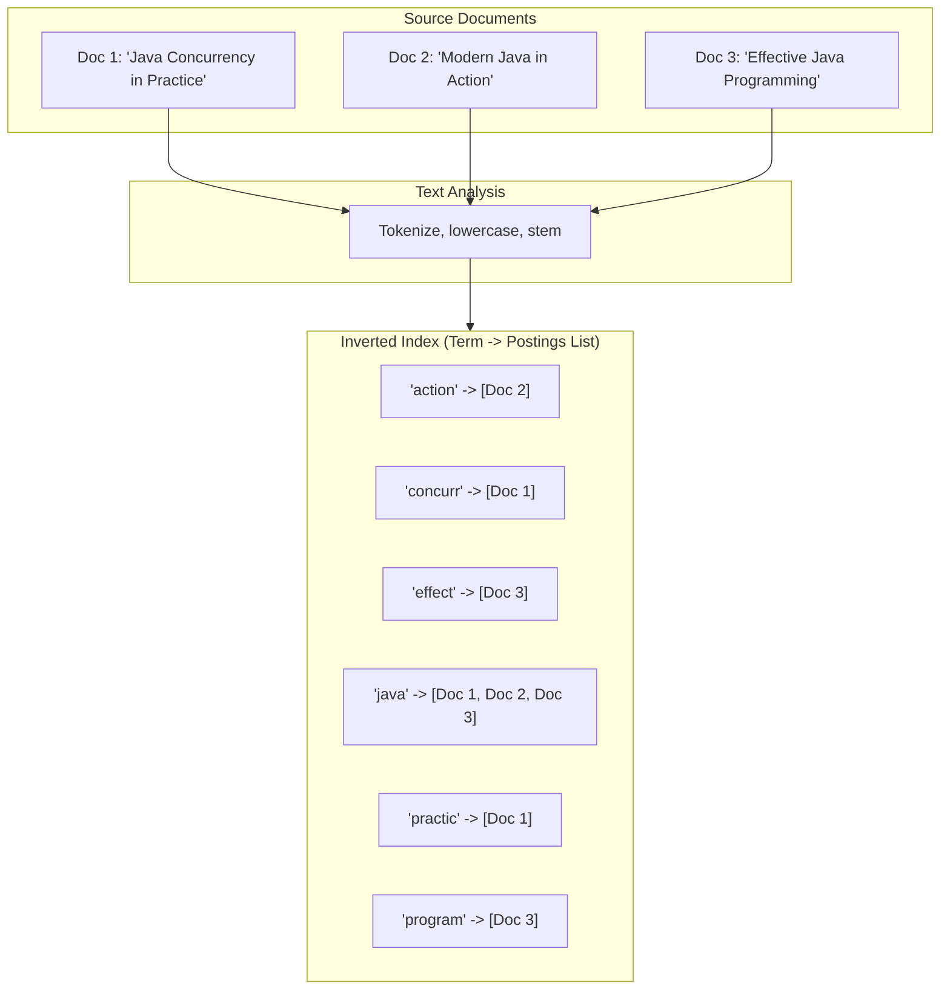
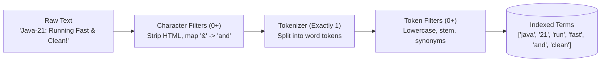
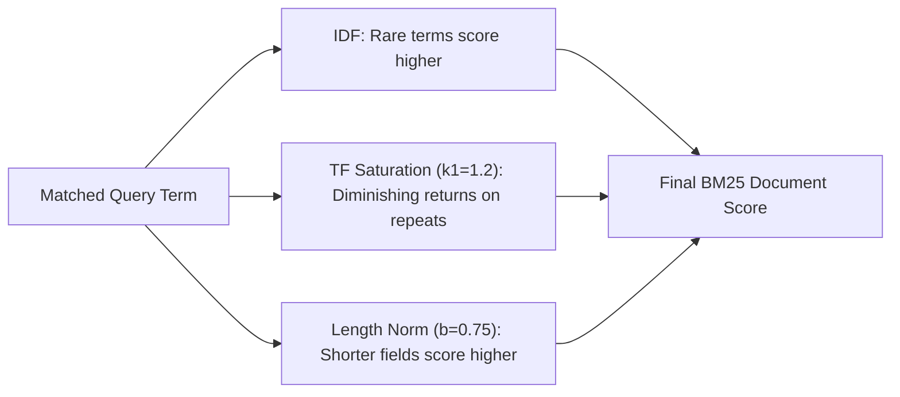
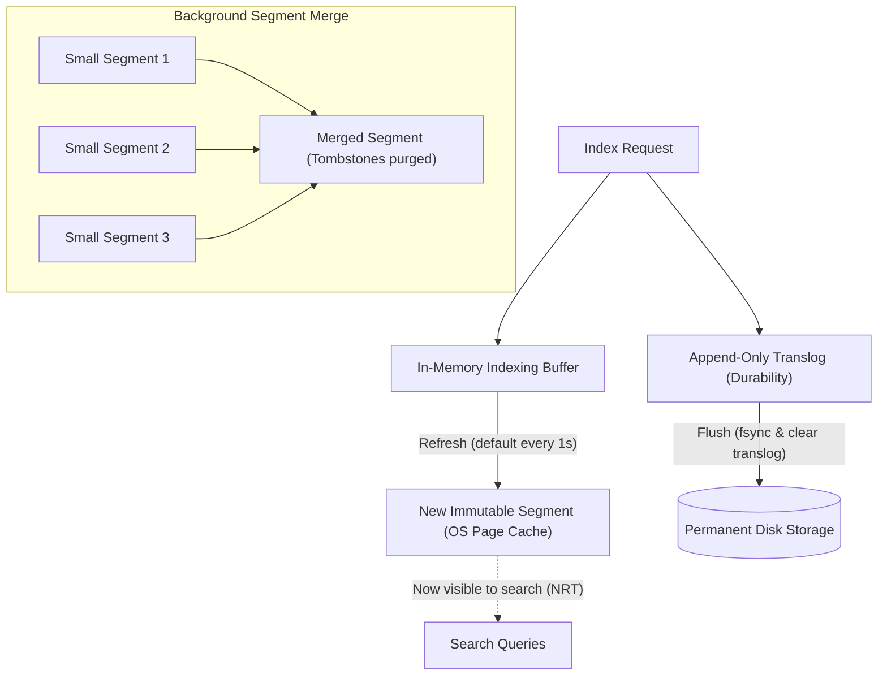
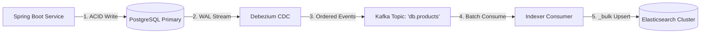

At some point on almost every backend team, a ticket lands asking for real search: *"Users should be able to search products by partial names, descriptions, or typos, filter by category and price range, and see faceted counts sorted by relevance."*

The first instinct is usually SQL:

```sql
SELECT * FROM products
WHERE description ILIKE '%ergonomic chair%'
   OR name ILIKE '%ergonomic chair%';
```

On a staging database with 500 rows, that runs in a few milliseconds. On a production table with 20 million rows, a leading wildcard (`%`) disables standard B-Tree index lookups and forces a full sequential scan across disk. Even if you add PostgreSQL's built-in `tsvector` and `pg_trgm` indexes (which actually cover many modest search requirements nicely), once you need multi-field relevance tuning, custom linguistic analysis, synonyms, typo tolerance, real-time faceted aggregations across tens of millions of documents, and horizontal read scaling, a dedicated search engine like **Elasticsearch** (built on **Apache Lucene**) becomes the right tool.

## Inverted Indexes and Tokenization

A relational B-Tree index maps row identifiers or column prefixes to rows. It is great for `WHERE sku = 'CHAIR-42'` or `WHERE name LIKE 'Ergonomic%'`, because keys are sorted by prefix. It cannot efficiently find which rows contain `"chair"` in the middle of a paragraph.

An **inverted index** reverses the lookup direction. Instead of mapping documents to the words inside them, it maps each normalized **term** to a **postings list** of document IDs where that term appears, along with term frequencies and word positions (needed for phrase queries like `"ergonomic chair"`).



When a user searches for `"Java Concurrency"`, Elasticsearch runs the query text through the same analysis pipeline, looks up `"java"` (`[Doc 1, Doc 2, Doc 3]`) and `"concurr"` (`[Doc 1]`) in the term dictionary, and intersects the sorted integer postings lists in memory.

## Analyzers and Tokenizers

Almost every confusing Elasticsearch bug ("why didn't my query match this document?") comes down to text analysis. Every `text` field passes through an **Analyzer** at index time, and your query string passes through an analyzer at search time. A document only matches when the indexed terms and the queried terms overlap.

An analyzer always consists of three ordered stages:

1. **Character Filters (0 or more)**: Transform the raw character stream before splitting it into words. Common examples are `html_strip` (removes HTML markup), `mapping` (replaces `&` with ` and `, or normalizes emojis/punctuation), and `pattern_replace`.
2. **Tokenizer (exactly 1)**: Splits the character stream into a sequence of tokens and records each token's `start_offset`, `end_offset`, and `position`.
3. **Token Filters (0 or more)**: Modify, add, or drop tokens in sequence (lowercasing, removing stop words, stemming, ASCII folding, injecting synonyms, or generating edge n-grams).



### Built-In Analyzers Compared

Seeing how built-in analyzers treat the exact same input string makes their differences concrete. Given `"<b>Java-21</b> Running Fast & Clean!"`:

| Analyzer | Tokenizer + Filters | Output Tokens | Typical Use |
| :--- | :--- | :--- | :--- |
| `standard` (default) | `standard` tokenizer + `lowercase` | `["b", "java", "21", "b", "running", "fast", "clean"]` | General-purpose text across most languages |
| `simple` | `lowercase` tokenizer (splits on non-letters) | `["b", "java", "b", "running", "fast", "clean"]` | Simple word splitting (note: drops digits like `21`) |
| `whitespace` | Splits only on whitespace | `["<b>Java-21</b>", "Running", "Fast", "&", "Clean!"]` | Preserving punctuation and case |
| `english` | `standard` + possessive/lowercase/stop/stemmer | `["b", "java", "21", "b", "run", "fast", "clean"]` | English prose where `"running"` should match `"run"` |
| `keyword` | No-op (emits entire string as one token) | `["<b>Java-21</b> Running Fast & Clean!"]` | Exact matching (usually better mapped as `keyword` type) |

Notice that `standard` does *not* strip HTML tags (`<b>` became the token `"b"`), and `simple` dropped the number `"21"`. That is why production search indexes usually define custom analyzers.

### Custom Analyzers and Index-Time vs. Search-Time Analysis

When you want HTML stripping, accent folding (`café` -> `cafe`), English stemming, or prefix autocomplete, define custom analyzers in the index settings:

```json
PUT /products_v1
{
  "settings": {
    "analysis": {
      "filter": {
        "english_stemmer": {
          "type": "stemmer",
          "language": "english"
        },
        "autocomplete_edge_ngram": {
          "type": "edge_ngram",
          "min_gram": 2,
          "max_gram": 15
        }
      },
      "analyzer": {
        "catalog_text": {
          "type": "custom",
          "char_filter": ["html_strip"],
          "tokenizer": "standard",
          "filter": ["lowercase", "asciifolding", "english_stemmer"]
        },
        "autocomplete_index": {
          "type": "custom",
          "tokenizer": "standard",
          "filter": ["lowercase", "asciifolding", "autocomplete_edge_ngram"]
        },
        "autocomplete_search": {
          "type": "custom",
          "tokenizer": "standard",
          "filter": ["lowercase", "asciifolding"]
        }
      }
    }
  },
  "mappings": {
    "properties": {
      "title": {
        "type": "text",
        "analyzer": "autocomplete_index",
        "search_analyzer": "autocomplete_search",
        "fields": {
          "raw": { "type": "keyword" }
        }
      },
      "description": {
        "type": "text",
        "analyzer": "catalog_text"
      }
    }
  }
}
```

Pay close attention to `analyzer` vs. `search_analyzer` on `title`. At index time, `"ergonomic"` is expanded by `edge_ngram` into `["er", "erg", "ergo", "ergon", ..., "ergonomic"]`. At search time, you **must not** apply `edge_ngram` to the user's query; otherwise searching for `"ergonomic"` would also emit `"er"` and falsely match `"eraser"` and `"error"`. Keeping `autocomplete_search` without `edge_ngram` makes `"erg"` match `"ergonomic"` cleanly and quickly without wildcard queries.

### Debugging Tokenization with the `_analyze` API

Never guess what an analyzer produces. Elasticsearch provides the `_analyze` endpoint so you can inspect exact tokens, character offsets, and positions before deploying mappings:

```http
POST /products_v1/_analyze
Content-Type: application/json

{
  "analyzer": "catalog_text",
  "text": "<p>Café Running Shoes</p>"
}
```

Response:

```json
{
  "tokens": [
    { "token": "cafe", "start_offset": 3, "end_offset": 7, "type": "<ALPHANUM>", "position": 0 },
    { "token": "run",  "start_offset": 8, "end_offset": 15, "type": "<ALPHANUM>", "position": 1 },
    { "token": "shoe", "start_offset": 16, "end_offset": 21, "type": "<ALPHANUM>", "position": 2 }
  ]
}
```

## Relevance Scoring with Okapi BM25

Finding which 10,000 documents match a query is only half the job. Ranking the best 20 at the top is handled by **Okapi BM25**, Elasticsearch's default similarity algorithm.

Older search engines used classic **TF-IDF** (Term Frequency multiplied by Inverse Document Frequency). Classic TF-IDF has two weaknesses: term frequency grows too aggressively (a spammy page repeating `"chair"` 80 times swamps a clean product listing mentioning `"chair"` 4 times), and it does not normalize document length gracefully.

BM25 combines three signals:

1. **Inverse Document Frequency (IDF)**: Rare terms across the index carry much more weight than common terms. Matching `"herman"` in a furniture catalog signals far more relevance than matching `"chair"`.
2. **Term Frequency Saturation (`k1`, default `1.2`)**: Additional mentions of a term add diminishing score gains and flatten toward a ceiling. Going from 1 mention to 3 mentions matters a lot; going from 10 mentions to 50 barely changes the score.
3. **Field Length Normalization (`b`, default `0.75`)**: A match in a 5-word `title` carries more weight than a match in a 600-word `description`, because BM25 scales term frequency against the field's length relative to the average length of that field across the index. Setting `b = 0` disables length normalization completely.



> [!NOTE]
> By default, Elasticsearch calculates IDF per shard rather than globally across the whole index. On large indexes with evenly distributed documents, shard-level IDF is accurate enough. On tiny dev or test indexes split across 5 shards, identical documents can get slightly different scores unless you use fewer shards (1 shard is plenty for small indexes) or pass `search_type=dfs_query_then_fetch` when debugging.

## Lucene Segments and Near-Real-Time (NRT) Refresh

Each Elasticsearch index is divided into primary **shards**, and each shard is an independent **Apache Lucene** instance made up of **immutable segments**.

When your Java service indexes a document, it does not write directly into a searchable file on disk:



1. **Indexing buffer + Translog**: The document goes into an in-memory buffer and is appended to the shard's **translog** (Write-Ahead Log) for crash recovery. At this moment, the document is durable once the translog fsyncs, but **not yet searchable**.
2. **Refresh (Near-Real-Time)**: Every `1s` by default (`index.refresh_interval`), Lucene builds a new immutable inverted-index segment from the buffer and opens it in the operating system's filesystem page cache. That is why Elasticsearch is called **near-real-time (NRT)**: a document written 50 ms ago may not appear in search results until the next 1-second refresh cycle.
3. **Flush**: Periodically (based on translog size or age), Lucene fsyncs open segments to permanent disk and truncates the translog.
4. **Immutable updates, deletes, and merges**: Because Lucene segments are never modified in place (which allows lock-free concurrent reads and friendly OS page caching), deleting a document writes its ID into a `.del` tombstone bitmap. Updating a document marks the old version deleted and writes a brand-new document into the buffer. Background **segment merges** combine small segments into larger ones and physically drop tombstoned documents to reclaim disk space.

Avoid forcing `?refresh=true` on every write in production. Creating a tiny segment on every single document write slows down indexing dramatically and overwhelms background merging. Reserve explicit refreshes for integration tests, or use `?refresh=wait_for` only on rare user-facing workflows that must immediately read back what they just wrote.

## Spring Data Elasticsearch Integration

In Spring Boot 3.x, `spring-boot-starter-data-elasticsearch` integrates with the official **Elasticsearch Java API Client** (`co.elastic.clients:elasticsearch-java`), replacing the deprecated `RestHighLevelClient`.

```xml
<dependency>
    <groupId>org.springframework.boot</groupId>
    <artifactId>spring-boot-starter-data-elasticsearch</artifactId>
</dependency>
```

### Mapping `text` vs. `keyword` and `@MultiField`

One of the most frequent schema mistakes is choosing the wrong string field type:

- **`FieldType.Text`**: Runs through an analyzer and is stored in the inverted index for full-text relevance queries. It does **not** build columnar Doc Values by default, so sorting or aggregating on a `text` field fails unless you enable `fielddata` (which loads the inverted index into JVM heap and is a common cause of `OutOfMemoryError`).
- **`FieldType.Keyword`**: Stored verbatim without tokenization in both the inverted index and disk-backed columnar **Doc Values**. Use it for exact filters (`category`, `sku`, `status`), sorting, and aggregations.

When a field needs both full-text search *and* exact sorting or faceting (such as a product `title`), map it as a `@MultiField`:

```java
package com.javahub.search.entity;

import org.springframework.data.annotation.Id;
import org.springframework.data.elasticsearch.annotations.Document;
import org.springframework.data.elasticsearch.annotations.Field;
import org.springframework.data.elasticsearch.annotations.FieldType;
import org.springframework.data.elasticsearch.annotations.InnerField;
import org.springframework.data.elasticsearch.annotations.MultiField;
import org.springframework.data.elasticsearch.annotations.Setting;

import java.math.BigDecimal;
import java.time.Instant;
import java.util.List;

@Document(indexName = "products_v1")
@Setting(shards = 2, replicas = 1)
public class ProductIndexDocument {

    @Id
    private String id;

    @MultiField(
        mainField = @Field(type = FieldType.Text, analyzer = "standard"),
        otherFields = {
            @InnerField(suffix = "raw", type = FieldType.Keyword)
        }
    )
    private String title;

    @Field(type = FieldType.Text, analyzer = "english")
    private String description;

    @Field(type = FieldType.Keyword)
    private String sku;

    @Field(type = FieldType.Keyword)
    private String category;

    @Field(type = FieldType.Double)
    private BigDecimal price;

    @Field(type = FieldType.Keyword)
    private List<String> tags;

    @Field(type = FieldType.Boolean)
    private boolean inStock;

    @Field(type = FieldType.Date)
    private Instant createdAt;

    public ProductIndexDocument() {}

    public String getId() { return id; }
    public void setId(String id) { this.id = id; }
    public String getTitle() { return title; }
    public void setTitle(String title) { this.title = title; }
    public String getDescription() { return description; }
    public void setDescription(String description) { this.description = description; }
    public String getSku() { return sku; }
    public void setSku(String sku) { this.sku = sku; }
    public String getCategory() { return category; }
    public void setCategory(String category) { this.category = category; }
    public BigDecimal getPrice() { return price; }
    public void setPrice(BigDecimal price) { this.price = price; }
    public List<String> getTags() { return tags; }
    public void setTags(List<String> tags) { this.tags = tags; }
    public boolean isInStock() { return inStock; }
    public void setInStock(boolean inStock) { this.inStock = inStock; }
    public Instant getCreatedAt() { return createdAt; }
    public void setCreatedAt(Instant createdAt) { this.createdAt = createdAt; }
}
```

### Query Context vs. Filter Context with `ElasticsearchOperations`

`ElasticsearchRepository` covers basic CRUD, but real search endpoints almost always combine boosted multi-field text search with structured filters using `ElasticsearchOperations` and `NativeQuery`:

```java
package com.javahub.search.service;

import co.elastic.clients.elasticsearch._types.query_dsl.BoolQuery;
import co.elastic.clients.elasticsearch._types.query_dsl.MultiMatchQuery;
import co.elastic.clients.elasticsearch._types.query_dsl.Operator;
import co.elastic.clients.elasticsearch._types.query_dsl.TextQueryType;
import com.javahub.search.entity.ProductIndexDocument;
import org.springframework.data.domain.PageRequest;
import org.springframework.data.elasticsearch.client.elc.NativeQuery;
import org.springframework.data.elasticsearch.core.ElasticsearchOperations;
import org.springframework.data.elasticsearch.core.SearchHit;
import org.springframework.data.elasticsearch.core.SearchHits;
import org.springframework.stereotype.Service;

import java.math.BigDecimal;
import java.util.List;

@Service
public class ProductSearchService {

    private final ElasticsearchOperations elasticsearchOperations;

    public ProductSearchService(ElasticsearchOperations elasticsearchOperations) {
        this.elasticsearchOperations = elasticsearchOperations;
    }

    public List<ProductIndexDocument> searchCatalog(
            String userQuery, String category, BigDecimal maxPrice, int page, int size) {

        BoolQuery.Builder bool = new BoolQuery.Builder();

        // Query context (must): calculates BM25 relevance score
        if (userQuery != null && !userQuery.isBlank()) {
            bool.must(m -> m.multiMatch(MultiMatchQuery.of(mm -> mm
                    .query(userQuery)
                    .fields("title^3.0", "tags^2.0", "description^1.0")
                    .type(TextQueryType.BestFields)
                    .operator(Operator.Or)
                    .fuzziness("AUTO")
            )));
        } else {
            bool.must(m -> m.matchAll(ma -> ma));
        }

        // Filter context: binary yes/no check, skips scoring and caches bitsets
        if (category != null && !category.isBlank()) {
            bool.filter(f -> f.term(t -> t.field("category").value(category)));
        }
        if (maxPrice != null) {
            bool.filter(f -> f.range(r -> r.number(n -> n.field("price").lte(maxPrice.doubleValue()))));
        }
        bool.filter(f -> f.term(t -> t.field("inStock").value(true)));

        NativeQuery query = NativeQuery.builder()
                .withQuery(bool.build()._toQuery())
                .withPageable(PageRequest.of(page, size))
                .build();

        SearchHits<ProductIndexDocument> hits =
                elasticsearchOperations.search(query, ProductIndexDocument.class);

        return hits.getSearchHits().stream()
                .map(SearchHit::getContent)
                .toList();
    }
}
```

Separating `must` from `filter` matters for performance. Clauses inside `must` compute BM25 scores for every candidate document. Clauses inside `filter` skip scoring completely and are automatically cached by Elasticsearch as compact bitsets in memory.

## Bulk Indexing

Indexing documents one HTTP request at a time wastes most of its time on network round-trips and per-request overhead. Whenever you are backfilling an index, processing a Kafka consumer batch, or reindexing after a mapping change, use the **`_bulk` API**.

You can call `elasticsearchOperations.bulkIndex(indexQueries, IndexCoordinates.of("products_v1"))` for simple batches, or inject the underlying `ElasticsearchClient` directly when you want explicit per-item error inspection:

```java
package com.javahub.search.service;

import co.elastic.clients.elasticsearch.ElasticsearchClient;
import co.elastic.clients.elasticsearch.core.BulkRequest;
import co.elastic.clients.elasticsearch.core.BulkResponse;
import co.elastic.clients.elasticsearch.core.bulk.BulkResponseItem;
import com.javahub.search.entity.ProductIndexDocument;
import org.slf4j.Logger;
import org.slf4j.LoggerFactory;
import org.springframework.stereotype.Service;

import java.io.IOException;
import java.util.ArrayList;
import java.util.List;

@Service
public class ProductBulkIndexer {

    private static final Logger log = LoggerFactory.getLogger(ProductBulkIndexer.class);
    private static final String INDEX_NAME = "products_v1";

    private final ElasticsearchClient client;

    public ProductBulkIndexer(ElasticsearchClient client) {
        this.client = client;
    }

    public List<String> bulkUpsert(List<ProductIndexDocument> batch) throws IOException {
        if (batch.isEmpty()) {
            return List.of();
        }

        BulkRequest.Builder request = new BulkRequest.Builder();
        for (ProductIndexDocument doc : batch) {
            request.operations(op -> op.index(idx -> idx
                    .index(INDEX_NAME)
                    .id(doc.getId())
                    .document(doc)
            ));
        }

        BulkResponse response = client.bulk(request.build());
        List<String> failedIds = new ArrayList<>();

        // Always inspect response.errors(): HTTP 200 can still contain per-item failures
        if (response.errors()) {
            for (BulkResponseItem item : response.items()) {
                if (item.error() != null) {
                    failedIds.add(item.id());
                    log.error("Failed to index doc {}: {}", item.id(), item.error().reason());
                }
            }
        }
        return failedIds;
    }
}
```

A few operational guidelines for bulk indexing:

- **Size batches by megabytes, not document count**: Aim for roughly **5 MB to 15 MB** per bulk request. For typical 1 KB product documents that is a few thousand docs per batch; for huge full-text articles it might be only 200 docs. Oversized batches create heap pressure on the coordinating node and trigger `429 Too Many Requests` rejections.
- **Check `response.errors()`**: Elasticsearch returns HTTP `200 OK` even if 12 documents in a 1,000-document batch failed mapping validation. Inspect each item and route failures to a retry or dead-letter queue.
- **Tune initial backfills**: During a large offline reindex into a brand-new index, temporarily set `index.refresh_interval` to `"-1"` and `index.number_of_replicas` to `0`, load all documents via bulk requests, and then restore `refresh_interval` (e.g., `"1s"`) and `number_of_replicas` (`1`).

## Search Aggregations

Aggregations compute analytics and faceted sidebar counts over the matched document set in the same round-trip as your search query. They fall into three categories:

- **Bucket aggregations** group documents into buckets based on field values or ranges (`terms`, `range`, `date_histogram`).
- **Metric aggregations** compute statistics over numeric values (`avg`, `min`, `max`, `stats`, `percentiles`).
- **Pipeline aggregations** operate on the output of other aggregations (such as moving averages or bucket sorting).

Here is how to run a search query alongside a `terms` facet on `category` and a `stats` metric on `price` using Spring Data Elasticsearch 5.x:

```java
package com.javahub.search.service;

import co.elastic.clients.elasticsearch._types.aggregations.Aggregation;
import co.elastic.clients.elasticsearch._types.aggregations.StatsAggregate;
import co.elastic.clients.elasticsearch._types.aggregations.StringTermsBucket;
import com.javahub.search.entity.ProductIndexDocument;
import org.springframework.data.domain.PageRequest;
import org.springframework.data.elasticsearch.client.elc.ElasticsearchAggregations;
import org.springframework.data.elasticsearch.client.elc.NativeQuery;
import org.springframework.data.elasticsearch.core.ElasticsearchOperations;
import org.springframework.data.elasticsearch.core.SearchHit;
import org.springframework.data.elasticsearch.core.SearchHits;
import org.springframework.stereotype.Service;

import java.util.LinkedHashMap;
import java.util.List;
import java.util.Map;

@Service
public class ProductFacetSearchService {

    private final ElasticsearchOperations elasticsearchOperations;

    public ProductFacetSearchService(ElasticsearchOperations elasticsearchOperations) {
        this.elasticsearchOperations = elasticsearchOperations;
    }

    public record SearchWithFacets(
            List<ProductIndexDocument> products,
            Map<String, Long> categoryCounts,
            double minPrice,
            double maxPrice,
            double avgPrice
    ) {}

    public SearchWithFacets searchWithFacets(String userQuery, int page, int size) {
        NativeQuery query = NativeQuery.builder()
                .withQuery(q -> q.bool(b -> b
                        .must(m -> m.match(mt -> mt.field("title").query(userQuery)))
                        .filter(f -> f.term(t -> t.field("inStock").value(true)))
                ))
                .withAggregation("by_category", Aggregation.of(a -> a
                        .terms(t -> t.field("category").size(20))
                ))
                .withAggregation("price_stats", Aggregation.of(a -> a
                        .stats(s -> s.field("price"))
                ))
                .withPageable(PageRequest.of(page, size))
                .build();

        SearchHits<ProductIndexDocument> hits =
                elasticsearchOperations.search(query, ProductIndexDocument.class);

        List<ProductIndexDocument> products = hits.getSearchHits().stream()
                .map(SearchHit::getContent)
                .toList();

        Map<String, Long> categoryCounts = new LinkedHashMap<>();
        double minPrice = 0.0;
        double maxPrice = 0.0;
        double avgPrice = 0.0;

        if (hits.getAggregations() instanceof ElasticsearchAggregations aggs) {
            var categoryAgg = aggs.get("by_category");
            if (categoryAgg != null && categoryAgg.aggregation().getAggregate().isSterms()) {
                for (StringTermsBucket bucket :
                        categoryAgg.aggregation().getAggregate().sterms().buckets().array()) {
                    categoryCounts.put(bucket.key().stringValue(), bucket.docCount());
                }
            }

            var priceAgg = aggs.get("price_stats");
            if (priceAgg != null && priceAgg.aggregation().getAggregate().isStats()) {
                StatsAggregate stats = priceAgg.aggregation().getAggregate().stats();
                minPrice = stats.min() != null ? stats.min() : 0.0;
                maxPrice = stats.max() != null ? stats.max() : 0.0;
                avgPrice = stats.avg() != null ? stats.avg() : 0.0;
            }
        }

        return new SearchWithFacets(products, categoryCounts, minPrice, maxPrice, avgPrice);
    }
}
```

If you only need the aggregation results without returning any hit documents (for example, rendering an analytics dashboard), pass `.withMaxResults(0)` so Elasticsearch skips fetching `_source` payloads.

## Keeping Elasticsearch in Sync with Your Database

In most Java architectures, PostgreSQL remains the **system of record** and Elasticsearch is a **derived read index**. Keeping them synchronized is where many search integrations quietly break.

### Why Application Dual-Writes Drift

Writing to PostgreSQL and Elasticsearch inside the same service method looks simple, but it has no atomic transaction across the two systems:

```java
// Fragile: dual-write without atomic guarantees
@Transactional
public Product createProduct(ProductDto dto) {
    Product saved = productRepository.save(new Product(dto));
    elasticsearchOperations.save(toIndexDocument(saved));
    return saved;
}
```

Three failure modes creep in over time:

1. **Partial failure**: PostgreSQL commits, then the network call to Elasticsearch times out. The product exists in the database but never appears in search.
2. **Rollback ghost records**: Elasticsearch indexes the document, then a later step in the Spring `@Transactional` method throws an exception and rolls back PostgreSQL. Search now returns a product that does not exist.
3. **Out-of-order updates**: Two concurrent threads update the same product's price to 100 and 120. If Thread 1's HTTP call reaches Elasticsearch after Thread 2's, Elasticsearch gets stuck showing 100 while PostgreSQL holds 120.

### Production Sync: Change Data Capture (CDC) or Outbox

To decouple writes from search indexing, write only to PostgreSQL and stream committed changes to Elasticsearch asynchronously:



- **Change Data Capture (Debezium + Kafka)**: Debezium tails PostgreSQL's Write-Ahead Log (WAL) and publishes ordered row changes to Kafka. A consumer reads batches of events and pushes them to Elasticsearch via the `_bulk` API using the primary key as document ID (making retries idempotent).
- **Transactional Outbox**: If you do not run Debezium, write an outbox row in the same PostgreSQL transaction as the domain change, then have a lightweight poller batch-publish outbox events to Elasticsearch (or Kafka) and mark them processed.

Either way, if Elasticsearch goes down for maintenance or a reindex, PostgreSQL stays completely unaffected and the consumer catches up cleanly once the cluster returns.

## Practical Questions

### What is the difference between `text` and `keyword` fields, and why does aggregating on a `text` field fail by default?

A `text` field runs through an analyzer at index time so full-text queries can match stemmed, lowercased words in the inverted index. It does not store Doc Values (disk-backed columnar values). A `keyword` field skips analysis and stores the exact string in both the inverted index and Doc Values, making it fast for exact filters, sorting, and aggregations. Running a `terms` aggregation on a `text` field fails with `Fielddata is disabled on text fields by default` because computing buckets over an analyzed field would require un-inverting the inverted index into JVM heap memory (`fielddata`), which causes severe GC pressure and OOM crashes. Map fields that need both search and aggregations as `@MultiField`.

### Why should an autocomplete field using `edge_ngram` define a separate `search_analyzer`?

At index time, `edge_ngram` turns `"keyboard"` into `["ke", "key", "keyb", "keybo", "keyboa", "keyboar", "keyboard"]`. If you used the same analyzer at search time, a user typing `"keyb"` would generate `["ke", "key", "keyb"]`, causing documents containing `"kettle"` or `"kernel"` (which share `"ke"`) to match. Setting a plain `standard` + `lowercase` `search_analyzer` searches for the exact prefix `"keyb"` directly in the inverted index.

### How does Elasticsearch handle document updates and deletions if Lucene segments are immutable?

Deletions append the document ID to a `.del` tombstone bitmap associated with that segment, and search queries filter out tombstoned IDs at read time. Updates perform a soft delete of the old document in `.del` and index the updated version as a new document in the in-memory buffer, which becomes searchable on the next refresh cycle (default 1 second). Background segment merges later combine smaller segments into larger ones and physically discard tombstoned documents.

### Why is `BulkResponse.errors()` important to check even when the HTTP call succeeds?

Elasticsearch's `_bulk` endpoint returns HTTP `200 OK` as long as the bulk request itself was parsed and executed, even if individual items inside the batch failed due to mapping conflicts, version conflicts, or malformed fields. If your indexer only catches `IOException` or `ElasticsearchException`, partial indexing failures go silently unnoticed and your search index drifts out of sync with PostgreSQL.
