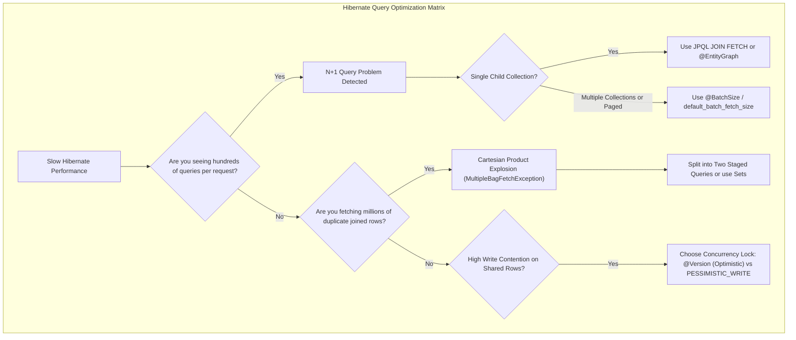
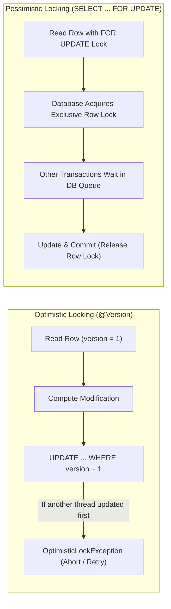

There is a running joke among database administrators: *"The fastest way to take down a database server is to give a junior developer Hibernate."*

In local development with ten rows of mock data in an in-memory H2 database, every Hibernate query executes in under two milliseconds. But deploy that exact same code to production with 100,000 customer orders, and disaster strikes:
- An endpoint loading a dashboard fires **10,001 independent SQL queries across the network socket**.
- Database CPU spikes to 100%, and HikariCP connection pools starve.
- Memory thrashing triggers violent Garbage Collection pauses as Hibernate materializes millions of redundant, joined proxy objects in the JVM heap.

An Object-Relational Mapping (ORM) framework does not replace the laws of physics. Every entity traversal, lazy collection initialization, and flush generates physical SQL statements. 

To build high-throughput enterprise systems, you must know how to inspect generated SQL, eliminate the **N+1 query problem**, prevent cartesian product explosions, and tune concurrency locks.



---

## The N+1 Query Problem: Anatomy of a Production Disaster

The **N+1 Query Problem** is the single most common performance defect in enterprise Java applications.

It occurs when an application executes **1 query** to fetch a list of N parent records, and then executes **N additional queries** (one for each parent) to fetch associated child entities as they are traversed in a loop.

### How It Happens in Real Code

```java
// SEVERE N+1 DEFECT:
@Transactional(readOnly = true)
public List<OrderSummaryDto> getRecentOrderSummaries() {
    // Query 1: Loads 100 orders
    List<PurchaseOrder> orders = entityManager.createQuery(
        "SELECT o FROM PurchaseOrder o WHERE o.status = 'COMPLETED'", 
        PurchaseOrder.class
    ).getResultList();

    List<OrderSummaryDto> summaries = new ArrayList<>();
    
    // In a loop over the 100 orders:
    for (PurchaseOrder order : orders) {
        // TRAP! order.getCustomer() is an uninitialized ByteBuddy proxy!
        // Calling getName() triggers an individual SQL query FOR EVERY SINGLE ORDER!
        String customerName = order.getCustomer().getName(); 
        summaries.add(new OrderSummaryDto(order.getId(), customerName));
    }
    
    return summaries;
}
```

### The Generated SQL Trace

```sql
-- Query 1 (The "1" Query):
SELECT * FROM purchase_orders WHERE status = 'COMPLETED';

-- Queries 2 through 101 (The "N" Queries fired sequentially over the wire!):
SELECT * FROM customers WHERE id = 101;
SELECT * FROM customers WHERE id = 102;
SELECT * FROM customers WHERE id = 103;
...
SELECT * FROM customers WHERE id = 200;
```

If you have 1,000 orders, your application makes **1,001 separate network round-trips to the database** just to render a single list.

---

## Solution 1: JPQL JOIN FETCH and Entity Graphs

The primary cure for N+1 queries is **Fetch Joining**. A `JOIN FETCH` instructs Hibernate to issue a single SQL `JOIN` query, retrieving both the parent and associated child entities in a single network round-trip.

### JPQL JOIN FETCH

```java
public List<PurchaseOrder> findAllWithCustomers() {
    return entityManager.createQuery(
        "SELECT o FROM PurchaseOrder o " +
        "JOIN FETCH o.customer " +          // Fetches @ManyToOne association
        "LEFT JOIN FETCH o.orderLines " +    // Fetches @OneToMany collection
        "WHERE o.status = 'COMPLETED'", 
        PurchaseOrder.class
    ).getResultList();
}
```

Hibernate generates a single SQL query:
```sql
SELECT o.id, o.status, c.id, c.name, l.id, l.sku, l.quantity
FROM purchase_orders o
INNER JOIN customers c ON o.customer_id = c.id
LEFT JOIN order_lines l ON o.id = l.order_id
WHERE o.status = 'COMPLETED';
```

All customer objects and order line collections are initialized immediately inside the First-Level Cache. Accessing `order.getCustomer().getName()` triggers zero additional queries.

### JPA Entity Graphs (@EntityGraph)

If you use Spring Data JPA or want to avoid hardcoding `JOIN FETCH` strings inside JPQL, use **Entity Graphs**. An Entity Graph defines a reusable, query-scoped fetching blueprint:

```java
public interface OrderRepository extends JpaRepository<PurchaseOrder, Long> {

    @EntityGraph(attributePaths = {"customer", "orderLines"})
    @Query("SELECT o FROM PurchaseOrder o WHERE o.status = :status")
    List<PurchaseOrder> findByStatusWithDetails(@Param("status") String status);
}
```

---

## The MultipleBagFetchException and Cartesian Product Trap

While `JOIN FETCH` solves N+1 for single associations, attempting to `JOIN FETCH` multiple collections in a single query triggers Hibernate's famous **`MultipleBagFetchException`**:

```java
// CRASHES WITH MultipleBagFetchException:
@Query("SELECT o FROM PurchaseOrder o " +
       "JOIN FETCH o.orderLines " +   // Collection 1 (List)
       "JOIN FETCH o.payments " +     // Collection 2 (List)
       "WHERE o.id = :id")
PurchaseOrder findOrderFullDetails(@Param("id") Long id);
```

### Why Hibernate Forbids Fetching Multiple Bags

In Java, a `List` that allows duplicates and is unordered is termed a **"Bag"** by Hibernate.

When you join two independent collections in relational SQL, the database engine produces a **Cartesian Product**:
- If an order has 10 order lines and 10 payment records, the database returns **100 rows (10 x 10)** in the JDBC result set!
- If an order has 50 lines and 20 payments, the database returns **1,000 rows**.

Hibernate cannot safely determine how to reconstruct two separate Java lists from a combinatorial explosion of cross-joined rows without risking duplicate elements and massive memory corruption.

### The Correct Remedy: Staged Multi-Query Fetching

Never force Hibernate into a massive Cartesian join. Instead, split the fetch into two sequential, highly efficient queries within the same transaction:

```java
@Transactional(readOnly = true)
public PurchaseOrder getCompleteOrder(Long orderId) {
    // Query 1: Fetch order and its orderLines
    PurchaseOrder order = entityManager.createQuery(
        "SELECT o FROM PurchaseOrder o " +
        "LEFT JOIN FETCH o.orderLines " +
        "WHERE o.id = :id", PurchaseOrder.class)
        .setParameter("id", orderId)
        .getSingleResult();

    // Query 2: Fetch payments into the SAME Persistence Context
    // Hibernate automatically binds payments to the order already in the L1 Cache!
    entityManager.createQuery(
        "SELECT o FROM PurchaseOrder o " +
        "LEFT JOIN FETCH o.payments " +
        "WHERE o = :order", PurchaseOrder.class)
        .setParameter("order", order)
        .getSingleResult();

    return order; // Both collections are now fully initialized with ZERO Cartesian explosion!
}
```

---

## The Pagination in Memory Warning (HHH000104)

One of the most dangerous warnings in Hibernate logs is:

```text
WARN: HHH000104: firstResult/maxResults specified with collection fetch; applying in memory!
```

### What This Warning Actually Means

Consider an API endpoint that paginates orders:

```java
// DISASTER IN PRODUCTION:
entityManager.createQuery(
    "SELECT o FROM PurchaseOrder o LEFT JOIN FETCH o.orderLines", 
    PurchaseOrder.class
)
.setFirstResult(0)
.setMaxResults(20)
.getResultList();
```

Because an order with 5 items produces 5 SQL rows, the database SQL `LIMIT 20` would truncate the 20th row midway through an order's items, leaving the 4th order with incomplete children!

To prevent returning corrupted, truncated entities, **Hibernate discards the SQL `LIMIT` and `OFFSET` clauses entirely**. 

Instead, Hibernate executes `SELECT * FROM purchase_orders LEFT JOIN order_lines`, **pulls every single row in your entire database table across the network into JVM heap memory**, and performs pagination in Java code!

On a table with 10 million rows, this warning is immediately followed by a catastrophic `OutOfMemoryError`.

### How to Paginate Entities with Child Collections

Use a **Two-Step ID Query Strategy**:

```java
// Step 1: Paginate the IDs ONLY (Executes fast SQL LIMIT/OFFSET on parent table)
List<Long> orderIds = entityManager.createQuery(
    "SELECT o.id FROM PurchaseOrder o ORDER BY o.createdAt DESC", Long.class)
    .setFirstResult(page * pageSize)
    .setMaxResults(pageSize)
    .getResultList();

// Step 2: Fetch the full entity graph for ONLY the 20 target IDs
List<PurchaseOrder> pagedOrders = entityManager.createQuery(
    "SELECT DISTINCT o FROM PurchaseOrder o " +
    "LEFT JOIN FETCH o.orderLines " +
    "WHERE o.id IN (:ids) " +
    "ORDER BY o.createdAt DESC", PurchaseOrder.class)
    .setParameter("ids", orderIds)
    .getResultList();
```

---

## Solution 2: Batch Fetching (@BatchSize)

What if you have hundreds of existing queries and cannot rewrite every JPQL query to use `JOIN FETCH`?

Hibernate provides the ultimate zero-code optimization: **Batch Fetching**.

Instead of loading lazy associations one by one (`WHERE id = ?`), batch fetching groups uninitialized proxies and loads them in batches using SQL **`WHERE id IN (?, ?, ...)`**.

### Global Configuration in Spring Boot

In your `application.yml`:

```yaml
spring:
  jpa:
    properties:
      hibernate:
        default_batch_fetch_size: 50
```

### How Batch Fetching Transforms SQL

When your loop iterates over 100 orders and accesses `order.getCustomer()`:
- **Without Batch Size**: Fires 100 separate queries (`SELECT * FROM customers WHERE id = 1`, `WHERE id = 2`...).
- **With `default_batch_fetch_size: 50`**: Hibernate inspects the Persistence Context, finds 100 uninitialized customer proxies, and fetches them in **just 2 queries**:
  ```sql
  SELECT * FROM customers WHERE id IN (1, 2, 3, ..., 50);
  SELECT * FROM customers WHERE id IN (51, 52, 53, ..., 100);
  ```

Setting `default_batch_fetch_size: 50` instantly reduces N+1 query overhead by up to **98% across your entire application** without touching a single line of business code!

---

## Concurrency Control: Optimistic vs Pessimistic Locking

When multiple threads or microservice pods attempt to update the same database record simultaneously, how do you prevent lost updates?



### Optimistic Locking with @Version

Optimistic locking assumes that conflicts are rare. It does not acquire physical database locks. Instead, it tracks a version counter:

```java
@Entity
@Table(name = "inventory_items")
public class InventoryItem {
    @Id private Long id;

    @Version
    @Column(name = "version_opt")
    private Long version;

    private int availableQuantity;

    public void deductStock(int count) {
        if (availableQuantity < count) throw new IllegalStateException("Out of stock");
        this.availableQuantity -= count;
    }
}
```

When an update is flushed, Hibernate automatically appends the version check to the SQL `WHERE` clause:

```sql
UPDATE inventory_items 
SET available_quantity = 45, version_opt = 2 
WHERE id = 101 AND version_opt = 1;
```

If another transaction updated the row first, `version_opt` in the database is already `2`. The `WHERE` clause matches 0 rows. Hibernate detects that zero rows were updated and immediately throws `jakarta.persistence.OptimisticLockException`!

- **Best For**: High-read, low-contention workloads (user profile edits, content management, order placement).

### Pessimistic Locking with LockModeType.PESSIMISTIC_WRITE

When write contention is extremely high (e.g., flash sales, ticket reservations, banking account balances), optimistic locking will fail constantly, wasting CPU on failed retries.

Pessimistic locking instructs the database engine to acquire an exclusive physical row lock immediately upon reading:

```java
public InventoryItem reserveInventoryPessimistic(Long itemId, int count) {
    InventoryItem item = entityManager.find(
        InventoryItem.class, 
        itemId, 
        LockModeType.PESSIMISTIC_WRITE
    );

    item.deductStock(count);
    return item;
}
```

Hibernate generates:
```sql
SELECT id, available_quantity, version_opt 
FROM inventory_items 
WHERE id = 101 
FOR UPDATE;
```

Any other transaction attempting to read or update this row is blocked at the database level until the current transaction commits or rolls back.

- **Best For**: High-contention financial operations and real-time inventory allocation where retries cannot be tolerated.

---

## Senior Engineer Interview Crucible

### Explain why combining a JPQL JOIN FETCH on a collection with setFirstResult() / setMaxResults() pagination triggers the dreaded HHH000104 memory warning.
When a parent entity is joined with a child collection in relational SQL (`LEFT JOIN FETCH`), the result set contains duplicate parent rows for every child record (an order with 5 items produces 5 SQL rows). 

If Hibernate applied database-level pagination (`LIMIT 20 OFFSET 0`), the database would cut off after the 20th joined row, potentially splitting an order's items in half.

To prevent returning incomplete entities with truncated child collections, Hibernate logs warning `HHH000104: firstResult/maxResults specified with collection fetch; applying in memory!` and **drops the SQL LIMIT clause entirely**. It executes a full table scan and loads every single row into JVM heap memory to perform pagination in memory, which triggers out-of-memory crashes on production-scale datasets.

### What causes MultipleBagFetchException in Hibernate, and how do you resolve it when an entity needs multiple collections loaded?
In Hibernate, an unordered `List` that allows duplicates is mapped as a "Bag". When a query attempts to `JOIN FETCH` two distinct bags simultaneously, the database generates a **Cartesian Product**: the result set rows equal the count of Collection A multiplied by the count of Collection B.

Hibernate throws `MultipleBagFetchException` because it cannot safely reconstruct two separate Java lists from a Cartesian product without risk of duplicate references and memory inflation.

To resolve it:
1. **Staged Multi-Query Fetching (Recommended)**: Fetch the parent and Collection A in Query 1, and then fetch Collection B in Query 2 within the same transaction. Hibernate's First-Level Cache merges both collections onto the managed parent instance without Cartesian explosion.
2. **Change Collection Type**: Convert the collections from `List` to `Set` (which removes duplicate ambiguity), though this still incurs the network bandwidth cost of the Cartesian product.

### How does hibernate.default_batch_fetch_size solve the N+1 problem without modifying JPQL queries, and how does it execute under the hood?
By default, when Hibernate traverses an uninitialized lazy collection or proxy in a loop, it fires an individual SQL `SELECT` statement for each entity (`WHERE id = ?`), resulting in N+1 queries.

When `hibernate.default_batch_fetch_size` (e.g., 50) is configured, Hibernate changes its loading strategy. When a lazy proxy is initialized, Hibernate inspects the current Persistence Context to find up to 50 other uninitialized proxies of the same entity type. It groups their IDs into a single batch query using SQL `WHERE id IN (?, ?, ..., ?)`. This reduces N sequential network round-trips down to `N / BatchSize`, mitigating up to 98% of N+1 overhead without modifying application queries.

### Compare Optimistic Locking (@Version) with Pessimistic Locking (PESSIMISTIC_WRITE): what are the database lock mechanisms and failure modes of each?
- **Optimistic Locking (`@Version`)**:
  - **Mechanism**: Acquires no physical database locks during reads. Uses a numeric version column that is checked and incremented during `UPDATE ... WHERE id = ? AND version = ?`.
  - **Failure Mode**: If another transaction updated the row first, the version mismatch causes the update count to be 0, throwing `OptimisticLockException`. The application must handle this by notifying the user or retrying.
  - **Workload**: High-read, low-contention scenarios where conflicts are rare.
- **Pessimistic Locking (`PESSIMISTIC_WRITE`)**:
  - **Mechanism**: Issues a physical database lock during the initial read using SQL `SELECT ... FOR UPDATE`.
  - **Failure Mode**: Concurrent transactions attempting to read or write the row are placed in a database wait queue. If lock acquisition exceeds timeout thresholds, it throws `PessimisticLockException` or deadlocks.
  - **Workload**: High-contention financial transactions where conflicts are frequent and retries are unacceptable.
