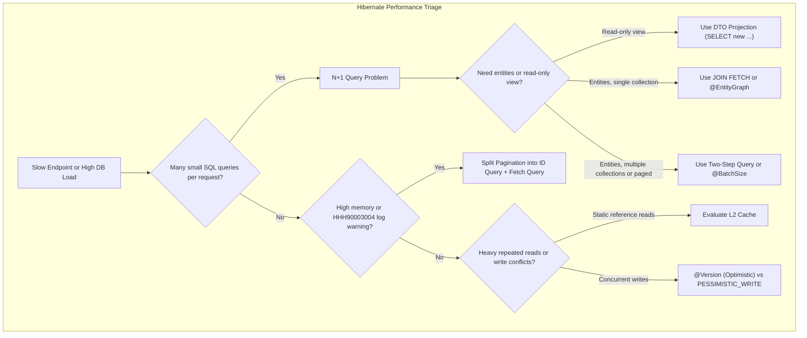
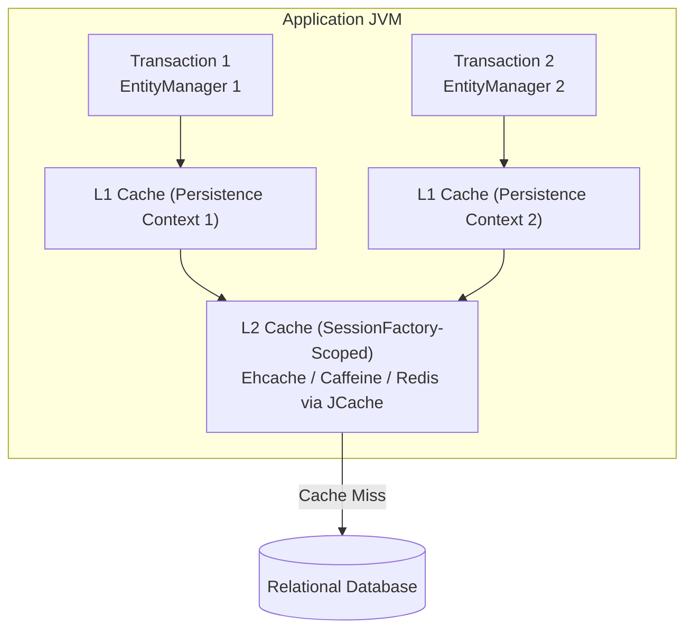

Hibernate queries that finish in two milliseconds against a local database with twenty test rows often fall apart once an application hits production scale. A single endpoint rendering a dashboard can quietly issue thousands of SQL queries, exhaust the HikariCP connection pool, or pull an entire table into JVM heap memory to paginate twenty rows.

An ORM does not change how relational databases or network sockets behave. Every entity traversal, lazy proxy access, and flush turns into SQL over JDBC. Tuning Hibernate comes down to inspecting the SQL your code actually emits, choosing the right fetching strategy per use case, keeping read-only queries lightweight, and picking a locking model that matches your write contention.



## Fetch Types: EAGER vs LAZY

Every JPA association has a `fetch` attribute that decides *when* Hibernate loads the related entity:

- **`FetchType.EAGER`**: Load the association immediately alongside the parent entity, even if the caller never reads that field.
- **`FetchType.LAZY`**: Defer loading until application code actually accesses the association. For single-valued associations (`@ManyToOne`, `@OneToOne`), Hibernate injects a ByteBuddy proxy; for collections (`@OneToMany`, `@ManyToMany`), it injects a lazy collection wrapper (`PersistentBag` or `PersistentSet`).

The Jakarta Persistence specification defines default fetch types that catch many developers off guard:

| Association | JPA Default Fetch | Recommended Setting |
| :--- | :--- | :--- |
| `@ManyToOne` | `FetchType.EAGER` | `FetchType.LAZY` (always override) |
| `@OneToOne` | `FetchType.EAGER` | `FetchType.LAZY` (always override) |
| `@OneToMany` | `FetchType.LAZY` | `FetchType.LAZY` |
| `@ManyToMany` | `FetchType.LAZY` | `FetchType.LAZY` |

### Why You Should Override @ManyToOne to LAZY

Leaving `@ManyToOne` as `EAGER` locks every query in your entire application into loading that parent association, whether it needs it or not. If `PurchaseOrder` eagerly fetches `Customer`, and `Customer` eagerly fetches `Organization` and `BillingAddress`, a simple query for order totals drags four tables across the wire every time.

Worse, **`EAGER` does not prevent N+1 queries**. When you run a JPQL query like `SELECT o FROM PurchaseOrder o` without an explicit `JOIN FETCH`, Hibernate obeys the JPQL query first (fetching only `purchase_orders`), then immediately fires a separate `SELECT` for every `EAGER` `@ManyToOne` association before returning the list.

The clean rule is straightforward: mark every association `FetchType.LAZY` on the entity mapping, and explicitly fetch only what each query needs using `JOIN FETCH`, `@EntityGraph`, or a DTO projection.

```java
@Entity
@Table(name = "purchase_orders")
public class PurchaseOrder {

    @Id
    private Long id;

    // Override JPA's EAGER default explicitly
    @ManyToOne(fetch = FetchType.LAZY, optional = false)
    @JoinColumn(name = "customer_id", nullable = false)
    private Customer customer;

    @OneToMany(mappedBy = "order", fetch = FetchType.LAZY)
    private List<OrderLine> orderLines = new ArrayList<>();
}
```

In Spring Boot applications, also set `spring.jpa.open-in-view: false`. By default, Spring Boot keeps the Hibernate `Session` and its database connection open through view/JSON rendering, which hides accidental lazy loading inside controllers and Jackson serializers. Disabling it surfaces missing fetches immediately during development as a `LazyInitializationException`, where you can fix them properly inside the repository or service query.

## The N+1 Query Problem

The N+1 problem happens when code executes **1 query** to load `N` parent records, and then triggers **N additional queries** (one per parent) to load an associated entity or collection inside a loop.

```java
// Triggers 1 query for orders + N queries for customers
@Transactional(readOnly = true)
public List<OrderSummaryDto> getCompletedOrderSummaries() {
    List<PurchaseOrder> orders = entityManager.createQuery(
        "SELECT o FROM PurchaseOrder o WHERE o.status = 'COMPLETED'",
        PurchaseOrder.class
    ).getResultList();

    List<OrderSummaryDto> summaries = new ArrayList<>(orders.size());
    for (PurchaseOrder order : orders) {
        // Each call initializes a separate Customer proxy
        String customerName = order.getCustomer().getName();
        summaries.add(new OrderSummaryDto(order.getId(), customerName));
    }
    return summaries;
}
```

If 100 orders match, Hibernate sends 101 queries over JDBC:

```sql
-- Query 1
SELECT o.id, o.status, o.customer_id FROM purchase_orders o WHERE o.status = 'COMPLETED';

-- Queries 2..101
SELECT c.id, c.name FROM customers c WHERE c.id = 101;
SELECT c.id, c.name FROM customers c WHERE c.id = 102;
-- ...98 more round-trips
```

Even when each individual query takes 0.5 ms, 100 sequential round-trips add 50 ms of pure network wait per request and hold the database connection open far longer than necessary.

## Solving N+1 with JOIN FETCH, @EntityGraph, and @BatchSize

### JPQL JOIN FETCH

`JOIN FETCH` tells Hibernate to issue a single SQL `JOIN` and hydrate both the parent and the associated entity or collection in one round-trip:

```java
public List<PurchaseOrder> findCompletedWithCustomerAndLines() {
    return entityManager.createQuery(
        """
        SELECT o FROM PurchaseOrder o
        JOIN FETCH o.customer
        LEFT JOIN FETCH o.orderLines
        WHERE o.status = 'COMPLETED'
        """,
        PurchaseOrder.class
    ).getResultList();
}
```

Hibernate generates one SQL query:

```sql
SELECT o.id, o.status, c.id, c.name, l.id, l.sku, l.quantity
FROM purchase_orders o
INNER JOIN customers c ON o.customer_id = c.id
LEFT JOIN order_lines l ON o.id = l.order_id
WHERE o.status = 'COMPLETED';
```

Note that since Hibernate 6 (used in Spring Boot 3), Hibernate automatically deduplicates root entity references returned by collection `JOIN FETCH` queries without requiring `SELECT DISTINCT` in JPQL (in Hibernate 5, you needed `SELECT DISTINCT` together with the `hibernate.query.passDistinctThrough=false` hint).

### JPA @EntityGraph

When you use Spring Data JPA derived queries or want to keep fetch plans separate from the JPQL `WHERE` clause, `@EntityGraph` expresses the same join fetches declaratively:

```java
public interface PurchaseOrderRepository extends JpaRepository<PurchaseOrder, Long> {

    @EntityGraph(attributePaths = {"customer", "orderLines"})
    @Query("SELECT o FROM PurchaseOrder o WHERE o.status = :status")
    List<PurchaseOrder> findByStatusWithDetails(@Param("status") String status);
}
```

`@EntityGraph` generates `LEFT OUTER JOIN` clauses for the listed attribute paths and works well for reusing one query across different fetch shapes.

### Batch Fetching with @BatchSize and default_batch_fetch_size

When you cannot rewrite every query with `JOIN FETCH` (or when you need to hydrate multiple child collections without causing a Cartesian join), Hibernate's batch fetching groups lazy proxy initializations into `WHERE id IN (?, ?, ...)` queries.

You can annotate a specific entity or collection with `@BatchSize(size = 50)`, or configure a global default in `application.yml`:

```yaml
spring:
  jpa:
    properties:
      hibernate:
        default_batch_fetch_size: 50
```

With a batch size of 50, initializing 100 uninitialized customer proxies drops from 100 individual queries down to 2 queries:

```sql
SELECT c.id, c.name FROM customers c WHERE c.id IN (1, 2, ..., 50);
SELECT c.id, c.name FROM customers c WHERE c.id IN (51, 52, ..., 100);
```

Batch fetching is a practical safety net across a codebase, though targeted `JOIN FETCH` or DTO queries remain faster for hot endpoints because they still avoid extra round-trips altogether.

## MultipleBagFetchException and Staged Fetching

Trying to `JOIN FETCH` two or more `List` collections (which Hibernate calls "bags") in the same query throws `MultipleBagFetchException`:

```java
// Throws MultipleBagFetchException
@Query("""
    SELECT o FROM PurchaseOrder o
    LEFT JOIN FETCH o.orderLines
    LEFT JOIN FETCH o.payments
    WHERE o.id = :id
    """)
PurchaseOrder findOrderWithLinesAndPayments(@Param("id") Long id);
```

Joining two independent one-to-many collections produces a Cartesian product in SQL: an order with 20 lines and 10 payments returns `20 * 10 = 200` rows. Hibernate refuses to reconstruct two unordered lists from those cross-joined rows because it cannot reliably tell legitimate duplicate elements apart from Cartesian duplication.

Converting both lists to `Set` silences the exception, but it still transfers the Cartesian product over the network. The better approach is to split the fetch into two small queries within the same transaction. Because both queries run inside the same Persistence Context, Hibernate attaches the second collection directly onto the already-managed `PurchaseOrder` instance in the First-Level Cache:

```java
@Transactional(readOnly = true)
public PurchaseOrder loadCompleteOrder(Long orderId) {
    PurchaseOrder order = entityManager.createQuery(
        """
        SELECT o FROM PurchaseOrder o
        LEFT JOIN FETCH o.orderLines
        WHERE o.id = :id
        """,
        PurchaseOrder.class
    ).setParameter("id", orderId).getSingleResult();

    entityManager.createQuery(
        """
        SELECT o FROM PurchaseOrder o
        LEFT JOIN FETCH o.payments
        WHERE o = :order
        """,
        PurchaseOrder.class
    ).setParameter("order", order).getSingleResult();

    return order; // Both orderLines and payments are initialized with 20 + 10 rows, not 200
}
```

## Collection Pagination and the HHH90003004 Warning

Combining `setFirstResult()` / `setMaxResults()` (or Spring Data `Pageable`) with a `JOIN FETCH` on a `@OneToMany` or `@ManyToMany` collection logs this warning in Hibernate 6 (logged as `HHH000104` in Hibernate 5):

```text
WARN: HHH90003004: firstResult/maxResults specified with collection fetch. In memory pagination was about to be applied. Failing because 'Fail on pagination over collection fetch' is enabled.
```

(By default, Hibernate logs the warning and proceeds with in-memory pagination unless `hibernate.query.fail_on_pagination_over_collection_fetch: true` is set, which is worth enabling in tests and staging.)

The reason is structural: an order with 5 line items occupies 5 joined SQL rows. If Hibernate sent `LIMIT 20` to the database, SQL would slice off the 20th joined row right in the middle of an order's line items, returning corrupted child collections. To preserve entity integrity, Hibernate drops `LIMIT` and `OFFSET` from the SQL completely, loads the entire result set into JVM heap memory, and slices the page in Java. On a large table, that quickly causes GC pressure or `OutOfMemoryError`.

To paginate parents along with a child collection safely, use a **two-step ID query**:

```java
@Transactional(readOnly = true)
public List<PurchaseOrder> findRecentOrdersPage(int page, int pageSize) {
    // Step 1: Paginate only the parent IDs in SQL (uses real LIMIT / OFFSET)
    List<Long> orderIds = entityManager.createQuery(
        "SELECT o.id FROM PurchaseOrder o ORDER BY o.createdAt DESC, o.id DESC",
        Long.class
    )
    .setFirstResult(page * pageSize)
    .setMaxResults(pageSize)
    .getResultList();

    if (orderIds.isEmpty()) {
        return List.of();
    }

    // Step 2: Fetch full graphs only for that page's IDs
    return entityManager.createQuery(
        """
        SELECT o FROM PurchaseOrder o
        JOIN FETCH o.customer
        LEFT JOIN FETCH o.orderLines
        WHERE o.id IN (:ids)
        ORDER BY o.createdAt DESC, o.id DESC
        """,
        PurchaseOrder.class
    )
    .setParameter("ids", orderIds)
    .getResultList();
}
```

## DTO Projections for Read-Only Queries

Loaded JPA entities carry overhead that you only pay for because you might modify them: Hibernate populates every mapped column, registers the entity in the Persistence Context, and stores a copy of its initial state for dirty checking.

If an endpoint only reads three columns to return JSON, skip loading entities entirely and project directly into a Java `record`:

```java
public record OrderSummaryDto(Long orderId, String customerName, BigDecimal totalAmount) {}

public interface PurchaseOrderRepository extends JpaRepository<PurchaseOrder, Long> {

    @Query("""
        SELECT new com.example.order.OrderSummaryDto(o.id, c.name, o.totalAmount)
        FROM PurchaseOrder o
        JOIN o.customer c
        WHERE o.status = :status
        ORDER BY o.createdAt DESC
        """)
    List<OrderSummaryDto> findSummariesByStatus(@Param("status") String status, Pageable pageable);
}
```

DTO projections give you three concrete wins:

- SQL selects only the three required columns instead of pulling wide tables or `TEXT`/`JSONB` blobs.
- Hibernate does not put DTOs into the First-Level Cache or allocate dirty-checking snapshots.
- Pagination works natively in SQL with `LIMIT` and `OFFSET` as long as you do not join to-many collections.

When you *do* load entities solely for read-only processing, annotate the service method with `@Transactional(readOnly = true)`. Spring sets Hibernate's flush mode to `MANUAL` and hints to Hibernate that entities can be loaded in read-only mode, skipping snapshot creation and dirty-checking scans at commit time.

## L1 and L2 Caching Strategies

Hibernate has two distinct caching layers with very different scopes and trade-offs.



### First-Level (L1) Cache

The L1 cache is the Persistence Context itself. It is always enabled, scoped to a single `EntityManager` (typically one transaction), and cannot be shared across threads. It guarantees repeatable reads by primary key inside a transaction and backs automatic dirty checking.

### Second-Level (L2) Cache

The L2 cache sits at the `SessionFactory` level and is shared across all transactions and requests in the application (or across multiple nodes if backed by a distributed cache provider like Infinispan or Redis). It is **disabled by default**.

When an application calls `em.find(Country.class, "US")`, Hibernate checks:
1. The current transaction's L1 cache.
2. The L2 cache (if the entity is marked cacheable).
3. The database, populating both L2 and L1 on a miss.

To enable L2 caching, add a JCache provider (such as Ehcache or Caffeine via `hibernate-jcache`), enable shared caching in configuration, and annotate specific read-heavy entities with `@Cacheable` and Hibernate's `@Cache` concurrency strategy:

```java
import jakarta.persistence.Cacheable;
import jakarta.persistence.Entity;
import jakarta.persistence.Id;
import jakarta.persistence.Table;
import org.hibernate.annotations.Cache;
import org.hibernate.annotations.CacheConcurrencyStrategy;

@Entity
@Table(name = "countries")
@Cacheable
@Cache(usage = CacheConcurrencyStrategy.READ_ONLY)
public class Country {

    @Id
    private String isoCode;

    private String displayName;
}
```

Hibernate offers four L2 cache concurrency strategies:

- **`READ_ONLY`**: Fastest and safest for immutable reference data (countries, currencies, tax brackets). Throws an exception if code attempts to update the entity.
- **`NONSTRICT_READ_WRITE`**: Evicts the cache entry after an update commits. Allows a brief window where concurrent readers might see stale data; suitable for rarely modified records where eventual consistency is acceptable.
- **`READ_WRITE`**: Uses soft locks during updates to keep cached data consistent across transactions without requiring JTA. Good default for read-mostly mutable entities.
- **`TRANSACTIONAL`**: Full XA/JTA transactional cache synchronization (supported only by providers like Infinispan).

### A Caution on the Query Cache

Hibernate also offers an optional **Query Cache** that caches the list of entity IDs returned by a specific JPQL query and its parameters. Be selective with it: whenever *any* row in a table referenced by that query is updated, Hibernate invalidates the cached query results for that table using its internal `UpdateTimestampsCache`. On write-heavy tables, the Query Cache causes constant invalidation churn and often performs worse than querying the database directly.

In practice, L2 caching pays off mainly for small, read-heavy reference entities accessed by primary key. For complex aggregated views or cross-service caching in multi-instance deployments, an explicit application-level cache (such as Redis) is usually easier to reason about and invalidate predictably.

## Optimistic Locking with @Version

When two transactions read the same row, compute changes in memory, and write back concurrently, the second write silently overwrites the first unless you guard against lost updates.

Optimistic locking assumes conflicts are uncommon and avoids holding database row locks while application code executes. Adding a `@Version` field tells Hibernate to track a numeric (or timestamp) version on every row:

```java
import jakarta.persistence.Column;
import jakarta.persistence.Entity;
import jakarta.persistence.Id;
import jakarta.persistence.Table;
import jakarta.persistence.Version;

@Entity
@Table(name = "inventory_items")
public class InventoryItem {

    @Id
    private Long id;

    @Version
    @Column(name = "version", nullable = false)
    private Long version;

    @Column(name = "available_quantity", nullable = false)
    private int availableQuantity;

    public void deductStock(int count) {
        if (count <= 0) {
            throw new IllegalArgumentException("Count must be positive");
        }
        if (availableQuantity < count) {
            throw new IllegalStateException("Insufficient stock");
        }
        this.availableQuantity -= count;
    }
}
```

When the transaction flushes, Hibernate checks and increments the version atomically in SQL:

```sql
UPDATE inventory_items
SET available_quantity = 45, version = 2
WHERE id = 101 AND version = 1;
```

If another transaction already updated row `101`, the database version is now `2`, so the `UPDATE` matches zero rows. Hibernate inspects the JDBC affected-row count, detects `0`, and throws `jakarta.persistence.OptimisticLockException` (wrapped as `ObjectOptimisticLockingFailureException` in Spring). Your service layer can then catch it and either retry the operation with fresh data or return `409 Conflict` to the caller.

### When to Switch to Pessimistic Locking

If hundreds of concurrent requests modify the exact same row (a flash-sale inventory counter or a hot ledger account), optimistic locking causes constant rollbacks and retries. In those high-contention cases, acquire an explicit row lock up front with `LockModeType.PESSIMISTIC_WRITE`:

```java
@Transactional
public void reserveStockPessimistic(Long itemId, int count) {
    InventoryItem item = entityManager.find(
        InventoryItem.class,
        itemId,
        LockModeType.PESSIMISTIC_WRITE
    );
    item.deductStock(count);
}
```

Hibernate emits `SELECT ... FROM inventory_items WHERE id = 101 FOR UPDATE`. Concurrent writers block at the database until the active transaction commits or rolls back. Keep pessimistic transactions short and always set a lock timeout (`jakarta.persistence.lock.timeout`) so blocked requests fail cleanly instead of piling up connections.

## Practical Questions

### Why do @ManyToOne and @OneToOne cause surprise performance issues if you leave their default fetch type?
In Jakarta Persistence, `@ManyToOne` and `@OneToOne` default to `FetchType.EAGER`, whereas `@OneToMany` and `@ManyToMany` default to `FetchType.LAZY`. Leaving `@ManyToOne` eager forces Hibernate to load related entities on every query even when unused, and in JPQL queries without `JOIN FETCH`, Hibernate still issues separate `SELECT` statements per parent row to satisfy those eager associations. Setting all associations to `FetchType.LAZY` and fetching per use case keeps query SQL predictable.

### Why does paginating a collection JOIN FETCH trigger HHH90003004 (HHH000104 in Hibernate 5)?
Joining a parent to a one-to-many collection duplicates the parent row once per child row in SQL. Applying a database `LIMIT` and `OFFSET` to that joined result set would slice a parent's child collection in half. To avoid returning partial collections, Hibernate drops `LIMIT`/`OFFSET`, loads all matching rows into JVM memory, and paginates in Java. Fix it by paginating parent IDs in query one and `JOIN FETCH`ing the full graph `WHERE o.id IN (:ids)` in query two.

### What causes MultipleBagFetchException, and how do you avoid it without causing a Cartesian product?
Hibernate represents unordered `List` collections as bags and forbids `JOIN FETCH`ing more than one bag in a single query because the SQL join creates a Cartesian product that cannot be cleanly deduplicated back into separate lists. Switching to `Set` avoids the exception but still transfers the Cartesian product over JDBC. Splitting the load into two sequential queries inside the same transaction lets the First-Level Cache merge both collections onto the managed parent with linear row counts.

### When should you choose @Version optimistic locking versus LockModeType.PESSIMISTIC_WRITE?
Use `@Version` optimistic locking for read-heavy or low-contention updates where conflicts are rare; it holds no database locks during reads and fails fast with `OptimisticLockException` if a row changed concurrently. Use `PESSIMISTIC_WRITE` (`SELECT ... FOR UPDATE`) on narrow, high-contention hot rows where optimistic retries would waste too much work, keeping the transaction short and bounded by a lock timeout.
