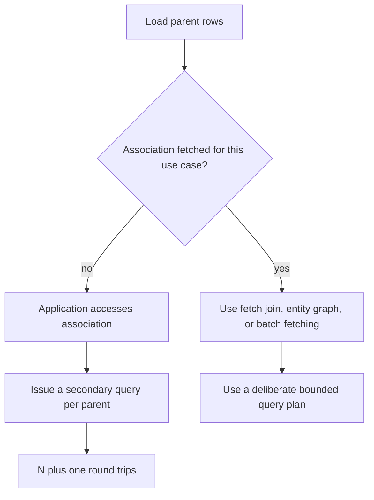

An ORM can make database access easier to express, but it cannot remove the cost of SQL, network round trips, locks, or materializing rows into objects. Hibernate performance work starts by observing the SQL and execution plan for a real use case, then changing the fetch plan or data access pattern that causes measurable cost.

This lesson uses Hibernate ORM 7.2.25.Final with Jakarta Persistence 3.2. The ORM dependency and a database are not configured in this repository, so examples show the APIs and behavior rather than claiming local query benchmarks.

## Measure the database work first

Before tuning an entity mapping, identify:

- How many SQL statements does the use case execute?
- How many rows and columns are returned?
- Are queries waiting on locks or the connection pool?
- Does the database plan use expected indexes and joins?
- Is time spent in the database, network, result conversion, or application work?

Enable SQL and statistics in a development or test environment, use database query plans for expensive SQL, and measure representative data. Logging every bind parameter in production can expose personal or confidential values; choose safe observability settings.

A fetch type does not promise a particular SQL statement count. The provider may use joins, secondary selects, or other strategies. Verify the generated SQL rather than inferring it from annotations.

## Lazy loading and the N+1 query problem

The **N+1 problem** occurs when one query loads N parent rows and accessing an association causes an additional query for each parent. For example, loading 100 orders and then reading each order's lines may produce 1 query for orders plus up to 100 queries for lines.

```java
List<PurchaseOrder> orders = entityManager.createQuery(
        "select o from PurchaseOrder o", PurchaseOrder.class)
    .getResultList();

for (PurchaseOrder order : orders) {
    System.out.println(order.lines().size());
}
```

In the preceding snippet, whether association access triggers SQL depends on whether the lines are already initialized and the persistence context is open. The query count must be measured for the actual mapping and provider configuration.



Choose the fetch plan for the operation that needs the data rather than making every association eager globally.

## Fetch joins

A JPQL `JOIN FETCH` retrieves an association as part of the query. For a use case that displays each order and its lines, a query-scoped fetch plan may avoid the per-parent selects:

```java
import jakarta.persistence.EntityManager;
import java.util.List;

public class OrderQueries {
    public List<PurchaseOrder> findOrdersWithLines(EntityManager entityManager) {
        return entityManager.createQuery(
                "select distinct o from PurchaseOrder o left join fetch o.lines",
                PurchaseOrder.class)
            .getResultList();
    }
}
```

A collection fetch join multiplies SQL rows: one order with five lines can appear in five result rows. `distinct` requests distinct root results at the JPQL level, but does not reduce the underlying joined row data sent by the database. Fetching multiple large collections in one query can create a row explosion or be rejected by the provider.

Avoid combining a collection fetch join with pagination unless the exact provider behavior is understood and tested. SQL pagination applies to joined rows, not necessarily distinct parent entities; Hibernate may need to fetch and paginate in memory in certain cases. For page-oriented screens, use a query strategy designed around page boundaries, such as selecting page IDs first and then loading the required associations.

## Entity graphs

An `EntityGraph` expresses which attributes a particular operation needs without hard-coding every query as a join. It can be useful when the same repository query has multiple response shapes:

```java
import jakarta.persistence.EntityGraph;
import jakarta.persistence.EntityManager;
import java.util.List;

public class OrderGraphQueries {
    public List<PurchaseOrder> findOrdersWithLines(EntityManager entityManager) {
        EntityGraph<PurchaseOrder> graph =
                entityManager.createEntityGraph(PurchaseOrder.class);
        graph.addAttributeNodes("lines");

        return entityManager.createQuery(
                "select o from PurchaseOrder o", PurchaseOrder.class)
            .setHint("jakarta.persistence.fetchgraph", graph)
            .getResultList();
    }
}
```

An entity graph is a fetch-plan template, not a guarantee of one SQL join. The provider chooses how to satisfy it, and may fetch additional state. Confirm the SQL and row volume for the provider and database in use.

## Batch fetching and JDBC batching

Batch **fetching** groups lazy association or entity loads so the provider can load several referenced objects in fewer round trips. Hibernate supports provider-specific batch-fetch configuration, including `@BatchSize` on an entity or collection. It can reduce N+1 overhead when a join would produce too many duplicate rows, but it does not remove the need to check query counts and parameter limits.

JDBC **write batching** is different: it groups compatible insert or update statements to reduce client/server round trips. It may improve bulk persistence workloads, but identifier-generation strategy, statement shape, flush frequency, and database/driver support affect whether batching is possible. Measure and configure it for the workload; do not assume that saving objects one by one automatically means one database call.

## First-level and second-level caches

The **first-level cache** is the persistence context associated with one `EntityManager`/Hibernate `Session`. It provides identity consistency within that context and avoids reloading the same entity identity repeatedly during a unit of work. It is not a shared application-wide cache.

The optional **second-level cache** is shared across persistence contexts within a configured provider/cache setup. It can reduce database reads for suitable data, but cache configuration must define storage, concurrency strategy, invalidation, and cluster behavior. A stale cache can return incorrect application data, so use it for data whose update and consistency characteristics are well understood, not as a generic “make it faster” switch.

Hibernate query caching is distinct from entity caching: it caches query-result information and works with the second-level cache for entity state. Cache hit rates, invalidation, memory use, and database query cost all matter. Compare end-to-end behavior with caching disabled and enabled under representative workloads.

## Optimistic locking with `@Version`

Optimistic locking detects concurrent updates without holding a database lock for the whole time a user edits an object. Map a version attribute:

```java
import jakarta.persistence.Entity;
import jakarta.persistence.Id;
import jakarta.persistence.Version;

@Entity
public class InventoryItem {
    @Id
    private Long id;

    @Version
    private long version;

    private int quantity;

    protected InventoryItem() {
    }

    public void changeQuantity(int quantity) {
        if (quantity < 0) {
            throw new IllegalArgumentException("quantity must not be negative");
        }
        this.quantity = quantity;
    }
}
```

When an entity is updated, the provider checks that the database version still matches the version originally read and advances it as part of the update. If another transaction has already changed it, the operation fails with an optimistic-lock exception rather than silently overwriting the concurrent change. The application must decide whether to report a conflict, reload and retry, or merge user intent; blind retries can overwrite newer business decisions.

`@Version` does not replace database transactions or constraints. It protects updates through the persistence mechanism that honors the version field; bulk JPQL/SQL updates and other writers must be designed so they do not bypass the expected version check.

## Practical tuning sequence

1. Reproduce the slow use case with representative data and collect statement counts and timings.
2. Inspect the SQL and database execution plan; distinguish too many round trips from a slow individual query.
3. Use a query-specific fetch join, entity graph, or batch-fetch strategy when it fits the result shape.
4. Reduce selected rows and columns, and avoid loading large object graphs just to render a small response.
5. Consider JDBC batching or caching only after identifying a repeated write or read workload they can improve.
6. Add optimistic locking where concurrent edits must detect lost updates, and handle conflicts as a business outcome.
7. Re-measure; keep a regression test or query-count assertion for the behavior that mattered.

## Further reading

- Hibernate ORM 7.2, [Introduction: fetching](https://docs.hibernate.org/orm/7.2/introduction/html_single/Hibernate_Introduction.html#fetching)
- Hibernate ORM 7.2, [User Guide](https://docs.hibernate.org/orm/7.2/userguide/html_single/)
- Jakarta Persistence 3.2 API, [`EntityGraph`](https://jakarta.ee/specifications/persistence/3.2/apidocs/jakarta.persistence/jakarta/persistence/EntityGraph.html)
- Jakarta Persistence 3.2 API, [`Version`](https://jakarta.ee/specifications/persistence/3.2/apidocs/jakarta.persistence/jakarta/persistence/Version.html)
- [Entity Relationships](./entity-relationships)
- [NoSQL Databases](./nosql-databases)
