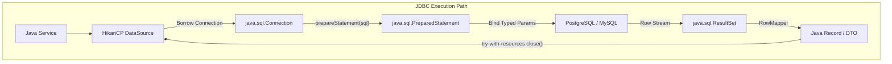
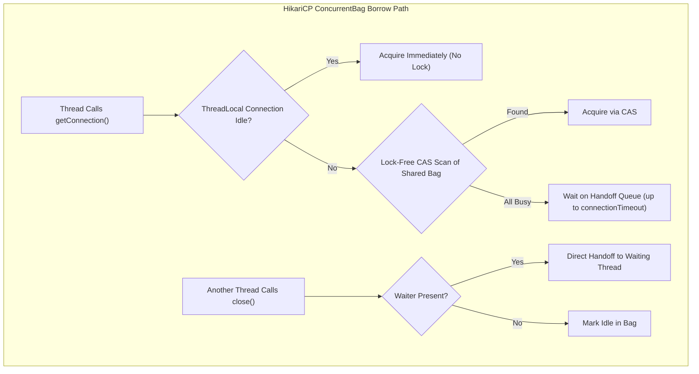

Every database library in the Java ecosystem (Spring Data JPA, Hibernate, jOOQ, MyBatis, and Spring's `JdbcClient`) ultimately talks to the database through **Java Database Connectivity (JDBC)**. Most days, higher-level abstractions hide that layer nicely. When a service starts throwing `HikariPool-1 - Connection is not available`, a report triggers an `OutOfMemoryError` while loading rows, or a bulk import takes 40 seconds instead of 2, knowing how JDBC and connection pools actually behave makes troubleshooting straightforward.



## `Connection`, `Statement`, and `PreparedStatement`

The `java.sql` API is built around a nested chain of `AutoCloseable` resources:

- **`DataSource`**: The factory (usually a connection pool like HikariCP) that hands out `Connection` leases. Prefer `DataSource` over legacy `DriverManager.getConnection(...)`.
- **`Connection`**: Represents a database session and transaction boundary. Calling `close()` on a pooled connection does not tear down the TCP socket; it resets state and returns the connection to the pool.
- **`Statement`**: Sends a static SQL string with no parameter placeholders. Fine for fixed DDL or parameterless queries, unsafe whenever user input is involved.
- **`PreparedStatement`**: Pre-parses SQL with `?` placeholders and binds typed parameters safely. Use this by default for all application queries and writes.
- **`CallableStatement`**: Extends `PreparedStatement` for invoking stored procedures (`{call ...}`).
- **`ResultSet`**: A forward cursor over rows returned by a `SELECT` (or generated keys returned by an `INSERT`).

Always open JDBC resources in `try-with-resources` so they close in strict reverse order (`ResultSet` -> `PreparedStatement` -> `Connection`), even when an exception is thrown:

```java
public long insertOrder(DataSource dataSource, long customerId, BigDecimal total) throws SQLException {
    String sql = "INSERT INTO orders (customer_id, total_amount, status) VALUES (?, ?, ?)";

    try (Connection conn = dataSource.getConnection();
         PreparedStatement ps = conn.prepareStatement(sql, Statement.RETURN_GENERATED_KEYS)) {

        ps.setLong(1, customerId);
        ps.setBigDecimal(2, total);
        ps.setString(3, "PENDING");
        ps.executeUpdate();

        try (ResultSet keys = ps.getGeneratedKeys()) {
            if (!keys.next()) {
                throw new SQLException("Insert succeeded but no generated key was returned");
            }
            return keys.getLong(1);
        }
    }
}
```

### Managing Transactions Explicitly

By default, a new JDBC `Connection` starts in **auto-commit mode** (`autoCommit = true`), meaning every single SQL statement commits in its own transaction immediately. Whenever two or more statements must succeed or fail together, disable auto-commit, call `commit()` on success, and `rollback()` in the `catch` block:

```java
public void transfer(DataSource dataSource, long fromId, long toId, BigDecimal amount) throws SQLException {
    try (Connection conn = dataSource.getConnection()) {
        boolean previousAutoCommit = conn.getAutoCommit();
        conn.setAutoCommit(false);

        try (PreparedStatement debit = conn.prepareStatement(
                 "UPDATE accounts SET balance = balance - ? WHERE id = ? AND balance >= ?");
             PreparedStatement credit = conn.prepareStatement(
                 "UPDATE accounts SET balance = balance + ? WHERE id = ?")) {

            debit.setBigDecimal(1, amount);
            debit.setLong(2, fromId);
            debit.setBigDecimal(3, amount);
            if (debit.executeUpdate() != 1) {
                throw new SQLException("Insufficient funds or missing source account: " + fromId);
            }

            credit.setBigDecimal(1, amount);
            credit.setLong(2, toId);
            if (credit.executeUpdate() != 1) {
                throw new SQLException("Missing destination account: " + toId);
            }

            conn.commit();
        } catch (SQLException | RuntimeException ex) {
            try {
                conn.rollback();
            } catch (SQLException rollbackEx) {
                ex.addSuppressed(rollbackEx);
            }
            throw ex;
        } finally {
            conn.setAutoCommit(previousAutoCommit);
        }
    }
}
```

Notice two small details that matter in real code: attaching any rollback error via `ex.addSuppressed(rollbackEx)` so the original root cause is not hidden, and restoring `autoCommit` in `finally` before returning the connection to the pool.

## Preventing SQL Injection

SQL injection happens when untrusted input is concatenated directly into a SQL string, allowing user-supplied characters to change the SQL grammar itself:

```java
// Vulnerable: attacker input becomes part of the SQL syntax
String sql = "SELECT id, email FROM users WHERE username = '" + userInput + "'";
try (Statement stmt = conn.createStatement();
     ResultSet rs = stmt.executeQuery(sql)) {
    // ...
}
```

If `userInput` is `' OR '1'='1' --`, the database parses a completely different `WHERE` clause and returns every row in `users`.

`PreparedStatement` eliminates this class of bug by separating the SQL template from the parameter values:

```java
// Safe: structure is fixed, input is bound strictly as a typed value
String sql = "SELECT id, email FROM users WHERE username = ?";
try (PreparedStatement ps = conn.prepareStatement(sql)) {
    ps.setString(1, userInput);
    try (ResultSet rs = ps.executeQuery()) {
        // ...
    }
}
```

Over the database wire protocol (for example, PostgreSQL's extended query protocol), the driver sends the SQL with placeholders in a `Parse` message and transmits parameter values separately in a `Bind` message. Because the database parses the query structure before binding data (and reuses server-side compiled plans once a statement runs repeatedly, after 5 executions by default in PostgreSQL's JDBC driver via `prepareThreshold`), characters like `'`, `;`, or `--` inside `userInput` are always treated as literal text, never executable SQL.

> [!IMPORTANT]
> `?` placeholders only work for **values**, not SQL identifiers such as table names, column names, or `ORDER BY` directions. If an API accepts a sort column from query parameters, never concatenate it directly. Map it through an explicit allow-list (`Map<String, String>` or `switch` expression) to hardcoded column names.

## ResultSets and Mappers

A `ResultSet` cursor starts **before the first row**. You advance it with `while (rs.next())` (or `if (rs.next())` for single-row lookups) and read columns by column label (`rs.getString("email")`) or 1-based index (`rs.getString(1)`). Prefer column labels in application code so adding or reordering columns in a `SELECT` clause does not silently break mapping.

### Handling SQL `NULL` Safely (`wasNull()` vs. `getObject`)

Primitive Java types (`int`, `long`, `double`, `boolean`) cannot hold `null`. By the JDBC specification, calling `rs.getInt("loyalty_points")` on a SQL `NULL` returns `0`, and `rs.getBoolean(...)` returns `false`. Without a null check, a missing value silently turns into a real zero.

You have two clean ways to read nullable numeric or boolean columns:

```java
// Approach 1: Check rs.wasNull() immediately after reading the primitive
int rawPoints = rs.getInt("loyalty_points");
Integer points = rs.wasNull() ? null : rawPoints;

// Approach 2 (JDBC 4.1+): Pass the target wrapper or java.time class to getObject()
Integer pointsClean = rs.getObject("loyalty_points", Integer.class);
OffsetDateTime createdAt = rs.getObject("created_at", OffsetDateTime.class);
```

`rs.getObject(column, Integer.class)` is concise and works smoothly with PostgreSQL, MySQL Connector/J 8+, and modern JDBC drivers, returning `null` directly when the column is SQL `NULL`.

### Writing a Clean `RowMapper<T>` Abstraction

Repeating `try (Connection ...; PreparedStatement ...; ResultSet ...)` boilerplate across every DAO method gets tedious fast. Extracting a small functional `RowMapper<T>` (the exact pattern Spring's `JdbcTemplate` and `JdbcClient` build on) keeps query execution and row mapping cleanly separated:

```java
@FunctionalInterface
public interface RowMapper<T> {
    T mapRow(ResultSet rs, int rowNum) throws SQLException;
}

public record UserAccount(
        long id,
        String email,
        Integer loyaltyPoints,
        BigDecimal balance,
        OffsetDateTime createdAt) {}
```

Now a reusable helper handles connection lifecycle and iteration while callers focus on SQL and mapping:

```java
public class JdbcQueryHelper {
    private final DataSource dataSource;

    public JdbcQueryHelper(DataSource dataSource) {
        this.dataSource = dataSource;
    }

    public <T> List<T> query(String sql, RowMapper<T> mapper, Object... params) throws SQLException {
        List<T> results = new ArrayList<>();
        try (Connection conn = dataSource.getConnection();
             PreparedStatement ps = conn.prepareStatement(sql)) {

            for (int i = 0; i < params.length; i++) {
                ps.setObject(i + 1, params[i]);
            }

            try (ResultSet rs = ps.executeQuery()) {
                int rowNum = 0;
                while (rs.next()) {
                    results.add(mapper.mapRow(rs, rowNum++));
                }
            }
        }
        return results;
    }
}

// Usage:
RowMapper<UserAccount> userMapper = (rs, rowNum) -> new UserAccount(
        rs.getLong("id"),
        rs.getString("email"),
        rs.getObject("loyalty_points", Integer.class),
        rs.getBigDecimal("balance"),
        rs.getObject("created_at", OffsetDateTime.class)
);

List<UserAccount> activeUsers = jdbcHelper.query(
        "SELECT id, email, loyalty_points, balance, created_at FROM users WHERE status = ?",
        userMapper,
        "ACTIVE"
);
```

### Streaming Large Result Sets Without Running Out of Heap

By default, both the PostgreSQL and MySQL JDBC drivers buffer the **entire** `ResultSet` in JVM heap memory before `executeQuery()` even returns. On a 50-row API query, that is fast and convenient. On an export job querying 2 million rows, it triggers an `OutOfMemoryError`.

In PostgreSQL, enabling server-side cursor streaming requires **two** settings together: `conn.setAutoCommit(false)` and a positive `ps.setFetchSize(500)`. If `autoCommit` stays `true`, pgJDBC silently ignores `setFetchSize` and loads everything into RAM anyway:

```java
public void exportActiveUsers(DataSource dataSource, Consumer<UserAccount> sink) throws SQLException {
    String sql = "SELECT id, email, loyalty_points, balance, created_at FROM users WHERE status = 'ACTIVE'";

    try (Connection conn = dataSource.getConnection()) {
        boolean originalAutoCommit = conn.getAutoCommit();
        conn.setAutoCommit(false); // Required by PostgreSQL JDBC driver for cursor streaming
        try (PreparedStatement ps = conn.prepareStatement(
                 sql, ResultSet.TYPE_FORWARD_ONLY, ResultSet.CONCUR_READ_ONLY)) {

            ps.setFetchSize(500); // Fetch 500 rows per network round trip
            try (ResultSet rs = ps.executeQuery()) {
                while (rs.next()) {
                    sink.accept(new UserAccount(
                            rs.getLong("id"),
                            rs.getString("email"),
                            rs.getObject("loyalty_points", Integer.class),
                            rs.getBigDecimal("balance"),
                            rs.getObject("created_at", OffsetDateTime.class)
                    ));
                }
            }
            conn.commit();
        } finally {
            conn.setAutoCommit(originalAutoCommit);
        }
    }
}
```

(In MySQL Connector/J, streaming requires either `ps.setFetchSize(Integer.MIN_VALUE)` for row-by-row streaming or adding `useCursorFetch=true` to the JDBC URL along with a positive fetch size.)

### Batch Inserts for High Throughput

Executing 10,000 individual `INSERT` statements in a loop costs 10,000 network round trips. Batching sends chunks of rows together and commits them in a single transaction:

```java
public void bulkInsertEvents(DataSource dataSource, List<AuditEvent> events) throws SQLException {
    String sql = "INSERT INTO audit_events (tenant_id, event_type, payload) VALUES (?, ?, ?)";
    int batchSize = 500;

    try (Connection conn = dataSource.getConnection()) {
        boolean originalAutoCommit = conn.getAutoCommit();
        conn.setAutoCommit(false);
        try (PreparedStatement ps = conn.prepareStatement(sql)) {
            int count = 0;
            for (AuditEvent event : events) {
                ps.setLong(1, event.tenantId());
                ps.setString(2, event.type());
                ps.setString(3, event.payloadJson());
                ps.addBatch();

                if (++count % batchSize == 0) {
                    ps.executeBatch();
                }
            }
            ps.executeBatch(); // Flush remaining rows
            conn.commit();
        } catch (SQLException ex) {
            conn.rollback();
            throw ex;
        } finally {
            conn.setAutoCommit(originalAutoCommit);
        }
    }
}
```

Pair this with the driver's batch rewrite flag in your JDBC URL (`reWriteBatchedInserts=true` for PostgreSQL or `rewriteBatchedStatements=true` for MySQL) so the driver rewrites batched statements into multi-row `VALUES (...), (...), (...)` packets, cutting insert time substantially.

## Connection Pooling with HikariCP

Opening a raw physical database connection is expensive: TCP handshake, TLS negotiation, authentication, and backend process/thread memory allocation on the database server (in PostgreSQL, each connection forks a dedicated OS process using several megabytes of RAM). Creating and closing a physical connection on every HTTP request quickly saturates both CPU and memory on the database host.

A **connection pool** keeps a bounded set of physical connections open and hands out short-lived leases to application threads. Spring Boot uses **HikariCP** by default because of its low overhead and predictable behavior under contention.

### How HikariCP Minimizes Contention

Two internal design choices keep HikariCP fast even when hundreds of application threads borrow and return connections concurrently:

- **`ConcurrentBag`**: Instead of guarding a single global queue with a coarse lock, `ConcurrentBag` keeps a `ThreadLocal` list of recently used connections per thread. When a thread requests a connection, it checks its own `ThreadLocal` list first without locking, falls back to a lock-free Compare-And-Swap (CAS) scan of shared connections, and only parks on a handoff queue if every connection is busy.
- **`FastList`**: JDBC statements and result sets are typically closed in reverse order of creation (LIFO). HikariCP replaces `ArrayList` with `FastList`, which scans backward from the tail on `remove(Object)` and drops redundant bounds checks.



### Sizing Your Connection Pool

It is tempting to match your database pool size to your web server thread count, such as 200 Tomcat threads and 200 database connections. In practice, oversized pools almost always *reduce* throughput and spike tail latency.

A database host has fixed CPU cores, memory bandwidth, and disk I/O queues. When 200 active queries fight over 4 or 8 database CPU cores, the OS kernel burns cycles context-switching, CPU caches thrash, and row locks pile up longer because every transaction progresses more slowly.

The well-known starting formula from the PostgreSQL wiki and HikariCP documentation is:

```text
connections = (db_cpu_cores * 2) + effective_spindle_count
```

On a 4-vCPU database with NVMe SSD storage, that formula suggests around **9 to 12 connections** total across the database. That last part is easy to forget in Kubernetes: if your database comfortably handles 40 active connections and you run 8 replicas of your Spring Boot service, each replica's `maximumPoolSize` should be around **5** (not 40), or you should place a server-side connection pooler like **PgBouncer** in transaction-pooling mode in front of PostgreSQL. Treat the formula as a baseline and verify under realistic load tests.

### Production HikariCP Configuration and Leak Detection

Here is a practical HikariCP setup illustrating the settings that matter most in production:

```java
import com.zaxxer.hikari.HikariConfig;
import com.zaxxer.hikari.HikariDataSource;
import javax.sql.DataSource;

public final class DataSourceFactory {

    public static DataSource create(String jdbcUrl, String user, String password) {
        HikariConfig config = new HikariConfig();
        config.setPoolName("orders-pool");
        config.setJdbcUrl(jdbcUrl);
        config.setUsername(user);
        config.setPassword(password);

        // Fixed-size pool sized for this replica's share of DB capacity
        config.setMaximumPoolSize(10);
        config.setMinimumIdle(10);

        // Fail fast instead of letting HTTP requests hang for 30s (default)
        config.setConnectionTimeout(3_000);

        // Retire connections 30-60s BEFORE DB or firewall/NAT idle timeouts kill them
        config.setMaxLifetime(1_500_000);   // 25 minutes
        config.setKeepaliveTime(300_000);   // 5 minutes: periodically validate idle sockets

        // Log stack trace if a connection stays checked out longer than 5 seconds
        config.setLeakDetectionThreshold(5_000);

        return new HikariDataSource(config);
    }
}
```

`leakDetectionThreshold` is especially helpful when tracking down forgotten `close()` calls or unexpectedly long external HTTP calls sitting inside a `@Transactional` method. When a connection stays borrowed past the threshold, HikariCP logs the exact stack trace where it was acquired:

```text
WARN com.zaxxer.hikari.pool.ProxyLeakTask - Connection leak detection triggered for
  org.postgresql.jdbc.PgConnection@4a92c77 on thread http-nio-8080-exec-4, stack trace follows
java.lang.Exception: Apparent connection leak detected
    at com.example.orders.ReportRepository.loadMonthlyData(ReportRepository.java:64)
```

Notice that `leakDetectionThreshold` does not forcefully close the connection; it warns you so you can fix the leak or move slow non-database I/O outside the transaction boundary.

## Interview Questions

### How does `PreparedStatement` prevent SQL injection, and what is one case it cannot protect by itself?

`PreparedStatement` separates the SQL query template from parameter values. The SQL with `?` placeholders is parsed by the database first, and user input is sent separately as typed parameter data over the wire protocol, so quotes or SQL keywords inside the value cannot alter the query structure. However, `?` placeholders cannot represent SQL identifiers like table names, column names, or `ORDER BY` directions. If you allow dynamic sorting from API input, you still need an explicit allow-list mapping user input to hardcoded column names.

### Why can `rs.getInt("column")` cause silent bugs on nullable columns?

Java's primitive `int` cannot represent `null`, so the JDBC specification requires `getInt()` (and `getLong()`, `getDouble()`, `getBoolean()`) to return `0` (or `false`) whenever the database column is SQL `NULL`. Unless you immediately check `rs.wasNull()` or read the column via `rs.getObject("column", Integer.class)`, missing data is silently coerced into zero.

### Why does streaming a huge `ResultSet` in PostgreSQL fail to save memory if you only call `ps.setFetchSize(500)`?

By default, PostgreSQL's JDBC driver fetches the entire query result into JVM heap memory before returning from `executeQuery()`. To enable cursor-based chunked fetching, the driver requires **both** `ps.setFetchSize(500)` and `conn.setAutoCommit(false)` (a server-side cursor only lives inside an active transaction). If `autoCommit` remains `true`, the fetch size setting is ignored.

### Why must HikariCP's `maxLifetime` be shorter than the database or firewall connection timeout?

Network firewalls, cloud NAT gateways, and database servers (such as MySQL's `wait_timeout`) silently drop idle TCP connections after a configured window. If `maxLifetime` is longer than that timeout, HikariCP can hand out a dead socket that fails mid-request with `Connection reset by peer` or broken pipe errors. Setting `maxLifetime` 30 to 60 seconds shorter than the shortest infrastructure timeout, along with `keepaliveTime`, ensures HikariCP retires aging connections cleanly before the network kills them.
