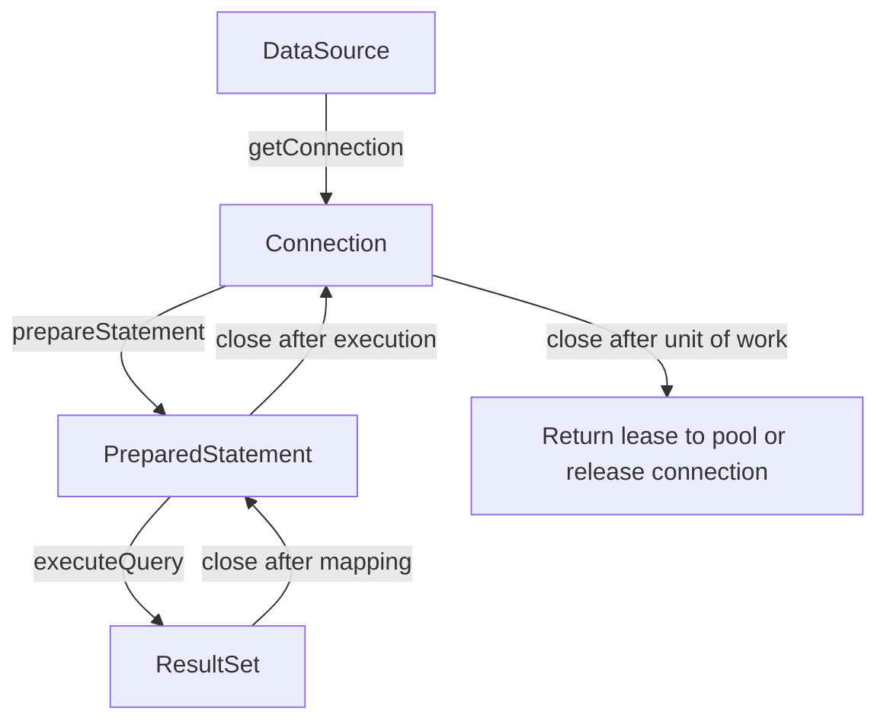

JDBC is Java's standard API for communicating with relational databases. A JDBC driver translates Java calls into the database protocol; application code acquires a `Connection`, executes a statement, maps a `ResultSet`, and releases the resources. A connection pool adds reuse and limits concurrent database sessions, but it does not change the responsibility to close each borrowed connection.

The JDBC examples below use Java 21 APIs. The HikariCP example is tied to HikariCP 7.1.0, whose project README lists Java 11+ support. The repository does not include a JDBC driver or HikariCP dependency, so those examples need the chosen database driver and pool on the application's classpath.

## The JDBC resource model

The main JDBC types form a nested resource lifecycle:

1. A `DataSource` provides a `Connection`.
2. A `Connection` creates a `PreparedStatement`.
3. Executing a query returns a `ResultSet`.
4. Close the result set and statement when finished, then close the connection.

JDBC resources implement `AutoCloseable`, so try-with-resources is the normal way to guarantee cleanup on both success and failure:



In the diagram, JDBC resource handles are nested: closing the `Connection` also closes statements it created, but explicit scopes make ownership clear and release each resource promptly. The last close has different physical meaning depending on the provider: with a pool it returns a lease; with a basic data source it closes the physical connection.

## Query with a `PreparedStatement`

A `PreparedStatement` separates SQL structure from parameter values. It prevents values from changing the SQL grammar and is the standard defense against SQL injection for data values. Use setter methods compatible with the database parameter types, and bind parameters in the order of the `?` markers:

```java
import java.sql.Connection;
import java.sql.PreparedStatement;
import java.sql.ResultSet;
import java.sql.SQLException;
import java.util.Optional;
import javax.sql.DataSource;

public class JdbcCustomerRepository {
    public record Customer(long id, String email) {}

    private final DataSource dataSource;

    public JdbcCustomerRepository(DataSource dataSource) {
        this.dataSource = dataSource;
    }

    public Optional<Customer> findById(long id) throws SQLException {
        String sql = "SELECT customer_id, email FROM customer WHERE customer_id = ?";
        try (Connection connection = dataSource.getConnection();
             PreparedStatement statement = connection.prepareStatement(sql)) {
            statement.setLong(1, id);

            try (ResultSet rows = statement.executeQuery()) {
                if (!rows.next()) {
                    return Optional.empty();
                }
                Customer customer = new Customer(
                        rows.getLong("customer_id"),
                        rows.getString("email"));
                return Optional.of(customer);
            }
        }
    }
}
```

The `ResultSet` cursor starts before the first row. `next()` advances it and returns `false` when there is no current row, so read column values only after a successful `next()`. Use column labels rather than positional indexes when the query's selected columns may be reordered.

SQL parameters represent **values**, not SQL identifiers. A query like `ORDER BY ?` orders by a bound constant in many drivers; it does not safely substitute a column name. If a column or sort direction must vary, choose it from a fixed allowlist and construct that trusted SQL fragment separately. Never concatenate untrusted input into SQL text.

Primitive getters such as `getLong` return zero for SQL `NULL`. If a nullable primitive column is mapped, call `wasNull()` immediately after its getter or use a nullable representation supported by the driver. Do not silently interpret a database `NULL` as a real zero.

## Statements and result mapping

Use the JDBC operation that matches the statement:

- `executeQuery()` for a query that returns a `ResultSet`.
- `executeUpdate()` for an insert, update, delete, or statement that returns no result set; it returns an affected-row count.
- `execute()` when the statement may produce different result forms.

Keep mapping logic close enough to the query that column names and null handling can be reviewed. For larger systems, extract a row-mapper helper and keep database access behind a repository boundary; don't return a live `ResultSet` to application code after closing its statement and connection.

An affected-row count is part of correctness. A command expected to update exactly one row should inspect the returned count and decide what zero or multiple updated rows means; otherwise a missing record can look like success.

## Transactions with JDBC

JDBC connections default to auto-commit: each statement is committed as its own transaction. To make several statements atomic, disable auto-commit, execute the operations, then explicitly commit. On failure, roll back:

```java
import java.sql.Connection;
import java.sql.PreparedStatement;
import java.sql.SQLException;
import javax.sql.DataSource;

public class JdbcInventoryService {
    private final DataSource dataSource;

    public JdbcInventoryService(DataSource dataSource) {
        this.dataSource = dataSource;
    }

    public void transfer(long fromId, long toId, int quantity) throws SQLException {
        if (quantity <= 0) {
            throw new IllegalArgumentException("quantity must be positive");
        }

        try (Connection connection = dataSource.getConnection()) {
            boolean previousAutoCommit = connection.getAutoCommit();
            connection.setAutoCommit(false);
            SQLException failure = null;

            try {
                try (PreparedStatement debit = connection.prepareStatement(
                             "UPDATE inventory SET quantity = quantity - ? WHERE item_id = ? AND quantity >= ?");
                     PreparedStatement credit = connection.prepareStatement(
                             "UPDATE inventory SET quantity = quantity + ? WHERE item_id = ?")) {
                    debit.setInt(1, quantity);
                    debit.setLong(2, fromId);
                    debit.setInt(3, quantity);
                    if (debit.executeUpdate() != 1) {
                        throw new SQLException("Source item is missing or has insufficient quantity");
                    }

                    credit.setInt(1, quantity);
                    credit.setLong(2, toId);
                    if (credit.executeUpdate() != 1) {
                        throw new SQLException("Destination item does not exist");
                    }
                }
                connection.commit();
            } catch (SQLException error) {
                failure = error;
                try {
                    connection.rollback();
                } catch (SQLException rollbackError) {
                    error.addSuppressed(rollbackError);
                }
                throw error;
            } finally {
                try {
                    connection.setAutoCommit(previousAutoCommit);
                } catch (SQLException resetError) {
                    if (failure != null) {
                        failure.addSuppressed(resetError);
                    } else {
                        throw resetError;
                    }
                }
            }
        }
    }
}
```

The debit includes the stock check in the `UPDATE` predicate, so concurrent transfers cannot both succeed by first reading the same available quantity and then decrementing it. The example expects each item ID to match exactly one row; a real domain must also decide whether transferring an item to itself is a no-op or a validation error.

Every transaction should be short. Holding a connection and database locks while making an HTTP request or waiting on unrelated work ties up pool capacity and may block other transactions. For more complex applications, transaction frameworks can manage boundaries, but the code still needs explicit, correct transaction semantics.

## Why use a connection pool?

Opening a physical database connection involves network and authentication work. A pool maintains a bounded set of physical connections and lends one to a caller for a unit of work. Closing the borrowed JDBC `Connection` returns the lease to the pool; it does not normally destroy the physical database connection.

Use a pool when the application serves repeated database work and connection setup cost or database connection limits matter. Create and close the pool at application lifecycle boundaries—not once per request. A pool does not make an expensive query faster, and an oversized pool can make a database slower by allowing more concurrent work than it can efficiently handle.

HikariCP 7.1.0 requires Java 11 or later according to its project README. Add its Maven dependency and the JDBC driver for the selected database. This configuration uses environment-provided credentials rather than committing secrets:

```java
import com.zaxxer.hikari.HikariConfig;
import com.zaxxer.hikari.HikariDataSource;
import javax.sql.DataSource;

public class DatabasePool {
    public static HikariDataSource create() {
        HikariConfig config = new HikariConfig();
        config.setJdbcUrl(required("DB_JDBC_URL"));
        config.setUsername(required("DB_USERNAME"));
        config.setPassword(required("DB_PASSWORD"));
        config.setMaximumPoolSize(10);
        config.setConnectionTimeout(2_000);
        return new HikariDataSource(config);
    }

    private static String required(String name) {
        String value = System.getenv(name);
        if (value == null || value.isBlank()) {
            throw new IllegalStateException("Missing environment variable: " + name);
        }
        return value;
    }

    public static void main(String[] args) throws Exception {
        try (HikariDataSource pool = create()) {
            DataSource dataSource = pool;
            try (var connection = dataSource.getConnection()) {
                System.out.println("Connected: " + !connection.isClosed());
            }
        }
    }
}
```

The value `10` is illustrative, not a universal pool size. Size a pool from measured concurrency, database capacity, and the total connection budget across all application instances and other clients. If 10 application instances each allow 10 connections, the database may see up to 100 connections from that service alone.

The `connectionTimeout` bounds how long a caller waits to borrow a connection; it is not the same as a statement/query timeout. Configure query timeouts and database-side limits intentionally, and make application behavior on pool exhaustion explicit rather than creating more connections without bound.

## Pool lifecycle and common failures

- **Connection leak:** a path fails to close a borrowed connection. Use try-with-resources; monitor leak warnings, but treat them as diagnostics rather than a substitute for ownership.
- **Long-held lease:** a connection is retained during slow non-database work. Keep the scope of the connection and transaction tight.
- **Pool exhaustion:** requests wait because all pool connections are checked out. Inspect query latency, lock waits, and leak behavior before increasing the maximum.
- **Too many database sessions:** multiple instances each create a pool. Calculate the aggregate maximum and reserve capacity for administration, migrations, and other services.
- **Stale connections:** network devices or database restarts can invalidate idle sessions. Pool lifetime and keepalive behavior must be compatible with the database and network; do not assume pool validation can fix every network failure.
- **Shared mutable connection:** JDBC connections and statements are not request-scoped global objects. Borrow a connection for the operation and do not share it concurrently between unrelated tasks.

## Practical rules

- Prefer `DataSource` over direct `DriverManager` calls in application code; it allows a driver, server, or pool to provide connection management.
- Use `PreparedStatement` for values, close resources with try-with-resources, and map results while the `ResultSet` is open.
- Make transaction boundaries explicit and check affected-row counts.
- Do not perform network calls or long waits while holding a connection or transaction open.
- Keep one application-lifecycle pool per database configuration; never create a new pool for each request.
- Tune pool limits from the database-wide connection budget and observed workload rather than choosing a large value by guesswork.

## Further reading

- Java 21 API, [`DataSource`](https://docs.oracle.com/en/java/javase/21/docs/api/java.sql/javax/sql/DataSource.html)
- Java 21 API, [`Connection`](https://docs.oracle.com/en/java/javase/21/docs/api/java.sql/java/sql/Connection.html)
- Java 21 API, [`PreparedStatement`](https://docs.oracle.com/en/java/javase/21/docs/api/java.sql/java/sql/PreparedStatement.html)
- Java 21 API, [`ResultSet`](https://docs.oracle.com/en/java/javase/21/docs/api/java.sql/java/sql/ResultSet.html)
- HikariCP, [Project README and configuration](https://github.com/brettwooldridge/HikariCP)
- [Database Migrations](./database-migrations)
