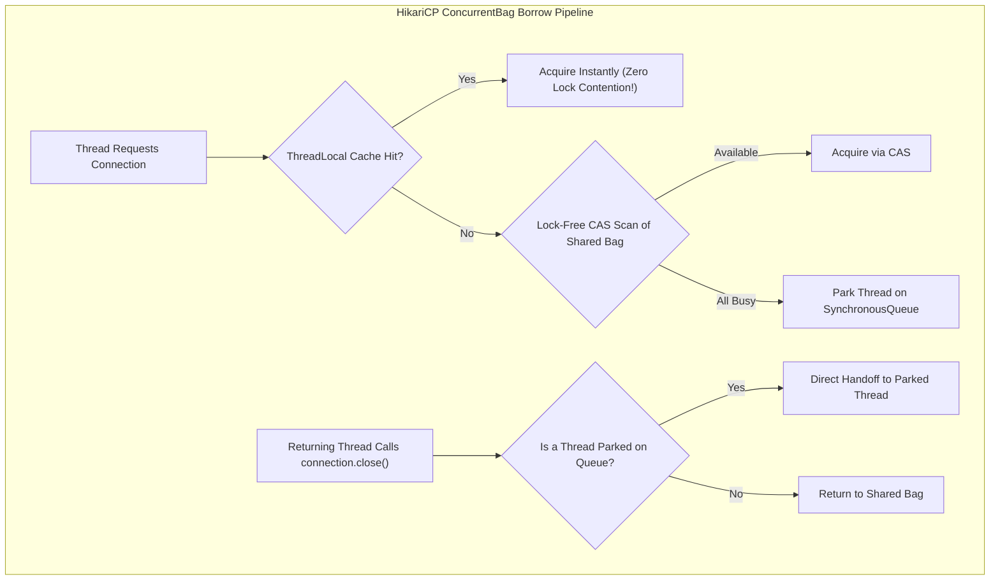
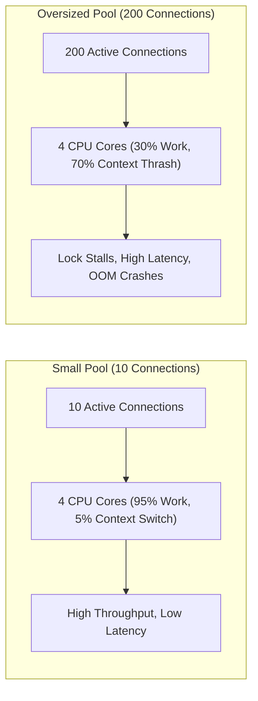

Every enterprise Java framework that touches a relational database—whether it is Spring Data JPA, Hibernate, MyBatis, or jOOQ—is an abstraction layer resting upon a single foundational specification: **Java Database Connectivity (JDBC)**.

When your application is healthy, ORM libraries make database access feel like manipulating ordinary Java objects. But when production begins stalling, transactions deadlock, and thread dumps show hundreds of threads blocked on `HikariPool-1 - Connection is not available`, your high-level abstractions cannot save you.

To diagnose and resolve severe database bottlenecks, you must understand what happens over the physical network socket: how the database server parses SQL, how `PreparedStatement` binaries prevent injection attacks, and how high-performance connection pools like **HikariCP** manage scarce operating system sessions.

```mermaid
flowchart TD
    subgraph "The JDBC Execution Topology"
        App["Java Application Logic"] --> Pool["HikariCP Connection Pool"]
        
        Pool -->|Borrows Lease| Conn["JDBC Connection (java.sql.Connection)"]
        Conn -->|Pre-compiles SQL AST| PS["PreparedStatement (java.sql.PreparedStatement)"]
        
        PS -->|Transmits Parameters over Wire| DB["PostgreSQL / MySQL Server"]
        DB -->|Returns Cursor Stream| RS["ResultSet (java.sql.ResultSet)"]
        
        RS -->|Maps Columns| DTO["Java Domain Record / Entity"]
        DTO --> Close["try-with-resources: Return Connection to Pool"]
        Close --> Pool
    end
```



---

## The Physical Anatomy of a Database Connection

A database connection is not a lightweight Java heap reference. It is an expensive, stateful, resource-heavy operating system bridge:
1. **TCP Handshake & SSL/TLS Negotiation**: Establishing the raw network socket connection between your application server and the database server.
2. **Process Allocation**: On databases like PostgreSQL, every new connection causes the operating system to fork a brand-new backend worker process, reserving native memory for sorting buffers (`work_mem`), statement execution caches, and lock tables.
3. **Authentication Handshake**: Exchanging cryptographic credentials, tenant schemas, and connection character encodings.

Physically establishing a single connection takes between **50 to 150 milliseconds** of latency and consumes 5 to 10MB of memory on the database host.

If your web server created a new physical connection for every incoming HTTP request, your database server would collapse under CPU context switching and memory starvation within seconds.

---

## JDBC Resource Hierarchy and the PreparedStatement Defense

The core JDBC API is defined in `java.sql`. It follows a nested resource ownership model where every resource must be closed in reverse order of creation:

```mermaid
flowchart TD
    subgraph "Nested JDBC Resource Lifecycle"
        DS["DataSource (Pool / Factory)"] -->|1. getConnection()| C["Connection"]
        C -->|2. prepareStatement(sql)| S["PreparedStatement"]
        S -->|3. executeQuery()| R["ResultSet"]
        
        R -.->|AutoCloseable: Closes First| S
        S -.->|AutoCloseable: Closes Second| C
        C -.->|AutoCloseable: Returns Lease to Pool| DS
    end
```

### The Physics of SQL Injection

Consider the classic rookie vulnerability:

```java
// DANGEROUS CODE VULNERABLE TO SQL INJECTION:
String sql = "SELECT * FROM users WHERE username = '" + userInput + "' AND password = '" + passInput + "'";
Statement stmt = connection.createStatement();
ResultSet rs = stmt.executeQuery(sql);
```

If an attacker supplies `' OR '1'='1` as the username, the database's SQL Lexer and Parser parse the input as raw SQL grammar rather than literal text data. The Abstract Syntax Tree (AST) generated by the database optimizer is fundamentally altered:

```sql
SELECT * FROM users WHERE username = '' OR '1'='1' AND password = '...'
```

The `'1'='1'` condition evaluates to `true` for every row in the table, bypassing authentication completely.

### Why PreparedStatement Prevents SQL Injection

When you use a `PreparedStatement`, the execution lifecycle is split into two completely separate phases over the database wire protocol:

```java
String sql = "SELECT id, email, balance FROM users WHERE username = ? AND password = ?";
try (Connection conn = dataSource.getConnection();
     PreparedStatement ps = conn.prepareStatement(sql)) {
    
    ps.setString(1, userInput);
    ps.setString(2, passInput);
    
    try (ResultSet rs = ps.executeQuery()) {
        // Safe mapping
    }
}
```

1. **Pre-Compilation Phase**: The Java driver sends the SQL string with `?` placeholders to the database server. The database parses the SQL text, builds the Abstract Syntax Tree (AST), validates table schemas, and compiles an execution plan. **The structure of the query is permanently frozen.**
2. **Parameter Binding Phase**: The parameter values (`userInput`, `passInput`) are transmitted separately as raw typed data over the binary protocol. 

Even if the user input contains `'; DROP TABLE users; --`, the database treats those characters as a literal text value to match against the `username` column. The database engine never re-parses or re-compiles the query text, making SQL injection physically impossible!

---

## ResultSets and the wasNull() Primitive Pitfall

A `ResultSet` represents a cursor pointing to data rows returned by the query. The cursor initially points **before the first row**. Invoking `rs.next()` advances the cursor to the next record:

```java
public record UserAccount(long id, String email, Integer loyaltyPoints) {}

public Optional<UserAccount> findAccount(DataSource dataSource, long accountId) throws SQLException {
    String sql = "SELECT id, email, loyalty_points FROM users WHERE id = ?";
    
    try (Connection conn = dataSource.getConnection();
         PreparedStatement ps = conn.prepareStatement(sql)) {
        
        ps.setLong(1, accountId);
        
        try (ResultSet rs = ps.executeQuery()) {
            if (!rs.next()) {
                return Optional.empty(); // No row found
            }
            
            long id = rs.getLong("id");
            String email = rs.getString("email");
            
            // THE FATAL TRAP:
            int points = rs.getInt("loyalty_points");
            Integer safePoints = rs.wasNull() ? null : points;
            
            return Optional.of(new UserAccount(id, email, safePoints));
        }
    }
}
```

### The wasNull() Trap

Java primitive types (`long`, `int`, `double`, `boolean`) cannot be `null`. 

When a database column contains a SQL `NULL`, the JDBC driver cannot assign `null` to a primitive `int`. By JDBC specification, **it returns default primitive zero (`0`)**!

If an account has `loyalty_points = NULL` (meaning unassigned or pending), calling `rs.getInt("loyalty_points")` returns `0`. Your application business logic will mistakenly treat the user as having zero points!

> [!WARNING]
> To determine whether a column was actually `NULL` in the database, you **must invoke `rs.wasNull()` immediately after reading the primitive value**, or cast the result to an `Integer` object.

---

## Managing Transactions Manually with JDBC

By default, every JDBC connection operates in **Auto-Commit Mode**: every individual SQL statement executed is treated as its own independent transaction and committed immediately.

To coordinate multi-statement atomic operations (such as transferring money from Account A to Account B), you must disable auto-commit, execute your statements, invoke `commit()`, and roll back inside a `catch` block on error:

```java
public class BankTransferService {
    private final DataSource dataSource;

    public BankTransferService(DataSource dataSource) {
        this.dataSource = dataSource;
    }

    public void transfer(long fromAccount, long toAccount, BigDecimal amount) throws SQLException {
        try (Connection conn = dataSource.getConnection()) {
            boolean originalAutoCommit = conn.getAutoCommit();
            conn.setAutoCommit(false); // Begin manual transaction boundary

            try (PreparedStatement debit = conn.prepareStatement(
                     "UPDATE accounts SET balance = balance - ? WHERE id = ? AND balance >= ?");
                 PreparedStatement credit = conn.prepareStatement(
                     "UPDATE accounts SET balance = balance + ? WHERE id = ?")) {

                // Step 1: Debit sender
                debit.setBigDecimal(1, amount);
                debit.setLong(2, fromAccount);
                debit.setBigDecimal(3, amount); // Guard against negative balances
                
                int debitCount = debit.executeUpdate();
                if (debitCount != 1) {
                    throw new SQLException("Debit failed: Insufficient balance or account missing");
                }

                // Step 2: Credit recipient
                credit.setBigDecimal(1, amount);
                credit.setLong(2, toAccount);
                
                int creditCount = credit.executeUpdate();
                if (creditCount != 1) {
                    throw new SQLException("Credit failed: Recipient account missing");
                }

                conn.commit(); // Commit all operations atomically
            } catch (SQLException ex) {
                conn.rollback(); // Rollback sender debit on any failure!
                throw ex;
            } finally {
                conn.setAutoCommit(originalAutoCommit); // Restore pool state
            }
        }
    }
}
```

---

## HikariCP: The Gold Standard Connection Pool

Spring Boot 2 and 3 default to **HikariCP** as their connection pool. Created by Brett Wooldridge, HikariCP is renowned for being up to 100x faster than legacy connection pools (like c3p0, Apache DBCP, and BoneCP).

### Why HikariCP Is So Fast: Internal Architecture

1. **FastList**: Standard `ArrayList.remove(Object)` performs a linear scan from index 0 to the end of the array. When closing JDBC statements, statements are almost always closed in reverse order of creation (LIFO). HikariCP replaces `ArrayList` with `FastList`, which scans from the tail backward and removes element index bounds checking, saving millions of CPU cycles.
2. **ConcurrentBag (Lock-Free Borrowing)**: Traditional pools use coarse-grained `ReentrantLock` or synchronized queues to hand out connections, causing massive thread contention under load. HikariCP invented `ConcurrentBag`:
   - It maintains a `ThreadLocal` cache of connections.
   - When a thread requests a connection, it first checks its own `ThreadLocal` list without acquiring any lock.
   - If empty, it attempts a lock-free scan of shared connections using Compare-And-Swap (CAS).
   - If all connections are in use, it registers on a handoff `SynchronousQueue` waiting for another thread to release a connection.



---

## The Database Pool Sizing Formula

A common misconception among developers is: *"More connections equal more throughput. We have 200 HTTP worker threads, so our database pool size should be 200."*

**This is completely false.** Setting your pool size to 200 on a standard database server will actively destroy performance.

A database server is governed by hardware limits: CPU cores, disk I/O channels, and RAM bus bandwidth. When 200 database threads execute queries simultaneously on an 8-core database server, the CPU cores spend more time thrashing between thread contexts and waiting for disk I/O than executing SQL.

### The PostgreSQL Sizing Formula

PostgreSQL core architects established the canonical connection pool sizing formula:

```
Optimal Connections = (Available CPU Cores * 2) + Effective Spindle Count (Disks)
```

For a modern cloud database running on an AWS EC2 instance with 4 vCPUs and high-speed NVMe SSD storage:
```
Pool Size = (4 * 2) + 1 = 9 connections!
```

A connection pool of **10 to 15 connections** will achieve significantly higher throughput and drastically lower query latency than a pool of 100 connections!



---

## Production Configuration and Leak Detection

Here is a battle-tested HikariCP production configuration:

```java
import com.zaxxer.hikari.HikariConfig;
import com.zaxxer.hikari.HikariDataSource;
import javax.sql.DataSource;

public class ProductionDataSourceFactory {
    public static DataSource createDataSource() {
        HikariConfig config = new HikariConfig();
        
        config.setJdbcUrl("jdbc:postgresql://db.prod.internal:5432/orders");
        config.setUsername(System.getenv("DB_USER"));
        config.setPassword(System.getenv("DB_PASS"));

        // Pool Sizing
        config.setMaximumPoolSize(16); // Bounded strictly according to DB core capacity
        config.setMinimumIdle(16);     // Fixed-size pool prevents churn and latency spikes

        // Timeouts
        config.setConnectionTimeout(3000);  // Fail fast: Throw exception if pool is exhausted for 3s
        config.setIdleTimeout(600000);      // 10 minutes
        config.setMaxLifetime(1800000);     // 30 minutes (Must be shorter than DB server max connection life!)

        // Connection Leak Detection
        config.setLeakDetectionThreshold(5000); // Alert if connection is checked out longer than 5 seconds!

        return new HikariDataSource(config);
    }
}
```

### The leakDetectionThreshold Lifesaver

If a developer forgets to close a connection inside a `try-with-resources` block, the connection is never returned to the pool. Over time, the pool slowly starves until all connections are permanently checked out.

When you configure `setLeakDetectionThreshold(5000)`, HikariCP captures a stack trace when a connection is borrowed. If that connection is not closed within 5 seconds, HikariCP logs a terrifying warning with the **exact line of code where the connection was leaked**:

```text
[WARN] Connection leak detection triggered for connection org.postgresql.jdbc.PgConnection@4a92c77!
  Thread "http-nio-8080-exec-4" allocated connection at:
    com.enterprise.service.ReportService.generateReport(ReportService.java:84)
```

---

## Senior Engineer Interview Crucible

### How does a PreparedStatement physically prevent SQL injection at the database protocol level?
`PreparedStatement` separates query structure from parameter data. When `prepareStatement(sql)` is executed, the SQL text containing `?` placeholders is sent to the database engine. The database parses the SQL, generates an Abstract Syntax Tree (AST), validates schema permissions, and compiles an execution plan. The query topology is permanently frozen.

When the parameters are bound via `ps.setString(1, input)` and `executeQuery()` is called, the driver transmits the parameter values separately across the wire in a binary parameter packet. The database engine maps the values directly into the execution plan slots without re-parsing the SQL grammar, making it physically impossible for malicious input to alter query logic.

### Why does rs.getInt() return 0 for a SQL NULL, and how do you safely map nullable numeric columns in JDBC?
Java primitive types cannot hold `null`. By JDBC specification, when a primitive getter (`getInt`, `getLong`, `getDouble`) encounters a SQL `NULL`, it returns the default primitive zero (`0`).

To map nullable numeric columns safely:
1. Immediately invoke `rs.wasNull()` after reading the column:
   ```java
   int points = rs.getInt("loyalty_points");
   Integer finalPoints = rs.wasNull() ? null : points;
   ```
2. Or read the column as an object using `rs.getObject("loyalty_points", Integer.class)`.

### Why does having a connection pool of 200 connections often make a database slower than a pool of 15 connections?
A database server has fixed physical hardware resources: CPU cores, disk I/O channels, and RAM bus bandwidth. 

When 200 connections execute queries concurrently on an 8-core server, the operating system kernel is forced to time-slice and context-switch across 200 competing processes. CPU cycles are wasted on thread scheduling, L1/L2 cache lines are constantly invalidated, and memory bus contention spikes. Furthermore, transactions contend for disk buffer pages and row locks, leading to lock queuing and cascade stalls.

A smaller pool of 15 connections keeps the 8 CPU cores fully saturated executing actual SQL without context-switching overhead, completing queries faster and achieving significantly higher overall system throughput.

### What is the purpose of HikariCP's maxLifetime setting, and why must it be set shorter than the database or firewall idle timeout?
`maxLifetime` controls the maximum lifespan of a physical database connection in the pool. When a connection reaches its `maxLifetime`, HikariCP gracefully closes it when it is returned to the pool and replaces it with a fresh connection.

It must be configured to be **at least 30 to 60 seconds shorter than the database server's connection timeout or any intermediate network firewall/load balancer idle timeout**. If a network firewall silently terminates an idle TCP socket after 30 minutes, but HikariCP believes the connection is still alive, a thread attempting to use that connection will suffer a network socket timeout or `Connection reset by peer` error. Setting `maxLifetime` shorter ensures that HikariCP retires the connection before network intermediaries terminate it.
