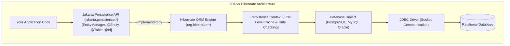
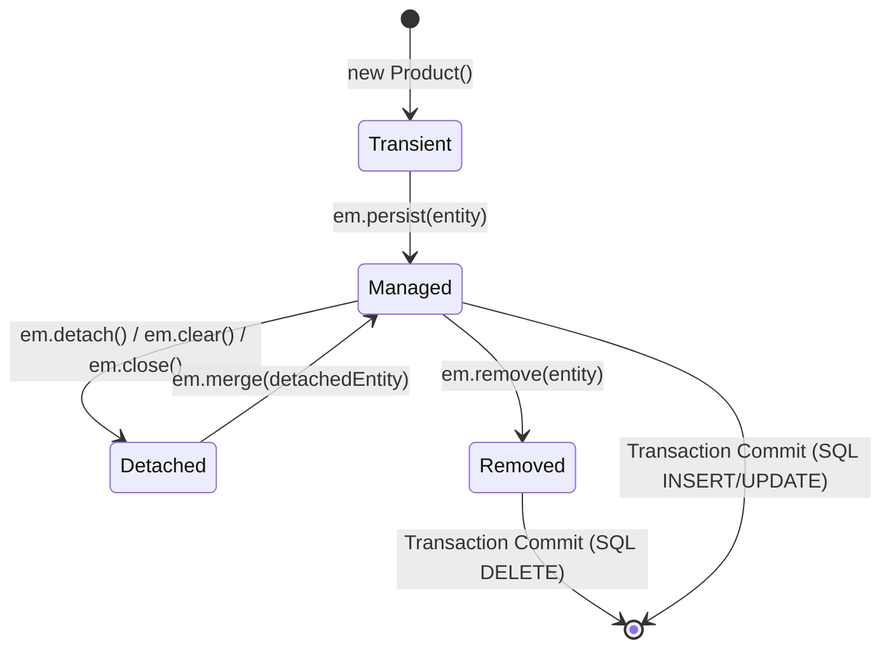
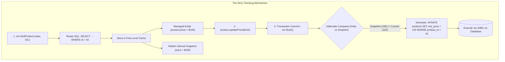

In the early days of enterprise Java, developers wrote thousands of lines of boilerplate JDBC code: opening connections, binding parameters into `PreparedStatement` instances by index number, iterating through `ResultSet` cursors, and manually constructing domain objects column by column.

The **Object-Relational Mapping (ORM)** paradigm was born to bridge the fundamental divide known as the **Object-Relational Impedance Mismatch**:
- **Object-Oriented Java** thinks in networks of interconnected heap objects, references, inheritance, polymorphism, and encapsulation.
- **Relational Databases** think in tabular sets, foreign key constraints, primary keys, and relational algebra.

To standardize ORM across the Java ecosystem, Sun Microsystems and the Java Community Process created the **Java Persistence API (JPA)**, now governed by the Eclipse Foundation as **Jakarta Persistence**.

JPA is purely a **specification** (a collection of interfaces, annotations, and contracts in `jakarta.persistence.*`). **Hibernate ORM** is the battle-tested, high-performance engine that implements that specification.



---

## Anatomy of a Jakarta Persistence Entity

An entity is an ordinary Java class whose state is persisted to a database table. In Jakarta Persistence, an entity must satisfy specific structural rules:
1. It must be annotated with `@Entity`.
2. It must have a **no-argument constructor** (public or protected) so the Hibernate reflection engine can instantiate it.
3. It must have a dedicated identifier field annotated with `@Id`.
4. It must not be `final`, and its persistent methods/fields must not be `final` (so Hibernate can generate dynamic CGLIB/ByteBuddy runtime proxies for lazy loading).

```java
import jakarta.persistence.*;
import java.math.BigDecimal;
import java.time.Instant;
import java.util.Objects;

@Entity
@Table(name = "products")
public class Product {

    @Id
    @GeneratedValue(strategy = GenerationType.SEQUENCE, generator = "product_seq_gen")
    @SequenceGenerator(name = "product_seq_gen", sequenceName = "products_id_seq", allocationSize = 50)
    @Column(name = "product_id")
    private Long id;

    @Column(name = "sku", nullable = false, unique = true, length = 64)
    private String sku;

    @Column(name = "display_name", nullable = false)
    private String name;

    @Column(name = "unit_price", nullable = false, precision = 12, scale = 2)
    private BigDecimal price;

    @Column(name = "created_at", nullable = false, updatable = false)
    private Instant createdAt;

    // Mandatory No-Arg Constructor for Hibernate Proxy Instantiation
    protected Product() {}

    public Product(String sku, String name, BigDecimal price) {
        this.sku = Objects.requireNonNull(sku, "SKU cannot be null");
        this.name = Objects.requireNonNull(name, "Name cannot be null");
        this.price = Objects.requireNonNull(price, "Price cannot be null");
        if (price.compareTo(BigDecimal.ZERO) < 0) {
            throw new IllegalArgumentException("Price cannot be negative");
        }
        this.createdAt = Instant.now();
    }

    // Business Methods
    public void updatePrice(BigDecimal newPrice) {
        Objects.requireNonNull(newPrice);
        if (newPrice.compareTo(BigDecimal.ZERO) < 0) {
            throw new IllegalArgumentException("Price cannot be negative");
        }
        this.price = newPrice;
    }

    public Long getId() { return id; }
    public String getSku() { return sku; }
    public String getName() { return name; }
    public BigDecimal getPrice() { return price; }
    public Instant getCreatedAt() { return createdAt; }
}
```

---

## The Four Entity Lifecycle States

Every Java object in a JPA application exists in one of four strictly defined lifecycle states relative to the **Persistence Context**:



### Transient (New)
The object was instantiated in memory via `new Product("SKU-1", "Laptop", 999.0)`. 
- It has no persistent identity (`id == null`).
- It is not associated with an active `EntityManager` or Persistence Context.
- If the application drops the reference, it is garbage collected like any ordinary Java object.

### Managed (Persistent)
The entity is actively tracked by the **Persistence Context**.
- It has a database identifier.
- It represents a row in the database (or one that will exist upon commit).
- **Automatic Dirty Checking**: Any modification to its fields via business methods or setters is automatically detected by Hibernate and written to the database during flush/commit.

### Detached
The entity has a database identifier, but is **no longer tracked** by an active Persistence Context.
- An entity becomes detached when the `EntityManager` closes, or when `em.clear()` or `em.detach(entity)` is called.
- Changes made to a detached entity are **NOT** tracked by Hibernate and will not be saved automatically.
- Calling `em.merge(detachedEntity)` copies the detached state into a fresh *managed* instance.

### Removed
The entity was passed to `em.remove(managedEntity)`.
- It remains in memory until the transaction finishes.
- At transaction commit or flush, Hibernate generates a SQL `DELETE` statement to remove the row from the database.

---

## The First-Level Cache and Automatic Dirty Checking

One of the most frequent questions from junior engineers is: **"Where is the `em.update()` method in JPA?"**

There is no `update()` method in JPA. You never explicitly tell Hibernate to update a record. Instead, Hibernate uses the **First-Level Cache (Persistence Context)** and **Automatic Dirty Checking**.

### How Dirty Checking Works Under the Hood

When an entity is loaded from the database (via `em.find()` or JPQL), Hibernate does two things inside the Persistence Context:
1. It loads the entity into memory and returns a reference to your application.
2. It takes an internal, deep-copy **Snapshot** of the entity's exact state and stores it in the First-Level Cache.



When the transaction is about to commit, `em.flush()` is triggered. Hibernate iterates through every managed entity in the Persistence Context and compares its current field values against its original internal snapshot:
- If all fields match the snapshot, Hibernate does nothing.
- If any field has changed, Hibernate automatically constructs and executes an optimized SQL `UPDATE` statement.

### The Repeatable Read Advantage of the L1 Cache

The Persistence Context also acts as a performance cache for identical lookups within the same transaction:

```java
Product p1 = em.find(Product.class, 42L); // Executes SQL SELECT over JDBC network
Product p2 = em.find(Product.class, 42L); // ZERO SQL! Returned instantly from L1 Cache!

System.out.println(p1 == p2); // TRUE! Both point to the exact same Java heap memory address!
```

> [!CAUTION]
> **The L1 Cache Heap Bloat Hazard**:
> The First-Level Cache lives for the duration of the `EntityManager` transaction. If you process a batch job that loads 100,000 entities in a single transaction, the Persistence Context retains all 100,000 entities and their 100,000 internal snapshots in JVM memory! 
> This will rapidly trigger `OutOfMemoryError: Java heap space`. For batch operations, you must periodically flush and clear the context:
> ```java
> if (i % 50 == 0) {
>     em.flush(); // Synchronize pending SQL to database
>     em.clear(); // Evict all managed entities to reclaim heap RAM
> }
> ```

---

## Primary Key Generation: IDENTITY vs SEQUENCE

How an entity generates its primary key determines whether Hibernate can batch inserts over the network.

### GenerationType.IDENTITY (The Batching Killer)

```java
@Id
@GeneratedValue(strategy = GenerationType.IDENTITY)
private Long id;
```

`IDENTITY` delegates ID generation to the database's `AUTO_INCREMENT` (MySQL) or `GENERATED ALWAYS AS IDENTITY` (PostgreSQL) column.

**The Fatal Flaw**: The database only generates the ID when the physical SQL `INSERT` statement is executed on the table. But Hibernate requires an entity to have an ID *immediately* upon calling `em.persist(entity)` so it can register it in the First-Level Cache map.

As a result, **`IDENTITY` forces Hibernate to execute an immediate SQL `INSERT` on every single `persist()` call, completely disabling JDBC batching!** Inserting 1,000 records requires 1,000 separate network round-trips to the database.

### GenerationType.SEQUENCE (The High-Performance Gold Standard)

```java
@Id
@GeneratedValue(strategy = GenerationType.SEQUENCE, generator = "order_seq")
@SequenceGenerator(name = "order_seq", sequenceName = "orders_id_seq", allocationSize = 50)
private Long id;
```

`SEQUENCE` uses a standalone database sequence object (supported by PostgreSQL, Oracle, and modern MariaDB).

**How Hibernate Optimizes with `allocationSize`**:
1. When your application starts, Hibernate calls `nextval('orders_id_seq')` once over the network.
2. The sequence advances by 50 in the database (e.g., from 1 to 51).
3. Hibernate now knows it owns the next 50 IDs (1 through 50) locally in JVM memory!
4. For the next 50 `em.persist()` calls, **zero database network round-trips occur**. Hibernate assigns IDs in-memory instantly.
5. Because IDs are assigned in-memory, Hibernate defers all `INSERT` statements until the end of the transaction and executes them as a single, ultra-fast **JDBC batch insert**.

---

## The Danger of hbm2ddl.auto in Production

Hibernate provides a configuration property called `hibernate.hbm2ddl.auto` (in Spring Boot: `spring.jpa.hibernate.ddl-auto`):
- `create-drop`: Creates tables on startup, drops them on shutdown (great for unit tests).
- `create`: Drops existing tables and creates fresh ones.
- `update`: Inspects Java `@Entity` classes and attempts to alter existing database tables to match.
- `validate`: Verifies that database tables and columns match the Java entities, failing application startup if any mismatch exists.

### Why `update` in Production Is Fatal

1. **`update` never drops columns or constraints**: If you rename a field from `email` to `emailAddress`, Hibernate adds an `emailAddress` column and leaves the old `email` column abandoned in the table.
2. **Accidental Exclusive Table Locks**: On tables with millions of rows, Hibernate's automatic DDL can trigger `AccessExclusiveLock` table rewrites during application startup, freezing production.
3. **No Rollback or Audit History**: No record of what changed or who ran it exists.

> [!IMPORTANT]
> **Production Rule**: In staging and production environments, **always set `hibernate.hbm2ddl.auto = validate`** (or `none`). All database schema migrations must be strictly managed via Flyway or Liquibase!

---

## Senior Engineer Interview Crucible

### Why is there no em.update() method in the standard JPA EntityManager API, and how does Dirty Checking work?
JPA treats entities as stateful domain models managed within a Unit of Work (the Persistence Context). When an entity is loaded into the context, Hibernate stores a hidden snapshot of its property values in its First-Level Cache. 

Application code mutates the entity using standard Java domain methods or setters. During transaction commit or `em.flush()`, Hibernate compares the current state of every managed entity against its original snapshot. If any property differs, Hibernate automatically generates and executes an optimized SQL `UPDATE` statement containing only the modified columns. Because mutation tracking is automatic, an explicit `update()` method is unnecessary.

### Why does GenerationType.IDENTITY disable Hibernate's JDBC batch insert optimization, whereas GenerationType.SEQUENCE preserves it?
Hibernate requires every managed entity to possess a valid primary key identifier before registering it in the First-Level Cache. 

With `GenerationType.IDENTITY`, the ID is generated by the database table engine upon row insertion. To learn the generated ID, Hibernate cannot buffer or batch the operation; it must execute an immediate SQL `INSERT` statement over JDBC during `em.persist()` to fetch the ID.

With `GenerationType.SEQUENCE`, Hibernate queries a database sequence independently of table insertion. Using the `allocationSize` parameter (e.g., 50), Hibernate fetches a pool of IDs in a single round-trip and allocates them to entities in JVM memory. Because entities receive their IDs immediately in memory, Hibernate buffers all insert operations and flushes them as a single JDBC batch write upon transaction commit.

### What is the First-Level Cache, what is its scope, and why can loading 100,000 entities in a single transaction cause an OutOfMemoryError?
The First-Level Cache is the in-memory cache intrinsically bound to a single `EntityManager` instance (and therefore scoped to a single transaction). It guarantees repeatable reads and reference equality (`a == b`) for identical IDs within that transaction.

Loading 100,000 entities in a single transaction causes `OutOfMemoryError` because the Persistence Context never evicts managed entities on its own until the `EntityManager` closes. Furthermore, for every entity loaded, Hibernate stores an additional snapshot copy for dirty checking. 100,000 entities create 200,000 object graphs in the JVM heap, rapidly exhausting memory. To process bulk records safely, you must periodically call `em.flush()` to send changes to the database and `em.clear()` to evict entities from the cache.

### What is the exact difference between em.persist() and em.merge(), and why does calling em.merge(detachedEntity) not make detachedEntity managed?
- **`em.persist(entity)`**: Takes a transient entity with no ID, assigns an ID, and directly attaches that specific object reference to the Persistence Context as a managed entity. The passed instance is now managed.
- **`em.merge(detachedEntity)`**: Accepts a detached entity and looks up its ID in the Persistence Context or database. It copies the field values from the detached entity onto a **new or existing managed entity instance** and returns that managed reference. 

Crucially, **`em.merge()` does NOT make the passed `detachedEntity` managed**. The original object remains detached in memory. If subsequent changes made to the entity need to be saved, the developer must discard the original reference and work exclusively with the object returned by `em.merge()`:
```java
Product managedProduct = em.merge(detachedProduct);
managedProduct.updatePrice(newPrice); // TRACKED AND SAVED
detachedProduct.updatePrice(newPrice); // IGNORED AND LOST!
```
