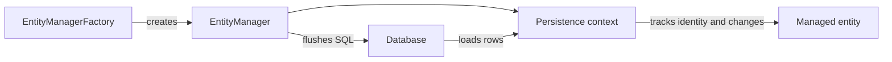
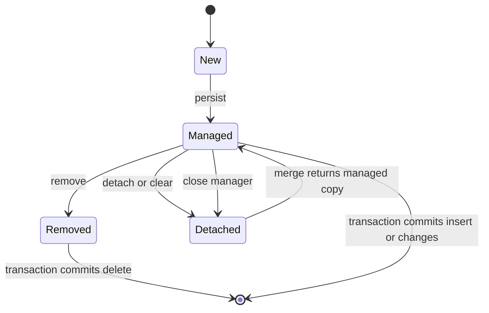

JDBC gives Java direct control of SQL and result mapping. An **object-relational mapper (ORM)** maps domain objects to relational rows so application code can work with entities while the provider generates SQL. **Jakarta Persistence** defines the standard API and mapping model; **Hibernate ORM** is one provider that implements that standard and adds provider-specific features.

Examples use Jakarta Persistence 3.2 and Hibernate ORM 7.2.25.Final, which the Hibernate guide documents as compatible with Java 17 or 21. The API examples are standard Jakarta Persistence unless marked Hibernate-specific. This repository does not declare either dependency, so the snippets require a Jakarta Persistence provider and a JDBC driver on the classpath.

## Mapping an entity

An entity is an ordinary class with persistent identity and state. Annotations describe how the class and its fields map to a table and columns:

```java
import jakarta.persistence.Column;
import jakarta.persistence.Entity;
import jakarta.persistence.GeneratedValue;
import jakarta.persistence.GenerationType;
import jakarta.persistence.Id;
import jakarta.persistence.Table;
import java.math.BigDecimal;
import java.util.Objects;

@Entity
@Table(name = "product")
public class Product {
    @Id
    @GeneratedValue(strategy = GenerationType.IDENTITY)
    @Column(name = "product_id")
    private Long id;

    @Column(name = "sku", nullable = false, unique = true, length = 80)
    private String sku;

    @Column(name = "price", nullable = false, precision = 12, scale = 2)
    private BigDecimal price;

    protected Product() {
    }

    public Product(String sku, BigDecimal price) {
        this.sku = Objects.requireNonNull(sku);
        this.price = Objects.requireNonNull(price);
        if (sku.isBlank() || price.signum() < 0) {
            throw new IllegalArgumentException("Invalid product values");
        }
    }

    public Long getId() {
        return id;
    }

    public String getSku() {
        return sku;
    }

    public BigDecimal getPrice() {
        return price;
    }

    public void changePrice(BigDecimal price) {
        Objects.requireNonNull(price);
        if (price.signum() < 0) {
            throw new IllegalArgumentException("price must not be negative");
        }
        this.price = price;
    }
}
```

In Jakarta Persistence 3.2, entity classes must be non-final and have a public or protected no-argument constructor; records and enums cannot be entities. The provider needs a mutable object it can instantiate and manage. Put domain validation in constructors and methods as well as schema constraints: annotation metadata is not a substitute for application invariants, and schema generation settings may not be enabled.

`@Id` defines persistent identity. `@GeneratedValue` delegates identifier generation to a strategy supported by the provider and database; this example uses `IDENTITY`, but sequence, table, and UUID strategies have different portability and operational properties. `@Column` describes mapping metadata, not necessarily a change to an already deployed schema.

## EntityManager and the persistence context

An `EntityManager` is the API through which application code interacts with a **persistence context**. A persistence context tracks managed entities and, for each entity identity, maintains at most one managed instance. Hibernate implements this with a first-level cache and unit-of-work behavior.



The persistence context is more than a cache: it also tracks changes and coordinates synchronization. Calling `persist` makes a new entity managed; changing a managed entity's persistent field is detected by the provider; SQL is typically synchronized during flush, often as the transaction commits. There is no separate JPA `update` method for ordinary managed changes.

A factory is normally created once for an application/persistence unit and reused; create a short-lived `EntityManager` for a unit of work. Do not share one `EntityManager` concurrently between request threads. The factory is designed to create managers; a manager represents mutable context and transaction state.

## Entity lifecycle

An entity's state determines what persistence operations mean:



- **New (transient):** a Java object not yet associated with a persistence context.
- **Managed (persistent):** attached to the context; changes are tracked and may be synchronized.
- **Detached:** has persistent identity but is not currently tracked by an active context.
- **Removed:** still associated with a context but scheduled for deletion at commit.

`merge(detached)` copies state into a managed instance and returns that instance. The original argument does not become managed merely because `merge` was called; use the returned value if subsequent changes must be tracked. `remove` schedules a database delete; the row is not necessarily deleted at the instant `remove` returns.

## Persisting and changing entities in a transaction

For application-managed, resource-local transactions, begin and commit the transaction through `EntityTransaction`, roll it back if work fails, and close the manager:

```java
import jakarta.persistence.EntityManager;
import jakarta.persistence.EntityManagerFactory;
import jakarta.persistence.EntityTransaction;
import java.math.BigDecimal;

public class ProductService {
    private final EntityManagerFactory factory;

    public ProductService(EntityManagerFactory factory) {
        this.factory = factory;
    }

    public long addProduct(String sku, BigDecimal price) {
        try (EntityManager manager = factory.createEntityManager()) {
            EntityTransaction transaction = manager.getTransaction();
            try {
                transaction.begin();
                Product product = new Product(sku, price);
                manager.persist(product);
                transaction.commit();
                return product.getId();
            } catch (RuntimeException failure) {
                if (transaction.isActive()) {
                    try {
                        transaction.rollback();
                    } catch (RuntimeException rollbackFailure) {
                        failure.addSuppressed(rollbackFailure);
                    }
                }
                throw failure;
            }
        }
    }
}
```

The code assumes a resource-local persistence unit. In a Jakarta EE container or a Spring application, transaction and `EntityManager` lifecycle are commonly managed by the container/framework; don't manually begin a second transaction on a container-managed manager.

When an entity is loaded and changed in the same context, the provider detects the change and writes it during flush:

```java
transaction.begin();
Product product = manager.find(Product.class, productId);
if (product == null) {
    throw new IllegalArgumentException("Unknown product: " + productId);
}
product.changePrice(new BigDecimal("19.95"));
transaction.commit();
```

There is no `manager.update(product)` call. After the context closes, `product` is detached. If code changes it later, those changes are only in memory until a managed instance is explicitly updated using an appropriate operation.

## Schema generation

ORM mappings can be used to generate database DDL for local development or disposable tests. This is convenient for experimenting with entity mappings, but it does not make automatic schema changes a safe production deployment strategy. A generated schema may not capture deliberate index choices, data backfills, compatibility sequencing, or database-specific operational requirements.

Use the migration workflow from [Database Migrations](./database-migrations) to evolve shared and production schemas. In development, choose a schema mode intentionally: creating or dropping objects can destroy local data, while an update mode is not a substitute for reviewed migration history. A schema validation mode can help catch mapping/schema disagreement, but it does not prove that the migration will be safe under production load.

Keep schema authority clear. If migrations own the production schema, configure the ORM not to mutate it during normal application startup; otherwise multiple mechanisms can compete to change the same database.

## Benefits, limits, and next steps

- ORM mapping reduces repetitive row-to-object plumbing, but SQL remains important for understanding generated queries and database behavior.
- A persistence context avoids duplicate managed objects for one identity and tracks changes, but it consumes memory and is scoped to a unit of work.
- Lazy loading and relationship traversal can trigger additional queries; fetching strategy and query shape matter. The later Hibernate performance topic covers N+1 queries and batching.
- Detached objects are not live database records. Treat them as data that can become stale, and define transaction boundaries explicitly.
- ORM annotations describe object/table mapping; they do not automatically enforce that every existing database has the intended schema.
- Use plain JDBC for operations where direct SQL control is clearer than entity mapping; JPA does not make JDBC knowledge obsolete.

## Further reading

- Jakarta Persistence 3.2, [Specification overview](https://jakarta.ee/specifications/persistence/3.2/)
- Jakarta Persistence 3.2 API, [`Entity`](https://jakarta.ee/specifications/persistence/3.2/apidocs/jakarta.persistence/jakarta/persistence/Entity.html)
- Jakarta Persistence 3.2 API, [`EntityManager`](https://jakarta.ee/specifications/persistence/3.2/apidocs/jakarta.persistence/jakarta/persistence/EntityManager.html)
- Hibernate ORM 7.2, [User Guide](https://docs.hibernate.org/orm/7.2/userguide/html_single/)
- [JDBC and Connection Pooling](./jdbc-and-connection-pooling)
- [Database Migrations](./database-migrations)
