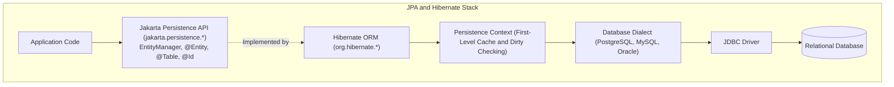
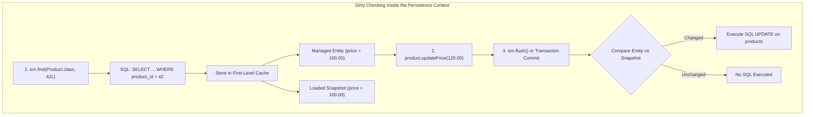
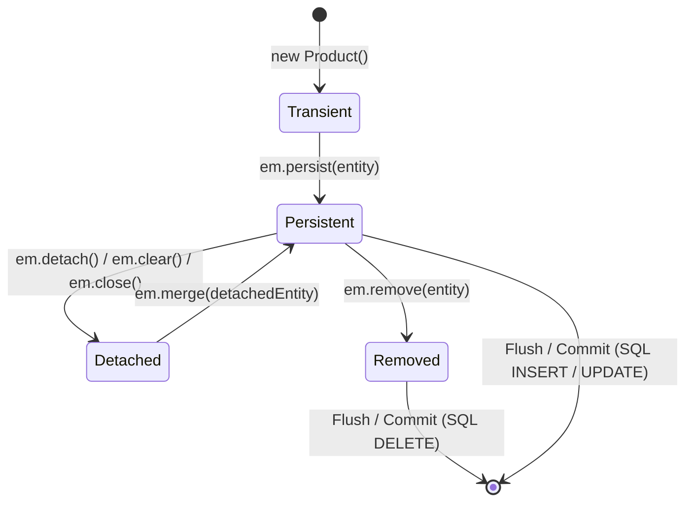

Writing raw JDBC works well for small utilities or specialized reporting queries, but in a typical business application it quickly turns into repetitive plumbing. You open connections, bind positional parameters into `PreparedStatement` objects, walk `ResultSet` cursors column by column, and reconstruct object graphs by hand. Worse, any schema change forces you to hunt down every SQL string and row mapper that touches the altered column.

Object-Relational Mapping (ORM) exists to bridge the gap between two different models of data. Java applications represent state as networks of heap objects with references, inheritance, and encapsulation. Relational databases store state as tables, foreign keys, primary keys, and sets of rows.

In Java, **Jakarta Persistence** (formerly the Java Persistence API, or JPA) defines the standard specification for ORM: annotations, interfaces, lifecycle rules, and the JPQL query language under `jakarta.persistence.*`. **Hibernate ORM** is the most widely used implementation of that specification. Your application code generally talks to Jakarta Persistence interfaces (or Spring Data JPA on top of them), while Hibernate handles SQL generation, caching, dirty checking, and dialect translation behind the scenes.



## Mapping an Entity: @Entity, @Table, @Id, and @Column

An entity is a regular Java class whose instances correspond to rows in a relational table. Jakarta Persistence expects a few structural rules so Hibernate can instantiate and proxy entities at runtime:

- Annotate the class with `@Entity`.
- Provide a `public` or `protected` no-argument constructor. Hibernate uses reflection to instantiate entities when reading rows from a `ResultSet`. Making it `protected` lets Hibernate call it while discouraging application code from creating half-initialized objects.
- Define a primary key field annotated with `@Id`.
- Do not mark the entity class or its persistent methods `final`. Hibernate generates dynamic subclasses via ByteBuddy to support lazy-loading proxies, which fails if a class cannot be subclassed.

By default, Hibernate maps the class name to the table name and field names to column names (Spring Boot's default naming strategy converts camelCase to snake_case automatically). Explicit `@Table` and `@Column` annotations keep the mapping readable and decouple Java refactoring from database column names.

```java
import jakarta.persistence.Column;
import jakarta.persistence.Entity;
import jakarta.persistence.GeneratedValue;
import jakarta.persistence.GenerationType;
import jakarta.persistence.Id;
import jakarta.persistence.SequenceGenerator;
import jakarta.persistence.Table;
import java.math.BigDecimal;
import java.time.Instant;
import java.util.Objects;

@Entity
@Table(name = "products")
public class Product {

    @Id
    @GeneratedValue(strategy = GenerationType.SEQUENCE, generator = "product_seq_gen")
    @SequenceGenerator(
        name = "product_seq_gen",
        sequenceName = "products_id_seq",
        allocationSize = 50
    )
    @Column(name = "product_id")
    private Long id;

    @Column(name = "sku", nullable = false, unique = true, length = 64)
    private String sku;

    @Column(name = "display_name", nullable = false)
    private String name;

    @Column(name = "unit_price", nullable = false, precision = 12, scale = 2)
    private BigDecimal price;

    @Column(name = "created_at", nullable = false, updatable = false)
    private Instant createdAt;

    protected Product() {
        // Required by Jakarta Persistence for reflection and proxy generation
    }

    public Product(String sku, String name, BigDecimal price) {
        this.sku = Objects.requireNonNull(sku, "SKU cannot be null");
        this.name = Objects.requireNonNull(name, "Name cannot be null");
        this.price = requireNonNegative(price);
        this.createdAt = Instant.now();
    }

    public void updatePrice(BigDecimal newPrice) {
        this.price = requireNonNegative(newPrice);
    }

    private static BigDecimal requireNonNegative(BigDecimal value) {
        Objects.requireNonNull(value, "Price cannot be null");
        if (value.compareTo(BigDecimal.ZERO) < 0) {
            throw new IllegalArgumentException("Price cannot be negative");
        }
        return value;
    }

    public Long getId() { return id; }
    public String getSku() { return sku; }
    public String getName() { return name; }
    public BigDecimal getPrice() { return price; }
    public Instant getCreatedAt() { return createdAt; }
}
```

Notice the `@Column` attributes in that example. Setting `nullable = false`, `length = 64`, or `precision = 12, scale = 2` serves two purposes: it documents the schema contract right on the entity, and Hibernate uses those attributes when validating or generating DDL. Attributes like `updatable = false` also affect runtime SQL generation, ensuring Hibernate omits `created_at` from `UPDATE` statements.

## Primary Key Generation: IDENTITY vs SEQUENCE

Choosing a primary key generation strategy has a direct impact on write throughput because of how Hibernate manages its internal cache.

### GenerationType.IDENTITY

```java
@Id
@GeneratedValue(strategy = GenerationType.IDENTITY)
private Long id;
```

With `IDENTITY`, the database assigns the primary key using an `AUTO_INCREMENT` column (MySQL) or `GENERATED BY DEFAULT AS IDENTITY` (PostgreSQL). The catch is that the database only knows the new ID after executing the physical `INSERT` statement. Hibernate, however, needs an identifier immediately when you call `em.persist(entity)` so it can register the entity in the Persistence Context.

Because Hibernate cannot wait until flush time to obtain the ID, `IDENTITY` forces an immediate SQL `INSERT` on every `persist()` call and disables JDBC insert batching in Hibernate. If you insert 500 rows in a transaction, Hibernate sends 500 separate `INSERT` round-trips instead of batching them together.

### GenerationType.SEQUENCE

```java
@Id
@GeneratedValue(strategy = GenerationType.SEQUENCE, generator = "order_seq")
@SequenceGenerator(name = "order_seq", sequenceName = "orders_id_seq", allocationSize = 50)
private Long id;
```

`SEQUENCE` uses a standalone database sequence (supported by PostgreSQL, Oracle, SQL Server, and MariaDB). Because querying a sequence is independent of inserting a table row, Hibernate can fetch IDs ahead of time using its pooled optimizer:

1. Hibernate calls `nextval('orders_id_seq')` once over JDBC.
2. The database sequence increments by 50 (the `INCREMENT BY` on the database sequence must match `allocationSize = 50`).
3. Hibernate keeps that block of 50 IDs in memory and assigns them to the next 50 `persist()` calls with zero database round-trips.
4. Because every entity receives its ID in memory right away, Hibernate can defer the actual `INSERT` statements until flush time and send them as a JDBC batch (when `hibernate.jdbc.batch_size` is configured).

> [!NOTE]
> If your database sequence has `INCREMENT BY 1` while `@SequenceGenerator` leaves `allocationSize` at its default of `50`, Hibernate's pooled optimizer can generate duplicate or negative IDs. Always make sure the sequence increment in your migration script matches `allocationSize`.

## The EntityManager and the Persistence Context

The `EntityManager` is the primary API you use to interact with JPA. Behind every active `EntityManager` sits a **Persistence Context**: an in-memory map of all entity instances currently managed within a unit of work, typically scoped to a single database transaction.

The Persistence Context does three jobs at once:

1. **First-Level (L1) Cache**: Every entity loaded by primary key is stored in the context, keyed by its class and ID. Calling `em.find(Product.class, 42L)` twice inside the same transaction hits the database only once and returns the exact same Java object reference (`p1 == p2` is `true`).
2. **Automatic Dirty Checking**: When Hibernate loads an entity, it records an internal snapshot of its initial property values. You do not call an `em.update()` method because none exists in JPA. Instead, you mutate the entity through normal Java methods and let Hibernate detect what changed.
3. **Write-Behind Buffering**: Hibernate holds pending `INSERT`, `UPDATE`, and `DELETE` operations in memory and sends them together when the Persistence Context flushes, reducing round-trips and ordering statements to satisfy foreign key constraints.



One detail that often surprises developers: by default, when a single field changes on a managed entity, Hibernate still generates an `UPDATE` statement listing all updatable columns of that table. It does this intentionally so the SQL string remains constant and can be cached and reused with JDBC prepared statements. If you have a very wide table where updating unchanged columns causes overhead (or triggers unwanted database triggers), you can annotate the entity with Hibernate's `@DynamicUpdate`, which builds an `UPDATE` statement containing only modified columns at the cost of extra SQL string generation.

### Flush vs Commit

`flush()` and `commit()` are frequently conflated, but they happen at different layers:

- **`em.flush()`** synchronizes the in-memory Persistence Context with the database by sending all queued `INSERT`, `UPDATE`, and `DELETE` SQL statements over the active JDBC connection. The database transaction is still open. Other transactions cannot see those changes (assuming `READ COMMITTED` or stricter isolation), and if an exception rolls the transaction back afterward, the flushed writes are discarded.
- **Transaction `commit()`** tells the database to make all changes durable and visible to other transactions. Under JPA's default `FlushModeType.AUTO`, Hibernate automatically flushes the Persistence Context right before a transaction commits, and also before executing a JPQL query that might read rows affected by pending changes in memory.

### L1 Cache Memory Growth in Batch Jobs

Because the Persistence Context retains every managed entity and its snapshot until the transaction ends, processing large volumes of records in one transaction will steadily consume heap memory. Loading 100,000 entities means keeping 100,000 entity instances plus 100,000 snapshots alive in the JVM heap, which slows down dirty checking and can trigger `OutOfMemoryError`.

For batch imports or bulk updates, flush and clear the context periodically:

```java
public void importProducts(List<Product> products) {
    int batchSize = 50;
    for (int i = 0; i < products.size(); i++) {
        em.persist(products.get(i));

        if (i > 0 && i % batchSize == 0) {
            em.flush(); // Send pending INSERTs to the database
            em.clear(); // Detach all entities so the GC can reclaim memory
        }
    }
    em.flush();
    em.clear();
}
```

## Entity Lifecycle States

Every entity object moves through four well-defined states relative to the Persistence Context: **Transient**, **Persistent (Managed)**, **Detached**, and **Removed**.



### Transient (New)

A transient entity is an ordinary Java object created with `new Product(...)`. It has no database row yet, its generated `@Id` is `null`, and the `EntityManager` knows nothing about it. If nothing holds a reference to it, the garbage collector reclaims it normally.

### Persistent (Managed)

An entity becomes persistent when you pass a transient instance to `em.persist()`, load it via `em.find()` or a JPQL query, or re-attach a detached copy via `em.merge()`. While persistent, it has a database identity (or will receive one on flush), lives in the First-Level Cache, and participates in automatic dirty checking.

### Detached

When the transaction ends and the `EntityManager` closes, or when you explicitly call `em.detach(entity)` or `em.clear()`, managed entities become detached. A detached entity still holds its `@Id` and field values in memory, so you can safely serialize it to a DTO or pass it across layers, but Hibernate no longer tracks mutations to it. Accessing an uninitialized lazy association on a detached entity throws `LazyInitializationException`.

### Removed

Calling `em.remove(managedEntity)` transitions a persistent entity to the removed state. Hibernate schedules a SQL `DELETE` statement for the next flush or transaction commit. Passing a detached entity directly to `em.remove()` throws `IllegalArgumentException`; it must be managed first.

### persist() vs merge()

Understanding the difference between `em.persist()` and `em.merge()` prevents subtle bugs where changes silently vanish:

- **`em.persist(entity)`** takes a transient entity and transitions *that exact object reference* into the persistent state. Any further changes to `entity` within the transaction are tracked and flushed. Calling `persist()` on an already detached entity throws `EntityExistsException`.
- **`em.merge(detachedEntity)`** copies the state of a detached entity onto a managed instance (loading it from the L1 cache or database if needed) and **returns the managed instance**. The original `detachedEntity` argument stays detached.

```java
// Correct usage of persist() and merge()
@Transactional
public void updateAndCreate(Product detachedProduct) {
    // New entity: 'fresh' itself becomes managed
    Product fresh = new Product("SKU-900", "Mechanical Keyboard", new BigDecimal("149.00"));
    em.persist(fresh);
    fresh.updatePrice(new BigDecimal("139.00")); // Tracked and flushed

    // Detached entity: capture the returned managed reference
    Product managed = em.merge(detachedProduct);
    managed.updatePrice(new BigDecimal("89.00"));         // Tracked and flushed
    detachedProduct.updatePrice(new BigDecimal("79.00")); // Ignored! Still detached
}
```

## Implementing equals() and hashCode() for JPA Entities

Writing `equals()` and `hashCode()` for entities requires care because an entity's `@Id` is typically `null` while transient and populated only after persistence.

If you compute `hashCode()` from `id`, adding a transient entity to a `HashSet` places it in a bucket computed from `null`. After `em.persist()`, `id` changes to `42L`, so `hashCode()` now returns a different value. Calling `set.contains(entity)` then looks in the wrong bucket and returns `false` even though the object is still inside the set.

There are two reliable patterns in JPA:

1. **Natural Business Key**: If the entity has an immutable, unique business identifier (such as `sku` or an application-generated UUID assigned in the constructor), base `equals()` and `hashCode()` on that field. Its value never changes across lifecycle transitions.
2. **Generated ID with a Constant `hashCode()`**: When no natural key exists, compare non-null IDs in `equals()` (accounting for Hibernate lazy proxies) and return a fixed value such as `getClass().hashCode()` from `hashCode()`. Returning a constant is valid under the Java `Object.hashCode()` contract and guarantees an entity stays in the same bucket before and after persistence.

```java
import org.hibernate.proxy.HibernateProxy;
import java.util.Objects;

@Override
public final boolean equals(Object o) {
    if (this == o) return true;
    if (o == null) return false;

    Class<?> otherClass = o instanceof HibernateProxy proxy
        ? proxy.getHibernateLazyInitializer().getPersistentClass()
        : o.getClass();
    Class<?> thisClass = this instanceof HibernateProxy proxy
        ? proxy.getHibernateLazyInitializer().getPersistentClass()
        : this.getClass();

    if (thisClass != otherClass) return false;

    Product other = (Product) o;
    return id != null && Objects.equals(id, other.getId());
}

@Override
public final int hashCode() {
    return this instanceof HibernateProxy proxy
        ? proxy.getHibernateLazyInitializer().getPersistentClass().hashCode()
        : getClass().hashCode();
}
```

Using `HibernateProxy` checks ensures equality works even when one reference is a real `Product` instance and the other is an uninitialized Hibernate proxy subclass.

## Generating Schemas Automatically

Hibernate can inspect your `@Entity` metadata at startup and generate or verify database DDL automatically. In Spring Boot, you control this with `spring.jpa.hibernate.ddl-auto` (which maps directly to Hibernate's `hibernate.hbm2ddl.auto` property):

| Setting | Behavior at Startup / Shutdown | Typical Use |
| :--- | :--- | :--- |
| `none` | Hibernate does not touch or inspect the database schema. | Production (when migrations run externally). |
| `validate` | Compares entity mappings against existing tables and columns, failing startup if anything is missing or incompatible. Makes no schema changes. | Staging and production alongside Flyway or Liquibase. |
| `update` | Compares entities against the schema and runs `ALTER TABLE` / `CREATE TABLE` statements to add missing tables or columns. | Quick local prototyping only. |
| `create` | Drops existing mapped tables and recreates them from scratch on startup. | Ephemeral local dev databases. |
| `create-drop` | Same as `create`, and drops all tables when the `SessionFactory` closes cleanly. | Isolated unit/integration tests with H2 or Testcontainers. |

```yaml
# application-prod.yml
spring:
  jpa:
    hibernate:
      ddl-auto: validate
    open-in-view: false
  flyway:
    enabled: true
```

### Why ddl-auto: update Does Not Belong in Production

Using `update` in a shared or production environment causes operational problems that are hard to unwind:

- **It only guesses additive changes**: If you rename a Java field from `email` to `emailAddress`, Hibernate cannot tell whether you renamed a column or added a new one. It creates a new `email_address` column and leaves the old `email` column orphaned with existing user data.
- **Uncontrolled table locks**: Adding a column with a constraint or changing a column type on a multi-million-row table can acquire an exclusive lock (`AccessExclusiveLock` in PostgreSQL) during application boot, blocking live traffic and stalling rolling deployments.
- **No version history or rollback path**: Schema changes are applied implicitly by whichever application pod starts first, with no audit trail, no code review of the actual SQL DDL, and no deterministic way to migrate existing data alongside the schema change.
- **Incomplete DDL modeling**: Hibernate's schema generator does not express partial indexes, PostgreSQL `CONCURRENTLY` index creation, partitioning, check constraints, or multi-step zero-downtime migrations.

In production and staging, pair **Flyway** or **Liquibase** with `spring.jpa.hibernate.ddl-auto: validate` (or `none`). Flyway executes reviewed, versioned SQL migrations first, and then Hibernate's `validate` step acts as a safety net at startup to verify that your Java entity annotations still match the migrated tables.

## Practical Questions

### Why does JPA have no em.update() method, and what happens during dirty checking?
JPA models persistence around a unit of work (the Persistence Context). Whenever you load an entity, Hibernate keeps a snapshot of its loaded state in the First-Level Cache. You mutate the entity using regular Java methods, and when the Persistence Context flushes (before a dependent query or transaction commit), Hibernate compares each managed entity's current fields against its snapshot. For any entity that changed, Hibernate issues an `UPDATE` statement automatically.

### Why does GenerationType.IDENTITY prevent JDBC insert batching while GenerationType.SEQUENCE allows it?
Hibernate requires every managed entity to have a primary key as soon as it enters the Persistence Context. With `IDENTITY`, the database only generates the key when the `INSERT` row is written, so Hibernate must execute each `INSERT` immediately during `em.persist()` rather than buffering statements into a batch. With `SEQUENCE` and an `allocationSize` (for example, 50), Hibernate fetches a block of IDs from the database sequence up front, assigns IDs in memory, and sends the queued `INSERT` statements together as a JDBC batch at flush time.

### What is the difference between em.flush() and committing a transaction?
`em.flush()` pushes pending SQL changes from the Persistence Context to the database over the current JDBC connection, but the transaction stays open and can still be rolled back. Committing a transaction triggers a flush (under default `FlushModeType.AUTO`) and makes the database changes permanent and visible to other transactions.

### Why does calling em.merge(detachedEntity) not make the passed object managed?
`em.merge()` looks up the entity's ID in the Persistence Context (or loads it from the database), copies the field values from `detachedEntity` onto that managed instance, and returns the managed instance. The original `detachedEntity` remains detached, so any further modifications must be made on the object returned by `em.merge()`, not on the argument you passed in.
