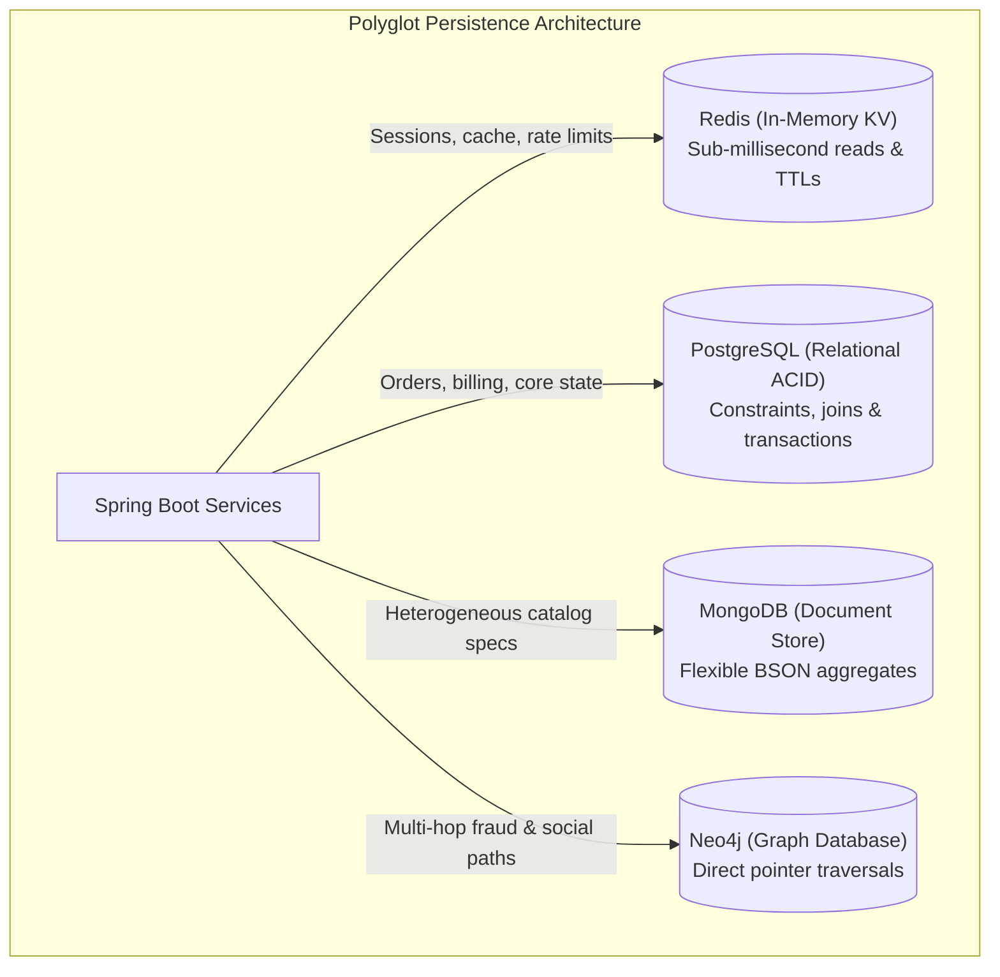
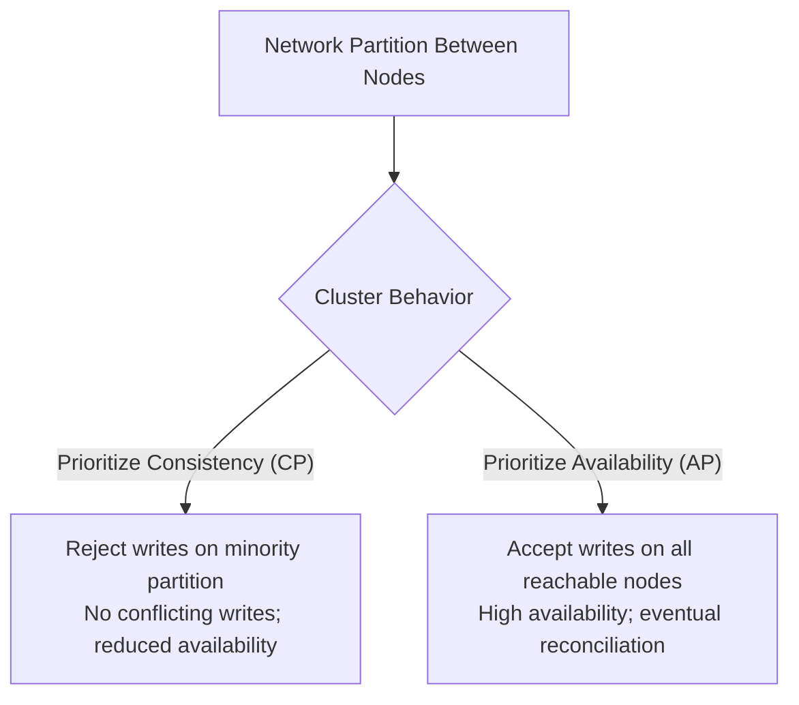
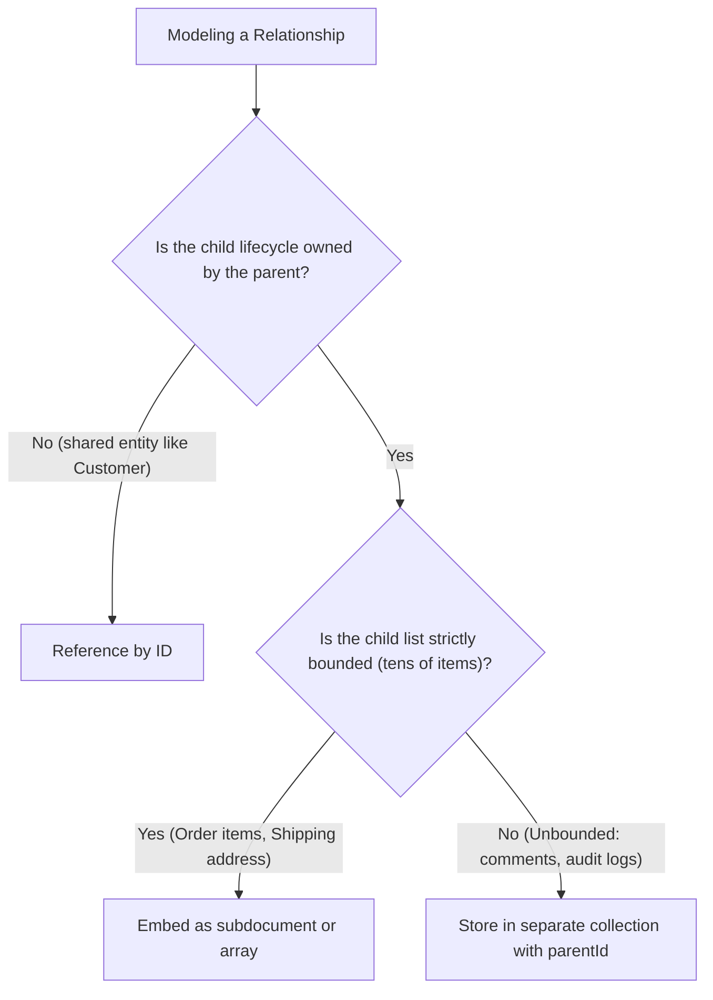
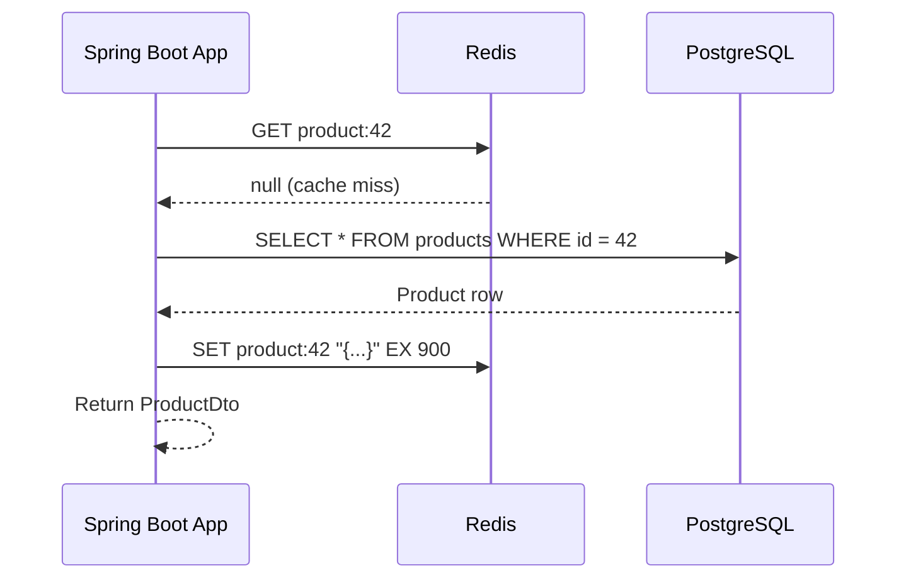

For a few years in the 2010s, it was fashionable to argue that relational databases were obsolete and that every new backend should default to a schema-less document store. Many teams learned the hard way what happens when you put orders, invoices, and user permissions into a store without foreign keys or multi-record relational modeling: validation logic sprawled across application services, reporting queries got painful, and subtle schema drift crept into production collections.

The pendulum has settled into a more practical approach called **polyglot persistence**: keep a relational database as the default system of record, and introduce a specialized NoSQL engine only when a specific access pattern genuinely earns the extra operational cost.

## When to Use SQL vs. NoSQL (And Why PostgreSQL Is Still the Default)

Every extra database in your stack adds real work: another cluster to provision, upgrade, back up, monitor, secure, and keep in sync with the rest of your data. Before reaching for a NoSQL store, ask whether PostgreSQL already handles the job cleanly.

Modern PostgreSQL is much more capable than the rigid RDBMS caricature from fifteen years ago:

- **Semi-structured attributes**: `JSONB` columns with GIN indexes let you store heterogeneous product attributes or webhook payloads inside a relational table while keeping ACID transactions and foreign keys for the structured columns around them.
- **Moderate hierarchical or graph queries**: Recursive Common Table Expressions (`WITH RECURSIVE`) handle org charts, category trees, and shallow 2-to-3-hop traversals without standing up a separate graph cluster.
- **Throughput**: A well-indexed PostgreSQL instance with connection pooling (HikariCP) and read replicas handles tens of thousands of queries per second for typical business applications.

PostgreSQL stays the better default when you have relational integrity constraints, complex ad-hoc reporting joins, financial or inventory ledgers, or a small team that wants one reliable database to operate.

NoSQL engines earn their keep when your data shape or scale pushes against relational trade-offs:

- **Document stores (MongoDB)** fit well when you load and save whole self-contained aggregates with deeply varied schemas per record (product catalogs across disparate categories, CMS content trees, form builders) and want built-in horizontal sharding across write-heavy collections.
- **In-memory key-value stores (Redis)** fit well when you need sub-millisecond reads, TTL-driven caches, atomic counters, distributed locks, session storage, or rolling-window rate limiters that would put unnecessary write load on PostgreSQL.
- **Graph databases (Neo4j)** fit well when core product features depend on deep, variable-length relationship traversals (3 to 6+ hops) across dense networks, such as fraud ring detection, access-control inheritance graphs, or real-time dependency/recommendation paths.
- **Wide-column stores (Cassandra, DynamoDB)** fit well for high-volume, predictable-key, write-heavy workloads across multiple regions (IoT telemetry, time-series event logs, messaging history) where horizontal write scaling and high availability matter more than ad-hoc joins.



## Distributed Trade-Offs: CAP and PACELC

Once a database runs across multiple nodes and availability zones, network behavior constrains what it can promise.

### The CAP Theorem

Eric Brewer's **CAP theorem** (formalized by Gilbert and Lynch) states that during a **network partition (P)**, a distributed data store cannot guarantee both **linearizable Consistency (C)** and **100% Availability (A)**.

Because physical networks drop packets, switches fail, and availability zones lose connectivity, partition tolerance is not optional in distributed clusters. When a split happens, a store has to choose one side:

- **CP behavior (Consistency over Availability)**: Nodes on the minority side of a partition reject writes (or reads requiring quorum) rather than risk divergent state. MongoDB with `writeConcern: "majority"` and `readConcern: "majority"` behaves this way.
- **AP behavior (Availability over Consistency)**: Both sides keep accepting reads and writes, tolerating stale reads or conflicting writes that must be reconciled later (for example, last-write-wins or conflict resolution). Apache Cassandra configured with `LOCAL_ONE` behaves this way.



### The PACELC Theorem

CAP only describes what happens *during* a network partition, yet networks run normally most of the time. Daniel Abadi extended CAP with **PACELC**:

- **If there is a Partition (P)**, choose between **Availability (A)** and **Consistency (C)**.
- **Else (E)** (normal operation), choose between **Latency (L)** and **Consistency (C)**.

Even on a healthy network, waiting for synchronous replication across nodes adds latency, while acknowledging locally returns faster at the cost of replica lag.

| Database | Typical PACELC Profile | Normal Operation (Else) | During Partition |
| :--- | :--- | :--- | :--- |
| **PostgreSQL (Primary + Async Replica)** | PC / EL | Fast local commits; async replicas may lag | Primary stays consistent; replicas stay read-only |
| **MongoDB (Primary Read, Majority Write)** | PC / EC | Primary reads see latest majority writes | Minority partition rejects writes |
| **Cassandra (Tunable Quorum)** | PA / EL (default) | Fast local reads/writes (tunable toward C via `QUORUM`) | Accepts writes everywhere via hinted handoff |
| **DynamoDB** | PA / EL or EC | Eventual reads by default; optional strongly consistent reads | Highly available across AZs |

Notice that real databases are configurable rather than locked into one box. Cassandra can enforce strong per-key consistency when `R + W > N` (for example, `QUORUM` reads and writes across 3 replicas), and MongoDB can trade consistency for lower latency by reading from secondaries.

## Document Stores: MongoDB

MongoDB stores records as **BSON (Binary JSON)** documents grouped into collections. BSON extends JSON with native types such as `ObjectId`, `Date`, `Decimal128`, and binary payloads, and allows documents in the same collection to have different fields.

Instead of splitting an order across `orders`, `order_items`, and `order_addresses` tables and joining them on every read, a document store often groups an entire aggregate into one document:

```json
{
  "_id": "ORD-99014",
  "customerId": "CUST-42",
  "placedAt": "2026-10-29T10:00:00Z",
  "shippingAddress": {
    "street": "100 Market St",
    "city": "San Francisco",
    "state": "CA",
    "zipCode": "94105"
  },
  "items": [
    { "sku": "TECH-01", "name": "Mechanical Keyboard", "unitPrice": 149.99, "qty": 1 },
    { "sku": "CBL-09", "name": "USB-C Braided Cable", "unitPrice": 19.99, "qty": 2 }
  ],
  "totalAmount": 189.97,
  "status": "PAID"
}
```

Reading `ORD-99014` takes a single document lookup instead of multi-table joins, and MongoDB guarantees atomic single-document writes without needing multi-document transactions (though MongoDB 4.0+ does support multi-document ACID transactions across replica sets and shards when needed, at a performance cost).

### Embedding vs. Referencing

The most important schema decision in MongoDB is whether to **embed** related data inside the parent document or **reference** it by ID in another collection.



A common mistake is the **unbounded array antipattern**, such as pushing every user audit log or every comment on a popular article into an array on the parent document:

1. **Hard 16 MB BSON limit**: MongoDB rejects any single document that exceeds 16 MB.
2. **Write amplification and cache pressure**: Appending to a multi-megabyte document forces WiredTiger to load and rewrite large pages in memory and on disk, hurting write throughput and evicting hot data from cache.

Embed for **1-to-few** bounded data that is almost always read together with the parent (like shipping addresses and order line items). Reference for **1-to-many** unbounded collections or shared entities updated independently (like `customerId` above).

### Spring Data MongoDB Example

With `spring-boot-starter-data-mongodb`, you map documents using `@Document` and query them with `MongoRepository` or `MongoTemplate`:

```java
package com.javahub.catalog.mongo;

import org.springframework.data.annotation.Id;
import org.springframework.data.mongodb.core.index.CompoundIndex;
import org.springframework.data.mongodb.core.mapping.Document;

import java.math.BigDecimal;
import java.time.Instant;
import java.util.List;

@Document(collection = "orders")
@CompoundIndex(name = "idx_customer_placed", def = "{'customerId': 1, 'placedAt': -1}")
public class OrderDocument {

    @Id
    private String id;

    // Referenced entity: Customer lives in its own collection
    private String customerId;

    private Instant placedAt;

    // Embedded value object: owned by this order snapshot
    private Address shippingAddress;

    // Embedded bounded list: an order has a small, finite number of line items
    private List<OrderLineItem> items;

    private BigDecimal totalAmount;
    private String status;

    public record Address(String street, String city, String state, String zipCode) {}

    public record OrderLineItem(String sku, String name, BigDecimal unitPrice, int qty) {}

    // Standard constructors, getters, and setters omitted for brevity
}
```

You can combine derived repository queries with targeted atomic updates through `MongoTemplate` so you do not have to pull and overwrite the whole document just to change one field:

```java
package com.javahub.catalog.mongo;

import org.springframework.data.mongodb.core.MongoTemplate;
import org.springframework.data.mongodb.core.query.Criteria;
import org.springframework.data.mongodb.core.query.Query;
import org.springframework.data.mongodb.core.query.Update;
import org.springframework.data.mongodb.repository.MongoRepository;
import org.springframework.stereotype.Service;

import java.util.List;

public interface OrderMongoRepository extends MongoRepository<OrderDocument, String> {
    List<OrderDocument> findTop20ByCustomerIdOrderByPlacedAtDesc(String customerId);
}

@Service
public class OrderDocumentService {

    private final OrderMongoRepository repository;
    private final MongoTemplate mongoTemplate;

    public OrderDocumentService(OrderMongoRepository repository, MongoTemplate mongoTemplate) {
        this.repository = repository;
        this.mongoTemplate = mongoTemplate;
    }

    public List<OrderDocument> recentOrders(String customerId) {
        return repository.findTop20ByCustomerIdOrderByPlacedAtDesc(customerId);
    }

    public boolean markShipped(String orderId) {
        Query query = Query.query(Criteria.where("_id").is(orderId).and("status").is("PAID"));
        Update update = new Update().set("status", "SHIPPED");
        return mongoTemplate.updateFirst(query, update, OrderDocument.class).getModifiedCount() == 1;
    }
}
```

## Key-Value Stores: Redis for Caching

Redis keeps its working dataset in RAM and processes commands on a single main event loop (with optional I/O threads for network reads/writes). That avoids lock contention inside the engine and keeps simple lookups under a millisecond on a local network.

Rather than storing only opaque byte blobs, Redis exposes native data structures directly over the wire:

| Data Structure | Core Commands | Common Java Backend Use Cases |
| :--- | :--- | :--- |
| **String** | `SET`, `GET`, `INCRBY`, `SET ... NX EX` | Serialized JSON caches, atomic counters, idempotency keys |
| **Hash** | `HSET`, `HGET`, `HINCRBY` | Session attributes, shopping cart fields updated individually |
| **List** | `LPUSH`, `RPOP`, `BLPOP` | Lightweight FIFO/LIFO queues, capped recent-activity feeds |
| **Set** | `SADD`, `SISMEMBER`, `SINTER` | Deduplicated tags, active user sets, set intersections |
| **Sorted Set (ZSet)** | `ZADD`, `ZRANGEBYSCORE`, `ZREMRANGEBYSCORE` | Leaderboards, delayed job queues, rolling-window rate limiters |
| **Stream** | `XADD`, `XREADGROUP` | Append-only event logs with consumer groups |

### Spring Data Redis Configuration and Cache-Aside

One quirk trips up nearly every team using Spring Data Redis for the first time: by default, `RedisTemplate<Object, Object>` uses `JdkSerializationRedisSerializer`, which writes unreadable binary prefixes into your Redis keys and couples cached values to Java `Serializable` class versions. Always configure explicit string key serialization and JSON value serialization.

```java
package com.javahub.cache.config;

import org.springframework.context.annotation.Bean;
import org.springframework.context.annotation.Configuration;
import org.springframework.data.redis.connection.RedisConnectionFactory;
import org.springframework.data.redis.core.RedisTemplate;
import org.springframework.data.redis.serializer.GenericJackson2JsonRedisSerializer;
import org.springframework.data.redis.serializer.StringRedisSerializer;

@Configuration
public class RedisConfig {

    @Bean
    public RedisTemplate<String, Object> redisTemplate(RedisConnectionFactory connectionFactory) {
        RedisTemplate<String, Object> template = new RedisTemplate<>();
        template.setConnectionFactory(connectionFactory);
        template.setKeySerializer(new StringRedisSerializer());
        template.setHashKeySerializer(new StringRedisSerializer());
        template.setValueSerializer(new GenericJackson2JsonRedisSerializer());
        template.setHashValueSerializer(new GenericJackson2JsonRedisSerializer());
        return template;
    }
}
```

With that template in place, a standard **Cache-Aside** read/write flow looks like this:

```java
package com.javahub.cache;

import org.springframework.data.redis.core.RedisTemplate;
import org.springframework.stereotype.Service;

import java.time.Duration;

@Service
public class ProductCacheService {

    private static final String KEY_PREFIX = "product:";
    private static final Duration CACHE_TTL = Duration.ofMinutes(15);

    private final RedisTemplate<String, Object> redisTemplate;
    private final ProductJpaRepository productRepository;

    public ProductCacheService(RedisTemplate<String, Object> redisTemplate,
                               ProductJpaRepository productRepository) {
        this.redisTemplate = redisTemplate;
        this.productRepository = productRepository;
    }

    public ProductDto findById(Long productId) {
        String key = KEY_PREFIX + productId;
        ProductDto cached = (ProductDto) redisTemplate.opsForValue().get(key);
        if (cached != null) {
            return cached;
        }

        ProductDto fromDb = productRepository.findById(productId)
                .map(ProductDto::fromEntity)
                .orElse(null);

        if (fromDb != null) {
            redisTemplate.opsForValue().set(key, fromDb, CACHE_TTL);
        }
        return fromDb;
    }

    public ProductDto updatePrice(Long productId, java.math.BigDecimal newPrice) {
        Product entity = productRepository.findById(productId).orElseThrow();
        entity.setPrice(newPrice);
        productRepository.save(entity);

        // Evict instead of updating in place to reduce stale-write races
        redisTemplate.delete(KEY_PREFIX + productId);
        return ProductDto.fromEntity(entity);
    }
}
```



When a hot key expires under heavy concurrency, naive Cache-Aside is vulnerable to a **cache stampede** (many concurrent misses querying PostgreSQL for the exact same row). For high-traffic keys, combine this flow with per-key distributed locking, TTL jitter, and null caching or Bloom filters, covered in detail in the Distributed Locking and Cache Patterns lesson.

### Rolling-Window Rate Limiter with `StringRedisTemplate` and Sorted Sets

Redis is equally useful for fast coordination tasks like API rate limiting. A fixed-minute counter (`INCR rate:user:42:10:01`) has a boundary burst problem: a client can send 100 requests at `10:01:59` and 100 more at `10:02:00`, sending 200 requests in two seconds.

A **Sorted Set (ZSet)** tracks exact request timestamps over a true rolling window. Note one subtle detail: the ZSet member must be unique per request (for example, `timestamp + ":" + uuid`), otherwise two requests arriving in the same millisecond overwrite the same member and only count as one.

```java
package com.javahub.cache;

import org.springframework.data.redis.core.StringRedisTemplate;
import org.springframework.data.redis.core.script.DefaultRedisScript;
import org.springframework.stereotype.Component;

import java.util.List;
import java.util.UUID;

@Component
public class RollingWindowRateLimiter {

    private static final DefaultRedisScript<Long> RATE_LIMIT_SCRIPT = new DefaultRedisScript<>(
            """
            local key = KEYS[1]
            local now = tonumber(ARGV[1])
            local windowStart = tonumber(ARGV[2])
            local maxRequests = tonumber(ARGV[3])
            local member = ARGV[4]
            local ttlSeconds = tonumber(ARGV[5])

            redis.call('ZREMRANGEBYSCORE', key, 0, windowStart)
            local currentCount = redis.call('ZCARD', key)
            if currentCount >= maxRequests then
                return 0
            end
            redis.call('ZADD', key, now, member)
            redis.call('EXPIRE', key, ttlSeconds)
            return 1
            """,
            Long.class
    );

    private final StringRedisTemplate redisTemplate;

    public RollingWindowRateLimiter(StringRedisTemplate redisTemplate) {
        this.redisTemplate = redisTemplate;
    }

    public boolean allowRequest(String userId, int maxRequests, long windowSeconds) {
        long now = System.currentTimeMillis();
        long windowStart = now - (windowSeconds * 1000L);
        String uniqueMember = now + ":" + UUID.randomUUID();

        Long allowed = redisTemplate.execute(
                RATE_LIMIT_SCRIPT,
                List.of("rate_limit:" + userId),
                String.valueOf(now),
                String.valueOf(windowStart),
                String.valueOf(maxRequests),
                uniqueMember,
                String.valueOf(windowSeconds + 1)
        );
        return Long.valueOf(1L).equals(allowed);
    }
}
```

Running the check and insert inside a single Lua script guarantees atomicity across all application pods and avoids adding rejected requests to the ZSet.

## Graph Databases: Neo4j Basics

Relational databases represent relationships with foreign keys and join tables. That works cleanly for 1-hop or 2-hop lookups, but multi-hop graph questions get awkward and expensive quickly:

- *"Find accounts connected to this flagged card within 4 hops through shared devices, IP addresses, or transfers."*
- *"Recommend people 2 to 3 degrees away sorted by mutual connections."*

In PostgreSQL, each extra hop adds another self-join and B-Tree index lookup (`O(log N)` per lookup across the full table size), and intermediate row counts fan out rapidly.

### Property Graphs and Index-Free Adjacency

**Neo4j** uses the **Property Graph** model:

- **Nodes** represent entities (such as `:Person`, `:Account`, `:Device`) and hold key-value properties.
- **Relationships** are directed, typed edges between nodes (such as `[:FRIENDS_WITH]`, `[:TRANSFERRED_TO]`) and can also hold properties like `amount` or `since`.

What makes a native graph database fast at deep traversals is **index-free adjacency**. Once Neo4j uses an index to find the starting node (such as Alice), each node record physically stores direct pointers to its adjacent relationships, and each relationship stores pointers to its connected nodes. Stepping from one node to its neighbor is an `O(1)` pointer traversal rather than a global index lookup. Traversal time depends on the size of the local subgraph you walk, not the total number of nodes in the database.

### Querying with Cypher

Neo4j queries are written in **Cypher**, a declarative pattern-matching language where nodes are wrapped in parentheses `()` and relationships in arrows `-->`:

```cypher
// Friends-of-friends recommendations (2 to 3 hops away)
MATCH (user:Person {email: "alice@example.com"})-[:FRIENDS_WITH*2..3]-(candidate:Person)
WHERE NOT (user)-[:FRIENDS_WITH]-(candidate) AND user <> candidate
RETURN candidate.name AS name, count(*) AS mutualConnections
ORDER BY mutualConnections DESC
LIMIT 10;
```

### Spring Data Neo4j Example

With `spring-boot-starter-data-neo4j`, you map nodes and relationships directly onto Java classes and run custom Cypher queries through `Neo4jRepository`:

```java
package com.javahub.graph;

import org.springframework.data.neo4j.core.schema.GeneratedValue;
import org.springframework.data.neo4j.core.schema.Id;
import org.springframework.data.neo4j.core.schema.Node;
import org.springframework.data.neo4j.core.schema.Relationship;

import java.util.HashSet;
import java.util.Set;

@Node("Person")
public class PersonNode {

    @Id
    @GeneratedValue
    private Long id;

    private String email;
    private String name;

    @Relationship(type = "FRIENDS_WITH", direction = Relationship.Direction.OUTGOING)
    private Set<PersonNode> friends = new HashSet<>();

    public PersonNode(String email, String name) {
        this.email = email;
        this.name = name;
    }

    public Long getId() { return id; }
    public String getEmail() { return email; }
    public String getName() { return name; }
    public Set<PersonNode> getFriends() { return friends; }
}
```

```java
package com.javahub.graph;

import org.springframework.data.neo4j.repository.Neo4jRepository;
import org.springframework.data.neo4j.repository.query.Query;
import org.springframework.data.repository.query.Param;

import java.util.List;

public interface PersonGraphRepository extends Neo4jRepository<PersonNode, Long> {

    record Recommendation(String name, long mutualConnections) {}

    @Query("""
            MATCH (u:Person {email: $email})-[:FRIENDS_WITH*2..3]-(candidate:Person)
            WHERE NOT (u)-[:FRIENDS_WITH]-(candidate) AND u <> candidate
            RETURN candidate.name AS name, count(*) AS mutualConnections
            ORDER BY mutualConnections DESC
            LIMIT 10
            """)
    List<Recommendation> findFriendRecommendations(@Param("email") String email);
}
```

Keep Neo4j's trade-off in mind as well: it shines on local multi-hop traversals, not on full-table analytical scans or high-throughput transactional ledgers. In most enterprise stacks, Neo4j holds a projection of relationship data synced asynchronously from the primary relational database.

## Storage Model Comparison

| Model | Examples | Core Primitive | Where It Excels | Key Trade-Offs |
| :--- | :--- | :--- | :--- | :--- |
| **Relational** | PostgreSQL, MySQL | Tables, rows, foreign keys, `JSONB` | ACID transactions, strict invariants, ad-hoc joins, reporting | Horizontal write sharding takes effort; rigid schema migrations on huge tables |
| **Document** | MongoDB, Couchbase | BSON/JSON documents in collections | Whole-aggregate reads, varying per-record schemas, built-in sharding | 16 MB doc limit; cross-collection joins (`$lookup`) are slower than relational joins |
| **Key-Value** | Redis, Valkey | In-memory keys, Hashes, Sets, ZSets, Streams | Sub-millisecond caching, counters, rate limits, ephemeral state | High cost per GB of RAM; limited ad-hoc querying without secondary indexes |
| **Graph** | Neo4j, Amazon Neptune | Nodes, directed edges, properties | Variable-depth multi-hop traversals, fraud rings, dependency graphs | Slower global aggregations; extra sync pipeline when used alongside SQL |

## Practical Questions

### If a team needs to store variable product attributes (electronics specs vs. clothing sizes), should they immediately adopt MongoDB?

Not automatically. If the rest of the domain (orders, inventory, pricing, tax rules) already lives in PostgreSQL, storing the variable attributes in a PostgreSQL `JSONB` column with a GIN index gives you flexible attributes while keeping foreign keys, joins, and single-database operations intact. MongoDB makes more sense when the catalog is a large, independently owned microservice with deeply nested document aggregates, frequent schema evolution across teams, or write/storage volume that benefits from native horizontal sharding.

### How does PACELC refine the CAP theorem for everyday backend design?

CAP only addresses behavior during a network partition, which is an edge case compared to normal operation. PACELC reminds you that even when the network is completely healthy, there is still a trade-off between **Latency (L)** and **Consistency (C)**. Waiting for synchronous replica acknowledgments before returning a write guarantees fresher reads across nodes, while acknowledging locally keeps tail latency low at the cost of temporary replication lag.

### Why is embedding an unbounded array in a MongoDB document dangerous, and how should you remodel it?

An array that grows without limit (such as IoT readings, order history on a user profile, or comments on a post) will eventually hit MongoDB's 16 MB BSON document limit and will degrade write performance long before that because WiredTiger has to read and rewrite oversized documents on every update. Move those child records into their own collection with an indexed parent reference (`userId` or `postId`), or use the bucket pattern (grouping fixed-size batches, such as 100 readings per document) for time-series workloads.

### Why does Neo4j outperform PostgreSQL on 4-hop relationship queries, and when should you avoid using it?

PostgreSQL evaluates each hop by probing a B-Tree index (`O(log N)` per lookup) across join tables, so cost grows with both table size and hop depth. Neo4j stores direct physical pointers between connected nodes and relationships (index-free adjacency), making each hop an `O(1)` pointer traversal whose cost depends only on the local neighborhood visited. Avoid Neo4j as a general-purpose transactional store or for global table-wide aggregations (like monthly revenue rollups), where relational or analytical databases are much simpler and faster.
