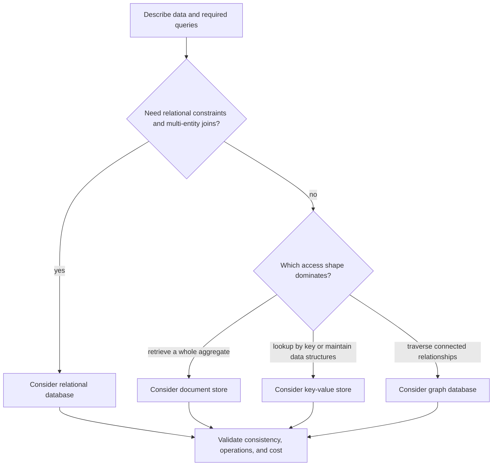

**NoSQL** describes a family of database models that do not require every application to represent data as normalized relational tables. It does not mean “no structure,” “no transactions,” or “automatically faster.” Document stores, key-value stores, and graph databases organize data differently because they optimize for different access patterns and relationships.

The examples use MongoDB's document model, Redis data types, and Neo4j's property graph model. Their exact transaction, durability, indexing, and deployment guarantees depend on product configuration and version; read the documentation for the specific deployment before treating a capability as a guarantee.

## Choosing a model from the workload

Start with the questions the application must answer, the invariants it must protect, and the number of records or relationships it must traverse. Choose a model that supports those access patterns without making consistency or operations harder than necessary:



This is a starting point, not a rule that an application can use only one model. Polyglot persistence can be appropriate when each store has a clear responsibility and an explicit data-consistency strategy. It also adds deployment, backup, monitoring, and failure modes, so avoid adding stores just to follow a trend.

## Relational databases and NoSQL

Relational systems organize data into tables with declared keys and constraints, and support joins and transactions across related rows. Many NoSQL systems instead optimize a particular data structure, aggregate, or traversal. These are tendencies, not universal limitations: some NoSQL products support schemas, secondary indexes, and multi-record transactions, and relational databases also support JSON and specialized index types.

The key design question is often **where a consistency invariant is enforced**. A relational unique constraint can prevent duplicate keys centrally. A document model may keep an aggregate together so one document update changes related fields atomically under that database's guarantees, while references across documents require an explicit consistency plan. A key-value cache may be disposable and derived from a primary source, or it may be the authoritative data store with stronger durability needs; decide deliberately.

## Document stores: MongoDB

MongoDB stores BSON documents in collections. Documents in one collection may have different fields, but a flexible schema still needs conventions and validation where correctness depends on shape. Model around access patterns: data commonly read and updated together may be embedded in one document, while high-cardinality, independently updated, or unbounded data is often referenced.

An order with a bounded set of line items can be represented as one document:

```javascript
{
  _id: "order-42",
  customerId: "customer-7",
  createdAt: ISODate("2026-10-01T10:00:00Z"),
  items: [
    { productId: "sku-11", description: "Travel mug", unitPrice: 18.50, quantity: 2 },
    { productId: "sku-29", description: "Bottle brush", unitPrice: 4.25, quantity: 1 }
  ],
  status: "PAID"
}
```

Embedding lets an order read return its lines together and preserves the price/description snapshot that was recorded when the order was placed. The item array should remain bounded; embedding an ever-growing event history or user-generated list can make a document large and expensive to update. Duplicated descriptions are reasonable only if their historical meaning is intentional and the application knows which copy is authoritative for future catalog changes.

For a product catalog that changes independently, the order can store a product identifier while keeping the snapshot values on each order line. That avoids treating the current catalog document as the historical record of an earlier purchase.

Use schema validation when particular fields or types must be enforced. Flexibility can ease iterative development, but inconsistent field names or mixed types can make queries and application code harder to reason about. Add indexes for observed queries and evaluate their write/storage cost just as with a relational database.

## Key-value stores: Redis

A key-value store maps a key to a value or data structure. Redis provides strings, hashes, lists, sets, sorted sets, streams, and other data types; the simple “key-value” name does not limit it to opaque strings.

A cache-aside flow might cache a product lookup with an expiration:

```text
GET product:sku-11

If the key is absent:
  read the product from the authoritative database
  SET product:sku-11 "{...serialized product...}" EX 300

Return the product
```

`EX 300` requests a five-minute expiration for that key. The TTL limits how long the cached value can remain without refresh, but it does not guarantee that the value is correct for five minutes: writes may need explicit invalidation or update. Applications should handle cache timeouts, missing values, serialization/version changes, and Redis unavailability according to the cache's role.

When Redis is only a cache, the relational or document database should remain the source of truth, and a cache miss should be recoverable. If Redis stores authoritative state such as sessions, queues, or counters, choose persistence, replication, backup, eviction, and recovery settings based on the data-loss tolerance. Do not treat “in memory” as equivalent to “never durable” or “automatically durable”; Redis behavior depends on configuration.

## Graph databases: Neo4j

A property graph represents entities as **nodes** and typed, directed connections as **relationships**; both can have properties. This makes multi-hop questions about connected data natural to express. Neo4j's graph model can be useful for recommendations, network dependencies, identity relationships, or knowledge graphs where traversals are central.

```cypher
CREATE (alice:Person {id: 'p-1', name: 'Alice'})
CREATE (bob:Person {id: 'p-2', name: 'Bob'})
CREATE (video:Video {id: 'v-9', title: 'Graph basics'})
CREATE (alice)-[:FOLLOWS]->(bob)
CREATE (bob)-[:CREATED]->(video)
```

Find videos created by people followed by a particular viewer:

```cypher
MATCH (viewer:Person {id: $viewerId})-[:FOLLOWS]->(creator:Person)-[:CREATED]->(video:Video)
RETURN video.title
ORDER BY video.title
LIMIT 20
```

The direction and type of each relationship make the traversal explicit. Graph modeling still needs uniqueness constraints and indexes for identity lookups, and a graph database is not automatically best for every connected dataset; compare the actual traversal and write workload against a relational model.

## Trade-offs to evaluate

| Model | Natural fit | Design pressure |
|---|---|---|
| Relational | Structured records, constraints, joins, and multi-row transactions | Evolving schemas and high-volume join patterns need deliberate design and indexes |
| Document | Data read and updated together as an aggregate | Embedding can duplicate facts or grow without bounds; references complicate cross-document reads |
| Key-value | Fast lookup by known key, cache entries, counters, queues, or native structures | Access may be limited by key design; cache invalidation and durability must be explicit |
| Graph | Queries that traverse paths and relationships | Requires graph-oriented data modeling and careful indexing for starting nodes |

For any candidate, measure read/write latency under realistic load, model index and storage costs, test the required consistency and transaction semantics, and plan backups, upgrades, and failure recovery. A benchmark on an empty local database does not predict production behavior.

## Practical rules

- Choose a database around required queries, invariants, and operational constraints—not just the shape of one Java class.
- In a document store, embed bounded data read and written as one aggregate; reference independently updated or unbounded data.
- In a cache, define expiration, invalidation, stampede control, and behavior when the cache is unavailable.
- In a graph database, model relationship meaning and direction explicitly, and index common traversal starting points.
- Check which guarantees are database-wide and which are enforced only by application code.
- If adding multiple stores, define which is authoritative and how changes propagate before shipping.

## Further reading

- MongoDB Manual, [Data modeling](https://www.mongodb.com/docs/manual/data-modeling/)
- MongoDB Manual, [Data modeling best practices](https://www.mongodb.com/docs/manual/data-modeling/best-practices/)
- Redis documentation, [Data types](https://redis.io/docs/latest/develop/data-types/)
- Neo4j Getting Started, [Graph database concepts](https://neo4j.com/docs/getting-started/appendix/graphdb-concepts/)
- [Hibernate Performance Tuning](./hibernate-performance-tuning)
- [Build Tools](../level-8/build-tools)
