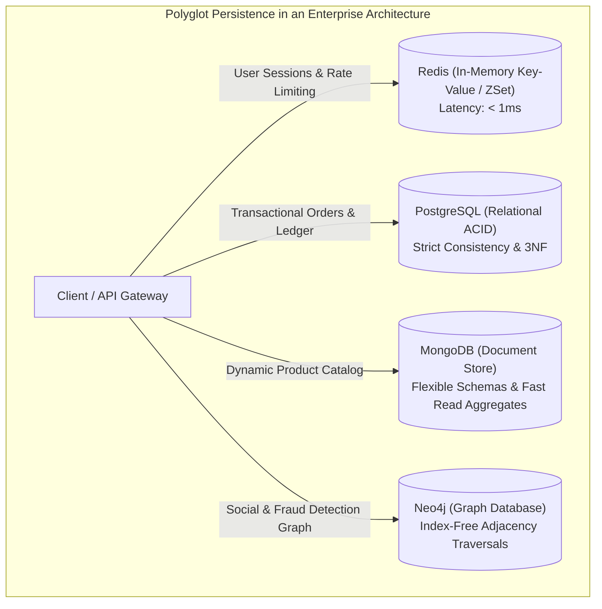
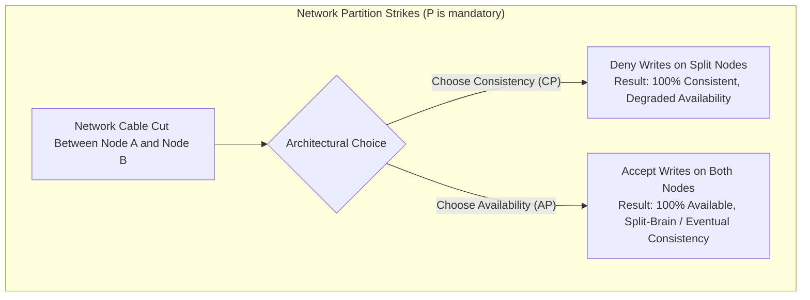
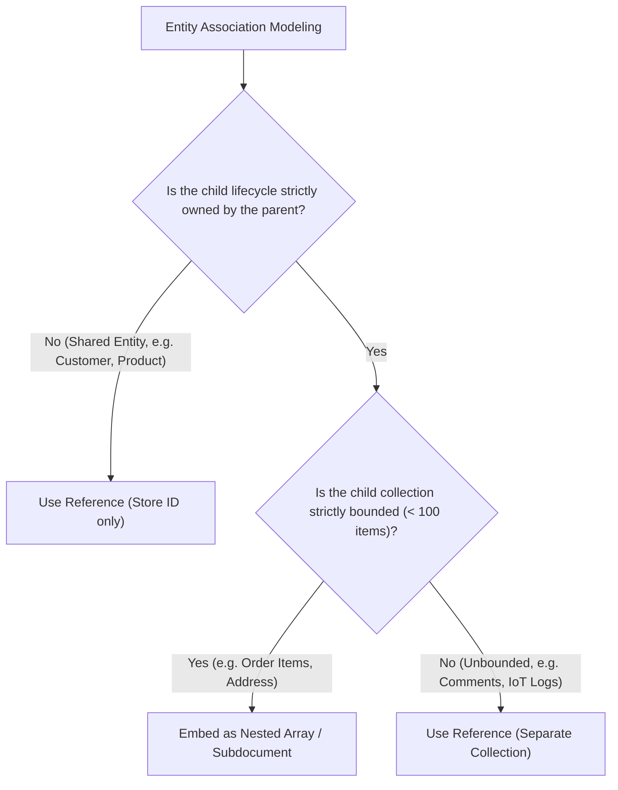
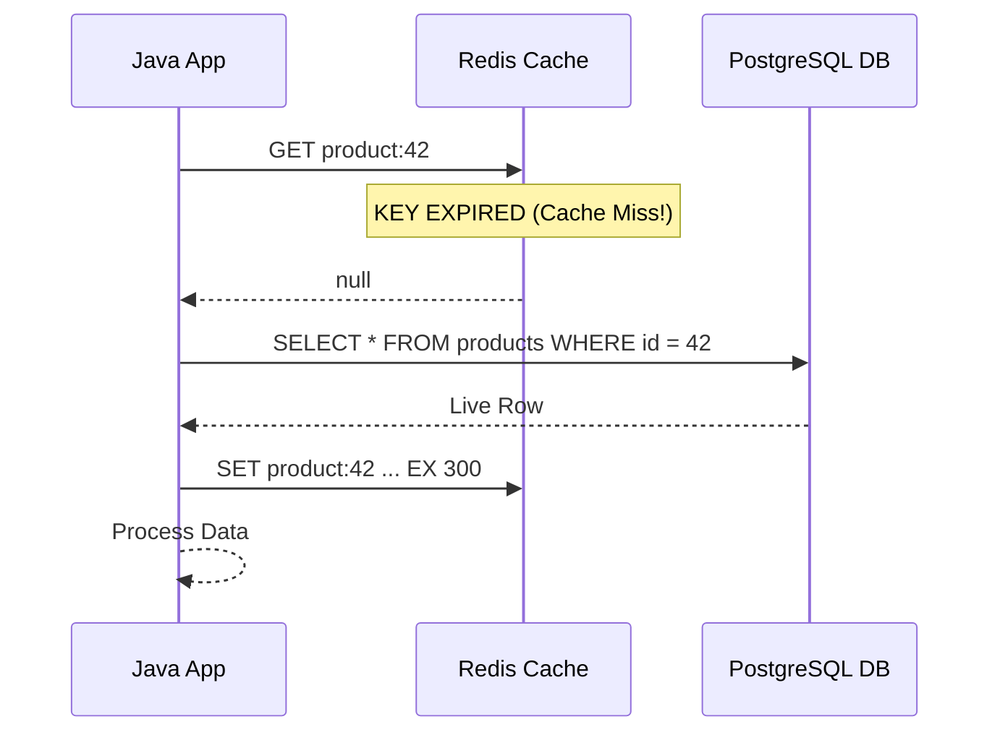

A decade ago, the tech industry rode a wave of anti-relational hype. Blogs declared that *"SQL is dead"* and that modern web applications should store everything in schema-less document stores.

Many engineering teams fell into the trap. They replaced battle-tested relational databases with NoSQL document stores for core financial ledgers, only to discover painful realities:
- Enforcing foreign key constraints across collections required writing thousands of lines of fragile application-level validation code.
- Without database-level multi-table transactions, partial writes created corrupted state during network hiccups.
- Document collections degenerated into unmaintainable, chaotic schemas where different rows had mismatched types and missing fields.

Today, mature software architects embrace **Polyglot Persistence**. We recognize that **NoSQL does not mean "No SQL"—it means "Not Only SQL"**. 

Different storage engines are physically optimized for radically different data shapes and access patterns. The goal of a senior engineer is to pair the right tool with the right job: using PostgreSQL for authoritative transactional state, Redis for sub-millisecond in-memory caching, MongoDB for heterogeneous product catalogs, and Neo4j for deep relationship traversals.



---

## Distributed Systems Fundamentals: CAP and PACELC Theorems

When you move from a single relational database instance to a distributed cluster of nodes spanning multiple availability zones, the physical laws of computer networks dictate your system's limits.

### The CAP Theorem

Formulated by Eric Brewer in 2000 and formally proven by Gilbert and Lynch, the **CAP Theorem** states that a distributed data store can simultaneously guarantee at most two of the following three properties:

1. **Consistency (C)**: Every read receives the most recent write or an error (Single-copy consistency / Linearizability).
2. **Availability (A)**: Every non-failing node returns a non-error response for every request, without guaranteeing that it contains the most recent write.
3. **Partition Tolerance (P)**: The system continues to operate despite an arbitrary number of messages being dropped or delayed by the physical network between nodes.

In the physical world, **network cables get severed, routers fail, and cloud availability zones experience network splits**. Therefore, **Partition Tolerance (P) is a mandatory reality of distributed computing**. 

When a network partition strikes, an architecture is forced into a binary trade-off:
- **CP Systems (Consistency over Availability)**: If nodes cannot communicate, the system rejects writes and returns errors rather than serving stale or conflicting data (e.g., MongoDB with `w: "majority"`, Google Spanner, HBase).
- **AP Systems (Availability over Consistency)**: All nodes accept reads and writes, serving potentially stale data and resolving conflicting writes later via reconciliation mechanisms (e.g., Apache Cassandra, Amazon DynamoDB).



### The PACELC Theorem

In 2012, Daniel Abadi identified a major flaw in the CAP theorem: CAP only discusses what happens **when a network failure occurs**. But distributed networks run normally 99.9% of the time!

Abadi formulated the **PACELC Theorem**:
- **If there is a Partition (P)**, trade off **Availability (A)** vs **Consistency (C)**;
- **Else (E)** (when the network is running normally), trade off **Latency (L)** vs **Consistency (C)**.

| Database | PACELC Classification | Normal State (Else) | Failure State (Partition) |
| :--- | :--- | :--- | :--- |
| **MongoDB** | **PC/EC** | Consistent reads (routes to primary) | Consistent (denies writes to minor partitions) |
| **Cassandra** | **PA/EL** | Low Latency (reads local replica) | Available (accepts writes everywhere) |
| **PostgreSQL (Async Replica)** | **PC/EL** | Low Latency (read replicas are async) | Consistent on Primary |

---

## Document Stores: MongoDB and BSON Aggregates

Document databases replace rigid relational tables with semi-structured, self-describing **BSON (Binary JSON)** documents grouped into collections.

A relational database requires an `orders` table, an `order_items` table, an `order_addresses` table, and an `order_discounts` table joined together across multiple foreign keys. A document database models an entire **Domain-Driven Design Aggregate** as a single, cohesive document:

```javascript
// MongoDB Document in 'orders' collection
{
  "_id": "ORD-99014",
  "customerId": "CUST-42",
  "placedAt": ISODate("2026-10-29T10:00:00Z"),
  "shippingAddress": {
    "street": "100 Market St",
    "city": "San Francisco",
    "state": "CA",
    "zipCode": "94105"
  },
  "items": [
    { "sku": "TECH-01", "name": "Mechanical Keyboard", "unitPrice": 149.99, "qty": 1 },
    { "sku": "CBL-09", "name": "USB-C Braided Cable", "unitPrice": 19.99, "qty": 2 }
  ],
  "totalAmount": 189.97,
  "status": "PAID"
}
```

### The Embedding vs Referencing Decision

The central design dilemma in document modeling is whether to **embed** child data or **reference** it by ID.



### The Unbounded Array Antipattern

A catastrophic mistake in MongoDB architecture is embedding collections that grow indefinitely over time:

```javascript
// FATAL ANTIPATTERN: Unbounded array
{
  "_id": "USER-101",
  "username": "alice",
  "auditLogs": [ ... 500,000 log entries ... ] // DISASTER!
}
```

1. **The 16MB Document Limit**: MongoDB strictly forbids any single BSON document from exceeding **16 Megabytes** in size.
2. **Memory Thrashing**: Every time you update Alice's profile, MongoDB must read and rewrite the entire multi-megabyte document in memory and disk, thrashing the WiredTiger storage engine cache.

> [!TIP]
> **Rule of Thumb**: Embed for **1-to-few** bounded relationships read together in 95% of queries. Reference for **1-to-many** and **1-to-unbounded** relationships.

---

## Key-Value Stores: Redis Data Structures and Caching Patterns

Redis (Remote Dictionary Server) is an in-memory, single-threaded (for command execution), network-accessible key-value database. 

Calling Redis a "key-value store" is an understatement. Redis is an **In-Memory Data Structure Server**. It provides rich, native primitives executed with sub-millisecond latency:

| Data Structure | Operations | Ideal Real-World Use Case |
| :--- | :--- | :--- |
| **String** | `SET`, `GET`, `INCRBY` | Caching serialized JSON, atomic global counters, idempotency keys. |
| **Hash** | `HSET`, `HGET`, `HINCRBY` | Storing mutable objects (User Session, Cart state) without re-serializing. |
| **List** | `LPUSH`, `RPOP`, `BRPOP` | Lightweight message queues, task pipelines. |
| **Set** | `SADD`, `SINTER`, `SMEMBERS` | Unique tags, friend circles, tracking active IP addresses. |
| **Sorted Set (ZSet)** | `ZADD`, `ZRANGEBYSCORE` | **Leaderboards, Priority queues, Rolling-window rate limiters**. |
| **Stream** | `XADD`, `XREADGROUP` | Append-only event streams with persistent consumer groups. |

### The Rolling-Window Rate Limiter Using Redis Sorted Sets

A common senior engineering interview question is: *"How do you implement an API rate limiter allowing 100 requests per minute using Redis?"*

A naive counter with TTL has a "boundary flaw": a user can make 100 requests at 00:59 and another 100 requests at 01:00, firing 200 requests in 2 seconds.

Using a Redis **Sorted Set (ZSet)**, you can enforce a rolling-window limit with mathematical precision:

```java
import redis.clients.jedis.Jedis;
import redis.clients.jedis.Transaction;

public class RedisRollingRateLimiter {
    private final Jedis jedis;

    public RedisRollingRateLimiter(Jedis jedis) {
        this.jedis = jedis;
    }

    public boolean isAllowed(String userId, int maxRequests, long windowSeconds) {
        String key = "rate_limit:" + userId;
        long now = System.currentTimeMillis();
        long windowStart = now - (windowSeconds * 1000);

        // Execute atomically in a Redis Pipeline / Multi block
        Transaction t = jedis.multi();
        
        // 1. Remove all request timestamps older than the rolling window
        t.zremrangeByScore(key, 0, windowStart);
        
        // 2. Add current request timestamp (Member = timestamp, Score = timestamp)
        t.zadd(key, now, String.valueOf(now));
        
        // 3. Count how many requests are in the current window
        t.zcard(key);
        
        // 4. Set TTL to auto-expire idle keys
        t.expire(key, (int) windowSeconds + 1);
        
        var results = t.exec();
        long requestCount = (Long) results.get(2);

        return requestCount <= maxRequests;
    }
}
```

### Caching Topologies and the Cache Stampede Hazard

The most popular caching pattern in Java is **Cache-Aside (Lazy Loading)**:
1. Application queries Redis for `product:42`.
2. If cache hit: Return data instantly.
3. If cache miss: Query PostgreSQL, write data to Redis with a TTL, and return.



### The Cache Stampede (Thundering Herd Problem)

What happens when a high-traffic key (e.g., the homepage hot-sale banner viewed by 50,000 requests per second) expires from Redis?

At the instant the key expires, all 50,000 concurrent threads experience a cache miss simultaneously. **All 50,000 threads fire the exact same expensive SQL query against PostgreSQL at the exact same millisecond.** 

The database server experiences a catastrophic connection spike, CPU hits 100%, and the database crashes—a disaster known as a **Cache Stampede**.

#### How to Prevent Cache Stampedes
1. **Mutex Locking (Distributed Lock)**: When a thread experiences a cache miss, it attempts to acquire a short-lived Redis lock (`SET lock:product:42 my_id NX EX 5`). Only the single thread that wins the lock queries the database and populates the cache; all other threads sleep briefly and re-query Redis.
2. **Probabilistic Early Expiration (XFetch Algorithm)**: As the key nears its expiration time, background threads calculate a probability function based on query latency and asynchronously refresh the cache in the background *before* it physically expires.

---

## Graph Databases: Neo4j and Index-Free Adjacency

Relational databases can model relationships using foreign keys and join tables. However, when you query deep, highly connected networks:
- *"Find all friends of friends within 4 hops who like jazz music."*
- *"Identify money laundering rings where Account A transfers to B, B to C, and C transfers back to A."*

A relational database must execute a 4-way self-join across multi-million-row join tables. Relational join cost scales quadratically with dataset size, rendering multi-hop queries impossibly slow.

### The Superpower of Graph Databases: Index-Free Adjacency

**Neo4j** is a native graph database implementing the **Property Graph Model** (Nodes, Directed Relationships, and Key-Value Properties).

In a relational database, finding connected records requires looking up foreign keys in a B-Tree index (`O(log N)` per lookup). 

In Neo4j, every node physically stores direct, native double-linked memory pointers to its adjacent relationships on disk and RAM. Traversing a relationship is a simple **`O(1)` pointer dereference**!

> [!NOTE]
> **Index-Free Adjacency**: Traversal speed in a native graph database depends **only on the size of the subgraph being traversed**, and is completely independent of the total size of the global database (whether it contains 1,000 nodes or 10 billion nodes).

### The Cypher Query Language

Neo4j uses **Cypher**, an expressive, ASCII-art declarative pattern matching language:

```cypher
// Discover friends-of-friends recommendations (2 to 3 hops away)
MATCH (user:Person {email: "alice@example.com"})-[:FRIENDS_WITH*2..3]-(fof:Person)
WHERE NOT (user)-[:FRIENDS_WITH]-(fof) AND user <> fof
RETURN fof.name, count(*) AS mutualFriendsCount
ORDER BY mutualFriendsCount DESC
LIMIT 10;
```

---

## NoSQL Storage Models Comparison Matrix

| Model | Representative Engine | Data Structure Primitive | Primary Optimization | Weakness / Trade-off |
| :--- | :--- | :--- | :--- | :--- |
| **Relational** | PostgreSQL, MySQL | Normalized Tables, Rows, Foreign Keys | ACID Transactions, Ad-hoc joins, 3NF Integrity | Horizontal sharding complexity, rigid schema migrations |
| **Document** | MongoDB, Couchbase | Hierarchical BSON / JSON documents | Fast aggregate retrieval, flexible schemas | 16MB document cap, joins across collections require manual $lookup |
| **Key-Value** | Redis, Memcached | In-memory key mappings, Sets, Hashes | Sub-millisecond latency, atomic counters, caching | Memory cost per byte, limited query capability without key |
| **Graph** | Neo4j, Amazon Neptune | Nodes, Directed Edges, Properties | Deep multi-hop network traversals (`O(1)` pointer hops) | High write overhead for graph indexing, global aggregations are slow |

---

## Senior Engineer Interview Crucible

### Explain the PACELC theorem and how it expands upon the classic CAP theorem.
The CAP theorem assumes that network partitions are the only trade-off boundary in distributed systems. It states that during a partition (P), you must choose between Availability (A) and Consistency (C). However, real distributed networks operate normally without partitions 99.9% of the time.

The PACELC theorem (formulated by Daniel Abadi) completes the picture:
- **If there is a Partition (P)**, trade off **Availability (A)** vs **Consistency (C)**;
- **Else (E)** (normal network operation), trade off **Latency (L)** vs **Consistency (C)**.

For example, when a cluster is completely healthy, maintaining strong single-copy consistency (C) requires synchronously waiting for acknowledgments across all replicas before returning, which increases write Latency (L). Alternatively, choosing low Latency (L) means returning immediately after updating a local node, accepting eventual consistency across replicas.

### What is "Index-Free Adjacency" in Neo4j, and why does it make deep graph traversals dramatically faster than relational joins?
In relational databases, evaluating relationships requires querying secondary B-Tree indexes on join tables, which takes `O(log N)` time per hop and degrades exponentially as tables grow into millions of rows.

In Neo4j's native graph storage engine, nodes and relationships are stored as raw physical memory records containing direct pointers (file offsets/memory addresses) to adjacent nodes. When traversing an edge, the engine dereferences the pointer directly in `O(1)` time without consulting any global index. Consequently, query execution time is proportional strictly to the size of the traversed subgraph, completely independent of the total volume of data stored in the database.

### In MongoDB, what is the "Unbounded Array Antipattern", and how do you decide whether to embed or reference child documents?
The Unbounded Array Antipattern occurs when an entity embeds an array of child subdocuments that can grow indefinitely over time (such as comments on a viral post, IoT device telemetry, or user audit logs). 

This is fatal in MongoDB because:
1. MongoDB enforces a hard **16 Megabyte limit** per BSON document.
2. Growing documents force the WiredTiger storage engine to repeatedly reallocate memory and move document pages on disk, degrading write performance and causing memory fragmentation.

To decide:
- **Embed**: When the relationship is **1-to-few**, the array is strictly bounded (e.g., maximum 50 order items or 5 addresses), and child data is queried together with the parent in 90%+ of use cases.
- **Reference**: When the relationship is **1-to-many** or **1-to-unbounded**, or when child entities are queried and updated independently.

### What is a Cache Stampede (Thundering Herd Problem), and what strategies can be used in Java/Redis architectures to prevent it?
A Cache Stampede occurs when a hot, high-traffic cached key (accessed by thousands of concurrent threads per second) expires from Redis. Because the key is missing, all concurrent requests experience a cache miss simultaneously and hammer the underlying relational database with the exact same query, causing connection pool exhaustion, CPU saturation, and database crashes.

To prevent it:
1. **Distributed Mutex Locking**: The first thread to encounter the cache miss acquires a distributed lock in Redis using `SET lock:key token NX EX 5`. Only this thread executes the database query and repopulates the cache; all other threads sleep briefly and retry the cache read.
2. **Probabilistic Early Expiration (XFetch)**: Background worker threads calculate a random probability function based on query duration and TTL. As the key nears expiration, a worker recomputes and refreshes the cache in the background *before* the key physically expires, ensuring user requests always experience a cache hit.
