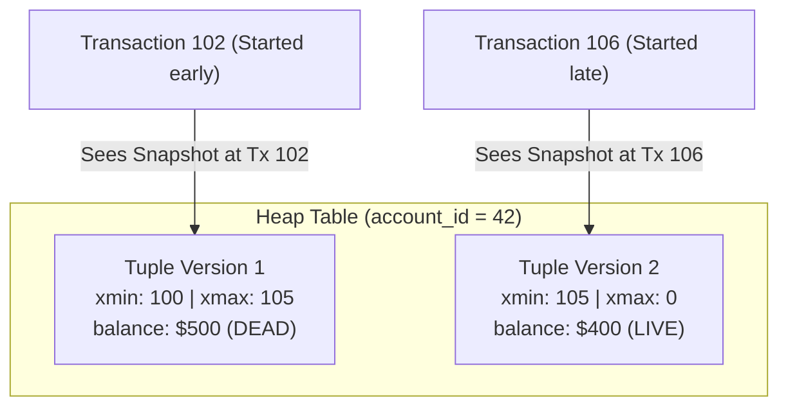
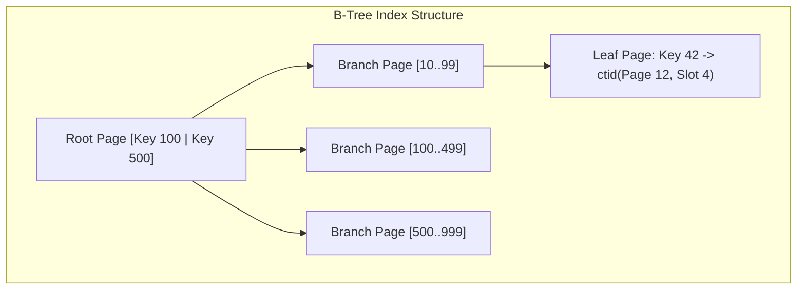

Many modern Java developers treat relational databases as magical black boxes hidden behind an Object-Relational Mapping (ORM) framework like Hibernate. They write clean Java entity code, deploy to production, and celebrate—until traffic surges.

Suddenly, an API endpoint takes 14 seconds to respond. Database CPU spikes to 100%. Active connection pools are exhausted, and deadlock alerts trigger in the middle of the night.

Frameworks come and go, but the relational database remains the permanent, authoritative state of your business. To build scalable enterprise systems, you must understand the underlying physics of relational storage engines: how data pages are written to physical disk, how Multi-Version Concurrency Control (MVCC) isolates transactions, how the query planner navigates B-Tree indexes, and how to write expressive, high-performance SQL.

```mermaid
flowchart TD
    subgraph "PostgreSQL Storage Engine Architecture"
        SQL["Incoming SQL Query"] --> Parser["Parser & Query Planner"]
        Parser --> Plan["Execution Plan (Index Scan / Seq Scan)"]
        Plan --> Executor["Execution Engine"]
        
        Executor --> Buffers["Shared Buffers Pool (8KB Pages in RAM)"]
        Buffers -.->|Buffer Miss: Random I/O| DiskData["Data Files on Disk (Heap Tables)"]
        
        Executor -->|Transaction Commit| WAL["Write-Ahead Log Buffer (WAL)"]
        WAL -->|Sequential Flush (fsync)| WALDisk["WAL Logs on Disk (Durability Guarantee)"]
    end
```

---

## The Physical Reality of ACID and Write-Ahead Logging (WAL)

We all memorize the ACID acronym for interviews: **Atomicity, Consistency, Isolation, and Durability**. But what does the database engine physically do to guarantee these properties without grinding performance to a halt?

### The Latency Dilemma: Random vs Sequential I/O

A PostgreSQL table is organized into physical 8KB data blocks ("pages") stored on disk. When you execute `UPDATE accounts SET balance = balance - 100 WHERE id = 42`, the modified page lives in memory inside the **Shared Buffers** pool.

If the database were forced to write that 8KB page directly back to the physical table file on disk every time a transaction committed, performance would collapse. Table pages are scattered randomly across the storage drive; writing random blocks would force the storage controller into catastrophic random I/O thrashing.

### The Write-Ahead Log (WAL) Solution

Relational databases solve this with the **Write-Ahead Log (WAL)** (known as the Redo Log in Oracle and MySQL InnoDB):

1. **In-Memory Modification**: The query updates the row in the shared buffer cache in RAM. The 8KB page is marked "dirty".
2. **Append-Only Sequential Logging**: Before acknowledging the commit to the Java client, the database writes a compact binary record describing the modification into the WAL buffer and flushes it sequentially to disk using an OS `fsync` syscall.
3. **Instant Acknowledgment**: Because appending to a sequential log file is orders of magnitude faster than random table writes, the transaction commits in sub-millisecond time.
4. **Asynchronous Checkpointing**: Background database processes (the Checkpointer) periodically write dirty in-memory pages back to the physical table heap files in batches.

If power fails or the operating system crashes at 2:00:00 PM:
- In-memory shared buffers are lost.
- Upon reboot, the database scans the sequential WAL file starting from the last valid checkpoint and replays all committed transactions back into the data pages (**Crash Recovery**). This is how Durability is guaranteed.

---

## Multi-Version Concurrency Control (MVCC)

Traditional database textbooks describe concurrency using shared read locks and exclusive write locks. In that naive model, whenever a reporting query reads 50,000 rows, no other thread can update those rows until the read finishes.

Modern relational databases (PostgreSQL, MySQL InnoDB, Oracle) reject this model using **Multi-Version Concurrency Control (MVCC)**.

> [!NOTE]
> **The Golden Law of MVCC**: *Readers never block writers, and writers never block readers.*

### How PostgreSQL Implements MVCC

In PostgreSQL, an `UPDATE` does not overwrite the existing row in place. Instead, it creates a **brand-new version of the row (tuple)**!

Every physical tuple on disk contains two hidden system columns:
- `xmin`: The transaction ID that inserted/created this row version.
- `xmax`: The transaction ID that deleted or replaced this row version (defaults to 0 if the row is currently live).



1. **Insert**: Transaction 100 inserts an account with balance 500. A tuple is written with `xmin = 100, xmax = 0`.
2. **Update**: Transaction 105 updates the balance to 400. PostgreSQL does not delete the old row! It sets `xmax = 105` on the first tuple, and inserts a second tuple with `balance = 400, xmin = 105, xmax = 0`.
3. **Visibility Check**: If a long-running reporting query started at Transaction 102, its transaction snapshot tells it that Transaction 105 has not happened yet. It continues reading Tuple Version 1 without blocking the update!

### The Operational Cost: Table Bloat and VACUUM

Because updates and deletes leave dead tuples on disk, tables accumulate "bloat". 

PostgreSQL runs a background daemon called **Auto-VACUUM** that periodically scans pages, identifies tuples where `xmax` is older than any active transaction in the system, marks the dead space as reusable for future inserts, and updates table statistics.

---

## Transaction Isolation Levels and Anomalies

The SQL-92 standard defines four transaction isolation levels designed to balance data consistency against concurrent throughput.

| Isolation Level | Dirty Read | Non-Repeatable Read | Phantom Read | Serialization Anomaly / Write Skew |
| :--- | :--- | :--- | :--- | :--- |
| **Read Uncommitted** | Possible (Not in PG) | Possible | Possible | Possible |
| **Read Committed** (Default) | Prevented | Possible | Possible | Possible |
| **Repeatable Read** | Prevented | Prevented | Prevented (in PG) | Possible (Write Skew) |
| **Serializable** | Prevented | Prevented | Prevented | Prevented |

### Understanding the Anomalies

- **Dirty Read**: Transaction A reads data modified by Transaction B before Transaction B commits. If Transaction B rolls back, Transaction A acted on ghost data. (PostgreSQL treats Read Uncommitted as Read Committed; dirty reads are physically impossible in PG).
- **Non-Repeatable Read**: Transaction A reads a row (`balance = 100`). Transaction B updates that row to 150 and commits. Transaction A re-reads the row and observes a different value within the same transaction.
- **Phantom Read**: Transaction A queries `SELECT COUNT(*) FROM orders WHERE customer_id = 5` and gets 3. Transaction B inserts a 4th order for that customer and commits. Transaction A re-runs the count and gets 4.
- **Write Skew**: Two concurrent transactions read overlapping data sets, satisfy an invariant independently, and make conflicting updates that violate a global business constraint.

```sql
-- WRITE SKEW SCENARIO (On-call doctors invariant: at least 1 doctor must be on duty)
-- Both Doctor Alice and Doctor Bob are currently on call. Both request leave at the exact same moment.

-- Transaction 1 (Doctor Alice):
BEGIN TRANSACTION ISOLATION LEVEL REPEATABLE READ;
SELECT COUNT(*) FROM doctors WHERE on_duty = true; -- Returns 2 (Safe to take leave!)
UPDATE doctors SET on_duty = false WHERE id = 'ALICE';
COMMIT;

-- Transaction 2 (Doctor Bob - Concurrent):
BEGIN TRANSACTION ISOLATION LEVEL REPEATABLE READ;
SELECT COUNT(*) FROM doctors WHERE on_duty = true; -- Returns 2 (Safe to take leave!)
UPDATE doctors SET on_duty = false WHERE id = 'BOB';
COMMIT;

-- RESULT: Both transactions commit successfully under Repeatable Read!
-- The invariant is broken: ZERO doctors are now on duty!
```

> [!CAUTION]
> To eliminate Write Skew, you must either use **`SERIALIZABLE`** isolation (which uses Serializable Snapshot Isolation to abort conflicting transactions) or use **Pessimistic Locking** (`SELECT ... FOR UPDATE`).

---

## Relational Normalization vs Strategic Denormalization

Normalization is the mathematical discipline of organizing relational tables to eliminate redundancy and prevent insertion, update, and deletion anomalies.

- **First Normal Form (1NF)**: Every cell contains an atomic value (no JSON arrays or comma-delimited strings in columns), and the table has a primary key.
- **Second Normal Form (2NF)**: Must be in 1NF, and all non-key columns must depend on the **entire** primary key (eliminating partial functional dependencies on composite keys).
- **Third Normal Form (3NF)**: Must be in 2NF, and no non-key column may depend on another non-key column (eliminating transitive dependencies). As the adage goes: *"Every column must depend on the key, the whole key, and nothing but the key, so help me Codd."*

### The Practical Rule: Historical Snapshots vs Live Lookups

Junior developers often over-normalize historical transactions. Consider an e-commerce order line:

```sql
-- NORMALIZATION DISASTER:
CREATE TABLE order_items (
    order_id bigint REFERENCES orders(id),
    product_id bigint REFERENCES products(id),
    quantity integer NOT NULL,
    PRIMARY KEY (order_id, product_id)
);
```

Where is the price? If the query calculates order totals by joining `order_items` to `products.price`, what happens when the merchant raises the price of the product next month? **Every past order in your company's accounting history retroactively changes its total!**

A senior database engineer distinguishes between **mutable catalog state** and **immutable historical facts**:

```sql
CREATE TABLE order_items (
    order_id bigint REFERENCES orders(id),
    product_id bigint REFERENCES products(id),
    quantity integer NOT NULL CHECK (quantity > 0),
    unit_price_at_purchase numeric(12, 2) NOT NULL CHECK (unit_price_at_purchase >= 0),
    tax_rate_at_purchase numeric(5, 4) NOT NULL,
    PRIMARY KEY (order_id, product_id)
);
```

The price charged at the moment of purchase is a historical invariant that must be permanently stored on the order item.

---

## B-Tree Indexes and EXPLAIN ANALYZE

By default, PostgreSQL indexes are balanced search trees (**B-Trees**). A B-Tree maintains sorted order across arbitrary data types, allowing lookups, range scans, and prefix searches in `O(log N)` time.



Every leaf node in the B-Tree stores the indexed key value along with a **Tuple ID (`ctid`)** indicating the physical 8KB page and slot number of the actual row in the heap table file.

### The Leftmost Prefix Rule in Composite Indexes

When you create a composite index on multiple columns:

```sql
CREATE INDEX idx_orders_tenant_status_created 
    ON orders (tenant_id, status, created_at DESC);
```

The database sorts the index entries **first by `tenant_id`**, then by `status` within that tenant, and finally by `created_at` within that status.

- **Uses Index Efficiently**:
  - `WHERE tenant_id = 10`
  - `WHERE tenant_id = 10 AND status = 'COMPLETED'`
  - `WHERE tenant_id = 10 AND status = 'COMPLETED' AND created_at > '2026-01-01'`
- **CANNOT Use Index Efficiently**:
  - `WHERE status = 'COMPLETED'` (Violates the Leftmost Prefix Rule; the B-Tree cannot jump to status without knowing the tenant).
  - `WHERE created_at > '2026-01-01'`

### Reading EXPLAIN (ANALYZE, BUFFERS) Like a Database Architect

When debugging slow queries, never guess. Run `EXPLAIN (ANALYZE, BUFFERS)` to observe the actual execution plan:

```sql
EXPLAIN (ANALYZE, BUFFERS)
SELECT id, amount, created_at
FROM orders
WHERE tenant_id = 42 AND status = 'PAID'
ORDER BY created_at DESC
LIMIT 10;
```

Sample output:
```text
Limit  (cost=0.42..15.80 rows=10 width=24) (actual time=0.042..0.058 rows=10 loops=1)
  Buffers: shared hit=4
  ->  Index Scan using idx_orders_tenant_status_created on orders  
      (cost=0.42..1540.20 rows=1000 width=24) (actual time=0.040..0.054 rows=10 loops=1)
      Index Cond: ((tenant_id = 42) AND (status = 'PAID'::text))
      Buffers: shared hit=4
Planning Time: 0.120 ms
Execution Time: 0.085 ms
```

Key metrics to inspect:
1. **Scan Type**:
   - `Seq Scan`: Scans every physical block of the table (fine for tiny tables, fatal for 100-million-row tables).
   - `Index Scan`: Traverses the B-Tree to find matching `ctid` pointers, then visits the heap table to retrieve data columns.
   - `Index Only Scan`: The fastest scan! All requested columns live inside the index itself (Covering Index). Zero heap page accesses required!
   - `Bitmap Index Scan`: Collects matching pointers from multiple indexes into an in-memory bitmap, then visits table pages in physical disk order.
2. **`shared hit` vs `shared read`**:
   - `shared hit=4`: The 4 database pages were already cached in RAM (Shared Buffers). Zero physical disk I/O.
   - `shared read=420`: The database had to perform 420 physical I/O reads from the SSD.
3. **Estimated vs Actual Rows**: If the planner estimates `rows=1` but actual execution reports `rows=500000`, the table statistics are stale. Run `ANALYZE orders;` to refresh planner histograms!

---

## Advanced SQL: Window Functions and CTEs

Standard SQL aggregation (`GROUP BY`) collapses multiple rows into a single summary row. 

A **Window Function** performs calculations across a set of table rows related to the current row, **without collapsing individual rows**. Every input row retains its distinct identity!

### The Syntax of Window Functions

```sql
function_name() OVER (
    PARTITION BY partition_column
    ORDER BY sort_column
    ROWS BETWEEN ...
)
```

### Ranking and Pagination: ROW_NUMBER vs RANK vs DENSE_RANK

```sql
SELECT
    department,
    employee_name,
    salary,
    ROW_NUMBER() OVER (PARTITION BY department ORDER BY salary DESC) as row_num,
    RANK()       OVER (PARTITION BY department ORDER BY salary DESC) as rnk,
    DENSE_RANK() OVER (PARTITION BY department ORDER BY salary DESC) as dense_rnk
FROM employees;
```

Notice how tied salaries are handled:

| Employee | Salary | ROW_NUMBER | RANK | DENSE_RANK | Explanation |
| :--- | :--- | :--- | :--- | :--- | :--- |
| Alice | 10,000 | 1 | 1 | 1 | Highest salary |
| Bob | 9,000 | 2 | 2 | 2 | Tied for second |
| Charlie | 9,000 | 3 | 2 | 2 | Tied for second |
| David | 8,000 | 4 | 4 | 3 | **RANK skips to 4; DENSE_RANK continues to 3!** |

### Common Table Expressions (CTEs) for Clean Analytics

Use CTEs (`WITH` clauses) to break complex queries into readable, sequential pipelines:

```sql
-- Find the top 2 highest-earning employees per department:
WITH RankedEmployees AS (
    SELECT
        department,
        employee_name,
        salary,
        DENSE_RANK() OVER (
            PARTITION BY department 
            ORDER BY salary DESC
        ) as ranking
    FROM employees
)
SELECT department, employee_name, salary
FROM RankedEmployees
WHERE ranking <= 2
ORDER BY department, ranking;
```

---

## Senior Engineer Interview Crucible

### Explain how Multi-Version Concurrency Control (MVCC) in PostgreSQL allows readers and writers to avoid blocking each other, and what operational problem it creates.
In PostgreSQL, updating a row does not overwrite its bytes in place. Instead, the engine writes a brand-new version of the row (tuple) into the table heap. The old tuple's `xmax` header is stamped with the updating transaction ID, and the new tuple's `xmin` header is stamped with the same ID. 

When a concurrent reader executes a query, its transaction snapshot determines visibility: it continues reading the older tuple where `xmin` is committed and `xmax` is either uncommitted or created in the future. As a result, readers never acquire read locks on data, allowing readers and writers to operate concurrently without blocking each other.

The operational problem this creates is **table and index bloat**. Deleted and superseded tuples remain physically stored on disk. If updates are frequent, tables grow massive with dead tuples. PostgreSQL relies on the background **Auto-VACUUM** process to scan pages, freeze old transaction IDs, and mark dead tuple space as reusable.

### What is the Leftmost Prefix Rule in composite B-Tree indexes, and why will a query filtering on WHERE status = 'ACTIVE' fail to use an index on (tenant_id, status)?
A composite B-Tree index on `(colA, colB)` sorts entries in the tree first by `colA`. For any given value of `colA`, entries are sorted by `colB`. 

Because the high-level tree branches are split exclusively on values of `colA`, the database cannot traverse the B-Tree root without knowing `colA`. Attempting to query `WHERE colB = 'ACTIVE'` without specifying `colA` violates the Leftmost Prefix Rule; the engine cannot navigate the tree hierarchy and must fall back to a full Sequential Scan of the table.

### Walk through the difference between RANK(), DENSE_RANK(), and ROW_NUMBER() with a concrete tied-score example.
Given three students with exam scores of 100, 90, 90, and 80:
- **`ROW_NUMBER()`**: Generates strictly unique sequential integers regardless of ties (`1, 2, 3, 4`). It assigns arbitrary distinct ranks to the two students with 90.
- **`RANK()`**: Assigns identical ranks to tied values, but **skips subsequent ranks** to reflect the count of preceding rows (`1, 2, 2, 4`). The rank 3 is skipped.
- **`DENSE_RANK()`**: Assigns identical ranks to tied values, but **never skips numbers** in the ranking sequence (`1, 2, 2, 3`). The next score after the tie receives rank 3.

### What is Write Skew, which transaction isolation level allows it, and how do you protect against it?
Write Skew occurs when two concurrent transactions read overlapping rows, check a shared business invariant, find that the invariant holds true, and perform distinct, non-overlapping updates that collectively break the invariant. 

It is allowed under **`REPEATABLE READ`** isolation because each transaction updates different rows, meaning no row-level write conflict is detected. 

To protect against Write Skew:
1. Escalate the transaction isolation level to **`SERIALIZABLE`**. Modern databases use Serializable Snapshot Isolation (SSI) to track read-write dependency cycles (siREAD locks) and abort one of the transactions with a serialization failure.
2. Use **Pessimistic Locking** (`SELECT ... FOR UPDATE`) in the query to explicitly lock all rows evaluated during the invariant check, forcing concurrent transactions to serialize.
