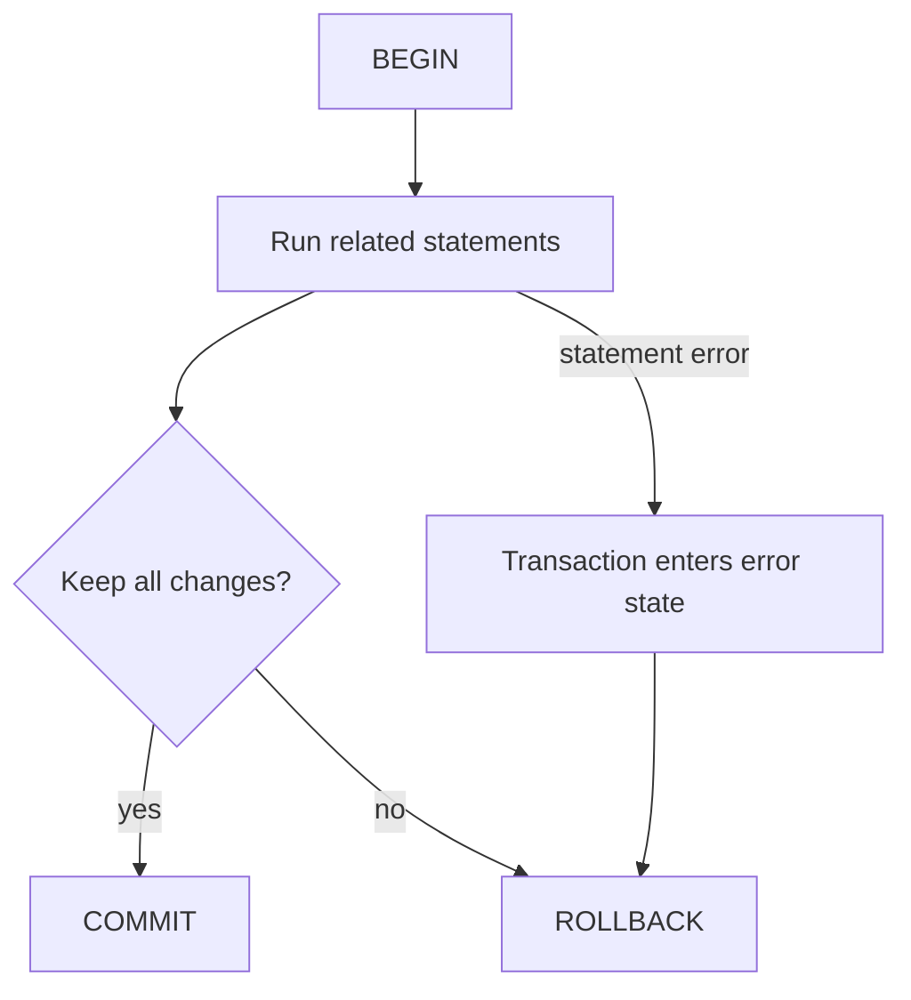

Relational databases store facts in tables and use constraints and transactions to keep those facts coherent as applications change them concurrently. SQL is the language for defining, querying, and updating that data. This lesson uses **PostgreSQL 17** for dialect-specific syntax such as `EXPLAIN ANALYZE`; most relational modeling ideas apply across database systems, but exact SQL behavior can vary.

## Tables, keys, and constraints

A table represents one kind of entity or relationship. A **row** is one stored occurrence, a **column** describes an attribute, and a **key** identifies or connects rows. Use constraints to make the database enforce important invariants, even when data is written by a different service or administrative tool.

```sql
CREATE TABLE customers (
    customer_id bigint GENERATED ALWAYS AS IDENTITY PRIMARY KEY,
    email text NOT NULL UNIQUE,
    display_name text NOT NULL
);

CREATE TABLE orders (
    order_id bigint GENERATED ALWAYS AS IDENTITY PRIMARY KEY,
    customer_id bigint NOT NULL REFERENCES customers(customer_id),
    created_at timestamptz NOT NULL DEFAULT now(),
    status text NOT NULL CHECK (status IN ('NEW', 'PAID', 'SHIPPED', 'CANCELLED'))
);

CREATE TABLE order_lines (
    order_id bigint NOT NULL REFERENCES orders(order_id),
    line_number integer NOT NULL CHECK (line_number > 0),
    product_code text NOT NULL,
    quantity integer NOT NULL CHECK (quantity > 0),
    unit_price numeric(12, 2) NOT NULL CHECK (unit_price >= 0),
    PRIMARY KEY (order_id, line_number)
);
```

- A **primary key** identifies a row and is unique and non-null.
- A **foreign key** enforces that a referenced row exists, subject to the chosen delete/update action.
- `NOT NULL`, `UNIQUE`, and `CHECK` constraints express local data rules.
- Use exact numeric types such as `numeric` for decimal amounts; binary floating-point types are approximate.

Constraints are a correctness boundary, not just documentation. A `CHECK (quantity > 0)` does not by itself reject `NULL`, because SQL uses three-valued logic: a check passes when its expression is true or unknown. Pair it with `NOT NULL` when absence is invalid. A `CHECK` constraint is also not a general way to enforce conditions that depend on other rows; use an appropriate key, exclusion, foreign-key constraint, or transaction-level design.

## Normalize to reduce update anomalies

Normalization organizes facts so one fact has one authoritative home. Repeating customer email on every order line creates anomalies: updating an address requires changing many rows, and inserting a customer may require inventing an order.

For example, keep a product's description in a product table instead of copying it into every order line:

```sql
CREATE TABLE products (
    product_code text PRIMARY KEY,
    description text NOT NULL
);

CREATE TABLE order_lines (
    order_id bigint NOT NULL REFERENCES orders(order_id),
    line_number integer NOT NULL,
    product_code text NOT NULL REFERENCES products(product_code),
    quantity integer NOT NULL CHECK (quantity > 0),
    unit_price numeric(12, 2) NOT NULL CHECK (unit_price >= 0),
    PRIMARY KEY (order_id, line_number)
);
```

The order line retains the **price charged at purchase time**: that is a historical fact and should not be replaced with today's product price. The product description is usually current catalog data and belongs with the product. Whether a historical description or tax amount must also be snapshotted is a domain decision.

The normal forms are useful diagnostics:

- **First normal form (1NF):** represent a value in a column as one value for that attribute, rather than packing repeating lists into a delimited string.
- **Second normal form (2NF):** in a table with a composite key, each non-key attribute depends on the whole key, not only part of it.
- **Third normal form (3NF):** non-key attributes describe the key, the whole key, and nothing but the key; avoid storing facts that depend on another non-key attribute.

Normalization is not a goal of maximizing table count. Denormalization can be appropriate for measured read or reporting needs, but it introduces duplicated facts that must be kept synchronized. Make that trade explicit and preserve a clear source of truth.

## Transactions and ACID

A **transaction** groups related statements into one all-or-nothing unit. The familiar ACID properties describe the intended guarantees:

- **Atomicity:** either the transaction's changes commit together or they are rolled back.
- **Consistency:** committed operations preserve the database's declared constraints and application invariants.
- **Isolation:** concurrent transactions observe behavior according to the database's isolation guarantees.
- **Durability:** after a successful commit is acknowledged, committed changes survive failures according to the database's durability configuration.

For a transfer, debit and credit must not be independent auto-committed statements:

```sql
BEGIN;

UPDATE accounts
SET balance = balance - 25.00
WHERE account_id = 101;

UPDATE accounts
SET balance = balance + 25.00
WHERE account_id = 202;

COMMIT;
```

The application must still check that the debit updated the intended account and obeys business rules such as a non-negative balance. A database constraint can enforce a row-level invariant such as `CHECK (balance >= 0)`, while transaction logic coordinates multi-row behavior. If any step fails, roll back rather than leaving only part of the transfer applied.



Isolation levels control what concurrent transactions can observe. The SQL names include Read Uncommitted, Read Committed, Repeatable Read, and Serializable, but implementations differ. In PostgreSQL 17, Read Uncommitted behaves like Read Committed; Read Committed is the default, and each command sees a snapshot taken at the beginning of that command. Serializable aims to make committed concurrent outcomes equivalent to some serial order, but a transaction may be aborted and need to be retried. Applications must handle that possibility.

Do not treat “Serializable” as meaning that transactions can never fail or that arbitrary application workflows are automatically correct. Keep transactions bounded, handle constraint and serialization errors, and retry only operations that are safe to run again.

## Indexes and query plans

An **index** is an additional data structure the database can use to find rows without scanning every table row. It can speed up filters, joins, and ordering when its key columns fit the query, but it also consumes storage and adds work to inserts, updates, and deletes.

```sql
CREATE INDEX orders_customer_created_idx
    ON orders (customer_id, created_at DESC);

SELECT order_id, created_at, status
FROM orders
WHERE customer_id = 42
  AND created_at >= TIMESTAMPTZ '2026-01-01 00:00:00+00'
ORDER BY created_at DESC
LIMIT 20;
```

The leading `customer_id` column makes this composite index a natural candidate for the equality filter followed by a time range and descending order. An index is not a command to the planner: if a query returns a large fraction of a table, a sequential scan can be cheaper. Confirm with representative data and a plan rather than assuming every index is used.

Use `EXPLAIN` to inspect the planner's estimated plan:

```sql
EXPLAIN
SELECT order_id, created_at
FROM orders
WHERE customer_id = 42
ORDER BY created_at DESC
LIMIT 20;
```

`EXPLAIN ANALYZE` executes the statement and reports actual measurements alongside estimates. It is not a harmless preview for a data-changing statement:

```sql
EXPLAIN (ANALYZE, BUFFERS)
SELECT order_id, created_at
FROM orders
WHERE customer_id = 42
ORDER BY created_at DESC
LIMIT 20;
```

Read estimated versus actual row counts, scan and join nodes, buffer activity, and where time is spent. Cost values are planner units, not milliseconds. A large estimate/actual mismatch can point to stale or insufficient statistics, skewed data, or correlated columns. `EXPLAIN ANALYZE` actually runs the query; for a write statement that must not persist, run it inside a transaction and roll back, while also considering triggers and external effects.

Index design is workload-specific. Start from observed slow queries and their predicates, joins, and ordering. Too many overlapping indexes increase write cost and complicate maintenance; a sequential scan is not automatically a problem.

## Joins, aggregation, and window functions

Use joins to combine related rows through keys, and aggregate functions to reduce groups to summaries:

```sql
SELECT
    c.customer_id,
    c.display_name,
    count(o.order_id) AS order_count
FROM customers AS c
LEFT JOIN orders AS o
    ON o.customer_id = c.customer_id
GROUP BY c.customer_id, c.display_name
HAVING count(o.order_id) >= 3
ORDER BY order_count DESC, c.customer_id;
```

`LEFT JOIN` keeps customers with no orders; `count(o.order_id)` counts only matched orders because the right-side key is null for an unmatched row. `WHERE` filters input rows before grouping, while `HAVING` filters groups after aggregation.

A **window function** computes across related rows while retaining one output row per input row. This is different from `GROUP BY`, which collapses each group:

```sql
SELECT
    customer_id,
    order_id,
    created_at,
    row_number() OVER (
        PARTITION BY customer_id
        ORDER BY created_at DESC, order_id DESC
    ) AS newest_order_number
FROM orders;
```

The partition restarts numbering for each customer. The unique `order_id` tie-breaker makes the ordering deterministic when timestamps match. Window functions are useful for ranking, running totals, and comparing a row with its group without losing row identity. In PostgreSQL they are evaluated after `WHERE`, `GROUP BY`, and `HAVING`, so filtering by a window result generally requires a subquery or common table expression.

```sql
WITH ranked_orders AS (
    SELECT
        customer_id,
        order_id,
        created_at,
        row_number() OVER (
            PARTITION BY customer_id
            ORDER BY created_at DESC, order_id DESC
        ) AS position
    FROM orders
)
SELECT customer_id, order_id, created_at
FROM ranked_orders
WHERE position <= 3
ORDER BY customer_id, position;
```

## Safety and correctness habits

- Bind untrusted values as parameters in the database client; do not build SQL by concatenating user input. Identifiers such as table names cannot generally be bound as values, so choose them from an allowlist when they must vary.
- Use constraints for invariants that must hold regardless of which application writes the row.
- Use explicit transactions around multi-statement operations that must succeed or fail together.
- Specify a complete order, including a unique tie-breaker, when pagination or ranking needs deterministic results.
- Avoid `SELECT *` in stable application queries when only a few columns are needed.
- Inspect real query plans before adding indexes, and test with representative data and parameter values.
- Treat isolation, null behavior, collation, date/time semantics, and generated-key behavior as database-specific details.

## Further reading

- PostgreSQL 17, [Transactions](https://www.postgresql.org/docs/17/tutorial-transactions.html)
- PostgreSQL 17, [Transaction Isolation](https://www.postgresql.org/docs/17/transaction-iso.html)
- PostgreSQL 17, [Constraints](https://www.postgresql.org/docs/17/ddl-constraints.html)
- PostgreSQL 17, [Indexes](https://www.postgresql.org/docs/17/indexes.html)
- PostgreSQL 17, [`EXPLAIN`](https://www.postgresql.org/docs/17/sql-explain.html)
- PostgreSQL 17, [Window Functions](https://www.postgresql.org/docs/17/tutorial-window.html)
- [Architectural Patterns](../level-6/architectural-patterns)
