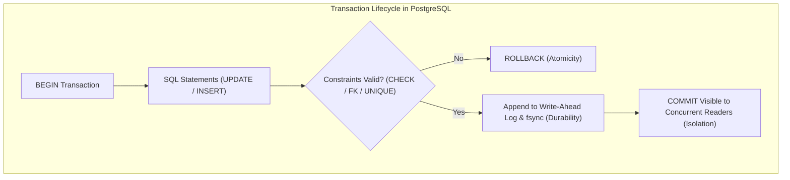
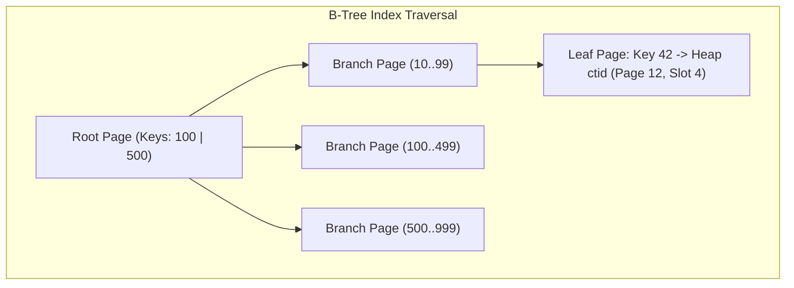

ORMs like Hibernate let Java teams move quickly on straightforward CRUD features, which makes it easy to treat the relational database as an implementation detail. That works fine until a table grows past a few million rows, a schema shortcut turns into inconsistent financial data, or a reporting endpoint starts taking several seconds because an index is being ignored.

SQL is not just a query syntax you pass through a repository method. The schema you design, the constraints you declare, and the execution plans your queries generate determine whether your application stays predictable under load. This guide covers the four pillars every backend engineer relies on daily: ACID transactions, normalization (and when to bend the rules), B-Tree indexes with `EXPLAIN ANALYZE`, and analytical SQL using CTEs and window functions.

## ACID Properties in Practice

When two services update the same rows at the same time, or when a server loses power halfway through a multi-step write, the database has to keep stored data trustworthy. The ACID acronym describes the four guarantees relational databases use to do that.



### Atomicity

A transaction is all-or-nothing. Either every statement inside `BEGIN ... COMMIT` takes effect, or none of them do. If your application debits one account and then hits a constraint violation or network disconnect before crediting the second account, the database rolls back the debit automatically so money never disappears mid-transfer.

### Consistency

Consistency means a transaction moves the database from one valid state to another, respecting every rule defined in the schema. Unlike the other three letters, consistency is a shared responsibility between the database and your application. The database enforces structural rules such as `PRIMARY KEY`, `FOREIGN KEY`, `UNIQUE`, `NOT NULL`, and `CHECK` constraints, while your application enforces cross-row business rules inside the transaction boundary.

### Isolation

Concurrent transactions should not interfere with each other in ways that corrupt results. Full serializability is expensive, so SQL defines four isolation levels (`READ UNCOMMITTED`, `READ COMMITTED`, `REPEATABLE READ`, and `SERIALIZABLE`) that trade stricter concurrency protection against throughput. Most relational engines, including PostgreSQL and MySQL InnoDB, rely on Multi-Version Concurrency Control (MVCC) so readers do not block writers and writers do not block readers.

### Durability

Once a database acknowledges a `COMMIT`, the change survives process crashes and power loss. Instead of flushing scattered 8 KB table pages directly to disk on every commit, engines like PostgreSQL append a compact change record to a sequential Write-Ahead Log (WAL) and flush it with `fsync`. Background processes write the modified table pages to disk asynchronously. If the server crashes before those pages are flushed, startup recovery replays the WAL from the last checkpoint.

Here is a concrete PostgreSQL example showing atomicity and schema-level consistency working together during an order placement:

```sql
CREATE TABLE accounts (
    id         bigint PRIMARY KEY,
    balance    numeric(12, 2) NOT NULL CHECK (balance >= 0)
);

CREATE TABLE ledger_entries (
    id          bigserial PRIMARY KEY,
    from_id     bigint NOT NULL REFERENCES accounts(id),
    to_id       bigint NOT NULL REFERENCES accounts(id),
    amount      numeric(12, 2) NOT NULL CHECK (amount > 0),
    created_at  timestamptz NOT NULL DEFAULT now()
);

BEGIN;

-- Debit sender; if balance would drop below 0, the CHECK constraint fails
UPDATE accounts
SET balance = balance - 250.00
WHERE id = 101;

-- Credit recipient
UPDATE accounts
SET balance = balance + 250.00
WHERE id = 202;

-- Record audit trail
INSERT INTO ledger_entries (from_id, to_id, amount)
VALUES (101, 202, 250.00);

COMMIT;
```

Notice the `CHECK (balance >= 0)` constraint on `accounts`. Even if a bug in a Java service skips a balance check, the database rejects the first `UPDATE`, aborts the transaction, and leaves both balances and `ledger_entries` untouched. Putting invariants directly in the schema is far safer than trusting every future caller to enforce them in application code.

> [!NOTE]
> Under PostgreSQL's default `READ COMMITTED` isolation, concurrent updates to the same row wait for the first transaction's row lock and then re-evaluate the `WHERE` clause and `CHECK` constraints against the newly committed balance. For multi-row invariants where two transactions update *different* rows, you will need `SELECT ... FOR UPDATE` or `SERIALIZABLE` isolation, which we cover in detail in the storage engine internals lesson.

## Normalization and Pragmatic Denormalization

Normalization is the process of structuring tables so each piece of data has one clear home. Without it, schemas suffer from three classic problems:

- **Update anomalies**: Changing a customer's city requires updating 500 historical order rows; missing one leaves contradictory data.
- **Insertion anomalies**: You cannot record a new department until at least one employee is assigned to it, because department details only live inside the `employees` table.
- **Deletion anomalies**: Deleting the last order for a product accidentally wipes out the only copy of that product's supplier contact info.

### Walking Through 1NF, 2NF, and 3NF

Suppose you inherit a flat table for an online store:

```sql
-- Unnormalized: repeating comma-separated values and mixed entities
CREATE TABLE bad_orders (
    order_id       bigint,
    customer_name  text,
    product_ids    text,      -- e.g. '10,42,88' (violates 1NF)
    product_names  text,
    zip_code       text,
    city           text
);
```

**First Normal Form (1NF)** requires a primary key and atomic column values (no repeating groups or delimited lists packed into a single cell). Splitting line items into their own table fixes 1NF:

```sql
-- 1NF, but still has a 2NF violation
CREATE TABLE order_lines_1nf (
    order_id      bigint,
    product_id    bigint,
    product_name  text,       -- depends ONLY on product_id, not the full composite key
    quantity      integer NOT NULL,
    PRIMARY KEY (order_id, product_id)
);
```

**Second Normal Form (2NF)** builds on 1NF and removes partial dependencies on composite primary keys. Every non-key column must depend on the *entire* primary key. In `order_lines_1nf`, `quantity` depends on `(order_id, product_id)`, but `product_name` depends only on `product_id`. Moving `product_name` to a dedicated `products` table satisfies 2NF.

**Third Normal Form (3NF)** builds on 2NF and removes transitive dependencies, where one non-key column depends on another non-key column rather than directly on the primary key. For example, if a `customers` table stores `(customer_id, zip_code, city, state)`, then `city` and `state` depend on `zip_code`, not directly on `customer_id`. Extracting a `postal_codes(zip_code, city, state)` lookup table satisfies 3NF.

In day-to-day backend design, 3NF is a sensible default starting point. Going further (BCNF, 4NF, 5NF) is occasionally useful for specialized modeling, but 3NF already eliminates the vast majority of write anomalies.

### When Denormalization Makes Sense

Strictly following 3NF everywhere can actually introduce bugs if you confuse **live catalog data** with **historical facts**. Consider an e-commerce order line:

```sql
-- Problematic over-normalization: no price captured on the order line
CREATE TABLE order_items_flawed (
    order_id    bigint REFERENCES orders(id),
    product_id  bigint REFERENCES products(id),
    quantity    integer NOT NULL,
    PRIMARY KEY (order_id, product_id)
);
```

If invoices calculate totals by joining `order_items_flawed` to `products.current_price`, then raising a product's price next month silently rewrites the totals of every historical order ever placed. The price charged at checkout is an immutable fact about that order, not a pointer to today's catalog:

```sql
CREATE TABLE order_items (
    order_id                bigint NOT NULL REFERENCES orders(id),
    product_id              bigint NOT NULL REFERENCES products(id),
    quantity                integer NOT NULL CHECK (quantity > 0),
    unit_price_at_purchase  numeric(12, 2) NOT NULL CHECK (unit_price_at_purchase >= 0),
    tax_rate_at_purchase    numeric(5, 4) NOT NULL CHECK (tax_rate_at_purchase >= 0),
    PRIMARY KEY (order_id, product_id)
);
```

A second legitimate reason to denormalize is **read performance** on heavy aggregations, such as storing `order_total` on `orders` or maintaining a materialized view for a dashboard. The trade-off is clear: you gain faster reads, and in exchange you take on the responsibility of keeping the duplicated value in sync (via triggers, application code in the same transaction, or scheduled refreshes). Always normalize first, and only denormalize a specific column when you have either a historical snapshot requirement or measured query latency that indexes alone cannot solve.

## Indexes and Query Execution Plans

Without an index, finding matching rows forces the database to read every page of the table from start to finish (a sequential scan). On a 50-million-row table, that means reading gigabytes from memory or disk on every request.

In PostgreSQL, MySQL, and Oracle, the default index structure is a balanced **B-Tree** (specifically a B+ Tree variant). It keeps indexed keys in sorted order across tree pages so lookups, prefix matches, and range scans complete in `O(log n)` page reads.



Each leaf entry stores the indexed key values alongside a pointer to the row in the table heap (in PostgreSQL, the physical tuple identifier `ctid`; in MySQL InnoDB, the primary key value).

### Composite Indexes and the Leftmost Prefix Rule

Most real queries filter on more than one column and sort by another. A **composite index** indexes multiple columns in a specific order:

```sql
CREATE INDEX idx_orders_tenant_status_created
    ON orders (tenant_id, status, created_at DESC);
```

The B-Tree sorts entries first by `tenant_id`. Within the same `tenant_id`, entries are sorted by `status`. Within the same `(tenant_id, status)`, entries are sorted by `created_at DESC`.

Because the tree is organized from left to right, the database can only jump directly into the tree if your query constrains a **leftmost prefix** of the indexed columns:

- `WHERE tenant_id = 42` uses the index cleanly.
- `WHERE tenant_id = 42 AND status = 'PAID'` uses the first two columns.
- `WHERE tenant_id = 42 AND status = 'PAID' ORDER BY created_at DESC LIMIT 10` uses all three columns and returns the 10 newest rows without a separate sort step.
- `WHERE status = 'PAID'` cannot use the B-Tree efficiently because `status` values are scattered across every `tenant_id` subtree.
- `WHERE created_at > '2026-01-01'` faces the same problem.

A second rule of thumb for column ordering in composite indexes is **equality columns before range columns**. Suppose you flip the order to `(tenant_id, created_at DESC, status)` and run:

```sql
SELECT id, total_amount
FROM orders
WHERE tenant_id = 42
  AND created_at >= '2026-01-01'
  AND status = 'PAID';
```

Once the engine hits the range predicate (`created_at >= '2026-01-01'`), `status` values inside that date range are no longer grouped together, so the index stops narrowing rows on `status` and has to filter them afterward. Putting equality filters (`tenant_id`, `status`) first and the range or sort column (`created_at`) last gives the B-Tree maximum selectivity.

### Covering Indexes and Partial Indexes

Two index features often cut query latency in half on busy tables:

- **Covering indexes (`INCLUDE`)**: Adding extra non-key columns to leaf pages lets PostgreSQL answer the query from the index alone (`Index Only Scan`) without touching the heap table.
- **Partial indexes (`WHERE`)**: If 95% of rows in `orders` are `ARCHIVED` and your hot path only queries `PENDING` orders, indexing only `WHERE status = 'PENDING'` produces a tiny index that stays warm in RAM and adds almost zero write overhead for archived rows.

```sql
-- Covering partial index: small footprint, enables Index Only Scan for active queue polling
CREATE INDEX idx_orders_pending_tenant_created
    ON orders (tenant_id, created_at DESC)
    INCLUDE (total_amount)
    WHERE status = 'PENDING';
```

Remember that indexes are not free. Every `INSERT`, `DELETE`, and non-HOT `UPDATE` has to maintain every index on the table, increasing write I/O and WAL volume. Index for your actual query patterns, not every column in the table.

### Reading `EXPLAIN (ANALYZE, BUFFERS)`

Never guess whether an index is helping. Prefix your query with `EXPLAIN (ANALYZE, BUFFERS)` in PostgreSQL (`EXPLAIN ANALYZE` in MySQL 8+):

```sql
EXPLAIN (ANALYZE, BUFFERS)
SELECT id, total_amount, created_at
FROM orders
WHERE tenant_id = 42
  AND status = 'PAID'
ORDER BY created_at DESC
LIMIT 10;
```

A healthy execution plan looks like this:

```text
Limit  (cost=0.43..14.92 rows=10 width=24) (actual time=0.038..0.052 rows=10 loops=1)
  Buffers: shared hit=4
  ->  Index Scan using idx_orders_tenant_status_created on orders
        (cost=0.43..1490.20 rows=1024 width=24) (actual time=0.036..0.049 rows=10 loops=1)
        Index Cond: ((tenant_id = 42) AND (status = 'PAID'::text))
        Buffers: shared hit=4
Planning Time: 0.145 ms
Execution Time: 0.078 ms
```

Four signals matter most when reading a plan:

1. **Scan node type**:
   - `Seq Scan`: Reads the whole table. Totally fine on a 200-row lookup table (often faster than an index), problematic on large tables when you only want a handful of rows.
   - `Index Scan`: Walks the B-Tree and fetches matching rows from the heap table.
   - `Index Only Scan`: Reads all required columns directly from the index leaf pages (assuming the visibility map shows the heap pages are all-visible).
   - `Bitmap Index Scan` + `Bitmap Heap Scan`: Useful when a query matches thousands of rows; builds a bitmap of matching heap pages and reads them in physical disk order instead of random jumps.
2. **Estimated vs. actual rows**: Compare `rows=1024` (planner estimate) with `actual ... rows=10` (note that `LIMIT 10` stopped the scan early here, which is normal). If an un-limited scan estimates `rows=5` but actually returns `rows=400000`, the planner likely picked a terrible join strategy because table statistics are stale. Run `ANALYZE orders;` to refresh column histograms.
3. **Buffer usage (`shared hit` vs. `shared read`)**: `shared hit=4` means 4 pages were already in PostgreSQL's shared buffers (RAM). `shared read=850` means 850 pages had to be pulled from the OS page cache or disk. Low buffer counts usually matter even more than raw wall-clock time when tuning queries on a warm test machine.
4. **Filter vs. Index Cond**: `Index Cond` means the B-Tree narrowed the rows directly. A `Filter` line with `Rows Removed by Filter: 95000` means the database pulled 95,000 rows only to throw them away. That is usually a sign that an index column is missing, out of order, or wrapped in a function like `WHERE LOWER(email) = ...` without a matching expression index.

> [!WARNING]
> `EXPLAIN ANALYZE` actually *executes* the query. If you run it on an `UPDATE` or `DELETE`, wrap it in `BEGIN; EXPLAIN (ANALYZE, BUFFERS) DELETE ...; ROLLBACK;` so you do not modify live data while profiling.

## Common Table Expressions (CTEs)

As analytical queries grow, nesting three levels of subqueries quickly becomes hard to read and harder to debug. A **Common Table Expression (`WITH` clause)** gives each intermediate step a name, turning nested subqueries into a top-to-bottom pipeline.

```sql
WITH monthly_revenue AS (
    SELECT
        tenant_id,
        date_trunc('month', created_at) AS month_start,
        SUM(total_amount) AS revenue
    FROM orders
    WHERE status = 'PAID'
      AND created_at >= DATE '2026-01-01'
    GROUP BY tenant_id, date_trunc('month', created_at)
),
tenant_averages AS (
    SELECT
        tenant_id,
        AVG(revenue) AS avg_monthly_revenue
    FROM monthly_revenue
    GROUP BY tenant_id
)
SELECT
    m.tenant_id,
    m.month_start,
    m.revenue,
    ROUND(t.avg_monthly_revenue, 2) AS avg_monthly_revenue
FROM monthly_revenue m
JOIN tenant_averages t ON t.tenant_id = m.tenant_id
WHERE m.revenue > t.avg_monthly_revenue * 1.25
ORDER BY m.tenant_id, m.month_start;
```

In PostgreSQL 12 and newer, non-recursive CTEs referenced once are inlined by default, meaning the query planner can push outer `WHERE` filters down into the CTE and use indexes normally. If you deliberately want a CTE evaluated once and cached in memory as an optimization fence, you can write `WITH monthly_revenue AS MATERIALIZED (...)`, or force inlining with `NOT MATERIALIZED`.

### Recursive CTEs for Hierarchical Data

Standard SQL cannot easily traverse trees of arbitrary depth (such as organizational charts, category hierarchies, or bill-of-materials graphs) with fixed self-joins. A **recursive CTE** (`WITH RECURSIVE`) solves this cleanly by combining a base query (the anchor) with a recursive query that references the CTE itself, joined by `UNION ALL`:

```sql
WITH RECURSIVE org_tree AS (
    -- Anchor member: start at the VP or root manager
    SELECT
        id,
        name,
        manager_id,
        1 AS depth,
        ARRAY[id] AS path
    FROM employees
    WHERE manager_id IS NULL

    UNION ALL

    -- Recursive member: join direct reports to the previous level
    SELECT
        e.id,
        e.name,
        e.manager_id,
        ot.depth + 1,
        ot.path || e.id
    FROM employees e
    JOIN org_tree ot ON e.manager_id = ot.id
    WHERE NOT (e.id = ANY(ot.path)) -- Cycle guard against corrupted manager loops
)
SELECT
    id,
    repeat('  ', depth - 1) || name AS indented_name,
    depth
FROM org_tree
ORDER BY path;
```

Notice the `WHERE NOT (e.id = ANY(ot.path))` check. Real production data eventually gets a cyclic reference (Alice reports to Bob, Bob reports to Alice). Without a cycle guard or PostgreSQL 14's `CYCLE` clause, a recursive CTE will loop until it hits a memory or statement timeout.

## Window Functions

A regular `GROUP BY` collapses all rows in a group into one output row. A **window function** calculates aggregates, rankings, or neighbor comparisons across a defined set of related rows *without* collapsing individual rows. Every input row stays in the result set with the computed value attached.

The general syntax is:

```sql
function_name(...) OVER (
    PARTITION BY group_column      -- Optional: resets calculation per group
    ORDER BY sort_column           -- Optional: defines row ordering inside each partition
    ROWS BETWEEN ... AND ...       -- Optional: defines the sliding frame relative to current row
)
```

Window functions are evaluated *after* `WHERE`, `GROUP BY`, and `HAVING`, which is why you cannot filter on a window function result directly inside `WHERE`. Wrap the query in a CTE (or subquery) and filter in the outer `SELECT`.

### Ranking: `ROW_NUMBER`, `RANK`, and `DENSE_RANK`

These three functions all assign positions within each partition, differing only in how they handle ties:

```sql
SELECT
    department,
    employee_name,
    salary,
    ROW_NUMBER() OVER (PARTITION BY department ORDER BY salary DESC) AS row_num,
    RANK()       OVER (PARTITION BY department ORDER BY salary DESC) AS rnk,
    DENSE_RANK() OVER (PARTITION BY department ORDER BY salary DESC) AS dense_rnk
FROM employees;
```

Given four engineers in the same department:

| Employee | Salary | `ROW_NUMBER()` | `RANK()` | `DENSE_RANK()` | Behavior |
| :--- | :--- | :--- | :--- | :--- | :--- |
| Alice | 150,000 | 1 | 1 | 1 | Highest salary |
| Bob | 135,000 | 2 | 2 | 2 | Tied for second |
| Charlie | 135,000 | 3 | 2 | 2 | Tied for second |
| David | 120,000 | 4 | 4 | 3 | `RANK` skips 3; `DENSE_RANK` continues at 3 |

Use `ROW_NUMBER()` when you need exactly one deterministic row per group (for example, fetching the latest order per customer, using a tie-breaker like `ORDER BY created_at DESC, id DESC` so results are reproducible). Use `DENSE_RANK()` when you want "top 3 salary tiers per department" including ties.

### Comparing Across Rows with `LAG` and `LEAD`

`LAG(col, offset, default)` reads a column from an earlier row in the partition; `LEAD(col, offset, default)` peeks ahead at a later row. They eliminate slow self-joins for time-series deltas and event gap analysis:

```sql
WITH daily_sales AS (
    SELECT
        created_at::date AS sale_date,
        SUM(total_amount) AS revenue
    FROM orders
    WHERE status = 'PAID'
    GROUP BY created_at::date
)
SELECT
    sale_date,
    revenue,
    LAG(revenue, 1) OVER (ORDER BY sale_date) AS prev_day_revenue,
    revenue - LAG(revenue, 1) OVER (ORDER BY sale_date) AS day_over_day_delta,
    LEAD(sale_date, 1) OVER (ORDER BY sale_date) - sale_date AS days_until_next_sale
FROM daily_sales
ORDER BY sale_date;
```

### Running Totals and Moving Averages

Passing an `ORDER BY` clause into `SUM()` or `AVG()` turns a regular aggregate into a cumulative calculation. Explicitly specifying a frame clause (`ROWS BETWEEN ...`) keeps the intent unmistakable and avoids surprises with duplicate sort keys:

```sql
WITH daily_sales AS (
    SELECT
        tenant_id,
        created_at::date AS sale_date,
        SUM(total_amount) AS revenue
    FROM orders
    WHERE status = 'PAID'
    GROUP BY tenant_id, created_at::date
)
SELECT
    tenant_id,
    sale_date,
    revenue,
    SUM(revenue) OVER (
        PARTITION BY tenant_id
        ORDER BY sale_date
        ROWS BETWEEN UNBOUNDED PRECEDING AND CURRENT ROW
    ) AS running_total,
    ROUND(AVG(revenue) OVER (
        PARTITION BY tenant_id
        ORDER BY sale_date
        ROWS BETWEEN 6 PRECEDING AND CURRENT ROW
    ), 2) AS rolling_7_day_avg
FROM daily_sales
ORDER BY tenant_id, sale_date;
```

> [!TIP]
> Notice the subtle difference between `ROWS` and the default `RANGE` frame when `ORDER BY` contains duplicate values (such as two orders with the same timestamp). `RANGE BETWEEN UNBOUNDED PRECEDING AND CURRENT ROW` includes *all* peer rows with the same sort key in the running total at once, whereas `ROWS` adds strictly one row at a time. When you want a true row-by-row running total, specify `ROWS` explicitly.

## Interview Questions

### Why is storing `unit_price_at_purchase` on `order_items` not considered a normalization mistake?

Normalization aims to eliminate redundant storage of *mutable* attributes that belong to another entity. A product's current catalog price lives in `products` and changes over time. The price a customer actually paid on a past order is a separate, immutable historical fact that belongs to the `order_items` entity. If you omit it and join back to `products`, updating the catalog price retroactively corrupts historical invoices and accounting records.

### Given a composite index on `(tenant_id, status, created_at DESC)`, which queries use it effectively and why?

The index is sorted first by `tenant_id`, then by `status`, then by `created_at DESC`. Queries filtering on `tenant_id` alone, `(tenant_id, status)`, or `(tenant_id, status)` with an `ORDER BY created_at DESC` follow the leftmost prefix and can navigate the B-Tree directly. A query filtering only on `WHERE status = 'PAID'` or `WHERE created_at > ...` cannot jump into the tree root because those values appear across every `tenant_id` subtree, so the planner typically falls back to a sequential scan (or an index scan over the entire index if it is much smaller than the heap).

### Why can you not write `WHERE ROW_NUMBER() OVER (...) = 1` directly in SQL?

SQL evaluates clauses in a logical order: `FROM`/`JOIN` -> `WHERE` -> `GROUP BY` -> `HAVING` -> `SELECT` (including window functions) -> `ORDER BY` -> `LIMIT`. Because `WHERE` runs before window functions are computed, the ranking value does not exist yet at filter time. Wrapping the window query in a CTE or subquery computes the window column first so the outer `WHERE` can filter on it. (Some engines like Snowflake, BigQuery, and DuckDB offer a `QUALIFY` clause as syntactic sugar for this, though PostgreSQL and MySQL do not.)

### When running `EXPLAIN (ANALYZE, BUFFERS)`, what does a huge gap between estimated rows and actual rows usually tell you?

It means the query planner's table statistics are out of date or there is a strong correlation between two columns that independent column histograms do not capture. Bad row estimates cause cascading mistakes, such as choosing a nested loop join when a hash join would be orders of magnitude faster. Running `ANALYZE table_name;` refreshes statistics, and in PostgreSQL you can also create extended multivariate statistics (`CREATE STATISTICS`) when two columns are tightly correlated (such as `zip_code` and `city`).
