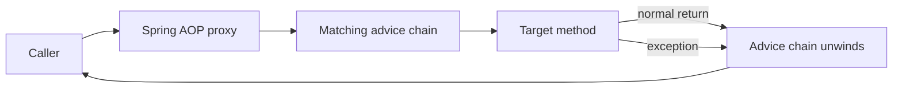

Logging, transaction boundaries, metrics, and authorization checks can affect many operations without being the operation's core business purpose. Copying that behavior into every method couples unrelated code and makes omissions likely. **Aspect-Oriented Programming (AOP)** provides a way to define such cross-cutting behavior once and apply it to a selected set of method executions.

This lesson uses Spring Framework 7.0.10 documentation and Java 21 examples. Spring AOP is proxy-based; it is not the same as compiling or weaving all AspectJ language features into application bytecode.

## The core vocabulary

| Term | Meaning |
|---|---|
| Concern | A responsibility such as timing, transactions, or audit logging. |
| Aspect | A module that declares where and how a cross-cutting concern is applied. |
| Join point | An execution point where advice could run. In Spring AOP, this is a method execution on a Spring bean. |
| Pointcut | A predicate that selects join points, for example methods in a service package or methods marked with an annotation. |
| Advice | The action to run at a matched join point, such as before a method or after it returns. |
| Target | The bean whose method is being advised. |
| Proxy | The object through which callers invoke the target and its advice chain. |

The pointcut answers **where** an aspect applies; advice answers **what** it does. Spring creates an AOP proxy for a bean when it has applicable advice. Calls made through that proxy can be intercepted:



An around advice can run code before and after the target, but it must call `proceed()` to let the target run. It may also intentionally skip the target or change the returned value or thrown exception. The diagram shows the usual path when the target is invoked.

## Where Spring AOP applies

Spring AOP supports method-execution join points for Spring-managed beans. It does not intercept arbitrary objects created with `new`, field reads/writes, constructors, or method calls that never pass through a Spring proxy. A proxy can be a JDK dynamic proxy exposing interfaces or a CGLIB proxy that subclasses the target class; the chosen proxy style affects which types and methods are interceptable.

The most common proxy trap is **self-invocation**:

```java
class ReportService {
    public void generate() {
        this.writeAuditEntry(); // Calls this object directly, not the Spring proxy.
    }

    public void writeAuditEntry() {
        // ...
    }
}
```

If `generate()` was called through a Spring proxy, the call from `generate()` to `this.writeAuditEntry()` still uses the target's `this` reference. The second call therefore bypasses proxy advice. Prefer moving the advised operation to another bean and calling that bean through its injected reference. Avoid reaching into `AopContext.currentProxy()` unless there is no better design; doing so couples business code to proxy mechanics.

Because class-based proxies subclass the target, a final class cannot be subclassed and final methods cannot be overridden for interception. Design proxy-advised beans with proxy constraints in mind, and test that the calls of interest actually cross the proxy boundary.

## Pointcuts select method executions

Spring's `@AspectJ` style uses AspectJ's pointcut expression language to select Spring bean methods. For example, `execution(* com.example.store.service.*.*(..))` matches any return type and method name, with any arguments, on a type directly in `com.example.store.service`; its `*` type pattern does not include nested subpackages. The `@annotation` designator matches method executions whose method carries the specified annotation, making it useful for an explicit opt-in marker. Inside an `@Aspect` class, named pointcut signatures are `void` methods and can be composed to make policy easier to read and review. Choose expressions intentionally: a pointcut that accidentally matches data access, framework internals, or the aspect itself can cause recursion, duplicate work, or a startup failure.

## Advice types and execution order

Spring provides advice that runs:

- **Before** the method execution.
- **After returning** only when the method completes normally.
- **After throwing** when the method exits with an exception.
- **After (finally)** regardless of normal or exceptional completion.
- **Around** the method execution, with control over whether and how to proceed.

Use the least powerful advice that solves the problem. For example, use after-returning advice to observe a successful return value; use around advice only when you need to measure both sides of a call, change arguments/results, or decide whether to proceed. An around advice that forgets to call `proceed()` silently replaces the target operation.

Advice can itself throw, change a return value, or affect exception propagation. Be explicit about those semantics. For transparent instrumentation such as timing, use `try/finally` so the measurement runs whether the target returns or throws. Do not catch and suppress the target's exception; ensure the instrumentation code in the `finally` block does not introduce its own failure.

## A custom `@Loggable` annotation

First define a runtime-retained marker annotation:

```java
package com.example.store.audit;

import java.lang.annotation.ElementType;
import java.lang.annotation.Retention;
import java.lang.annotation.RetentionPolicy;
import java.lang.annotation.Target;

@Target(ElementType.METHOD)
@Retention(RetentionPolicy.RUNTIME)
public @interface Loggable {
}
```

Then register an aspect as a Spring bean and enable `@AspectJ` auto-proxying. This timing example uses a named pointcut to measure elapsed time, calls the target once, returns its value, and does not catch or translate exceptions from the target:

```java
package com.example.store.audit;

import org.aspectj.lang.ProceedingJoinPoint;
import org.aspectj.lang.annotation.Around;
import org.aspectj.lang.annotation.Aspect;
import org.aspectj.lang.annotation.Pointcut;
import org.slf4j.Logger;
import org.slf4j.LoggerFactory;
import org.springframework.stereotype.Component;

@Aspect
@Component
class TimingAspect {
    private static final Logger log = LoggerFactory.getLogger(TimingAspect.class);

    @Pointcut("@annotation(com.example.store.audit.Loggable)")
    void loggableOperation() {
    }

    @Around("loggableOperation()")
    Object measure(ProceedingJoinPoint invocation) throws Throwable {
        long start = System.nanoTime();
        try {
            return invocation.proceed();
        } finally {
            long elapsedNanos = System.nanoTime() - start;
            log.debug("{} completed in {} ns",
                    invocation.getSignature().toShortString(), elapsedNanos);
        }
    }
}
```

```java
package com.example.store.config;

import org.springframework.context.annotation.Configuration;
import org.springframework.context.annotation.EnableAspectJAutoProxy;

@Configuration
@EnableAspectJAutoProxy
class AopConfiguration {
}
```

The aspect class must also be registered in the application context; `@Component` does that when its package is component-scanned. Spring's `@AspectJ` support requires AspectJ's `org.aspectj:aspectjweaver` library on the classpath for parsing and matching pointcut expressions. It does not mean that Spring is using the AspectJ compiler or bytecode weaver.

Now annotate only the method whose timing is useful:

```java
package com.example.store.invoice;

import com.example.store.audit.Loggable;
import org.springframework.stereotype.Service;

@Service
class InvoiceService {
    @Loggable
    Invoice createInvoice(String orderId) {
        // Validate the order and create the invoice.
        return new Invoice(orderId);
    }
}
```

The example assumes `Invoice` and its imports are supplied by the application. Avoid adding request bodies, credentials, personal information, or other sensitive values to generic logging advice. A cross-cutting aspect should not accidentally turn a useful operational log into a data-exposure path.

## When AOP helps, and when it hurts

AOP is useful when a behavior is genuinely shared across a set of operations and can be expressed as a clear policy: transactions, metrics, tracing, or consistent audit hooks. It can reduce repetition, but it also moves execution behavior away from the method body. A reader may not see the effect by opening only the target class.

Keep aspects small, make their pointcuts reviewable, and document which layer they apply to. Do not hide ordinary business decisions in advice. For transaction management, security, and other built-in concerns, prefer the framework's established facilities rather than writing a second custom implementation.

## Troubleshooting checklist

- **Advice never runs:** Is the target a Spring bean? Is AOP enabled? Is the aspect registered? Does the pointcut match the actual method?
- **Advice runs for external calls but not internal calls:** Check whether the method is invoked through `this`; self-invocation bypasses the proxy.
- **A final class or method is not advised:** A class-based proxy cannot subclass a final class or override a final method.
- **A proxy cannot be assigned to the concrete class:** The proxy may expose an interface rather than the concrete implementation. Inject the interface or configure proxying intentionally.
- **The target method never runs:** Inspect around advice for a missing `proceed()` call or a deliberate short-circuit.
- **An unrelated method is advised:** Narrow the pointcut or use a marker annotation; test the positive and negative match cases.

## Further reading

- Spring Framework 7.0.10, [AOP Concepts](https://docs.spring.io/spring-framework/reference/core/aop/introduction-defn.html)
- Spring Framework 7.0.10, [Enabling `@AspectJ` Support](https://docs.spring.io/spring-framework/reference/core/aop/ataspectj/aspectj-support.html)
- Spring Framework 7.0.10, [Declaring a Pointcut](https://docs.spring.io/spring-framework/reference/core/aop/ataspectj/pointcuts.html)
- Spring Framework 7.0.10, [Declaring Advice](https://docs.spring.io/spring-framework/reference/core/aop/ataspectj/advice.html)
- Spring Framework 7.0.10, [Understanding AOP Proxies](https://docs.spring.io/spring-framework/reference/core/aop/proxying.html)
- [Spring Core Internals](./spring-core-internals)
