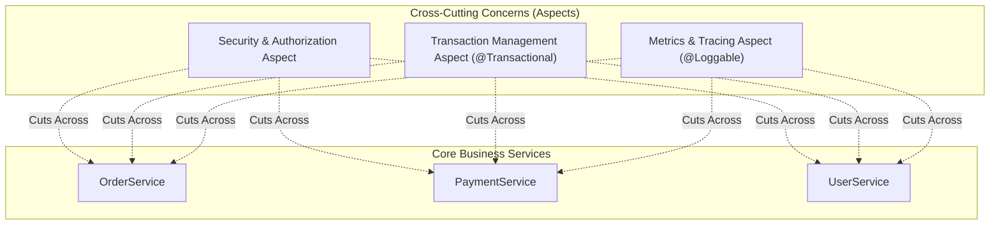
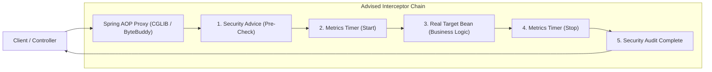
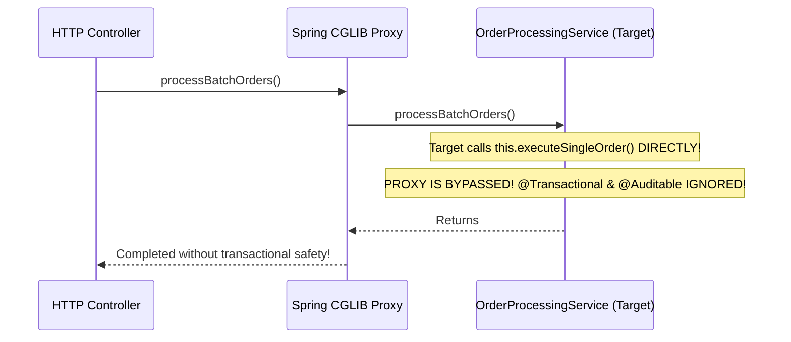
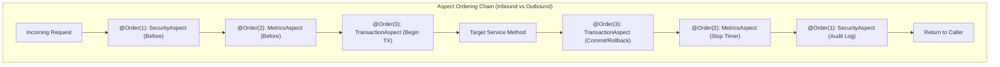

Consider what it takes to write a clean, secure financial transfer method in enterprise Java:

```java
public void transferMoney(String fromId, String toId, BigDecimal amount) {
    // 1. Security Check: Does the user have TRANSFER_FUNDS permission?
    // 2. Distributed Tracing: Start OpenTelemetry span & propagate traceparent
    // 3. Metrics: Start Prometheus micrometer timer
    // 4. Rate Limiting: Check Redis token bucket for caller IP
    // 5. Transaction: Begin JDBC transaction & set isolation level
    
    // --- ACTUAL CORE BUSINESS LOGIC (3 LINES) ---
    Account from = accountRepo.findById(fromId);
    from.debit(amount);
    to.credit(amount);
    // --------------------------------------------
    
    // 6. Transaction: Commit or Rollback
    // 7. Audit Logging: Record immutable event to Kafka audit log
    // 8. Metrics: Record execution latency and error tags
    // 9. Tracing: Close span
}
```

If you implement these infrastructural requirements imperatively, **80% of your codebase is noisy boilerplate**, completely obscuring your actual business domain logic. Even worse, if a developer forgets to copy-paste the audit log into a new endpoint, you have an undetectable security compliance breach.

These pervasive, horizontal concerns are known as **Cross-Cutting Concerns**. 

**Aspect-Oriented Programming (AOP)** provides an elegant architectural paradigm to extract cross-cutting concerns into modular, reusable components called **Aspects**, applying them declaratively across your entire system without altering a single line of business domain code.



---

## The AOP Lexicon and Mental Model

To master AOP, you must internalize its formal vocabulary:

| Concept | Formal Definition | Real-World Analogy |
| :--- | :--- | :--- |
| **Join Point** | A specific point in program execution where an aspect can be plugged in. In Spring AOP, this is **always a method execution on a Spring bean**. | A specific street intersection on a city map. |
| **Pointcut** | A predicate expression that selects one or more Join Points matching specific criteria (packages, method names, annotations). | A traffic rule: *"All intersections within the financial district."* |
| **Advice** | The concrete action executed at a Join Point (Before, After, or Around). | The police officer stationed at the intersection checking badges. |
| **Aspect** | A modular class combining Pointcuts and Advice together (annotated with `@Aspect`). | The security department operating the traffic checkpoints. |
| **Target Object** | The raw Spring bean whose methods are being intercepted. | The delivery driver passing through the checkpoint. |
| **Weaving** | The process of linking aspects with target beans to create an advised proxy. | Equipping the vehicle with a GPS tracker before dispatch. |

---

## Spring AOP vs Full AspectJ: The Proxy Reality

There is a profound architectural difference between **Spring AOP** and **AspectJ**:

- **AspectJ**: A full-fledged language extension created by Xerox PARC. It modifies compiled `.class` files directly using **Bytecode Weaving** (Compile-Time Weaving or Load-Time Weaving via a JVM `-javaagent`). AspectJ can intercept private methods, field reads/writes, static initializers, and direct constructor invocations (`new`).
- **Spring AOP**: A lightweight, **pure Java runtime proxy framework**. It requires no special compiler or JVM agent. It creates dynamic wrapper proxies around Spring beans.

Because Spring AOP is proxy-based, it has strict operational boundaries:
1. **It can ONLY intercept public method calls on Spring-managed beans.** It cannot intercept private, protected, or package-private methods.
2. **It CANNOT intercept calls on objects created with `new`** outside the Spring container.
3. **It CANNOT intercept `final` methods or methods in `final` classes** when using CGLIB subclassing.



---

## The Self-Invocation Trap

The single most common bug in Spring enterprise applications is the **Self-Invocation Trap**.

Consider this service:

```java
@Service
public class OrderProcessingService {

    public void processBatchOrders(List<Order> orders) {
        for (Order order : orders) {
            // CALLING INTERNAL METHOD ON 'this':
            this.executeSingleOrder(order); 
        }
    }

    @Transactional // THIS ANNOTATION DOES NOT RUN!
    @Auditable
    public void executeSingleOrder(Order order) {
        // Database queries execute WITHOUT a transaction!
        // No audit logs are emitted!
    }
}
```

### Why It Fails Under the Hood

When an external controller calls `orderProcessingService.processBatchOrders(orders)`:
1. The call passes through the outer **Spring AOP Proxy**.
2. The proxy delegates execution to the real target object's `processBatchOrders()` method.
3. Inside `processBatchOrders()`, the method invokes `this.executeSingleOrder(order)`.
4. In Java, **`this` points directly to the raw, unproxied target instance on the JVM thread stack!**
5. The call bypasses the Spring proxy completely. The interceptor chain is never invoked, meaning `@Transactional`, `@Async`, `@Cacheable`, and custom aspects **silently fail to execute**!



### How to Fix the Self-Invocation Trap

1. **Refactoring into Separate Beans (Best Practice)**: Extract `executeSingleOrder()` into a dedicated `OrderExecutionService` and inject it. This preserves clean Single Responsibility principles.
2. **Self-Injection via ObjectProvider**:
   ```java
   @Service
   public class OrderProcessingService {
       private final ObjectProvider<OrderProcessingService> selfProvider;

       public OrderProcessingService(ObjectProvider<OrderProcessingService> selfProvider) {
           this.selfProvider = selfProvider;
       }

       public void processBatchOrders(List<Order> orders) {
           // Invokes through the proxy!
           OrderProcessingService proxy = selfProvider.getObject();
           for (Order order : orders) {
               proxy.executeSingleOrder(order); // Interceptors run successfully!
           }
       }
   }
   ```

---

## The 5 Advice Types in Spring AOP

Spring AOP provides five specialized advice types. Always choose the least powerful advice that satisfies your requirement:

| Advice | Annotation | Execution Timing | Primary Use Case |
| :--- | :--- | :--- | :--- |
| **Before** | `@Before` | Runs before the target method executes. Cannot prevent execution unless it throws an exception. | Input validation, permission authorization checks. |
| **After Returning** | `@AfterReturning` | Runs **only if** the target method returns normally (no unhandled exception). | Emitting success events, caching returned results. |
| **After Throwing** | `@AfterThrowing` | Runs **only if** the target method exits by throwing an exception. | Alerting, error metric logging, error notification. |
| **After (Finally)** | `@After` | Runs regardless of whether the target returned normally or threw an exception. | Resource cleanup, telemetry finalize. |
| **Around** | `@Around` | **The most powerful advice**. Wraps the entire invocation. Controls whether, when, and how many times `proceed()` is called. | Performance profiling, retries, distributed tracing, transaction demarcations. |

---

## Building a Production Distributed Tracing & Audit Aspect

Here is an industrial-grade AOP aspect implementing a custom `@AuditExecution` annotation that logs method latency, captures user identity, masks sensitive parameters, and records metrics.

### Step 1: Define the Marker Annotation

```java
package com.enterprise.audit;

import java.lang.annotation.ElementType;
import java.lang.annotation.Retention;
import java.lang.annotation.RetentionPolicy;
import java.lang.annotation.Target;

@Target(ElementType.METHOD)
@Retention(RetentionPolicy.RUNTIME)
public @interface AuditExecution {
    String action();
    boolean maskSensitiveData() default false;
}
```

### Step 2: Implement the Aspect

```java
package com.enterprise.audit;

import org.aspectj.lang.ProceedingJoinPoint;
import org.aspectj.lang.annotation.Around;
import org.aspectj.lang.annotation.Aspect;
import org.aspectj.lang.annotation.Pointcut;
import org.aspectj.lang.reflect.MethodSignature;
import org.slf4j.Logger;
import org.slf4j.LoggerFactory;
import org.springframework.core.annotation.Order;
import org.springframework.stereotype.Component;

import java.lang.reflect.Method;

@Aspect
@Component
@Order(10) // Explicit precedence in the aspect chain
public class AuditAspect {
    private static final Logger log = LoggerFactory.getLogger(AuditAspect.class);

    // Named Pointcut: Selects any method carrying our custom annotation
    @Pointcut("@annotation(auditAnnotation)")
    public void auditableMethod(AuditExecution auditAnnotation) {}

    @Around(value = "auditableMethod(auditAnnotation)", argNames = "joinPoint,auditAnnotation")
    public Object profileAndAudit(ProceedingJoinPoint joinPoint, AuditExecution auditAnnotation) throws Throwable {
        long startTime = System.nanoTime();
        String actionName = auditAnnotation.action();
        MethodSignature signature = (MethodSignature) joinPoint.getSignature();
        Method method = signature.getMethod();
        String className = method.getDeclaringClass().getSimpleName();

        log.info("[AUDIT-START] Action={} Method={}.{}", actionName, className, method.getName());

        Object result;
        try {
            // CRUCIAL: Must call proceed() to let the real business logic execute!
            result = joinPoint.proceed();
        } catch (Throwable ex) {
            long durationMs = (System.nanoTime() - startTime) / 1_000_000;
            log.error("[AUDIT-FAILURE] Action={} Duration={}ms Error={}", 
                actionName, durationMs, ex.getMessage());
            
            // Mandatory: Never swallow exceptions in transparent instrumentation aspects!
            throw ex; 
        }

        long durationMs = (System.nanoTime() - startTime) / 1_000_000;
        log.info("[AUDIT-SUCCESS] Action={} Duration={}ms", actionName, durationMs);
        
        return result;
    }
}
```

### Step 3: Enable AspectJ Auto-Proxying

In your Spring configuration:

```java
@Configuration
@EnableAspectJAutoProxy(exposeProxy = true)
public class AopConfig {
}
```

---

## Aspect Ordering and the Onion Precedence Model

In enterprise applications, a single method is often targeted by multiple aspects simultaneously:
- A Security Aspect checking JWT roles.
- A Transaction Aspect (`@Transactional`) managing the database connection.
- An Audit Logging Aspect recording metrics.

**What order do they execute in?**

If the Transaction Aspect runs before the Security Aspect, the application **opens an expensive database connection from the HikariCP pool before verifying whether the user is even authorized!** If the user is unauthenticated, a database connection was wasted.

Spring models the execution order as an **Onion**:



To enforce execution order, annotate your aspect classes with Spring's **`@Order(N)`**:
- **Lowest value runs FIRST on the way in** (`@Order(1)` executes before `@Order(2)`).
- **Lowest value runs LAST on the way out** (the outer layer of the onion wraps everything).

> [!IMPORTANT]
> Always enforce `@Order` on custom aspects. Ensure that **Security Aspects run first (`@Order(1)`)**, **Telemetry/Profiling Aspects run second (`@Order(10)`)**, and **Transaction Aspects run innermost (`@Order(100)`)**.

---

## Senior Engineer Interview Crucible

### What is the fundamental operational difference between Spring AOP and full AspectJ?
Spring AOP is a runtime proxy framework implemented in pure Java. It creates dynamic CGLIB or JDK dynamic proxies that wrap Spring beans in the `ApplicationContext`. It can only intercept public method executions on managed beans, cannot advise self-invocations, and requires no custom compiler.

AspectJ is a full language extension that performs bytecode weaving (Compile-Time Weaving, Post-Compile Weaving, or Load-Time Weaving via a JVM `-javaagent`). It modifies bytecode directly, allowing it to advise private methods, constructors, field accesses, static initializers, and arbitrary objects created with `new`, with zero runtime proxy overhead.

### Explain the "Self-Invocation Problem" in Spring AOP, why it silently breaks @Transactional, and how to solve it architecturally.
Spring AOP intercepts calls by wrapping the target bean in a dynamic proxy. When an external caller invokes a method on the bean, the invocation passes through the proxy, executing transaction advice before delegating to the target.

When Method A inside a target bean invokes Method B on `this` (`this.methodB()`), the invocation is executed directly on the raw memory reference of the target instance on the thread stack. It completely bypasses the outer Spring proxy. Because the proxy is bypassed, Method B's `@Transactional` annotation is never detected, and its SQL statements run without a transactional context.

To solve it:
1. **Refactor**: Extract Method B into a separate Spring service bean and inject it into the caller (Recommended).
2. **Self-Injection**: Inject an `ObjectProvider<Self>` into the bean and call `selfProvider.getObject().methodB()`, forcing the call through the proxy.

### Compare the 5 advice types in Spring AOP: when would you choose @AfterReturning over @Around?
- `@Before`: Runs before target execution; cannot stop execution unless it throws an exception.
- `@AfterReturning`: Runs only after the target method returns normally; receives the returned value.
- `@AfterThrowing`: Runs only when the target throws an unhandled exception.
- `@After`: Runs finally, regardless of normal or exceptional completion.
- `@Around`: Surrounds method execution; controls if and when `proceed()` is called.

You should choose `@AfterReturning` over `@Around` when your aspect only needs to **passively observe or inspect a successful return value** (such as publishing a domain event or auditing an order completion). `@AfterReturning` is less error-prone because it cannot accidentally swallow exceptions, does not require handling `ProceedingJoinPoint.proceed()`, and makes the single-direction intent explicit.

### If both a Security Aspect and a Transaction Aspect advise the same service method, how do you enforce that Security executes before the Transaction opens, and why is this critical for performance?
You enforce execution order by applying the **`@Order(N)`** annotation to the aspect classes (or having them implement `Ordered`). Lower numerical values have higher precedence on the inbound request.

You should assign the Security Aspect a lower order value (e.g., `@Order(1)`) than the Transaction Aspect (e.g., `@Order(100)`).

This is critical for performance because if the Transaction Aspect ran first, the application would acquire a physical database connection from the HikariCP pool and begin a database transaction before the caller's credentials or roles were evaluated. If the Security Aspect subsequently threw an `AccessDeniedException`, an expensive database connection was checked out and held pointlessly. Running Security first rejects unauthorized requests immediately at zero database cost.
