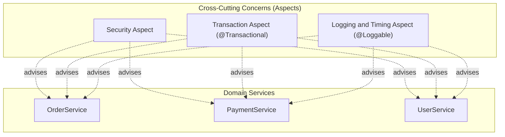
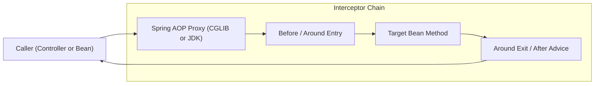
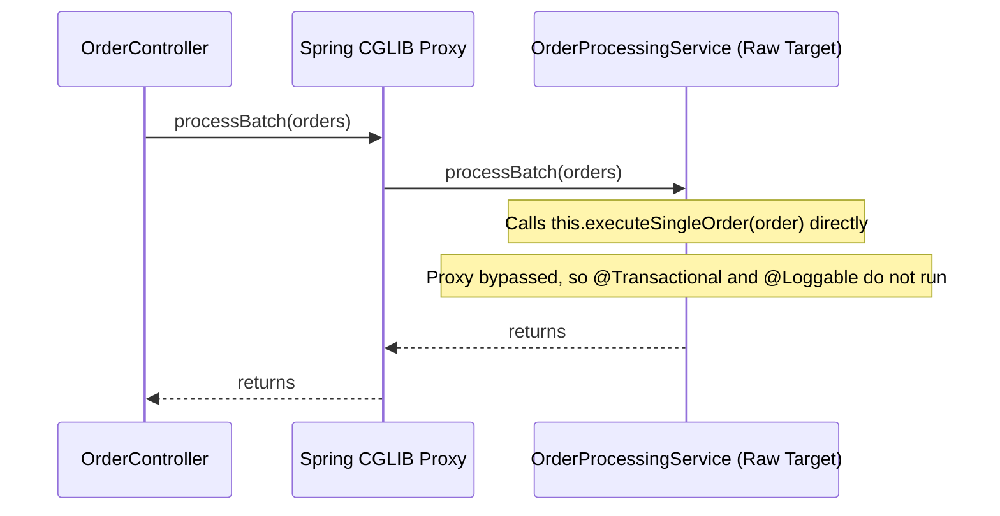
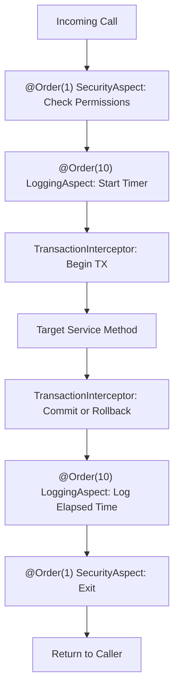

Look at what happens when every infrastructural requirement around a financial transfer is written inline inside a service method:

```java
public void transferMoney(String fromId, String toId, BigDecimal amount) {
    // 1. Authorization check
    // 2. OpenTelemetry span start
    // 3. Micrometer timer start
    // 4. Begin database transaction

    // Core business logic (3 lines)
    Account from = accountRepo.findById(fromId).orElseThrow();
    Account to = accountRepo.findById(toId).orElseThrow();
    from.debit(amount);
    to.credit(amount);

    // 5. Commit or roll back transaction
    // 6. Emit audit log
    // 7. Stop timer and close span
}
```

Most of the method has nothing to do with transferring money. Logging, metrics, authorization, caching, retries, and transaction boundaries repeat across dozens of services. When they are copy-pasted manually, domain logic gets buried in boilerplate and a single missed copy-paste leaves an endpoint un-audited or non-transactional.

These horizontal requirements are **cross-cutting concerns**. **Aspect-Oriented Programming (AOP)** extracts them into dedicated classes called **Aspects** and applies them declaratively around business methods without cluttering the domain code itself.



---

## Core AOP Concepts and Pointcut Expressions

Spring AOP uses AspectJ's annotation and pointcut syntax, so it helps to be precise about the vocabulary:

| Term | Definition | Example in Spring |
| :--- | :--- | :--- |
| **Join Point** | A point during execution where behavior can be inserted. In Spring AOP, a join point is always a **method execution on a Spring bean**. | Calling `OrderService.placeOrder(...)` |
| **Pointcut** | A predicate expression that matches one or more join points. | `@annotation(com.example.aop.Loggable)` |
| **Advice** | The code that runs at a matched join point (`@Before`, `@After`, `@AfterReturning`, `@AfterThrowing`, `@Around`). | Measuring elapsed time and writing a log entry |
| **Aspect** | A class annotated with `@Aspect` that groups pointcuts and advice. | `LoggingAspect` |
| **Target Object** | The underlying Spring bean being advised. | The raw `OrderService` instance |
| **Weaving** | Linking aspects with target objects to produce advised behavior. | Wrapping the bean in a runtime proxy during `BeanPostProcessor.postProcessAfterInitialization` |

### Common Pointcut Designators

Pointcuts can match by method signature, package, bean type, or annotation, and you can combine them with `&&`, `||`, and `!`:

```java
@Aspect
@Component
public class CommonPointcuts {

    // Every public method in the service package and its sub-packages
    @Pointcut("execution(public * com.example.order.service..*(..))")
    public void serviceLayer() {}

    // Every method inside classes annotated with @RestController
    @Pointcut("within(@org.springframework.web.bind.annotation.RestController *)")
    public void restControllers() {}

    // Any method carrying a specific custom annotation
    @Pointcut("@annotation(com.example.aop.Loggable)")
    public void loggableMethod() {}

    // Composing pointcuts: service methods that are not simple getters
    @Pointcut("serviceLayer() && !execution(* get*(..))")
    public void mutatingServiceOperation() {}
}
```

In `execution(public * com.example.order.service..*(..))`, the first `*` matches any return type, `..` after the package matches sub-packages, the second `*` matches any class and method name, and `(..)` matches zero or more parameters of any type.

---

## Proxy Mechanics: JDK Dynamic Proxy vs. CGLIB

Spring AOP does not rewrite your `.class` files on disk. Instead, it creates **runtime proxies** around Spring beans. Every external call hits the proxy first, passes through the matching interceptor chain, and then delegates to the target object.



Spring creates proxies using one of two mechanisms:

### JDK Dynamic Proxy (Interface-Based)
- Built into the JDK (`java.lang.reflect.Proxy`).
- Generates a proxy class at runtime that implements the **same Java interfaces** as the target bean.
- Only methods declared on those interfaces can be intercepted, and you must inject the bean by its interface type (injecting the concrete class fails because the proxy is not a subclass of it).

### CGLIB Proxy (Subclass-Based)
- Embedded inside `spring-core` (Spring repackages CGLIB internally).
- Generates a runtime **subclass** of the target bean and overrides non-final methods to delegate through the interceptor chain.
- Works on classes that do not implement any interface and allows injecting by concrete class type.
- **Limitations**: Cannot subclass a `final` class, and cannot override `final`, `private`, or `static` methods.

In **Spring Boot**, `spring.aop.proxy-target-class` defaults to `true`, meaning Spring Boot uses **CGLIB proxies by default** even when a bean implements an interface. You can switch back to JDK proxies for interface-backed beans by setting `spring.aop.proxy-target-class=false` in `application.properties`.

### Spring AOP vs. Full AspectJ Weaving

Because Spring AOP relies on runtime proxies, it covers the vast majority of enterprise use cases (`@Transactional`, `@Cacheable`, `@Async`, logging, metrics) with minimal setup. However, it has structural boundaries compared to full AspectJ:

| Capability | Spring AOP (Runtime Proxies) | Full AspectJ (Bytecode Weaving) |
| :--- | :--- | :--- |
| **Weaving mechanism** | Runtime JDK or CGLIB proxies | Compile-time (`ajc`), post-compile, or load-time (`-javaagent`) bytecode modification |
| **Supported join points** | Method execution on Spring-managed beans only | Methods, constructors, field reads/writes, static initializers, exception handlers |
| **Private / `final` methods** | Not intercepted | Intercepted |
| **Objects created with `new`** | Not intercepted (not managed by Spring) | Intercepted (useful for domain entities, e.g. `@Configurable`) |
| **Self-invocation (`this.foo()`)** | Bypasses proxy | Works, because advice is woven directly into the method bytecode |
| **Build and runtime setup** | Just add `spring-boot-starter-aop` | Requires `aspectj-maven-plugin` or JVM load-time weaving agent |

Stick with Spring AOP unless you specifically need to advise domain objects created with `new`, private helpers, or field access.

---

## The Self-Invocation Trap

Because Spring AOP wraps the target bean in an outer proxy, calling another method on `this` inside the same class **bypasses the proxy completely**:

```java
@Service
public class OrderProcessingService {

    public void processBatch(List<Order> orders) {
        for (Order order : orders) {
            // Calls the raw target instance via 'this', bypassing the proxy
            this.executeSingleOrder(order);
        }
    }

    @Transactional
    @Loggable
    public void executeSingleOrder(Order order) {
        // Neither @Transactional nor @Loggable runs when called from processBatch()
        orderRepository.save(order);
    }
}
```

When a controller invokes `orderProcessingService.processBatch(orders)`, the call enters the CGLIB proxy, which delegates to the raw `OrderProcessingService` instance. Inside `processBatch`, `this` refers to that raw target object, not the proxy. As a result, `this.executeSingleOrder(order)` jumps straight to the method body without entering the transaction or logging interceptors.



### Practical Ways to Fix Self-Invocation

1. **Extract a dedicated collaborator (recommended)**: Move `executeSingleOrder` into a separate `SingleOrderExecutor` bean and inject it into `OrderProcessingService`. Calls from `OrderProcessingService` to `SingleOrderExecutor` go through `SingleOrderExecutor`'s proxy naturally, and each class stays focused.
2. **Self-lookup with `ObjectProvider<T>`**: When splitting the class is not practical, inject an `ObjectProvider` for the bean itself so you fetch the proxy without creating a circular constructor dependency:

```java
@Service
public class OrderProcessingService {
    private final ObjectProvider<OrderProcessingService> selfProvider;

    public OrderProcessingService(ObjectProvider<OrderProcessingService> selfProvider) {
        this.selfProvider = selfProvider;
    }

    public void processBatch(List<Order> orders) {
        OrderProcessingService proxy = selfProvider.getObject();
        for (Order order : orders) {
            proxy.executeSingleOrder(order); // Goes through the proxy
        }
    }

    @Transactional
    @Loggable
    public void executeSingleOrder(Order order) {
        orderRepository.save(order);
    }
}
```

3. **`AopContext.currentProxy()`**: With `@EnableAspectJAutoProxy(exposeProxy = true)`, you can cast `AopContext.currentProxy()` to your service type. Most teams avoid this because it couples business logic directly to Spring AOP's thread-local proxy holder and fails in plain unit tests.

---

## The Five Advice Types

Choose the narrowest advice type that solves the problem instead of defaulting to `@Around` for everything:

| Advice | Annotation | When It Runs | Typical Use Case |
| :--- | :--- | :--- | :--- |
| **Before** | `@Before` | Before target method execution. Cannot stop execution except by throwing an exception. | Permission checks, argument validation |
| **After Returning** | `@AfterReturning` | Only if the target method completes normally. Can inspect the return value via `returning = "result"`. | Emitting domain events, logging successful outcomes |
| **After Throwing** | `@AfterThrowing` | Only if the target method throws an exception. Can inspect via `throwing = "ex"`. | Error counters, alerting (does not swallow the exception) |
| **After (Finally)** | `@After` | Always runs after method exit, whether normal or exceptional. | Cleanup, MDC context clearing |
| **Around** | `@Around` | Wraps the invocation completely. Decides whether, when, and with what arguments `proceed()` runs. | Latency profiling, retries, caching, transactions |

---

## Creating a Custom `@Loggable` Annotation

A common real-world use of Spring AOP is a declarative `@Loggable` annotation that records method execution time, optionally logs arguments, flags slow calls, and logs failures without touching business code.

First, add `spring-boot-starter-aop` to your build (in Spring Boot, `AopAutoConfiguration` automatically activates AspectJ proxying as soon as `spring-boot-starter-aop` is on the classpath, so you do not need to add `@EnableAspectJAutoProxy` manually).

### Defining the `@Loggable` Annotation

```java
package com.example.aop;

import java.lang.annotation.ElementType;
import java.lang.annotation.Retention;
import java.lang.annotation.RetentionPolicy;
import java.lang.annotation.Target;

@Target(ElementType.METHOD)
@Retention(RetentionPolicy.RUNTIME)
public @interface Loggable {
    boolean includeArgs() default false;
    long slowThresholdMs() default 500;
}
```

Using `RetentionPolicy.RUNTIME` is required because Spring AOP inspects annotations at runtime via reflection.

### Implementing `LoggingAspect` with `@Pointcut` and `@Around`

```java
package com.example.aop;

import org.aspectj.lang.ProceedingJoinPoint;
import org.aspectj.lang.annotation.Around;
import org.aspectj.lang.annotation.Aspect;
import org.aspectj.lang.annotation.Pointcut;
import org.aspectj.lang.reflect.MethodSignature;
import org.slf4j.Logger;
import org.slf4j.LoggerFactory;
import org.springframework.core.annotation.Order;
import org.springframework.stereotype.Component;

import java.util.Arrays;

@Aspect
@Component
@Order(10)
public class LoggingAspect {
    private static final Logger log = LoggerFactory.getLogger(LoggingAspect.class);

    @Pointcut("@annotation(loggable)")
    public void annotatedWithLoggable(Loggable loggable) {}

    @Around(value = "annotatedWithLoggable(loggable)", argNames = "joinPoint,loggable")
    public Object logExecution(ProceedingJoinPoint joinPoint, Loggable loggable) throws Throwable {
        MethodSignature signature = (MethodSignature) joinPoint.getSignature();
        String methodLabel = signature.getDeclaringType().getSimpleName() + "." + signature.getName();

        if (loggable.includeArgs()) {
            log.info("Entering {} args={}", methodLabel, Arrays.toString(joinPoint.getArgs()));
        } else {
            log.debug("Entering {}", methodLabel);
        }

        long startNanos = System.nanoTime();
        try {
            // Invoke the next interceptor or the real target method
            Object result = joinPoint.proceed();
            long elapsedMs = (System.nanoTime() - startNanos) / 1_000_000;

            if (elapsedMs >= loggable.slowThresholdMs()) {
                log.warn("Slow execution: {} completed in {} ms", methodLabel, elapsedMs);
            } else {
                log.info("Completed {} in {} ms", methodLabel, elapsedMs);
            }
            return result;
        } catch (Throwable ex) {
            long elapsedMs = (System.nanoTime() - startNanos) / 1_000_000;
            log.error("Failed {} after {} ms: {}", methodLabel, elapsedMs, ex.getMessage());
            // Always rethrow in observational aspects so callers and transactions react properly
            throw ex;
        }
    }
}
```

### Applying `@Loggable` to a Service

```java
@Service
public class PaymentService {

    @Loggable(includeArgs = false, slowThresholdMs = 300)
    public PaymentReceipt charge(String orderId, BigDecimal amount) {
        // Sensitive arguments stay out of logs because includeArgs = false
        return gateway.authorize(orderId, amount);
    }
}
```

> [!WARNING]
> Be careful with `includeArgs = true` on methods accepting passwords, payment tokens, or PII. Defaulting `includeArgs` to `false` prevents sensitive data from leaking into log aggregators by accident.

---

## Aspect Ordering

When multiple aspects advise the same method (for example, security checks, timing logs, and `@Transactional`), execution order matters.

If `@Transactional` runs *before* your security check, Spring checks out a database connection from HikariCP and opens a transaction before discovering that the caller lacks permission. Under load or a burst of unauthorized traffic, that wastes database connections.

Spring executes multiple aspects like concentric layers of an onion, controlled by `@Order(int)` (or implementing `Ordered`):
- **Lower numbers have higher precedence**: `@Order(1)` runs **first** on the way in, and **last** on the way out.
- By default, `@EnableTransactionManagement` uses `Ordered.LOWEST_PRECEDENCE` (`Integer.MAX_VALUE`), so custom aspects with small positive orders (like `@Order(1)` or `@Order(10)`) automatically wrap transactions on the outside.



---

## Interview Questions

### What is the difference between a JDK Dynamic Proxy and a CGLIB proxy in Spring AOP?
A JDK Dynamic Proxy implements the target bean's Java interfaces at runtime using `java.lang.reflect.Proxy`, so it only intercepts interface methods and requires callers to inject the interface type. A CGLIB proxy generates a runtime subclass of the target class, so it works without interfaces and supports concrete class injection, but it cannot proxy `final` classes or intercept `final`, `private`, or `static` methods. Spring Boot defaults to CGLIB (`spring.aop.proxy-target-class=true`).

### Why does self-invocation break `@Transactional` and custom aspects in Spring AOP, and how should you fix it?
Spring AOP intercepts calls through a proxy wrapping the target bean. When method A inside the bean calls `this.methodB()`, `this` references the raw target object rather than the proxy, so the interceptor chain never runs. The cleanest fix is moving `methodB()` into a separate collaborating service bean so the call crosses a proxy boundary. If refactoring is not feasible, inject `ObjectProvider<MyService>` and invoke `selfProvider.getObject().methodB()`.

### When would you need full AspectJ instead of Spring AOP?
Use Spring AOP for normal method interception on Spring beans (transactions, logging, security, caching). Consider full AspectJ bytecode weaving only when you must advise join points Spring proxies cannot reach: objects instantiated directly with `new` (such as JPA entities), `private` or `final` methods, constructors, or field reads and writes, or when you must advise self-invocations without refactoring.

### When should you choose `@AfterReturning` instead of `@Around`?
Choose `@AfterReturning` when you only need to observe a successful return value (for instance, publishing an event or recording a success metric). With `@Around`, you are responsible for calling `joinPoint.proceed()`, returning its result, and rethrowing exceptions correctly. Using `@AfterReturning` eliminates those failure modes and makes the aspect's read-only intent immediately obvious.
