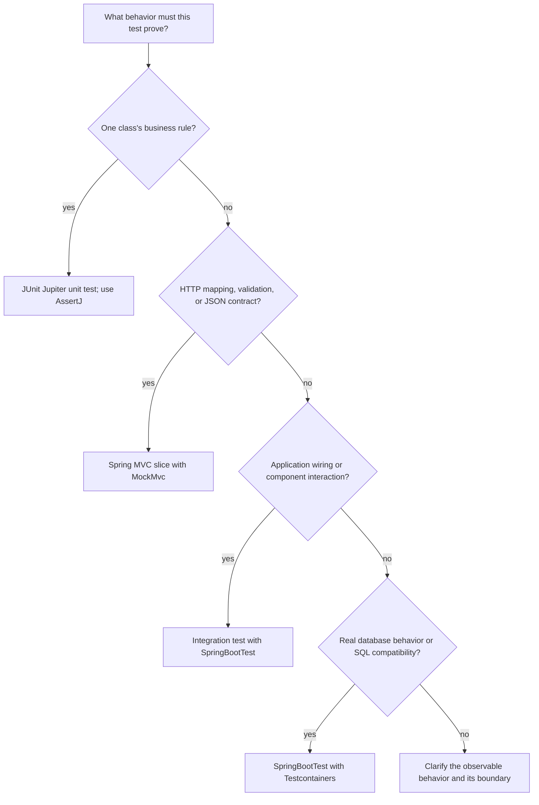

Automated tests make behavior repeatable: after a change, they can check whether important contracts still hold without relying on a developer to click through the application by hand. The useful question is not how to maximize the number of tests, but which test gives fast, reliable evidence for a behavior at the right boundary.

This lesson uses Java 21, the JUnit Jupiter programming model (commonly called JUnit 5), Spring Boot 4.1.2 / Spring Framework 7, and current Mockito, AssertJ, and Testcontainers APIs. Spring Boot's dependency BOM selects the exact JUnit artifact version; its newer releases may manage a later JUnit major while retaining the Jupiter API model shown here. Examples assume the usual Spring Boot test dependencies, but this repository does not include Java or Spring test dependencies, so the snippets are instructional rather than locally compiled or run.

## Choose the boundary that answers the question

Use the narrowest test that verifies the behavior you care about. As the test crosses more application boundaries, it usually proves more integration and costs more setup and runtime:



The categories are complementary rather than competing. A focused unit test can cover many business-rule cases; a smaller set of MVC and full-context tests checks framework wiring and external boundaries. Avoid making every test load the entire application and database when a plain unit test would answer the same question.

## JUnit Jupiter and AssertJ for unit tests

JUnit 5 is a family of projects: the JUnit Platform launches tests, and JUnit Jupiter provides the programming and extension model used in these examples. `@Test` marks a test method; lifecycle annotations such as `@BeforeEach` can prepare per-test state. Prefer independent tests with explicit setup over state shared between tests.

AssertJ complements JUnit by providing fluent assertions and useful failure messages. For example, an exception can be asserted by type and message:

```java
import static org.assertj.core.api.Assertions.assertThatThrownBy;

import org.junit.jupiter.api.Test;

record Order(String id) {
}

class OrderService {
    Order findRequired(String orderId) {
        if (orderId == null || orderId.isBlank()) {
            throw new IllegalArgumentException("orderId must not be blank");
        }
        return new Order(orderId);
    }
}

class OrderServiceTest {
    private final OrderService service = new OrderService();

    @Test
    void rejectsBlankOrderIds() {
        assertThatThrownBy(() -> service.findRequired(" "))
                .isInstanceOf(IllegalArgumentException.class)
                .hasMessage("orderId must not be blank");
    }
}
```

This is a unit test: it runs the class directly, without starting Spring or connecting to a database. Assertions should describe externally observable results and important side effects, not private method calls or implementation details that may change without changing behavior.

JUnit also supports parameterized tests for the same behavior over a set of inputs. Use them when cases share one clear assertion; keep each case easy to understand and report. Test meaningful boundaries (blank, malformed, minimum/maximum, absent, and valid values) rather than producing large numbers of nearly identical test methods.

## Mock collaborators with Mockito

A unit test should not contact a production database, network, or mail provider. Mockito can replace a collaborator at the boundary and let the test focus on the class's decision. A small example uses constructor injection so the dependency is explicit:

```java
import static org.assertj.core.api.Assertions.assertThat;
import static org.mockito.Mockito.verify;
import static org.mockito.Mockito.when;

import java.util.Optional;
import org.junit.jupiter.api.Test;
import org.junit.jupiter.api.extension.ExtendWith;
import org.mockito.InjectMocks;
import org.mockito.Mock;
import org.mockito.junit.jupiter.MockitoExtension;

interface OrderRepository {
    Optional<Order> findById(String id);
}

class OrderLookupService {
    private final OrderRepository repository;

    OrderLookupService(OrderRepository repository) {
        this.repository = repository;
    }

    Order findRequired(String id) {
        return repository.findById(id)
                .orElseThrow(() -> new IllegalArgumentException("Order not found: " + id));
    }
}

@ExtendWith(MockitoExtension.class)
class OrderLookupServiceTest {
    @Mock
    private OrderRepository repository;

    @InjectMocks
    private OrderLookupService service;

    @Test
    void returnsTheOrderFoundByTheRepository() {
        var expected = new Order("42");
        when(repository.findById("42")).thenReturn(Optional.of(expected));

        var actual = service.findRequired("42");

        assertThat(actual).isEqualTo(expected);
        verify(repository).findById("42");
    }
}
```

The example assumes an `OrderRepository` with `Optional<Order> findById(String id)` and an `OrderLookupService` whose constructor takes that repository and whose `findRequired` method returns the matching order. `@Mock` creates the mock, `@InjectMocks` constructs the subject and injects its mock dependencies, and `MockitoExtension` integrates Mockito with JUnit Jupiter. Keep real business logic in the subject under test; mocks are for collaborators, not for the value being tested.

Stub only behavior the test needs, then assert the result or externally relevant effect. A test that only verifies an interaction can pass while the returned value or state is wrong. Avoid mocking every class: excessive mocks couple tests to implementation and can give false confidence about real wiring. For Spring-managed components, use a Spring context test and `@MockitoBean` when the test needs to replace one application bean; `@Mock` alone does not register a bean in Spring's `ApplicationContext`.

## Test an HTTP contract with MockMvc

`MockMvc` exercises Spring MVC request handling with mock servlet request and response objects, without starting a real HTTP server. A `@WebMvcTest` loads a focused MVC slice; mock collaborators that the controller needs rather than loading unrelated services and infrastructure.

```java
import static org.mockito.Mockito.when;
import static org.springframework.test.web.servlet.request.MockMvcRequestBuilders.get;
import static org.springframework.test.web.servlet.result.MockMvcResultMatchers.jsonPath;
import static org.springframework.test.web.servlet.result.MockMvcResultMatchers.status;

import org.junit.jupiter.api.Test;
import org.springframework.beans.factory.annotation.Autowired;
import org.springframework.boot.test.autoconfigure.web.servlet.WebMvcTest;
import org.springframework.test.context.bean.override.mockito.MockitoBean;
import org.springframework.test.web.servlet.MockMvc;

@WebMvcTest(OrderController.class)
class OrderControllerTest {
    @Autowired
    private MockMvc mockMvc;

    @MockitoBean
    private OrderLookupService orders;

    @Test
    void returnsAnOrderAsJson() throws Exception {
        when(orders.findRequired("42")).thenReturn(new Order("42"));

        mockMvc.perform(get("/orders/42"))
                .andExpect(status().isOk())
                .andExpect(jsonPath("$.id").value("42"));
    }
}
```

This assumes an `OrderController` mapped to `GET /orders/{id}` that delegates to `OrderLookupService` and serializes an `Order` with an `id` property. `@MockitoBean` replaces a bean in the Spring test context; it is distinct from Mockito's plain `@Mock`. Spring Framework 7's bean-override annotation is used here rather than the older Spring Boot `@MockBean` API.

An MVC test can check routing, JSON serialization, validation, exception mapping, and HTTP status behavior. The example assumes this route permits anonymous access; if the application's security filters protect it, configure the test with authentication and authorities that match the real rule. It does not prove that the real service or database works. Do not disable security just to make the test pass. Keep assertions on externally observable response contracts rather than incidental JSON formatting.

## Full application integration with `@SpringBootTest`

Use `@SpringBootTest` when a test needs Spring Boot's actual application configuration, dependency injection, and several collaborating components. By default, it loads the application context but does not start a server. Select a web environment explicitly when the test needs a real listening server, such as a test of the deployed HTTP stack or network configuration.

```java
import static org.assertj.core.api.Assertions.assertThat;

import org.junit.jupiter.api.Test;
import org.springframework.beans.factory.annotation.Autowired;
import org.springframework.boot.test.context.SpringBootTest;

@SpringBootTest
class OrderLookupIntegrationTest {
    @Autowired
    private OrderLookupService orders;

    @Test
    void applicationContextProvidesTheRealService() {
        assertThat(orders).isNotNull();
    }
}
```

This simple example checks context wiring; a useful integration test should exercise an important workflow through real application components and assert its result. Full context tests can take more time and use more resources than unit or slice tests, so reserve them for integration behavior that narrower tests cannot verify.

Spring's test context framework may cache compatible application contexts between tests. Keep test configuration stable when reuse is valuable, and avoid changing shared static state. Transactions can roll back work performed in the test-managed transaction, but they do not automatically undo external messages, HTTP calls, or database work performed in another transaction or thread.

## Real database behavior with Testcontainers

Mocks cannot prove that the application's SQL, schema migrations, indexes, or database-specific behavior work against a real database engine. Testcontainers starts disposable services in Docker so an integration test can connect to the same database family used in production without depending on a developer-maintained local database.

Assume the application persists an `Order` JPA entity with a `String` identifier and has a Spring Data `OrderRepository` with `save` and `findById` methods. Spring Boot can create connection details from a Testcontainers-managed database with `@ServiceConnection`:

```java
import static org.assertj.core.api.Assertions.assertThat;

import org.junit.jupiter.api.Test;
import org.springframework.beans.factory.annotation.Autowired;
import org.springframework.boot.test.context.SpringBootTest;
import org.springframework.boot.testcontainers.service.connection.ServiceConnection;
import org.testcontainers.junit.jupiter.Container;
import org.testcontainers.junit.jupiter.Testcontainers;
import org.testcontainers.postgresql.PostgreSQLContainer;

@Testcontainers
@SpringBootTest
class OrderRepositoryIntegrationTest {
    @Container
    @ServiceConnection
    static final PostgreSQLContainer<?> postgres =
            new PostgreSQLContainer<>("postgres:16.4");

    @Autowired
    private OrderRepository orders;

    @Test
    void persistsAnOrderInPostgres() {
        orders.save(new Order("42"));
        var found = orders.findById("42");

        assertThat(found).isPresent();
        assertThat(found.orElseThrow().getId()).isEqualTo("42");
    }
}
```

The repository round trip uses a real PostgreSQL service, not a mock. Add the Spring Boot Testcontainers integration, the Testcontainers JUnit Jupiter and PostgreSQL modules, and Docker support in the test environment. Let the Spring Boot dependency management or project BOM select compatible library versions. The example image tag illustrates database selection; pin and maintain a specific image version or digest according to the project's reproducibility and supply-chain policy.

Static `@Container` fields are shared across test methods in a class and are started once for that class by the JUnit Jupiter integration; instance fields restart for each test method. The Testcontainers JUnit Jupiter extension documents sequential execution as its supported mode, so do not assume that its lifecycle is safe under parallel execution. Spring-managed container beans are another lifecycle option when sharing a container across a cached application context; choose one lifecycle strategy deliberately.

Testcontainers needs Docker or a compatible container runtime; a missing runtime is an environment prerequisite failure, not a passing database test. Container-backed tests should still clean up data or isolate records so that order, retries, or reused contexts do not make results depend on stale state.

## Keep a suite trustworthy

- **Test behavior, not private structure.** Refactoring should not break a test when public behavior remains the same.
- **Keep tests deterministic.** Use fixed clocks, controlled IDs, and explicit inputs when time or randomness matters; avoid sleeps and tests that depend on order.
- **Make failures diagnostic.** Use descriptive test names and focused assertions so a failure identifies the behavior that changed.
- **Test both success and failure paths.** Include invalid input, missing data, authorization failures, and dependency errors where they are part of the contract.
- **Avoid shared mutable fixtures.** Each test should establish its own relevant state and clean up external resources.
- **Treat mocks as boundaries.** Too many mocked collaborators test the arrangement of mocks instead of the application's real behavior.
- **Run the project wrapper.** Maven projects commonly run tests with `mvnw.cmd test`; Gradle projects commonly use `gradlew.bat test`. CI should execute the same wrapper and publish test reports.
- **Do not equate coverage with correctness.** Coverage can find unexecuted lines, but it does not show whether assertions check meaningful outcomes.

## Further reading

- JUnit, [JUnit 5 User Guide](https://docs.junit.org/5.13.4/user-guide/)
- AssertJ, [AssertJ Core Reference Guide](https://assertj.github.io/doc/)
- Mockito, [Mockito JUnit Jupiter Extension](https://javadoc.io/doc/org.mockito/mockito-junit-jupiter/latest/org/mockito/junit/jupiter/MockitoExtension.html)
- Spring Boot 4.1, [Testing Spring Boot Applications](https://docs.spring.io/spring-boot/4.1/reference/testing/spring-boot-applications.html)
- Spring Boot 4.1, [Testcontainers Support](https://docs.spring.io/spring-boot/4.1/reference/testing/testcontainers.html)
- Spring Framework 7, [MockMvc](https://docs.spring.io/spring-framework/reference/testing/mockmvc.html)
- Spring Framework 7, [`@MockitoBean`](https://docs.spring.io/spring-framework/reference/testing/annotations/integration-spring/annotation-mockitobean.html)
- Testcontainers, [JUnit 5 Integration](https://java.testcontainers.org/test_framework_integration/junit_5/)
- [Spring Data JPA](./spring-data-jpa)
- [Building RESTful APIs](./building-restful-apis)
