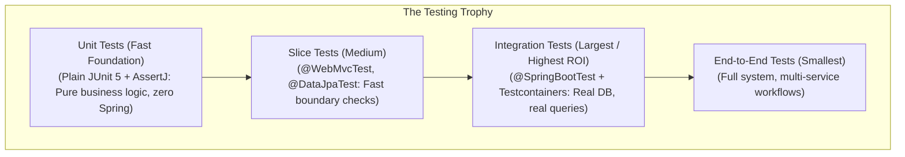
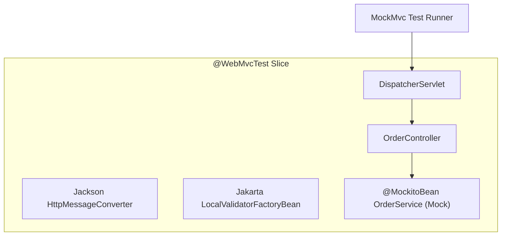
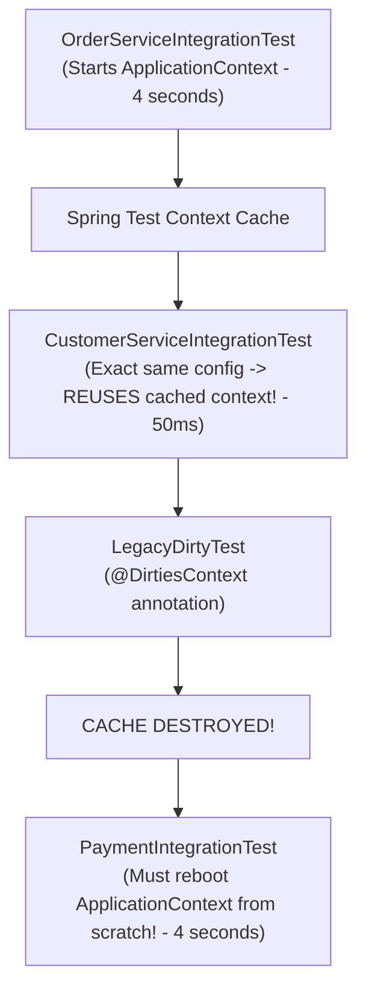

There are two kinds of automated test suites in enterprise software engineering: the kind that gives your team the fearless confidence to deploy to production on a Friday afternoon, and the kind that developers routinely bypass with `-DskipTests` because it takes 45 minutes to run, consumes 16 GB of RAM, and fails intermittently due to timing glitches.

Writing high-value tests is not about chasing arbitrary 100% code coverage metrics. It is about understanding the **cost-to-confidence ratio** of each testing boundary: knowing when a 2-millisecond pure unit test is superior to a 5-second Spring context test, and knowing when an in-memory mock provides dangerous, false confidence that hides a production outage.

In this guide, we will examine the full testing spectrum in modern Java 21 and Spring Boot. We will master JUnit 5, AssertJ, and Mockito, dive into Spring MVC slice tests with `MockMvc`, optimize Spring's context caching engine, and replace flawed in-memory database mocks with real, containerized PostgreSQL instances using **Testcontainers** and `@ServiceConnection`.

---

## The Testing Pyramid vs The Testing Trophy

In traditional software engineering, the "Testing Pyramid" advocated for thousands of unit tests and almost zero integration tests. In modern cloud-native architectures where microservices heavily integrate with databases, messaging brokers, and HTTP APIs, senior engineers advocate for the **Testing Trophy**:



| Test Type | Scope | Execution Speed | Spring Context Loaded? | What It Proves |
|---|---|---|---|---|
| **Pure Unit Test** | A single Java class / algorithm | 1 - 5 milliseconds | **No** (Zero overhead) | Business logic, state calculations, branch rules. |
| **Web Slice Test (`@WebMvcTest`)** | Controller layer | 200 - 800 milliseconds | **Partial** (Only MVC controllers, Jackson, Security) | HTTP routing, JSON serialization, validation, status codes. |
| **Data Slice Test (`@DataJpaTest`)** | Repository layer | 500ms - 2 seconds | **Partial** (Only JPA entities and repositories) | Derived queries, JPQL correctness, custom mappings. |
| **Full Integration Test (`@SpringBootTest`)** | End-to-end service flow | 2 - 10 seconds | **Full** (Entire `ApplicationContext`) | Spring bean wiring, transaction boundaries, component interplay. |
| **Containerized Integration** | Real DB / Broker interactions | 3 - 15 seconds | **Full + Docker** | Real PostgreSQL/Kafka compatibility, migrations, foreign keys. |

---

## Unit Testing with JUnit 5 and AssertJ

A pure unit test should never bootstrap the Spring `ApplicationContext`. Bootstrapping Spring takes 2 to 5 seconds per test class; running 500 pure unit tests takes under 500 milliseconds total.

### Fluent Assertions with AssertJ
AssertJ provides type-safe, human-readable assertion chaining that generates crystal-clear failure messages when something breaks:

```java
package com.example.ecommerce.domain;

import org.junit.jupiter.api.DisplayName;
import org.junit.jupiter.api.Test;
import org.junit.jupiter.params.ParameterizedTest;
import org.junit.jupiter.params.provider.ValueSource;

import java.math.BigDecimal;
import java.util.List;

import static org.assertj.core.api.Assertions.*;

class OrderDiscountCalculatorTest {

    private final OrderDiscountCalculator calculator = new OrderDiscountCalculator();

    @Test
    @DisplayName("Should apply 15% VIP discount when order total exceeds USD 100")
    void shouldApplyVipDiscountForHighValueOrders() {
        // Arrange
        Order order = new Order(
            "VIP-CUSTOMER",
            List.of(new OrderItem("LAPTOP", new BigDecimal("1200.00"), 1))
        );

        // Act
        BigDecimal discountedTotal = calculator.calculateTotal(order);

        // Assert (AssertJ chaining)
        assertThat(discountedTotal)
            .isNotNull()
            .isEqualByComparingTo(new BigDecimal("1020.00")) // 1200 - 15% (180)
            .isLessThan(order.getRawTotal());
    }

    @ParameterizedTest
    @ValueSource(strings = {"", "   ", "\t"})
    @DisplayName("Should throw IllegalArgumentException when customer ID is blank")
    void shouldRejectBlankCustomerIds(String invalidCustomerId) {
        assertThatThrownBy(() -> new Order(invalidCustomerId, List.of()))
            .isInstanceOf(IllegalArgumentException.class)
            .hasMessageContaining("Customer ID must not be blank");
    }
}
```

---

## Mocking Collaborators with Mockito

Mockito allows you to stub external collaborators (e.g., payment gateways, remote REST APIs) so your unit test focuses exclusively on the class under test.

```java
package com.example.ecommerce.service;

import com.example.ecommerce.domain.Order;
import com.example.ecommerce.domain.PaymentGateway;
import com.example.ecommerce.domain.PaymentResult;
import com.example.ecommerce.repository.OrderRepository;
import org.junit.jupiter.api.DisplayName;
import org.junit.jupiter.api.Test;
import org.junit.jupiter.api.extension.ExtendWith;
import org.mockito.InjectMocks;
import org.mockito.Mock;
import org.mockito.junit.jupiter.MockitoExtension;

import java.math.BigDecimal;
import java.util.UUID;

import static org.assertj.core.api.Assertions.assertThat;
import static org.mockito.ArgumentMatchers.any;
import static org.mockito.Mockito.*;

@ExtendWith(MockitoExtension.class)
class OrderProcessingServiceTest {

    @Mock
    private OrderRepository orderRepository;

    @Mock
    private PaymentGateway paymentGateway;

    @InjectMocks
    private OrderProcessingService orderService;

    @Test
    @DisplayName("Should confirm order and save when payment succeeds")
    void shouldConfirmOrderOnSuccessfulPayment() {
        // Arrange
        UUID orderId = UUID.randomUUID();
        Order pendingOrder = new Order(orderId, new BigDecimal("250.00"));
        
        when(orderRepository.findById(orderId)).thenReturn(java.util.Optional.of(pendingOrder));
        when(paymentGateway.charge(eq(orderId), any(BigDecimal.class)))
            .thenReturn(PaymentResult.success("TXN-999"));
        when(orderRepository.save(any(Order.class))).thenAnswer(invocation -> invocation.getArgument(0));

        // Act
        Order confirmedOrder = orderService.processOrder(orderId);

        // Assert
        assertThat(confirmedOrder.isConfirmed()).isTrue();
        assertThat(confirmedOrder.getTransactionId()).isEqualTo("TXN-999");

        // Verify side-effect interactions
        verify(paymentGateway, times(1)).charge(orderId, new BigDecimal("250.00"));
        verify(orderRepository, times(1)).save(pendingOrder);
    }
}
```

### The Pitfall of Over-Mocking
If your test mocks 8 different collaborators and contains 25 lines of `when(...).thenReturn(...)` just to test 3 lines of business logic, you are not testing behavior—you are testing the internal implementation details. If someone refactors a method signature or changes an internal helper call, your tests will break even though the public behavior never changed. Only mock external I/O boundaries (networks, emails, payment terminals).

---

## Controller Slice Testing with `@WebMvcTest` and `MockMvc`

When testing a REST controller, bootstrapping the entire database and security infrastructure is unnecessary. `@WebMvcTest` instantiates a lightweight, focused slice of Spring MVC:



> [!NOTE]
> **Spring Framework 6.2 / Spring Boot 3.4 `@MockitoBean` Upgrade**  
> In modern Spring Boot, the legacy `@MockBean` from `org.springframework.boot.test.mock.mockito` has been deprecated in favor of `@MockitoBean` from `org.springframework.test.context.bean.override.mockito`. It provides superior bean-override semantics during test context construction.

```java
package com.example.ecommerce.api;

import com.example.ecommerce.api.dto.CreateOrderRequest;
import com.example.ecommerce.api.dto.OrderResponse;
import com.example.ecommerce.domain.OrderService;
import com.fasterxml.jackson.databind.ObjectMapper;
import org.junit.jupiter.api.DisplayName;
import org.junit.jupiter.api.Test;
import org.springframework.beans.factory.annotation.Autowired;
import org.springframework.boot.test.autoconfigure.web.servlet.WebMvcTest;
import org.springframework.http.MediaType;
import org.springframework.test.context.bean.override.mockito.MockitoBean;
import org.springframework.test.web.servlet.MockMvc;

import java.math.BigDecimal;
import java.time.Instant;
import java.util.List;
import java.util.UUID;

import static org.mockito.ArgumentMatchers.any;
import static org.mockito.Mockito.when;
import static org.springframework.test.web.servlet.request.MockMvcRequestBuilders.post;
import static org.springframework.test.web.servlet.result.MockMvcResultMatchers.*;

@WebMvcTest(OrderController.class)
class OrderControllerTest {

    @Autowired
    private MockMvc mockMvc;

    @Autowired
    private ObjectMapper objectMapper;

    @MockitoBean
    private OrderService orderService;

    @Test
    @DisplayName("POST /api/v1/orders - Valid request returns 201 Created with Location header")
    void createOrderSuccess() throws Exception {
        UUID orderId = UUID.randomUUID();
        CreateOrderRequest request = new CreateOrderRequest(
            "CUST-101",
            List.of(new CreateOrderRequest.OrderItemRequest("SKU-BOOK", 2, new BigDecimal("19.99")))
        );

        OrderResponse response = new OrderResponse(
            orderId, "CUST-101", "CREATED", new BigDecimal("39.98"), List.of(), Instant.now()
        );

        when(orderService.createOrder(any())).thenReturn(response);

        mockMvc.perform(post("/api/v1/orders")
                .contentType(MediaType.APPLICATION_JSON)
                .content(objectMapper.writeValueAsString(request)))
            .andExpect(status().isCreated())
            .andExpect(header().string("Location", org.hamcrest.Matchers.containsString("/api/v1/orders/" + orderId)))
            .andExpect(jsonPath("$.id").value(orderId.toString()))
            .andExpect(jsonPath("$.status").value("CREATED"))
            .andExpect(jsonPath("$.totalAmount").value(39.98));
    }

    @Test
    @DisplayName("POST /api/v1/orders - Invalid request triggers RFC 9457 ProblemDetail 400")
    void createOrderValidationError() throws Exception {
        // Missing customerId and empty items list
        CreateOrderRequest invalidRequest = new CreateOrderRequest("", List.of());

        mockMvc.perform(post("/api/v1/orders")
                .contentType(MediaType.APPLICATION_JSON)
                .content(objectMapper.writeValueAsString(invalidRequest)))
            .andExpect(status().isBadRequest())
            .andExpect(jsonPath("$.title").value("Validation Failure"))
            .andExpect(jsonPath("$.status").value(400))
            .andExpect(jsonPath("$.invalidParams").isArray());
    }
}
```

---

## The Danger of In-Memory Databases (The H2 Trap)

For years, tutorials recommended testing Spring Data repositories against an in-memory H2 database because it was fast and required no external tools.

**Using H2 to test queries destined for PostgreSQL, MySQL, or Oracle in production is an architectural disaster.**

### Why H2 Gives False Confidence
1. **Dialect Discrepancies**: H2 accepts SQL syntax that PostgreSQL rejects, and vice-versa.
2. **Missing Advanced Features**: H2 does not support PostgreSQL `JSONB` operators (`->>`), full-text search vectors, specific window functions, or UUID array types.
3. **Case Sensitivity & Types**: H2 defaults to uppercase table names, hiding case-sensitivity bugs on Linux production servers.
4. **Locking & Concurrency**: H2 does not replicate PostgreSQL's Multi-Version Concurrency Control (MVCC) or row-level `FOR UPDATE NOWAIT` locking behavior.

---

## Real Database Testing with Testcontainers and `@ServiceConnection`

**Testcontainers** uses Docker to spin up genuine, production-identical database instances (PostgreSQL 16, MySQL 8, Redis 7, Kafka) directly from your JUnit test suite.

In Spring Boot 3.1+, the `@ServiceConnection` annotation automatically discovers the container's dynamic port and binds Spring Boot's `spring.datasource.url`, `username`, and `password` properties without any manual `@DynamicPropertySource` configuration!

```java
package com.example.ecommerce.integration;

import com.example.ecommerce.entity.Order;
import com.example.ecommerce.entity.OrderStatus;
import com.example.ecommerce.repository.OrderRepository;
import org.junit.jupiter.api.DisplayName;
import org.junit.jupiter.api.Test;
import org.springframework.beans.factory.annotation.Autowired;
import org.springframework.boot.test.context.SpringBootTest;
import org.springframework.boot.testcontainers.service.connection.ServiceConnection;
import org.testcontainers.containers.PostgreSQLContainer;
import org.testcontainers.junit.jupiter.Container;
import org.testcontainers.junit.jupiter.Testcontainers;

import java.math.BigDecimal;
import java.util.UUID;

import static org.assertj.core.api.Assertions.assertThat;

@SpringBootTest(webEnvironment = SpringBootTest.WebEnvironment.NONE)
@Testcontainers
class OrderRepositoryPostgresTest {

    // Starts a real PostgreSQL 16 Docker container for the test suite
    @Container
    @ServiceConnection
    static PostgreSQLContainer<?> postgres = new PostgreSQLContainer<>("postgres:16-alpine");

    @Autowired
    private OrderRepository orderRepository;

    @Test
    @DisplayName("Should persist order and verify UUID generation in real PostgreSQL")
    void shouldSaveAndQueryInRealPostgres() {
        Order newOrder = new Order(UUID.randomUUID(), "CUST-999", OrderStatus.PENDING, new BigDecimal("89.50"));

        Order saved = orderRepository.save(newOrder);
        assertThat(saved.getId()).isNotNull();

        var retrieved = orderRepository.findById(saved.getId());
        assertThat(retrieved).isPresent();
        assertThat(retrieved.get().getCustomerId()).isEqualTo("CUST-999");
        assertThat(retrieved.get().getTotalAmount()).isEqualByComparingTo(new BigDecimal("89.50"));
    }
}
```

---

## Spring Test Context Caching and the `@DirtiesContext` Build Bloat

Spring's Test Context Framework includes a smart **Context Caching Mechanism**:
If Test Class A and Test Class B share the identical Spring configuration (same active profiles, same mock beans, same environment variables), Spring Boots up the `ApplicationContext` **only once** and reuses it for Test Class B!



### The Cost of `@DirtiesContext`
When a developer adds `@DirtiesContext` to a test class, it tells Spring: *"My test mutated shared Spring bean state; destroy this ApplicationContext from cache when I finish."*

If 20 integration test classes use `@DirtiesContext`, Spring Boot starts up from scratch 20 times! A test suite that should have run in 15 seconds will now take 3 minutes.

### How to Maintain Clean State Without `@DirtiesContext`
1. Use `@Transactional` on test classes: The test runner automatically rolls back all database mutations when each `@Test` method finishes.
2. Clean up tables via an explicit `@AfterEach` helper:
   ```java
   @Autowired
   private OrderRepository orderRepository;

   @AfterEach
   void cleanUp() {
       orderRepository.deleteAllInBatch();
   }
   ```
3. Avoid mutating singleton bean fields inside tests.

---

## Architectural Traps and Real-World Outages

### The "H2 False Confidence" Production Crash
An e-commerce team ran 1,200 integration tests using an in-memory H2 database. All tests passed in CI in 45 seconds. 
During a major Black Friday release, a new repository method executed this query:
```sql
SELECT * FROM orders o WHERE o.metadata->>'promo' = 'BLACK_FRIDAY'
```
H2's PostgreSQL compatibility mode accepted the syntax in tests. But in production, the application connected to an older AWS RDS PostgreSQL cluster whose JSONB index configuration threw an invalid cast exception. The checkout service crashed immediately upon launch, causing USD 250,000 in lost orders before rollback. 

The fix was replacing H2 with Testcontainers running the exact PostgreSQL Docker image version deployed in AWS.

### The MockMvc False Security Bug
A developer wrote a `@WebMvcTest` for an administrative endpoint:
```java
mockMvc.perform(get("/api/admin/users")).andExpect(status().isOk());
```
The test passed with flying colors. But in production, the endpoint was completely inaccessible, returning 403 Forbidden to everyone. 
Why? The developer had added `@AutoConfigureMockMvc(addFilters = false)` or omitted Spring Security from the `@WebMvcTest`, disabling all security filters! Always include Spring Security in your controller tests and test both authenticated and unauthorized roles with `@WithMockUser(roles = "ADMIN")`.

---

## Senior Interview Questions

### Question 1: What is the exact difference between `@Mock`, `@InjectMocks`, and `@MockitoBean` in a Spring Boot application?
**Answer:**  
- **`@Mock`**: A standard Mockito annotation used in pure unit tests (`@ExtendWith(MockitoExtension.class)`). It creates a plain Mockito mock instance. It knows nothing about the Spring `ApplicationContext`.
- **`@InjectMocks`**: A standard Mockito annotation that instantiates the tested class using constructor, setter, or field injection, passing in the collaborators marked with `@Mock`.
- **`@MockitoBean`** (formerly `@MockBean`): A Spring Framework test annotation used in integration/slice tests (`@SpringBootTest`, `@WebMvcTest`). It creates a Mockito mock and registers it as a singleton bean **inside the Spring ApplicationContext**, replacing any existing real bean of that type for the duration of the test.

### Question 2: How does the Spring Test Context Framework determine whether to reuse a cached `ApplicationContext` across multiple test classes?
**Answer:**  
Spring computes a `MergedTestConfiguration` cache key composed of:
1. Test class hierarchy and annotations.
2. Active Spring profiles (`@ActiveProfiles`).
3. Configuration locations/classes (`@ContextConfiguration`).
4. Custom property sources (`@TestPropertySource`).
5. Overridden beans (`@MockitoBean` / `@MockBean`).
6. Web environment configuration (`@SpringBootTest(webEnvironment = ...)`).

If two test classes have the exact same combined configuration key, Spring reuses the running context. If a test class declares a unique `@MockitoBean` or different `@TestPropertySource`, it produces a cache miss and forces Spring to bootstrap an entirely new context.

### Question 3: How does `@ServiceConnection` in Spring Boot Testcontainers work under the hood?
**Answer:**  
`@ServiceConnection` registers a `ConnectionDetails` bean in the test `ApplicationContext`. 
For example, when applied to `PostgreSQLContainer<?>`, Spring Boot automatically registers a `JdbcConnectionDetails` bean that dynamically queries the container's randomized host port, database name, and credentials via `container.getJdbcUrl()`, `container.getUsername()`, and `container.getPassword()`. Spring Boot's auto-configuration prioritizes `ConnectionDetails` beans over standard `application.properties` datasource URLs, achieving seamless, zero-config container binding.

### Question 4: Why can `@Transactional` on a `@SpringBootTest` method produce misleading results when testing concurrency or lazy loading?
**Answer:**  
When `@Transactional` is placed on a test method, the test runner wraps the entire test execution in a transaction and rolls it back at the end.
1. **Lazy Loading False Confidence**: Because the test method itself holds an open Hibernate transaction, accessing lazy-loaded associations will succeed inside the test. However, in production, if a controller attempts to access that lazy collection outside a service transaction, it will crash with `LazyInitializationException`.
2. **Concurrency Invalidation**: If the test spawns multiple threads or triggers an `@Async` method, the child threads cannot participate in the test runner's uncommitted transaction, resulting in race conditions and invisible state.
Senior engineers prefer testing repository logic without test-level `@Transactional`, using explicit cleanup (`deleteAllInBatch()`) to observe true commit and flush behavior.
