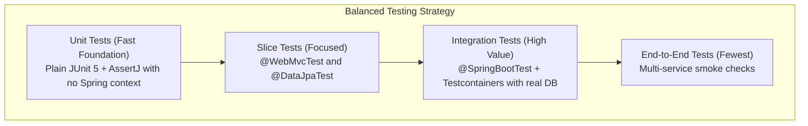
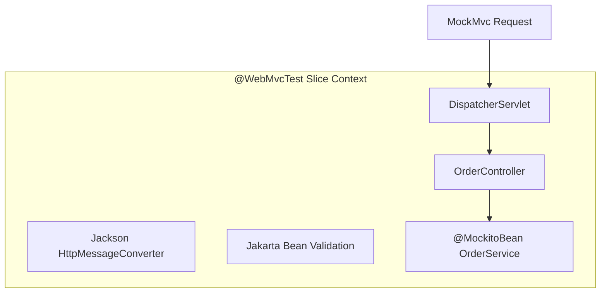
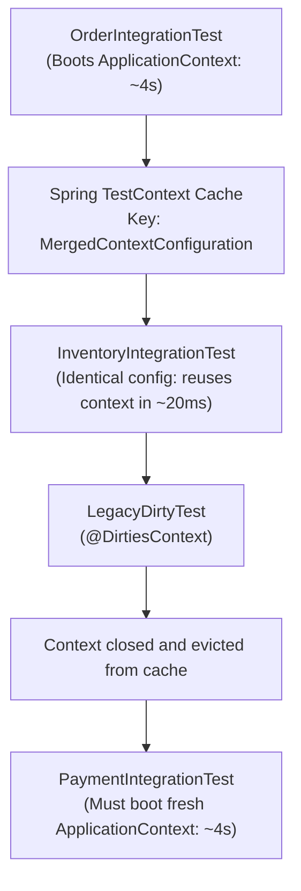

Every engineering team eventually encounters two very different test suites. One runs in under two minutes, catches real regressions before merge, and makes refactoring safe. The other takes twenty minutes, flakes on timing issues, and trains developers to pass `-DskipTests` locally.

The difference is rarely about chasing 100% line coverage. It comes down to choosing the right test boundary for each piece of code: using millisecond-fast plain JUnit tests for pure domain logic, lightweight Spring slices for HTTP contracts, and real containerized databases for SQL and transaction behavior instead of brittle mocks or H2 workarounds.

## Balancing the Testing Trophy

The classic Testing Pyramid pushed almost all effort into isolated unit tests. In Spring Boot services, though, a large share of production bugs live at integration boundaries: Jackson serialization mismatches, Spring Security rules, JPA query mistakes, Flyway migrations, and transaction boundaries. A balanced **Testing Trophy** invests heavily in both fast unit tests for domain rules and focused integration tests for infrastructure boundaries:



| Test Layer | Scope | Typical Speed | Spring Context | Best Used For |
| :--- | :--- | :--- | :--- | :--- |
| **Pure Unit Test** | Single class or domain model | 1–5 ms | None | Pricing rules, state machines, parsers, edge-case math |
| **Web Slice (`@WebMvcTest`)** | Controller + MVC + Security | 200–800 ms | Partial | Routing, validation, JSON mapping, status codes, RBAC |
| **Data Slice (`@DataJpaTest`)** | Repositories + JPA | 0.5–2 s | Partial | Custom JPQL/native queries, entity mappings, migrations |
| **Full Integration (`@SpringBootTest`)** | Whole service wiring | 2–10 s (amortized) | Full (cached) | Bean wiring, transactions, end-to-end API + DB flows |

## Unit Testing with JUnit 5 and AssertJ

Pure unit tests should never boot Spring. Running 500 plain JUnit 5 tests finishes in well under a second, which makes testing every boundary condition cheap.

Pair JUnit 5 (`@Test`, `@ParameterizedTest`, `@DisplayName`) with **AssertJ**. AssertJ's fluent assertions read clearly, catch type mismatches at compile time, and produce detailed diff messages when a test fails. For `BigDecimal` assertions, always prefer `isEqualByComparingTo(...)` over `isEqualTo(...)` because `new BigDecimal("10.0")` and `new BigDecimal("10.00")` have different scales and fail `equals()`.

```java
package com.example.ecommerce.domain;

import org.junit.jupiter.api.DisplayName;
import org.junit.jupiter.api.Test;
import org.junit.jupiter.params.ParameterizedTest;
import org.junit.jupiter.params.provider.ValueSource;

import java.math.BigDecimal;
import java.util.List;

import static org.assertj.core.api.Assertions.assertThat;
import static org.assertj.core.api.Assertions.assertThatThrownBy;

class OrderDiscountCalculatorTest {

    private final OrderDiscountCalculator calculator = new OrderDiscountCalculator();

    @Test
    @DisplayName("Applies 15% VIP discount when subtotal exceeds USD 100")
    void appliesVipDiscountForHighValueOrders() {
        Order order = new Order(
                "VIP-CUSTOMER",
                List.of(new OrderItem("LAPTOP", new BigDecimal("1200.00"), 1))
        );

        BigDecimal discountedTotal = calculator.calculateTotal(order);

        assertThat(discountedTotal)
                .isNotNull()
                .isEqualByComparingTo(new BigDecimal("1020.00"))
                .isLessThan(order.getRawTotal());
    }

    @ParameterizedTest
    @ValueSource(strings = {"", "   ", "\t"})
    @DisplayName("Rejects blank customer IDs")
    void rejectsBlankCustomerIds(String invalidCustomerId) {
        assertThatThrownBy(() -> new Order(invalidCustomerId, List.of()))
                .isInstanceOf(IllegalArgumentException.class)
                .hasMessageContaining("Customer ID must not be blank");
    }
}
```

## Mocking Dependencies with Mockito

When unit-testing a service class that coordinates external boundaries (such as a payment gateway or repository), Mockito lets you replace those collaborators with controlled stubs. `@ExtendWith(MockitoExtension.class)` initializes `@Mock` fields, injects them into `@InjectMocks` (preferring constructor injection), and enables strict stubbing by default so unused `when(...)` stubs fail the test instead of rotting quietly.

```java
package com.example.ecommerce.service;

import com.example.ecommerce.domain.Order;
import com.example.ecommerce.domain.PaymentGateway;
import com.example.ecommerce.domain.PaymentResult;
import com.example.ecommerce.repository.OrderRepository;
import org.junit.jupiter.api.Test;
import org.junit.jupiter.api.extension.ExtendWith;
import org.mockito.ArgumentCaptor;
import org.mockito.InjectMocks;
import org.mockito.Mock;
import org.mockito.junit.jupiter.MockitoExtension;

import java.math.BigDecimal;
import java.util.Optional;
import java.util.UUID;

import static org.assertj.core.api.Assertions.assertThat;
import static org.mockito.ArgumentMatchers.any;
import static org.mockito.ArgumentMatchers.eq;
import static org.mockito.Mockito.verify;
import static org.mockito.Mockito.when;

@ExtendWith(MockitoExtension.class)
class OrderProcessingServiceTest {

    @Mock
    private OrderRepository orderRepository;

    @Mock
    private PaymentGateway paymentGateway;

    @InjectMocks
    private OrderProcessingService orderService;

    @Test
    void confirmsAndSavesOrderWhenPaymentSucceeds() {
        UUID orderId = UUID.randomUUID();
        Order pendingOrder = new Order(orderId, new BigDecimal("250.00"));

        when(orderRepository.findById(orderId)).thenReturn(Optional.of(pendingOrder));
        when(paymentGateway.charge(eq(orderId), any(BigDecimal.class)))
                .thenReturn(PaymentResult.success("TXN-999"));
        when(orderRepository.save(any(Order.class)))
                .thenAnswer(invocation -> invocation.getArgument(0));

        Order confirmedOrder = orderService.processOrder(orderId);

        assertThat(confirmedOrder.isConfirmed()).isTrue();
        assertThat(confirmedOrder.getTransactionId()).isEqualTo("TXN-999");

        ArgumentCaptor<Order> savedCaptor = ArgumentCaptor.forClass(Order.class);
        verify(paymentGateway).charge(orderId, new BigDecimal("250.00"));
        verify(orderRepository).save(savedCaptor.capture());
        assertThat(savedCaptor.getValue().isConfirmed()).isTrue();
    }
}
```

### Avoiding Over-Mocking

Mocks are useful at I/O boundaries (HTTP clients, payment gateways, message producers). Mocking value objects, domain calculators, or five internal helper services turns tests into mirrors of the implementation: every small refactor breaks a dozen tests even when the public behavior never changed. If a service is mostly orchestration between JPA repositories and transactions, write a real integration test with Testcontainers instead of 40 lines of Mockito stubbing.

## Controller Slice Testing with `@WebMvcTest` and `MockMvc`

Testing REST controllers does not require starting a database or full application context. `@WebMvcTest(OrderController.class)` boots only the web slice: `DispatcherServlet`, your controller, Jackson converters, Jakarta Validation, `@ControllerAdvice` exception handlers, and Spring Security filters (if Spring Security is on the classpath).



> [!NOTE]
> **Spring Boot 3.4 / Spring Framework 6.2 `@MockitoBean`:** Spring Boot 3.4 deprecated `@MockBean` and `@SpyBean` (`org.springframework.boot.test.mock.mockito`) in favor of Spring Framework 6.2's `@MockitoBean` and `@MockitoSpyBean` (`org.springframework.test.context.bean.override.mockito`). If your project is still on Spring Boot 3.1–3.3, use `@MockBean`; on Spring Boot 3.4+, prefer `@MockitoBean`.

```java
package com.example.ecommerce.api;

import com.example.ecommerce.api.dto.CreateOrderRequest;
import com.example.ecommerce.api.dto.OrderResponse;
import com.example.ecommerce.domain.OrderService;
import com.fasterxml.jackson.databind.ObjectMapper;
import org.junit.jupiter.api.Test;
import org.springframework.beans.factory.annotation.Autowired;
import org.springframework.boot.test.autoconfigure.web.servlet.WebMvcTest;
import org.springframework.http.MediaType;
import org.springframework.test.context.bean.override.mockito.MockitoBean;
import org.springframework.test.web.servlet.MockMvc;

import java.math.BigDecimal;
import java.time.Instant;
import java.util.List;
import java.util.UUID;

import static org.hamcrest.Matchers.containsString;
import static org.mockito.ArgumentMatchers.any;
import static org.mockito.Mockito.when;
import static org.springframework.test.web.servlet.request.MockMvcRequestBuilders.post;
import static org.springframework.test.web.servlet.result.MockMvcResultMatchers.header;
import static org.springframework.test.web.servlet.result.MockMvcResultMatchers.jsonPath;
import static org.springframework.test.web.servlet.result.MockMvcResultMatchers.status;

@WebMvcTest(OrderController.class)
class OrderControllerTest {

    @Autowired
    private MockMvc mockMvc;

    @Autowired
    private ObjectMapper objectMapper;

    @MockitoBean
    private OrderService orderService;

    @Test
    void createOrderReturns201AndLocationHeader() throws Exception {
        UUID orderId = UUID.randomUUID();
        CreateOrderRequest request = new CreateOrderRequest(
                "CUST-101",
                List.of(new CreateOrderRequest.OrderItemRequest("SKU-BOOK", 2, new BigDecimal("19.99")))
        );
        OrderResponse response = new OrderResponse(
                orderId, "CUST-101", "CREATED", new BigDecimal("39.98"), List.of(), Instant.now()
        );

        when(orderService.createOrder(any())).thenReturn(response);

        mockMvc.perform(post("/api/v1/orders")
                        .contentType(MediaType.APPLICATION_JSON)
                        .content(objectMapper.writeValueAsString(request)))
                .andExpect(status().isCreated())
                .andExpect(header().string("Location", containsString("/api/v1/orders/" + orderId)))
                .andExpect(jsonPath("$.id").value(orderId.toString()))
                .andExpect(jsonPath("$.status").value("CREATED"))
                .andExpect(jsonPath("$.totalAmount").value(39.98));
    }

    @Test
    void invalidRequestReturns400ProblemDetail() throws Exception {
        CreateOrderRequest invalidRequest = new CreateOrderRequest("", List.of());

        mockMvc.perform(post("/api/v1/orders")
                        .contentType(MediaType.APPLICATION_JSON)
                        .content(objectMapper.writeValueAsString(invalidRequest)))
                .andExpect(status().isBadRequest())
                .andExpect(jsonPath("$.title").value("Validation Failure"))
                .andExpect(jsonPath("$.status").value(400));
    }
}
```

Resist the temptation to silence Spring Security errors in controller tests with `@AutoConfigureMockMvc(addFilters = false)`. Disabling filters lets tests pass even when your security configuration blocks every real request in production. Instead, import your `SecurityConfig` and test both authorized and unauthorized callers using `spring-security-test` (`@WithMockUser(roles = "ADMIN")`, `csrf()`, or `jwt()`).

## Integration Testing with `@SpringBootTest` and Testcontainers

For years, Spring guides ran repository and integration tests against an in-memory H2 database. That shortcut hides production bugs:

- H2's SQL dialect differs from PostgreSQL and MySQL (especially for `JSONB` operators, `ON CONFLICT` upserts, window functions, and native arrays).
- H2 handles identifier case sensitivity and timestamp precision differently.
- H2 does not reproduce PostgreSQL's MVCC snapshot isolation or row-level `FOR UPDATE SKIP LOCKED` locking.
- Flyway or Liquibase migrations written with PostgreSQL-specific DDL fail on H2, forcing teams to maintain separate test schemas that drift from production.

**Testcontainers** solves this by starting the exact Docker image your service uses in production (such as `postgres:16-alpine`, `redis:7-alpine`, or Kafka) straight from JUnit.

### Zero-Boilerplate Binding with `@ServiceConnection`

Introduced in **Spring Boot 3.1**, `@ServiceConnection` eliminates manual `@DynamicPropertySource` wiring. When placed on a Testcontainers field or `@Bean`, Spring Boot registers a `ConnectionDetails` bean (for example, `JdbcConnectionDetails`) populated with the container's dynamic host port and credentials. Auto-configuration uses that `ConnectionDetails` bean automatically.

### Singleton Container Reuse Across Test Classes

A common mistake with `@Testcontainers` + `@Container` is declaring a container field directly on each test class:

```java
// Pitfall when combined with Spring TestContext caching across multiple classes:
// ClassA starts Postgres on port 55101, Spring caches the DataSource pointing to 55101,
// then JUnit stops ClassA's container and ClassB hits a closed port!
```

Even when it does not cause closed-port errors, starting a fresh Docker container per test class wastes seconds on every class. The cleanest production pattern is a **singleton container** defined once in an abstract base class (started manually in a `static` block, without `@Testcontainers`/`@Container` stopping it between classes; Testcontainers' Ryuk sidecar automatically cleans up the container when the JVM exits):

```java
package com.example.ecommerce.integration;

import org.springframework.boot.test.context.SpringBootTest;
import org.springframework.boot.testcontainers.service.connection.ServiceConnection;
import org.testcontainers.containers.PostgreSQLContainer;

@SpringBootTest(webEnvironment = SpringBootTest.WebEnvironment.RANDOM_PORT)
public abstract class AbstractIntegrationTest {

    @ServiceConnection
    static final PostgreSQLContainer<?> POSTGRES =
            new PostgreSQLContainer<>("postgres:16-alpine");

    static {
        POSTGRES.start();
    }
}
```

Now every integration test class extends `AbstractIntegrationTest`, shares the single running PostgreSQL container, and shares the cached Spring `ApplicationContext`:

```java
package com.example.ecommerce.integration;

import com.example.ecommerce.entity.Order;
import com.example.ecommerce.entity.OrderStatus;
import com.example.ecommerce.repository.OrderRepository;
import org.junit.jupiter.api.AfterEach;
import org.junit.jupiter.api.Test;
import org.springframework.beans.factory.annotation.Autowired;

import java.math.BigDecimal;
import java.util.UUID;

import static org.assertj.core.api.Assertions.assertThat;

class OrderRepositoryIntegrationTest extends AbstractIntegrationTest {

    @Autowired
    private OrderRepository orderRepository;

    @AfterEach
    void tearDown() {
        orderRepository.deleteAllInBatch();
    }

    @Test
    void persistsAndQueriesOrderInRealPostgres() {
        Order newOrder = new Order(
                UUID.randomUUID(), "CUST-999", OrderStatus.PENDING, new BigDecimal("89.50"));

        Order saved = orderRepository.save(newOrder);

        var retrieved = orderRepository.findById(saved.getId());
        assertThat(retrieved).isPresent();
        assertThat(retrieved.get().getCustomerId()).isEqualTo("CUST-999");
        assertThat(retrieved.get().getTotalAmount()).isEqualByComparingTo(new BigDecimal("89.50"));
    }
}
```

(As an alternative to an abstract base class, Spring Boot 3.1+ also supports declaring a `@TestConfiguration(proxyBeanMethods = false)` with a `@Bean @ServiceConnection` container method and importing it via `@Import(TestcontainersConfiguration.class)`—the exact pattern Spring Initializr generates today.)

## Spring TestContext Caching vs. `@DirtiesContext`

Starting a full Spring Boot `ApplicationContext` takes 2 to 6 seconds. If a suite has 40 integration test classes and boots a new context for each class, the build spends minutes just initializing beans.

Spring's TestContext framework prevents this by caching contexts keyed by `MergedContextConfiguration`. Two test classes share the exact same cached context if their configuration key matches:

- Active profiles (`@ActiveProfiles`)
- Context classes and initializers (`@ContextConfiguration`, `@Import`)
- Test properties (`@TestPropertySource`, `@SpringBootTest(properties = ...)`)
- Web environment (`RANDOM_PORT`, `MOCK`, `NONE`)
- Bean overrides (`@MockitoBean`, `@MockitoSpyBean`, `@MockBean`)



### Why `@DirtiesContext` and Scattered `@MockitoBean` Hurt Build Times

Adding `@DirtiesContext` forces Spring to tear down and evict the cached context after the class (or method) finishes, making the next test pay the full startup cost again. Almost as often, teams accidentally defeat context caching by placing different `@MockitoBean` fields on different `@SpringBootTest` classes: every unique combination of overridden beans produces a different `MergedContextConfiguration` cache key and triggers another full context boot.

To keep integration suites fast:

1. Standardize integration test configuration in one base class (`AbstractIntegrationTest`), including any shared test doubles (such as a WireMock server or shared `@MockitoBean` for an external payment client).
2. Reset database state explicitly between tests (`deleteAllInBatch()` or a truncate utility) rather than destroying the Spring context.
3. Reserve `@DirtiesContext` strictly for rare tests that genuinely mutate singleton bean state or Spring infrastructure that cannot be reset cleanly.

### Watch Out for `@Transactional` on Integration Tests

Putting `@Transactional` on a `@DataJpaTest` is standard because Spring rolls back every test automatically. Putting `@Transactional` on a `@SpringBootTest`, however, comes with two real traps:

1. **Broken with `WebEnvironment.RANDOM_PORT`**: When your test calls the embedded Tomcat server via `TestRestTemplate` or `WebTestClient`, the HTTP request runs on a servlet worker thread with its own database transaction. It cannot see uncommitted rows inserted by the test thread's `@Transactional` method, and changes committed by the HTTP handler will *not* be rolled back when the test finishes.
2. **False confidence with Hibernate lazy loading and flushes**: Because the test method holds an open persistence context until rollback, lazy collections load without throwing `LazyInitializationException`, and deferred constraint violations or dirty-checking bugs may never flush if no query triggers a flush before rollback.

For `@SpringBootTest` classes, let transactions commit naturally during the test and clean up tables explicitly in `@AfterEach` (or `@BeforeEach`) so your tests exercise real commit, flush, and lazy-loading boundaries.

## Interview Questions

### What is the difference between `@Mock`, `@InjectMocks`, and `@MockitoBean`?

`@Mock` and `@InjectMocks` are pure Mockito annotations used in unit tests (`@ExtendWith(MockitoExtension.class)`) without Spring. `@Mock` creates a mock instance and `@InjectMocks` instantiates the class under test with those mocks injected. `@MockitoBean` (introduced in Spring Framework 6.2 / Spring Boot 3.4 to replace `@MockBean`) is a Spring TestContext annotation used in `@WebMvcTest` or `@SpringBootTest`: it registers a Mockito mock inside the Spring `ApplicationContext`, overriding any real bean of that type.

### What goes into Spring's `MergedContextConfiguration` cache key, and why can adding one `@MockitoBean` double a build's duration?

The cache key includes active profiles, test property sources, context initializers, web environment mode, configuration classes, and bean overrides (`@MockitoBean` / `@MockitoSpyBean`). If 15 integration test classes share one context and you add a unique `@MockitoBean` to 5 of them, Spring can no longer reuse the base context for those 5 classes and boots 5 separate `ApplicationContext` instances (each consuming heap and startup time, and even evicting older contexts once the default cache size of 32 is reached).

### How does `@ServiceConnection` work under the hood in Spring Boot 3.1+?

`@ServiceConnection` inspects the Testcontainers container type (such as `PostgreSQLContainer`, `GenericContainer` with a Redis image, or `KafkaContainer`) and registers a matching Spring Boot `ConnectionDetails` bean (like `JdbcConnectionDetails` or `RedisConnectionDetails`) in the test `ApplicationContext`. Spring Boot's auto-configurations check for `ConnectionDetails` beans before falling back to `application.properties`, so the application connects to the container's randomized host port automatically without `@DynamicPropertySource`.

### Why should you be careful putting `@Transactional` on a `@SpringBootTest(webEnvironment = RANDOM_PORT)` test method?

In `RANDOM_PORT` mode, the test method and the embedded web server execute on different threads with separate database connections and transactions. Data inserted inside the test's uncommitted transaction is invisible to the HTTP controller thread, and data committed by the controller is not rolled back when the test completes. Even in `MOCK` or `NONE` mode, a test-level transaction keeps the Hibernate session open for the whole method, hiding `LazyInitializationException` bugs that only appear in production once the service transaction ends.
