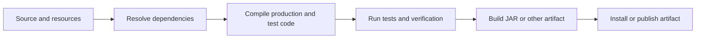

A Java build tool turns source code and resources into tested, packaged artifacts. It also resolves libraries, runs plugins, and makes the same build repeatable for developers and continuous integration. Maven and Gradle solve these jobs with different build models: Maven organizes work around lifecycles and conventions, while Gradle exposes a task graph configured by plugins and build scripts.

Examples use Java 21 and show Maven POM XML and Gradle Kotlin DSL. The dependency coordinates below are illustrative placeholders; replace them with libraries supported by your application and selected versions.

## What a build does

A typical build resolves dependencies, compiles production and test code, runs checks, and packages output:



The exact phases, task names, and default bindings depend on the build tool and plugins. A build passing locally is not sufficient if another developer or CI silently uses a different JDK, tool version, or dependency graph.

## Maven: POM and lifecycle

Maven configuration lives in `pom.xml`, the **Project Object Model (POM)**. Project coordinates identify an artifact (`groupId`, `artifactId`, and `version`), while properties and dependencies describe how it is built:

```xml
<properties>
    <maven.compiler.release>21</maven.compiler.release>
    <project.build.sourceEncoding>UTF-8</project.build.sourceEncoding>
    <json-library.version>1.2.3</json-library.version>
    <test-library.version>4.5.6</test-library.version>
</properties>

<dependencies>
    <dependency>
        <groupId>org.example</groupId>
        <artifactId>json-library</artifactId>
        <version>${json-library.version}</version>
    </dependency>

    <dependency>
        <groupId>org.example</groupId>
        <artifactId>test-library</artifactId>
        <version>${test-library.version}</version>
        <scope>test</scope>
    </dependency>
</dependencies>
```

The coordinates are examples, not real published artifacts. In a real POM, declare versions in properties, a parent, or a Bill of Materials (BOM) where appropriate. The `release` property tells Java compilation which language/API release to target; it does not install that JDK. Ensure the chosen JDK is available to run the build.

Maven's default lifecycle includes phases such as `validate`, `compile`, `test`, `package`, `verify`, `install`, and `deploy`. Invoking a later phase runs the earlier phases in that lifecycle first:

```text
mvnw.cmd clean verify
```

`clean` belongs to Maven's separate clean lifecycle; `verify` runs the default lifecycle through verification. Use `test` when you only need unit tests, `package` when you need the distributable archive, and `verify` when integration or quality checks are bound to that phase. A phase is a lifecycle checkpoint; plugins bind concrete goals to phases to perform the actual work.

Maven dependency scopes control when a dependency is available. `compile` is the default, `runtime` is needed at runtime but not source compilation, and `test` is limited to test compilation/execution. `provided` means the runtime environment is expected to supply it. Prefer the narrowest correct scope so test-only libraries do not leak into production packaging.

## Gradle: plugins, tasks, and configurations

Gradle build logic is commonly written in Kotlin DSL (`build.gradle.kts`) or Groovy DSL (`build.gradle`). Applying a plugin adds conventions, configurations, and tasks. A Java application can use the Java plugin and a toolchain:

```kotlin
plugins {
    application
}

group = "com.example"
version = "1.0.0"

java {
    toolchain {
        languageVersion = JavaLanguageVersion.of(21)
    }
}

repositories {
    mavenCentral()
}

dependencies {
    implementation("org.example:core-library:1.2.3")
    runtimeOnly("org.example:database-driver:4.5.6")
    testImplementation("org.example:test-library:7.8.9")
}
```

The coordinates are placeholders and must be replaced with real dependencies. A toolchain requests a Java version for the build; the build tool may provision it if configured, otherwise the required toolchain must be installed. It keeps the compilation target explicit instead of relying on whichever `javac` happens to be first on `PATH`.

The Java plugin provides tasks such as `compileJava`, `processResources`, `test`, `jar`, and `check`. Tasks declare dependencies on other tasks, and Gradle constructs the task graph needed for the requested command:

```text
gradlew.bat clean build
```

`build` conventionally depends on compilation, tests, and verification tasks added by plugins. Use `tasks` to discover available tasks and `help --task <name>` to inspect a task rather than assuming every plugin creates the same task names.

Gradle dependency configurations include `implementation`, `api`, `compileOnly`, `runtimeOnly`, and `testImplementation`. For an application, `implementation` is the common choice for production code; `api` is intended for a library dependency that must be exposed to consumers' compile classpaths. Do not select `api` merely because a dependency is used by the project.

## Transitive dependencies and version control

A dependency can bring its own dependencies into the build; these are **transitive dependencies**. This saves manual declarations but creates a graph where two libraries may request different versions of the same module. Inspect the resolved graph when behavior or a vulnerability report points to an unexpected library:

```text
mvnw.cmd dependency:tree
gradlew.bat dependencies --configuration runtimeClasspath
```

Maven documents **nearest definition** mediation: when versions conflict, it generally selects the version closest to the project in the dependency tree, with declaration order breaking ties at the same depth. A direct dependency or `dependencyManagement` can control the version.

Gradle resolves conflicts according to its dependency-resolution rules and supports platforms, constraints, and version catalogs for central version management. Do not assume that Maven and Gradle use the same conflict-resolution rule. A Gradle constraint can influence a module's version without adding that module as a direct dependency.

A Maven BOM (`<dependencyManagement>`) or Gradle platform/version catalog can keep related library versions aligned. Still declare libraries that your source directly uses: relying on a dependency that only arrives transitively can break when another library changes its graph.

Review the resolved dependency tree for:

- Multiple incompatible versions of the same module.
- A library present only transitively even though your code imports it directly.
- Test dependencies accidentally included in the production runtime.
- An unexpected library or plugin source.

## Reproducible builds and wrappers

Use the project wrapper so contributors and CI run the build-tool version selected by the repository:

- Maven projects commonly commit `mvnw`, `mvnw.cmd`, and the Maven Wrapper configuration.
- Gradle projects commonly commit `gradlew`, `gradlew.bat`, and `gradle/wrapper/`.

The Gradle Wrapper downloads and invokes the declared Gradle distribution when needed; its files should be checked into version control. The Maven Wrapper provides the analogous project-pinned Maven invocation. A wrapper pins the build tool, but a truly repeatable build also needs controlled JDKs, dependency/plugin versions, repositories, and relevant environment settings.

Treat wrapper and plugin updates as build changes: review the distribution source and version, run the full verification task, and confirm the resulting artifact. Do not check secrets or repository credentials into a build file; provide private repository credentials through the project's approved secret configuration.

## Choosing between Maven and Gradle

| Maven | Gradle |
|---|---|
| Convention-heavy POM and ordered lifecycles | Plugin-driven build scripts and task dependency graph |
| XML configuration with explicit plugin goals and phase bindings | Kotlin or Groovy DSL with task and configuration APIs |
| Familiar lifecycle commands such as `test`, `package`, and `verify` | Fine-grained tasks such as `test`, `jar`, and `check` |
| Dependency mediation and management through POM mechanisms/BOMs | Dependency constraints, platforms, and version catalogs |

Neither is universally better. Follow the existing project unless there is a concrete migration reason; the cost is not only the build script but also plugins, CI commands, IDE setup, and contributor familiarity.

## Practical rules

- Use the repository wrapper and document the expected JDK/toolchain.
- Keep production, runtime-only, compile-only, and test dependencies in the right scope/configuration.
- Inspect the transitive dependency graph when versions conflict or unexpected classes appear.
- Pin and review plugin versions and use a BOM/platform/catalog to coordinate related dependencies.
- Prefer standard plugin tasks over custom build logic until a requirement needs customization.
- Run the same verification command locally and in CI, and publish the exact artifact that was tested.

## Further reading

- Apache Maven, [Introduction to the Build Lifecycle](https://maven.apache.org/guides/introduction/introduction-to-the-lifecycle.html)
- Apache Maven, [Introduction to the Dependency Mechanism](https://maven.apache.org/guides/introduction/introduction-to-dependency-mechanism.html)
- Gradle 9.8.2, [The Java Plugin](https://docs.gradle.org/current/userguide/java_plugin.html)
- Gradle 9.8.2, [Dependency management basics](https://docs.gradle.org/current/userguide/dependency_management_basics.html)
- Gradle 9.8.2, [Gradle Wrapper](https://docs.gradle.org/current/userguide/gradle_wrapper.html)
- [NoSQL Databases](../level-7/nosql-databases)
