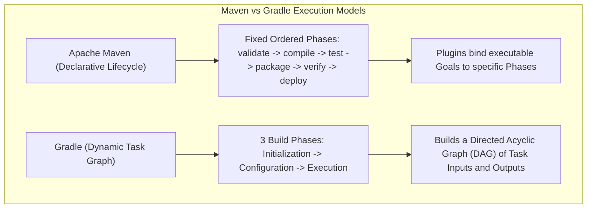
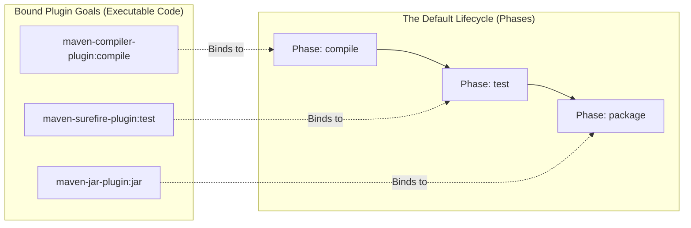
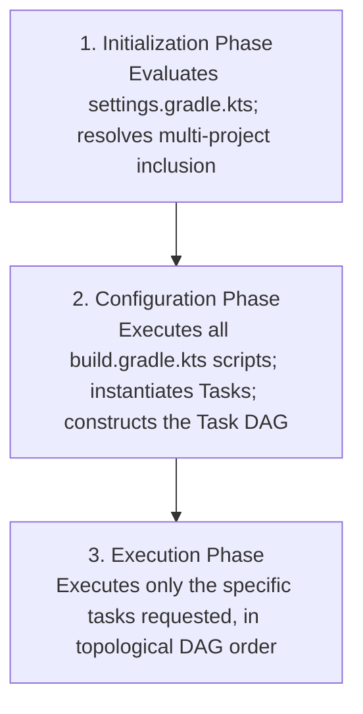
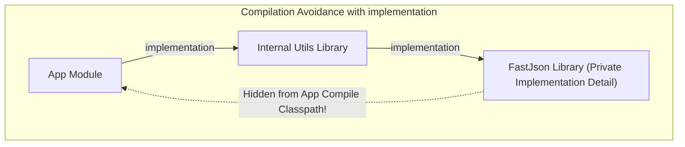
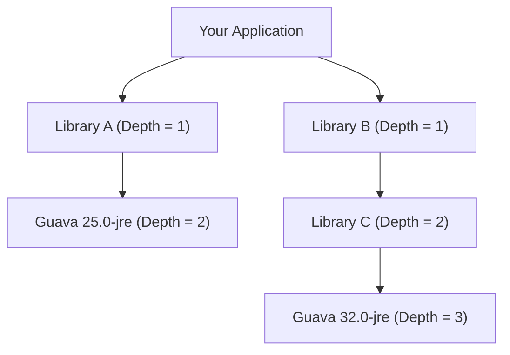

Every Java developer remembers the dread of their first enterprise dependency outage:

You download a repository, run `javac`, and are greeted with fifty compilation errors. You download the missing JARs manually, place them in a `lib/` directory, commit them to Git, and celebrate. Three months later, another developer updates one JAR. Suddenly, an innocent runtime call throws `java.lang.NoSuchMethodError` in production at 3:00 AM because an ancient transitive dependency conflict slipped into the classpath.

A build tool is not merely a script that packages a `.jar` file. It is the **formal execution contract of your engineering organization**:
- It manages reproducible compilation environments across heterogeneous operating systems.
- It enforces security vulnerability scans and license compliance.
- It resolves complex, multidimensional dependency graphs containing hundreds of open-source libraries.
- It orchestrates automated unit, integration, and performance testing suites in CI/CD pipelines.

In the modern Java landscape, two build engines dominate enterprise software: **Apache Maven** and **Gradle**.



---

## Apache Maven: Lifecycles, Phases, and Goals

Created in 2004, **Apache Maven** is built upon the philosophy of **Convention over Configuration**. 

Maven standardizes the structure of every Java project:
- `src/main/java`: Production Java source code
- `src/main/resources`: Application properties, SQL scripts, templates
- `src/test/java`: Automated unit and integration test code
- `pom.xml`: The Project Object Model descriptor

### The Three Independent Lifecycles

Maven has three completely separate, independent built-in lifecycles:
1. **`clean`**: Cleans up artifacts generated by prior builds (`pre-clean -> clean -> post-clean`).
2. **`default`**: The primary lifecycle responsible for compiling, testing, and deploying the software.
3. **`site`**: Generates project documentation and reports (`pre-site -> site -> post-site -> site-deploy`).

When you run `mvn clean install`, you are executing two distinct lifecycles in sequence: the `clean` lifecycle through its `clean` phase, followed by the `default` lifecycle through its `install` phase.

### Phases vs Goals: The Core Mental Model

One of the most common misconceptions in Java engineering is conflating a **Phase** with a **Goal**:

- **A Phase is an abstract milestone in a lifecycle**. A phase does not know how to compile code or run tests. It is simply an ordered checkpoint (e.g., `compile`, `test`, `package`, `verify`).
- **A Goal is an executable unit of work provided by a Maven Plugin**. A plugin contains concrete code that performs work (e.g., `compiler:compile` from `maven-compiler-plugin`, `surefire:test` from `maven-surefire-plugin`).



When you execute `mvn package`, Maven steps through every phase in the default lifecycle in order:
`validate -> compile -> test -> package`. At each phase, it invokes all plugin goals bound to that phase!

### Dependency Scopes in Maven

In your `pom.xml`, every dependency can define a `<scope>`:

| Scope | Compile Classpath | Test Classpath | Runtime / Packaged JAR | Example Use Case |
| :--- | :--- | :--- | :--- | :--- |
| **`compile`** (Default) | Yes | Yes | Yes | Core domain libraries (Guava, Apache Commons). |
| **`provided`** | Yes | Yes | **No** (Assumed provided by runtime) | Servlet API, Lombok, AWS Lambda core stubs. |
| **`runtime`** | **No** | Yes | Yes | Database JDBC drivers, SLF4J binding logback engines. |
| **`test`** | **No** | Yes | **No** | JUnit 5, Mockito, AssertJ, Testcontainers. |
| **`import`** | N/A | N/A | N/A | Used exclusively in `<dependencyManagement>` for BOMs. |

> [!TIP]
> Setting the proper scope prevents classpath leakage. If you mark JUnit as `compile` scope, test classes and assertion libraries will accidentally leak into your production production JAR, increasing attack surface and Docker image size.

---

## Gradle: Directed Acyclic Graphs (DAGs) and Incremental Builds

While Maven uses rigid, ordered lifecycle phases defined in XML, **Gradle** approaches builds as a **Directed Acyclic Graph (DAG) of Tasks**.

Gradle is powered by a high-performance daemon, intelligent caching, and scriptable configuration via **Kotlin DSL (`build.gradle.kts`)**.

### The Three Phases of a Gradle Build

Understanding Gradle's internal lifecycle is critical to avoiding massive build slowness:



1. **Initialization Phase**: Evaluates `settings.gradle.kts` to determine which projects participate in the build (essential for multi-module monorepos).
2. **Configuration Phase**: Executes the top-level script code of every `build.gradle.kts` file. It configures plugins, evaluates properties, and builds an in-memory **Directed Acyclic Graph (DAG)** of all tasks and their dependencies.
3. **Execution Phase**: Gradle inspects the tasks requested on the CLI (e.g., `./gradlew build`) and executes only the tasks necessary to produce the desired outputs, running independent tasks concurrently across multiple CPU threads.

### The Configuration Phase Antipattern

A widespread mistake in Gradle builds is placing expensive operations directly in the script body:

```kotlin
// SEVERE BUILD SMELL: Runs during the CONFIGURATION phase!
tasks.register("deployToCloud") {
    // This code runs on EVERY SINGLE GRADLE RUN (even ./gradlew clean or IDE sync!)
    val credentials = downloadSecretFromVault() 
    println("Connected to Vault: $credentials")

    doLast {
        // This is the actual EXECUTION phase:
        pushArtifactsToProduction()
    }
}
```

Any code written outside `doFirst` or `doLast` runs during the **Configuration Phase**. If you query a database, download secrets, or parse large files in the configuration body, you slow down every single build and IDE project sync, even when running `./gradlew tasks`!

### Compilation Avoidance: implementation vs api

In Gradle, dependencies are declared using configurations. The two most critical configurations for Java libraries are **`implementation`** and **`api`** (provided by the `java-library` plugin):



- **`implementation`**: The dependency is private to the module. It is available on the module's compile and runtime classpaths, but **it is hidden from consumers of the module**. If `InternalLib` changes its internal implementation or upgrades `FastJson`, the consumer `App` does not need to recompile! This is known as **Compilation Avoidance**, and it reduces build times in multi-module projects by up to 80%.
- **`api`**: The dependency is part of the module's public Application Binary Interface (ABI). Types from the dependency are exposed in public method signatures. Any change to the dependency forces all downstream consumers to recompile.

---

## Transitive Dependency Hell: Nearest-Wins vs Highest-Wins

Modern enterprise applications rarely depend on only ten libraries. When you import Spring Boot, Hibernate, and Jackson, your application pulls in hundreds of **transitive dependencies** (the dependencies required by your dependencies).

What happens when two libraries demand conflicting versions of the exact same dependency?



### Maven's "Nearest-Wins" Resolution Strategy

When Maven encounters conflicting versions of the same artifact, it uses **Nearest-Wins**:
- It calculates the depth of each dependency in the tree.
- The version **nearest to the root project** in the dependency graph is selected!
- In the diagram above, `Guava 25.0-jre` (at Depth 2) is closer to the root than `Guava 32.0-jre` (at Depth 3). **Maven silently selects the older Guava 25.0-jre!**

If `Library C` attempts to call a method introduced in Guava 32, your application compiles cleanly, but crashes at runtime with:
`java.lang.NoSuchMethodError: com.google.common.collect.ImmutableList.toImmutableList()`!

### Gradle's "Highest-Wins" Resolution Strategy

Gradle takes the opposite approach: by default, **Gradle selects the highest (newest) version** requested in the dependency graph (`Guava 32.0-jre`). While this prevents `NoSuchMethodError` for newly added APIs, it can introduce breaking changes if a library dropped deprecated methods.

### The Cure: The Bill of Materials (BOM)

To prevent conflicting transitive versions, senior architects use a **Bill of Materials (BOM)**. 

A BOM is a special packaging POM that curates and tests hundreds of compatible library versions together as a cohesive suite:

```xml
<!-- In Maven pom.xml: Enforcing global versions via Spring Boot BOM -->
<dependencyManagement>
    <dependencies>
        <dependency>
            <groupId>org.springframework.boot</groupId>
            <artifactId>spring-boot-dependencies</artifactId>
            <version>3.3.4</version>
            <type>pom</type>
            <scope>import</scope>
        </dependency>
    </dependencies>
</dependencyManagement>

<dependencies>
    <!-- Notice NO <version> tags! Versions are controlled strictly by the BOM! -->
    <dependency>
        <groupId>com.fasterxml.jackson.core</groupId>
        <artifactId>jackson-databind</artifactId>
    </dependency>
</dependencies>
```

In Gradle, you import a BOM using the `enforcedPlatform()` or `platform()` directive:
```kotlin
dependencies {
    implementation(platform("org.springframework.boot:spring-boot-dependencies:3.3.4"))
    implementation("com.fasterxml.jackson.core:jackson-databind") // Version managed by BOM!
}
```

---

## Reproducible Builds: The Mandatory Build Wrapper

Never instruct your team or CI/CD runner to invoke global system binaries like `mvn clean install` or `gradle build`.

If Developer Alice has Maven 3.8.1 installed on her MacBook, Developer Bob has Maven 3.9.6 on Linux, and the CI server runs Maven 3.6.3 on an old Jenkins agent, you do not have a reproducible software system. You have an unpredictable environment lottery.

Always invoke the build via the **Build Wrapper**:
- **Maven**: `./mvnw clean verify` (Linux/macOS) or `mvnw.cmd clean verify` (Windows)
- **Gradle**: `./gradlew build` (Linux/macOS) or `gradlew.bat build` (Windows)

```text
my-project/
  ├── .mvn/wrapper/
  │     ├── maven-wrapper.jar
  │     └── maven-wrapper.properties  <-- PINS EXACT MAVEN VERSION (e.g. 3.9.6)
  ├── mvnw
  └── mvnw.cmd
```

The wrapper script automatically downloads the exact verified binary distribution of the build tool and executes it with SHA-256 verification, ensuring that every developer and every CI server compiles with byte-for-byte reproducibility.

---

## Build Tools Comparison Matrix

| Feature | Apache Maven | Gradle |
| :--- | :--- | :--- |
| **Configuration Style** | Declarative XML (`pom.xml`) | Programmatic Kotlin / Groovy DSL (`build.gradle.kts`) |
| **Execution Model** | Strict sequential lifecycle phases | Directed Acyclic Graph (DAG) of task dependencies |
| **Transitive Conflict Rule** | **Nearest-Wins** in dependency tree | **Highest-Wins** by default |
| **Performance Tuning** | Incremental build plugins, parallel threads (`-T 1C`) | Incremental tasks, Compile Avoidance, Persistent Daemon, Remote Build Cache |
| **Multi-Module Support** | Parent POM with `<modules>` | `settings.gradle.kts` with subprojects |
| **Best Used For** | Standard enterprise services, stable conventions | Massive multi-project monorepos, Android, complex custom pipelines |

---

## Senior Engineer Interview Crucible

### What is the exact structural difference between a Maven Phase and a Maven Goal, and how do plugins bind to the build lifecycle?
A **Maven Phase** is an abstract milestone within a predefined build lifecycle (such as `compile`, `test`, `package`, or `verify`). A phase has no executable logic of its own; it serves as an ordered execution checkpoint.

A **Maven Goal** is an executable task provided by a Maven plugin (e.g., `compiler:compile`, `surefire:test`, or `jar:jar`). 

Plugins bind to the lifecycle by mapping their goals to specific phases. When a project declares a packaging type (such as `<packaging>jar</packaging>`), Maven loads a default binding configuration: it binds `compiler:compile` to the `compile` phase, `surefire:test` to the `test` phase, and `jar:jar` to the `package` phase. When a user runs `mvn package`, Maven steps through all prior phases sequentially, invoking all goals bound to each phase.

### Explain the compilation avoidance difference between Gradle's implementation and api configurations.
Both configurations make a dependency available on the compiling module's classpath. However, their impact on downstream consumers is fundamentally different:
- **`implementation`**: Hides the dependency from downstream consumers' compile classpaths. If Module B uses Module C via `implementation`, and Module A depends on Module B, Module A cannot reference classes from Module C at compile time. If Module C changes its internal code without altering Module B's public ABI, Gradle skips recompiling Module A (**Compilation Avoidance**), drastically reducing build times.
- **`api`**: Exports the dependency transitively to all downstream consumers. Types from Module C can be used in Module B's public method signatures and are exposed to Module A's compile classpath. Any internal change in Module C invalidates the ABI, forcing Gradle to recompile Module B and all downstream modules.

### How do Maven and Gradle differ in their default conflict resolution strategies for transitive dependencies, and how does a Bill of Materials (BOM) enforce consistency?
When multiple versions of the same dependency exist in the transitive graph:
- **Maven uses Nearest-Wins**: It selects the version located at the shallowest depth in the dependency tree. If depths are identical, the first declaration in the POM wins. This can accidentally downgrade dependencies if an older version is brought in at Depth 1 or 2.
- **Gradle uses Highest-Wins**: It selects the highest (newest) version requested anywhere in the dependency graph.

A **Bill of Materials (BOM)** overrides both strategies. By declaring a BOM in `<dependencyManagement>` (Maven) or `platform()` (Gradle), the engineering team defines a centralized, authoritative version catalog. Whenever an artifact defined in the BOM appears in the dependency tree (directly or transitively), the build tool forces the exact version dictated by the BOM, eliminating conflict resolution discrepancies.

### Why is putting network calls or database initialization inside the Configuration Phase of a Gradle build script an architectural defect?
Gradle executes builds in three distinct phases: Initialization, Configuration, and Execution. The Configuration Phase runs for **every single invocation of Gradle**, regardless of which task was requested (even running `./gradlew tasks`, running a single unit test, or opening the project in IntelliJ IDEA).

If a build script executes network calls (like fetching secrets from Vault) or initializes a database in the top-level script body, that operation runs during the Configuration Phase. This introduces network latency to every single interaction with the build tool, causes builds to fail when working offline, breaks Gradle's configuration caching, and pollutes the task graph creation with non-deterministic side effects. All execution logic must be deferred to the Execution Phase inside task actions (`doLast { ... }`).
