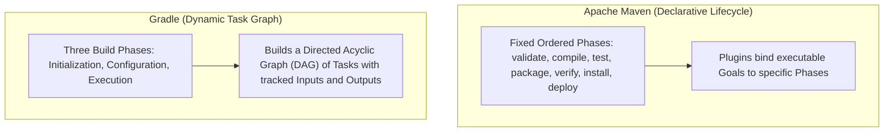
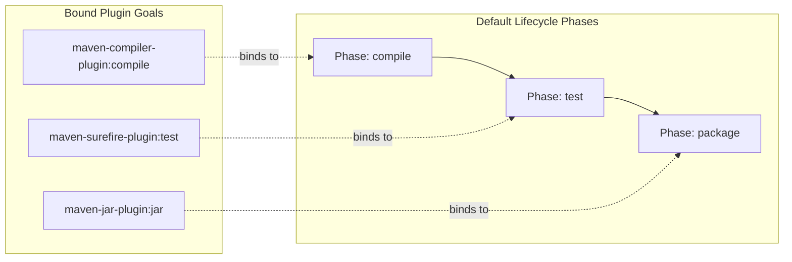
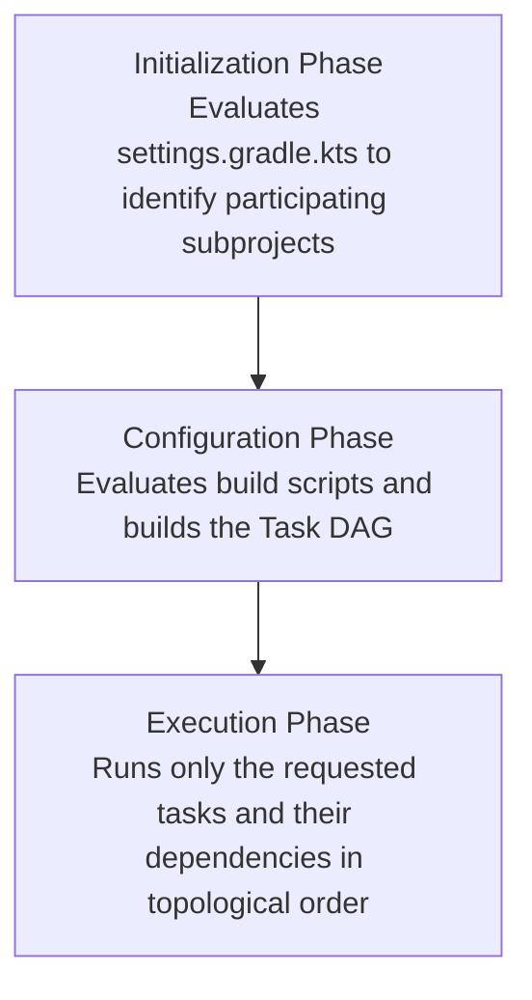
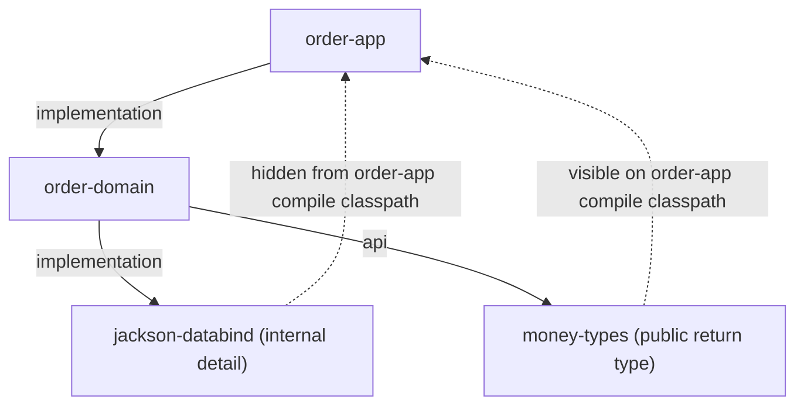
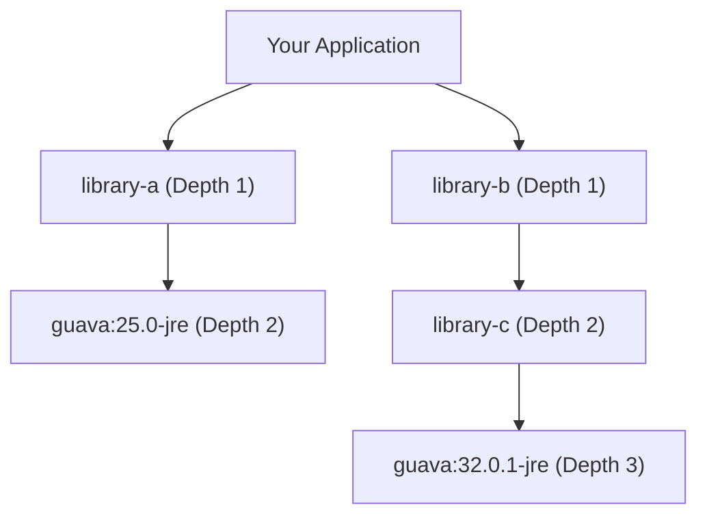

Compiling a single `.java` file with `javac` is straightforward. Compiling an enterprise service with 150 transitive JARs, code generators, database migration checks, unit tests, integration tests, and container image packaging is a different problem altogether. Without a dedicated build tool, teams end up with checked-in `lib/` folders, manual classpath scripts, and runtime `NoSuchMethodError` crashes caused by mismatched library versions.

A Java build tool defines a repeatable contract for turning source code into a tested, deployable artifact:
- Resolving direct and transitive dependencies from remote repositories such as Maven Central or an internal artifact mirror.
- Compiling source code with a pinned JDK target and running annotation processors.
- Orchestrating unit tests, integration tests, static analysis, and packaging in a predictable order.
- Producing consistent artifacts across macOS, Linux, Windows, and CI runners.

In modern Java backends, two tools dominate: **Apache Maven** and **Gradle**.



---

## Apache Maven: Convention, Lifecycles, and `pom.xml`

Apache Maven is built around **convention over configuration**. If you place files in the standard layout, Maven knows where to find them without extra setup:

- `src/main/java`: Production Java source files
- `src/main/resources`: Configuration files (`application.yml`), SQL migrations, templates
- `src/test/java`: Unit and integration test sources
- `src/test/resources`: Test-only configuration and fixtures
- `pom.xml`: The Project Object Model describing coordinates, dependencies, and plugins

### The Three Built-In Lifecycles

Maven separates build work into three independent lifecycles:
- **`clean`**: Deletes generated output from prior builds (`pre-clean`, `clean`, `post-clean`).
- **`default`**: Validates, compiles, tests, packages, verifies, installs locally, and deploys artifacts.
- **`site`**: Generates project reports and static site documentation.

When you run `./mvnw clean verify`, Maven executes the `clean` lifecycle up through the `clean` phase, and then executes the `default` lifecycle from `validate` through `verify`.

### Phases vs. Goals

A common point of confusion is treating Maven **phases** and **goals** as the same thing:

- A **Phase** is an abstract step in a lifecycle (`compile`, `test`, `package`, `verify`). A phase does not contain executable code on its own.
- A **Goal** is an actual task implemented by a Maven plugin (for example, `compiler:compile` from `maven-compiler-plugin`, or `surefire:test` from `maven-surefire-plugin`).

Plugins attach their goals to lifecycle phases. When a project declares `<packaging>jar</packaging>`, Maven automatically binds standard plugin goals to the default lifecycle phases.



Running `./mvnw package` steps through every phase up to `package` in sequence and runs every goal bound to each phase along the way.

### Anatomy of a Practical `pom.xml`

A production `pom.xml` uses `<dependencyManagement>` to import a Bill of Materials (BOM), assigns explicit scopes to each dependency, excludes unwanted transitive libraries, and configures build plugins explicitly.

```xml
<project xmlns="http://maven.apache.org/POM/4.0.0"
         xmlns:xsi="http://www.w3.org/2001/XMLSchema-instance"
         xsi:schemaLocation="http://maven.apache.org/POM/4.0.0 https://maven.apache.org/xsd/maven-4.0.0.xsd">
    <modelVersion>4.0.0</modelVersion>

    <groupId>com.example</groupId>
    <artifactId>order-service</artifactId>
    <version>1.4.0-SNAPSHOT</version>
    <packaging>jar</packaging>

    <properties>
        <java.version>21</java.version>
        <project.build.sourceEncoding>UTF-8</project.build.sourceEncoding>
        <spring-boot.version>3.3.5</spring-boot.version>
    </properties>

    <!-- Centralized version alignment via BOM -->
    <dependencyManagement>
        <dependencies>
            <dependency>
                <groupId>org.springframework.boot</groupId>
                <artifactId>spring-boot-dependencies</artifactId>
                <version>${spring-boot.version}</version>
                <type>pom</type>
                <scope>import</scope>
            </dependency>
        </dependencies>
    </dependencyManagement>

    <dependencies>
        <!-- compile scope (default): managed by BOM, no version tag needed -->
        <dependency>
            <groupId>org.springframework.boot</groupId>
            <artifactId>spring-boot-starter-web</artifactId>
            <exclusions>
                <!-- Example: swap default Tomcat for Jetty or Undertow -->
                <exclusion>
                    <groupId>org.springframework.boot</groupId>
                    <artifactId>spring-boot-starter-tomcat</artifactId>
                </exclusion>
            </exclusions>
        </dependency>

        <dependency>
            <groupId>org.springframework.boot</groupId>
            <artifactId>spring-boot-starter-undertow</artifactId>
        </dependency>

        <!-- runtime scope: JDBC driver is loaded via SPI at runtime, not referenced in code -->
        <dependency>
            <groupId>org.postgresql</groupId>
            <artifactId>postgresql</artifactId>
            <scope>runtime</scope>
        </dependency>

        <!-- test scope: excluded from production JAR -->
        <dependency>
            <groupId>org.springframework.boot</groupId>
            <artifactId>spring-boot-starter-test</artifactId>
            <scope>test</scope>
        </dependency>
    </dependencies>

    <build>
        <plugins>
            <plugin>
                <groupId>org.apache.maven.plugins</groupId>
                <artifactId>maven-compiler-plugin</artifactId>
                <version>3.13.0</version>
                <configuration>
                    <release>${java.version}</release>
                </configuration>
            </plugin>
            <plugin>
                <groupId>org.apache.maven.plugins</groupId>
                <artifactId>maven-surefire-plugin</artifactId>
                <version>3.5.0</version>
            </plugin>
        </plugins>
    </build>
</project>
```

### Maven Dependency Scopes

Each `<dependency>` accepts a `<scope>` that controls which classpaths include the library and whether it is packaged into the final artifact:

| Scope | Compile Classpath | Test Classpath | Runtime / Packaged Artifact | Typical Use Case |
| :--- | :--- | :--- | :--- | :--- |
| **`compile`** (default) | Yes | Yes | Yes | Application libraries (`spring-web`, Jackson, Guava) |
| **`provided`** | Yes | Yes | No | Servlet API when deploying to an external container, compile-time annotations |
| **`runtime`** | No | Yes | Yes | JDBC drivers (`postgresql`), SLF4J implementations (`logback-classic`) |
| **`test`** | No | Yes | No | JUnit 5, Mockito, AssertJ, Testcontainers |
| **`import`** | N/A | N/A | N/A | Only valid inside `<dependencyManagement>` with `<type>pom</type>` to import a BOM |

> [!TIP]
> Marking JDBC drivers as `runtime` prevents application code from accidentally importing driver-specific classes like `org.postgresql.PGConnection`, keeping your data layer bound to standard JDBC interfaces. Similarly, keeping test frameworks in `test` scope keeps them out of your production container image.

---

## Gradle: Task Graphs, DSL, and Compilation Avoidance

Where Maven follows a fixed linear lifecycle declared in XML, **Gradle** models a build as a **Directed Acyclic Graph (DAG) of tasks**. Each task declares its inputs, outputs, and dependencies on other tasks. Because Gradle hashes task inputs and outputs, it can skip unchanged tasks (`UP-TO-DATE`) or restore outputs from a local or remote build cache (`FROM-CACHE`).

Gradle supports both Groovy (`build.gradle`) and Kotlin (`build.gradle.kts`) DSLs. Kotlin DSL is preferred in modern projects because IDEs can provide static type checking, reliable autocomplete, and safe refactoring.

### The Three Build Phases

Every Gradle invocation moves through three stages:



1. **Initialization**: Reads `settings.gradle.kts` to decide whether this is a single-project build or a multi-module build and registers each subproject.
2. **Configuration**: Evaluates the `build.gradle.kts` scripts to configure plugins and construct the task dependency graph.
3. **Execution**: Walks the subgraph required for the requested task (for example, `./gradlew check`) and executes tasks, running independent tasks in parallel when enabled.

### Practical `build.gradle.kts` with Tasks and Dependency Configurations

The example below uses the `java-library` plugin to configure a Java 21 toolchain, import a Spring Boot BOM, separate `api` and `implementation` dependencies, and register a custom task chained into the build graph.

```kotlin
plugins {
    `java-library`
}

group = "com.example"
version = "1.4.0"

java {
    toolchain {
        languageVersion.set(JavaLanguageVersion.of(21))
    }
}

repositories {
    mavenCentral()
}

dependencies {
    // Import BOM for version management (equivalent to Maven <dependencyManagement>)
    implementation(platform("org.springframework.boot:spring-boot-dependencies:3.3.5"))

    // Exposed in this library's public method signatures -> consumers need it at compile time
    api("org.slf4j:slf4j-api")

    // Internal implementation detail -> hidden from downstream compile classpaths
    implementation("com.fasterxml.jackson.core:jackson-databind") {
        exclude(group = "commons-logging", module = "commons-logging")
    }

    runtimeOnly("org.postgresql:postgresql")
    testImplementation("org.junit.jupiter:junit-jupiter")
    testRuntimeOnly("org.junit.platform:junit-platform-launcher")
}

tasks.test {
    useJUnitPlatform()
}

// Custom task wired into the DAG via dependsOn
val generateBuildMetadata by tasks.registering {
    val outputFile = layout.buildDirectory.file("generated/build-info.txt")
    outputs.file(outputFile)

    doLast {
        val file = outputFile.get().asFile
        file.parentFile.mkdirs()
        file.writeText(
            """
            artifact=${project.name}
            version=${project.version}
            """.trimIndent()
        )
    }
}

tasks.named("processResources") {
    dependsOn(generateBuildMetadata)
}
```

### Avoiding the Configuration Phase Pitfall

Code written directly inside a task registration block (outside `doFirst` or `doLast`) runs during the **Configuration Phase**, which executes on every Gradle command, including `./gradlew clean`, `./gradlew tasks`, and IntelliJ project imports.

```kotlin
// Bad: fetches secrets during configuration on every Gradle invocation
tasks.register("publishBundle") {
    val token = fetchVaultTokenOverHttp() // Runs even during IDE sync or ./gradlew clean
    doLast {
        uploadArtifact(token)
    }
}

// Good: defer all side effects and I/O to the execution phase
tasks.register("publishBundle") {
    doLast {
        val token = fetchVaultTokenOverHttp()
        uploadArtifact(token)
    }
}
```

Keeping network calls, file reads, and subprocesses out of the configuration block also keeps your build compatible with Gradle's **Configuration Cache**, which serializes the task graph and skips the configuration phase on subsequent runs.

### Compilation Avoidance: `implementation` vs. `api`

The `java-library` plugin introduces two compile-time configurations that behave very differently in multi-module builds:



- **`implementation`**: Available while compiling and running the current module, and present on downstream **runtime** classpaths, but excluded from downstream **compile** classpaths. If `order-domain` upgrades or replaces `jackson-databind` without changing its own public method signatures, Gradle does not need to recompile `order-app`. This optimization is called **Compilation Avoidance**.
- **`api`**: Leaks the dependency onto downstream compile classpaths. Use `api` only when types from that dependency appear in your module's public class signatures, method parameters, or return types. Any ABI change in an `api` dependency forces downstream modules to recompile.

As a rule of thumb, default to `implementation` and promote a dependency to `api` only when the compiler requires it for a public contract.

---

## Transitive Dependencies and Conflict Resolution

Most Java services declare 10 to 25 direct dependencies, yet end up with 100+ JARs on the classpath. The rest are **transitive dependencies**: libraries pulled in by the libraries you depend on.

Sooner or later, two branches of your dependency tree will ask for different versions of the same artifact:



Maven and Gradle resolve this diamond conflict using different default rules.

### Maven: Nearest-Wins

Maven traverses the dependency graph breadth-first and picks the version **closest to the root `pom.xml`**:
- In the graph above, `guava:25.0-jre` is at depth 2, while `guava:32.0.1-jre` is at depth 3. Maven selects **`25.0-jre`**, silently downgrading Guava.
- If two conflicting versions sit at the exact same depth, Maven picks whichever dependency was declared **first** in `pom.xml`.

This explains why a seemingly harmless reordering of dependencies in a `pom.xml` can break production at runtime: `library-c` was compiled against Guava 32, and if it calls a method introduced after Guava 25, the JVM throws `java.lang.NoSuchMethodError` only when that code path runs.

### Gradle: Highest-Version Wins

By default, Gradle resolves version conflicts by selecting the **highest version** requested anywhere in the graph (`32.0.1-jre` in the example above).

Selecting the newest version avoids missing newly added methods, though it carries the inverse trade-off: if a library jumps across an incompatible major version and drops a deprecated method that `library-a` still calls, you can still hit a runtime `NoSuchMethodError`. Gradle lets you make conflicts explicit with `failOnVersionConflict()` or pin versions with `strictly` constraints when tighter control is needed.

### Aligning Versions with a BOM and Exclusions

Instead of letting tree depth or ordering decide your runtime classpath, centralize version choices with a **Bill of Materials (BOM)**:
- **Maven**: Import the BOM inside `<dependencyManagement>` with `<type>pom</type>` and `<scope>import</scope>`. Versions listed in `<dependencyManagement>` override transitive versions across the entire tree, regardless of depth.
- **Gradle**: Use `implementation(platform("group:bom:version"))` to provide recommended versions (still allowing higher transitive versions to win), or `implementation(enforcedPlatform("group:bom:version"))` when you want the BOM to strictly override even higher transitive versions.
- **Exclusions**: Use `<exclusions>` (Maven) or `exclude(group = ..., module = ...)` (Gradle) when a library pulls in a conflicting logging bridge (such as `commons-logging` vs. `jcl-over-slf4j`) or an embedded server you are replacing.

### Diagnosing Dependency Trees from the CLI

Never guess which dependency pulled in an unexpected JAR. Both tools have built-in diagnostics that show the exact path and conflict resolution reason:

```bash
# Maven: print the full dependency tree and show omitted conflict losers (-Dverbose)
./mvnw dependency:tree -Dverbose -Dincludes=com.google.guava:guava

# Maven: find declared-but-unused and used-but-undeclared dependencies
./mvnw dependency:analyze

# Gradle: inspect the resolved runtime classpath
./gradlew dependencies --configuration runtimeClasspath

# Gradle: trace exactly why a specific version of Guava won
./gradlew dependencyInsight --dependency guava --configuration runtimeClasspath
```

Running `dependencyInsight` in Gradle or `dependency:tree -Dverbose` in Maven takes a few seconds and eliminates hours of classpath guesswork.

---

## Reproducible Builds with Build Wrappers

Relying on globally installed `mvn` or `gradle` binaries introduces subtle drift: one engineer runs Maven 3.8.6, another runs 3.9.9, and CI runs whatever image was baked last year.

Both tools ship with a **wrapper** that you commit directly to Git:

```text
order-service/
├── .mvn/wrapper/
│   └── maven-wrapper.properties   # Pins exact Maven distribution URL and SHA-256
├── mvnw                           # Unix/macOS wrapper script
├── mvnw.cmd                       # Windows wrapper script
└── pom.xml
```

Generate or upgrade wrappers directly from the CLI:

```bash
# Generate or upgrade the Maven Wrapper (pins Maven 3.9.9)
./mvnw wrapper:wrapper -Dmaven=3.9.9

# Generate or upgrade the Gradle Wrapper with SHA-256 verification
./gradlew wrapper --gradle-version 8.10.2 --distribution-type bin
```

In CI pipelines and READMEs, always invoke `./mvnw clean verify` or `./gradlew check`. The wrapper downloads the exact pinned build tool version once into the user's cache directory, verifies its checksum when configured, and runs the build identically on every machine.

---

## Choosing Between Maven and Gradle

| Dimension | Apache Maven | Gradle |
| :--- | :--- | :--- |
| **Configuration format** | Declarative XML (`pom.xml`) | Kotlin DSL (`build.gradle.kts`) or Groovy (`build.gradle`) |
| **Execution model** | Fixed sequential lifecycle phases | Task DAG with incremental input/output tracking |
| **Conflict mediation** | Nearest-wins (first-declared breaks ties) | Highest-version wins by default |
| **Build speed features** | Parallel module builds (`-T 1C`), Maven Build Cache extension | Persistent daemon, incremental compilation, compilation avoidance, configuration & remote build caches |
| **Multi-module structure** | Parent POM with `<modules>` | `settings.gradle.kts` with subprojects and convention plugins (`buildSrc` / `build-logic`) |
| **Typical sweet spot** | Microservices and teams that value strict uniformity and predictable XML | Large multi-module repositories, custom build pipelines, Android, and polyglot repos |

---

## Interview Questions

### What is the difference between a Maven phase and a Maven goal?
A phase is an ordered milestone in a Maven lifecycle (`compile`, `test`, `package`, `verify`) that holds no executable logic of its own. A goal is an executable unit of work inside a plugin (such as `compiler:compile` or `surefire:test`). Packaging types bind default plugin goals to phases, and you can bind additional plugin goals in `<build><plugins>`. Running a phase executes every preceding phase in that lifecycle along with all goals bound to each phase.

### How does Maven's conflict resolution differ from Gradle's, and how does a BOM help?
When two versions of the same artifact appear in the transitive graph, Maven picks the version closest to the root POM (nearest-wins, breaking ties by declaration order), which can silently downgrade a library to an older version. Gradle picks the highest version requested anywhere in the graph by default. Importing a BOM (`<dependencyManagement>` with `import` scope in Maven, or `platform()` / `enforcedPlatform()` in Gradle) centralizes tested versions so modules stay aligned instead of relying on graph depth or transitive ordering.

### Why does Gradle separate `implementation` from `api` dependencies?
Both configurations put a library on the current module's compile classpath and downstream runtime classpaths. However, `implementation` hides the dependency from downstream modules' compile classpaths. When an internal `implementation` dependency changes without affecting the module's public ABI, Gradle skips recompiling downstream consumers (compilation avoidance). `api` exports the dependency to downstream compile classpaths and should only be used when its types appear in public signatures.

### Why should build scripts avoid doing I/O or network calls outside `doFirst` and `doLast` in Gradle?
Code in the body of a Gradle script or inside `tasks.register("name") { ... }` executes during the Configuration Phase, which runs on every Gradle command and IDE sync, even if that task is never executed. Putting HTTP requests, Vault lookups, or heavy file scans there slows down every build, breaks offline work, and prevents Gradle from reusing the Configuration Cache. Execution work belongs inside task actions (`doLast`) or dedicated `DefaultTask` `@TaskAction` methods with declared inputs and outputs.
