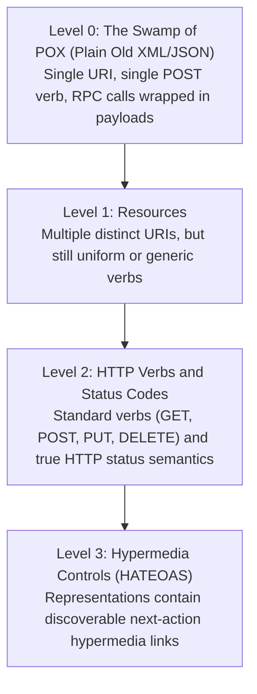
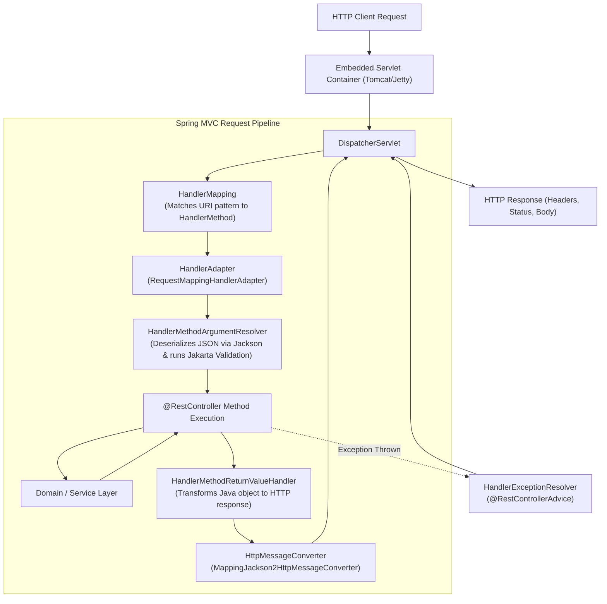

If you have ever had to integrate with an API that faithfully returned `HTTP 200 OK` with a response payload of `{"success": false, "error": "NullPointerException at line 348"}`, you already know the visceral frustration of poorly designed web services. 

REST (Representational State Transfer) is often misunderstood as merely "sending JSON over HTTP." In reality, REST is an architectural style designed by Roy Fielding to leverage the native strengths of the World Wide Web: uniform interfaces, stateless interactions, explicit caching, and standardized status codes.

In this guide, we will step behind the scenes of Spring Web MVC. We will trace the lifecycle of a request through the `DispatcherServlet`, enforce rock-solid boundary security with Java 21 records and Jakarta Validation, implement RFC 9457 Problem Details, and expose the subtle bugs that separate amateur endpoints from battle-tested production APIs.

---

## The Richardson Maturity Model

In 2008, Leonard Richardson proposed a model to break down how closely a web service aligns with the architectural constraints of REST. Understanding this model prevents religious arguments about what is "truly RESTful" and helps engineering teams make pragmatic design choices.



### Level 0: The Swamp of POX (Plain Old XML/JSON)
At Level 0, the API uses HTTP purely as a transport tunnel. All requests are sent to a single endpoint (for example, `/api/service`) using `POST`, and the operation name is hidden inside the body:

```json
POST /api/service
{"action": "cancelOrder", "orderId": "ORD-1234"}
```
This is essentially Remote Procedure Call (RPC) or SOAP masquerading as web services. Caching proxies cannot tell what is safe to cache, load balancers cannot route based on resource paths, and every error returns `200 OK`.

### Level 1: Resources
Level 1 introduces individual URIs for distinct resources. Instead of a single dumping ground, you address resources directly:
- `/orders/ORD-1234`
- `/customers/CUST-88`

However, Level 1 often still uses a single verb (such as `POST`) for all actions on those resources.

### Level 2: HTTP Verbs and Status Codes
Level 2 is the pragmatic sweet spot where 95% of high-scale enterprise systems operate. You leverage the standard HTTP method vocabulary and meaningful HTTP status codes:
- `GET /orders/ORD-1234` -> Retrieve order (safe, idempotent, returns `200 OK` or `404 Not Found`).
- `POST /orders` -> Create a new order (unsafe, non-idempotent, returns `201 Created` with a `Location` header).
- `PUT /orders/ORD-1234` -> Full replacement of order state (idempotent, returns `200 OK` or `204 No Content`).
- `PATCH /orders/ORD-1234` -> Partial update (returns `200 OK` or `204 No Content`).
- `DELETE /orders/ORD-1234` -> Delete order (idempotent, returns `204 No Content`).

### Level 3: Hypermedia Controls (HATEOAS)
Hypermedia As The Engine Of Application State (HATEOAS) requires the server response to contain self-descriptive links indicating what actions the client can take next based on the resource's current lifecycle state:

```json
{
  "id": "ORD-1234",
  "status": "AWAITING_PAYMENT",
  "total": 149.50,
  "_links": {
    "self": { "href": "https://api.store.com/orders/ORD-1234" },
    "cancel": { "href": "https://api.store.com/orders/ORD-1234/cancellation" },
    "payment": { "href": "https://api.store.com/orders/ORD-1234/payments" }
  }
}
```

> [!NOTE]
> **Why do most teams stop at Level 2?**  
> While HATEOAS sounds elegant on paper, building smart clients that dynamically parse link relations rather than relying on compiled TypeScript or OpenAPI contracts adds significant development friction. Most teams standardize on OpenAPI/Swagger contracts at Level 2, avoiding the operational overhead of Level 3 hypermedia parsing.

---

## Spring MVC Request Pipeline: Under the Hood

When an HTTP request arrives on port 8080, how does Spring Boot translate raw TCP bytes into an invocation of your Java controller method? The entire architecture hinges on the **Front Controller** pattern, implemented by `DispatcherServlet`.



### The Seven Steps of Request Processing
1. **DispatcherServlet Entry**: The servlet container routes the `HttpServletRequest` to `DispatcherServlet.doDispatch()`.
2. **HandlerMapping Lookup**: Spring queries a chain of `HandlerMapping` beans (primarily `RequestMappingHandlerAdapter`) to match the incoming HTTP method and URI path against the `@RequestMapping` metadata registered during startup.
3. **HandlerExecutionChain**: Spring retrieves not just the target controller method, but also all registered `HandlerInterceptor` instances configured for that path (pre-handle security checks, tracing span setup).
4. **Argument Resolution & Validation**: The `HandlerAdapter` iterates over the controller method parameters. For each parameter, it selects an appropriate `HandlerMethodArgumentResolver`:
   - `@PathVariable` uses `PathVariableMethodArgumentResolver`.
   - `@RequestParam` uses `RequestParamMethodArgumentResolver`.
   - `@RequestBody` triggers `RequestResponseBodyMethodProcessor`, which invokes `MappingJackson2HttpMessageConverter` to deserialize JSON into a Java DTO and fires `LocalValidatorFactoryBean` if `@Valid` is present.
5. **Controller Invocation**: Using reflection (or pre-compiled MethodHandles), the controller method is executed with the resolved arguments.
6. **Return Value Handling**: The returned object is handed to `HandlerMethodReturnValueHandler`. Because the controller is marked `@RestController` (or `@ResponseBody`), Spring bypasses View resolution and delegates straight to Jackson to serialize the object into the HTTP response body stream.
7. **Exception Resolution**: If an exception escapes the controller, the `DispatcherServlet` catches it and delegates to `HandlerExceptionResolverComposite`, triggering your `@RestControllerAdvice` methods.

---

## DTOs vs Entities: The Cardinal Rule of API Boundaries

One of the most dangerous anti-patterns in enterprise Java is returning JPA entities directly from `@RestController` methods:

```java
// ANTI-PATTERN: NEVER DO THIS IN PRODUCTION
@GetMapping("/users/{id}")
public User getUser(@PathVariable Long id) {
    return userRepository.findById(id).orElseThrow();
}
```

### Why Exposing Entities Kills Applications
1. **Mass Assignment Vulnerabilities**: If your entity has a `boolean isAdmin` field and you accept the entity as a `@RequestBody`, an attacker can send `{"isAdmin": true}` in their JSON registration payload. Jackson will eagerly bind it, promoting the attacker to an administrator.
2. **Infinite Recursion / StackOverflowError**: Bidirectional JPA relationships (`@OneToMany` / `@ManyToOne`) cause Jackson to serialize Parent -> Child -> Parent -> Child in an infinite loop until the JVM crashes with `StackOverflowError`.
3. **LazyInitializationException**: Outside an active Hibernate transaction, accessing an uninitialized lazy collection during JSON serialization throws a 500 error.
4. **Leaking Private Data**: Accidental exposure of password hashes, internal database IDs, audit columns, or soft-delete flags.
5. **Rigid Coupling**: Changing a database column name breaks your public API contract and ruins client backward compatibility.

### The Modern Java 21 Record DTO Pattern
Always define explicit, immutable records for incoming requests and outgoing responses:

```java
package com.example.ecommerce.api.dto;

import jakarta.validation.constraints.DecimalMin;
import jakarta.validation.constraints.NotBlank;
import jakarta.validation.constraints.NotEmpty;
import jakarta.validation.constraints.Positive;
import java.math.BigDecimal;
import java.time.Instant;
import java.util.List;
import java.util.UUID;

// Immutable incoming request contract
public record CreateOrderRequest(
    @NotBlank(message = "Customer ID is required")
    String customerId,

    @NotEmpty(message = "Order must contain at least one item")
    List<OrderItemRequest> items
) {
    public record OrderItemRequest(
        @NotBlank(message = "SKU is required")
        String sku,

        @Positive(message = "Quantity must be greater than zero")
        int quantity,

        @DecimalMin(value = "0.01", message = "Price must be positive")
        BigDecimal unitPrice
    ) {}
}
```

```java
package com.example.ecommerce.api.dto;

import java.math.BigDecimal;
import java.time.Instant;
import java.util.List;
import java.util.UUID;

// Immutable outgoing response contract
public record OrderResponse(
    UUID id,
    String customerId,
    String status,
    BigDecimal totalAmount,
    List<OrderItemResponse> items,
    Instant createdAt
) {
    public record OrderItemResponse(
        String sku,
        int quantity,
        BigDecimal unitPrice,
        BigDecimal subtotal
    ) {}
}
```

---

## Implementing the Controller

Let's look at a production-grade controller adhering to REST conventions:

```java
package com.example.ecommerce.api;

import com.example.ecommerce.api.dto.CreateOrderRequest;
import com.example.ecommerce.api.dto.OrderResponse;
import com.example.ecommerce.domain.OrderService;
import jakarta.validation.Valid;
import org.springframework.http.MediaType;
import org.springframework.http.ResponseEntity;
import org.springframework.web.bind.annotation.*;
import org.springframework.web.servlet.support.ServletUriComponentsBuilder;

import java.net.URI;
import java.util.UUID;

@RestController
@RequestMapping(path = "/api/v1/orders", produces = MediaType.APPLICATION_JSON_VALUE)
public class OrderController {

    private final OrderService orderService;

    public OrderController(OrderService orderService) {
        this.orderService = orderService;
    }

    @PostMapping(consumes = MediaType.APPLICATION_JSON_VALUE)
    public ResponseEntity<OrderResponse> createOrder(@Valid @RequestBody CreateOrderRequest request) {
        OrderResponse created = orderService.createOrder(request);

        // Build the Location URI: /api/v1/orders/{id}
        URI location = ServletUriComponentsBuilder.fromCurrentRequest()
                .path("/{id}")
                .buildAndExpand(created.id())
                .toUri();

        return ResponseEntity.created(location).body(created);
    }

    @GetMapping("/{id}")
    public ResponseEntity<OrderResponse> getOrder(@PathVariable UUID id) {
        OrderResponse order = orderService.getOrderById(id);
        return ResponseEntity.ok(order);
    }

    @DeleteMapping("/{id}")
    public ResponseEntity<Void> cancelOrder(@PathVariable UUID id) {
        orderService.cancelOrder(id);
        return ResponseEntity.noContent().build();
    }
}
```

### Essential REST Details Implemented Above
- **`201 Created` with `Location` Header**: When a new resource is created via `POST`, REST requires the server to return the direct URI where the client can retrieve that newly minted resource. `ServletUriComponentsBuilder.fromCurrentRequest()` inspects the current request URL (even behind reverse proxies when `ForwardedHeaderFilter` is enabled) and appends the newly generated ID.
- **`204 No Content` for Deletions**: A successful `DELETE` operation doesn't need to transmit an empty JSON object `{}`. Returning HTTP status `204 No Content` with an empty body saves network bandwidth and signals successful removal.

---

## Input Validation with Jakarta Validation API

Validation must happen right at the network perimeter before untrusted client data penetrates your application service layer.

### Built-in Jakarta Annotations Reference
| Annotation | Validates | Notes |
|---|---|---|
| `@NotNull` | Element is not `null` | Allows empty string `""` or whitespace `" "` |
| `@NotEmpty` | Not `null` and length/size > 0 | Applies to Strings, Collections, Arrays, Maps |
| `@NotBlank` | Not `null` and trimmed length > 0 | Strings only. Best for user-facing text fields |
| `@Positive` / `@PositiveOrZero` | Numeric value > 0 / >= 0 | For counts, quantities, monetary amounts |
| `@Min` / `@Max` | Numeric bounds check | Inclusive limits |
| `@Email` | Valid email address syntax | Regex-based RFC 5322 check |
| `@Pattern(regexp = "...")` | Matches specified regex | For zip codes, tax IDs, phone numbers |

### Building a Custom Constraint Validator
When standard annotations fall short (e.g., verifying a business-specific currency code), create a custom validator:

```java
package com.example.ecommerce.validation;

import jakarta.validation.Constraint;
import jakarta.validation.Payload;
import java.lang.annotation.*;

@Target({ElementType.FIELD, ElementType.PARAMETER})
@Retention(RetentionPolicy.RUNTIME)
@Constraint(validatedBy = CurrencyCodeValidator.class)
@Documented
public @interface ValidCurrency {
    String message() default "Invalid ISO 4217 currency code";
    Class<?>[] groups() default {};
    Class<? extends Payload>[] payload() default {};
}
```

```java
package com.example.ecommerce.validation;

import jakarta.validation.ConstraintValidator;
import jakarta.validation.ConstraintValidatorContext;
import java.util.Currency;
import java.util.Set;
import java.util.stream.Collectors;

public class CurrencyCodeValidator implements ConstraintValidator<ValidCurrency, String> {

    private static final Set<String> VALID_CURRENCIES = Currency.getAvailableCurrencies()
            .stream()
            .map(Currency::getCurrencyCode)
            .collect(Collectors.toUnmodifiableSet());

    @Override
    public boolean isValid(String value, ConstraintValidatorContext context) {
        if (value == null) {
            return true; // Let @NotBlank handle null checks if required
        }
        return VALID_CURRENCIES.contains(value.toUpperCase().trim());
    }
}
```

---

## Global Error Handling with RFC 9457 Problem Details

For years, every engineering team invented their own ad-hoc error JSON format. Spring Boot 3 standardized on **RFC 7807 / RFC 9457 Problem Details for HTTP APIs** (`application/problem+json`).

A standard Problem Detail payload contains:
- `type`: A URI reference identifying the error type (documentation link).
- `title`: A short, human-readable summary of the problem.
- `status`: The HTTP status code.
- `detail`: An occurrence-specific explanation safe for client consumption.
- `instance`: A URI identifying the specific request/occurrence.
- Custom extensions (e.g., validation field errors, timestamp, error code).

### Production Controller Advice Implementation

```java
package com.example.ecommerce.api;

import com.example.ecommerce.domain.OrderNotFoundException;
import org.springframework.http.HttpStatus;
import org.springframework.http.HttpStatusCode;
import org.springframework.http.ProblemDetail;
import org.springframework.http.ResponseEntity;
import org.springframework.validation.FieldError;
import org.springframework.web.bind.MethodArgumentNotValidException;
import org.springframework.web.bind.annotation.ExceptionHandler;
import org.springframework.web.bind.annotation.RestControllerAdvice;
import org.springframework.web.context.request.WebRequest;
import org.springframework.web.servlet.mvc.method.annotation.ResponseEntityExceptionHandler;

import java.net.URI;
import java.time.Instant;
import java.util.List;
import java.util.Map;

@RestControllerAdvice
public class GlobalExceptionHandler extends ResponseEntityExceptionHandler {

    // 1. Handle Domain Not Found Exceptions (404)
    @ExceptionHandler(OrderNotFoundException.class)
    public ProblemDetail handleOrderNotFound(OrderNotFoundException ex) {
        ProblemDetail problem = ProblemDetail.forStatusAndDetail(
                HttpStatus.NOT_FOUND, ex.getMessage());
        problem.setTitle("Order Not Found");
        problem.setType(URI.create("https://api.store.com/errors/order-not-found"));
        problem.setProperty("timestamp", Instant.now());
        problem.setProperty("errorCode", "ORDER_NOT_FOUND");
        return problem;
    }

    // 2. Override default Spring MVC validation handler to supply detailed field errors (400)
    @Override
    protected ResponseEntity<Object> handleMethodArgumentNotValid(
            MethodArgumentNotValidException ex,
            org.springframework.http.HttpHeaders headers,
            HttpStatusCode status,
            WebRequest request) {

        ProblemDetail problem = ProblemDetail.forStatusAndDetail(
                HttpStatus.BAD_REQUEST, "One or more request parameters failed validation.");
        problem.setTitle("Validation Failure");
        problem.setType(URI.create("https://api.store.com/errors/validation-error"));
        problem.setProperty("timestamp", Instant.now());

        // Extract human-friendly field-level error messages
        List<Map<String, String>> fieldErrors = ex.getBindingResult().getFieldErrors().stream()
                .map(error -> Map.of(
                        "field", error.getField(),
                        "rejectedValue", String.valueOf(error.getRejectedValue()),
                        "message", error.getDefaultMessage() != null ? error.getDefaultMessage() : "Invalid value"
                ))
                .toList();

        problem.setProperty("invalidParams", fieldErrors);

        return ResponseEntity.status(status).body(problem);
    }

    // 3. Catch-all for unexpected internal exceptions (500)
    @ExceptionHandler(Exception.class)
    public ProblemDetail handleGeneralException(Exception ex) {
        // Log the full stack trace internally! Never expose it to the external caller.
        logger.error("Unhandled server exception encountered", ex);

        ProblemDetail problem = ProblemDetail.forStatusAndDetail(
                HttpStatus.INTERNAL_SERVER_ERROR,
                "An unexpected internal error occurred. Please contact customer support.");
        problem.setTitle("Internal Server Error");
        problem.setType(URI.create("https://api.store.com/errors/internal-error"));
        problem.setProperty("timestamp", Instant.now());
        return problem;
    }
}
```

### What the Client Receives on Invalid Input
When a client sends an empty customer ID and negative quantity, Spring MVC produces this standard JSON:

```json
{
  "type": "https://api.store.com/errors/validation-error",
  "title": "Validation Failure",
  "status": 400,
  "detail": "One or more request parameters failed validation.",
  "timestamp": "2026-10-29T10:15:30.123Z",
  "invalidParams": [
    {
      "field": "customerId",
      "rejectedValue": "",
      "message": "Customer ID is required"
    },
    {
      "field": "items[0].quantity",
      "rejectedValue": "-5",
      "message": "Quantity must be greater than zero"
    }
  ]
}
```

---

## Architectural Traps and Real-World Outages

### The "HTTP 200 False Positive" Monitoring Blindspot
A high-volume fintech platform designed all their microservices to catch every exception and return `200 OK` with `{ "success": false, "code": "DB_UNAVAILABLE" }`. 
When their database cluster lost quorum during an AWS availability zone outage, their monitoring alarms (Datadog/Prometheus) looked completely green because the HTTP 5xx error rate was exactly 0.00%. Thousands of credit card payments failed silently for two hours while on-call engineers slept, because their alerting relied on standard HTTP status codes.

### The "Over-Posting" Data Corruption Bug
A developer exposed a `UserProfile` JPA entity directly in a `@PutMapping("/profile")`. An end user sent this JSON in a curl command:

```json
{
  "bio": "Software Engineer",
  "accountBalance": 1000000.00,
  "role": "SYSTEM_ADMIN"
}
```
Because the entity had setters for all fields and Jackson mapped everything dynamically, the user successfully credited their account with USD 1,000,000 and escalated their privileges. Always use explicit DTO records to whitelist precisely what the client is permitted to mutate.

---

## Senior Interview Questions

### Question 1: What is the semantic difference between `PUT` and `PATCH`, and how do you handle partial null updates in Spring Boot?
**Answer:**  
`PUT` represents a complete resource replacement and is strictly idempotent: sending the exact same `PUT` request ten times results in the identical server state as sending it once. Any fields omitted in a `PUT` payload should conceptually be reset to their default values or cleared.

`PATCH` (RFC 5789) represents a partial modification and is not guaranteed to be idempotent. Handling `PATCH` in Spring Boot has a subtle trap: how do you distinguish between a client sending `"nickname": null` (meaning "please clear my nickname") versus omitting `"nickname"` altogether (meaning "do not touch my current nickname")? Standard Java POJOs deserialize both scenarios to `null`. 

To solve this, senior engineers use `JsonNullable<T>` from the OpenAPITools Jackson module or accept `Map<String, Object>`/RFC 6902 JSON Patch structures, allowing the application to detect whether a key was explicitly present in the incoming JSON token stream.

### Question 2: How does `DispatcherServlet` find the appropriate controller method for an incoming request?
**Answer:**  
During application startup, `RequestMappingHandlerMapping` scans all Spring beans marked with `@Controller` or `@RestController`. It reflects over their methods looking for `@RequestMapping` (and composed variants like `@GetMapping`). For each method, it creates a `RequestMappingInfo` object representing the path patterns, HTTP methods, parameters, headers, and media types (`consumes`/`produces`).

When a request arrives, `DispatcherServlet` queries `getHandler(request)` on its registered `HandlerMapping` beans. The `RequestMappingHandlerMapping` searches its internal lookup registry. If multiple mappings match (e.g., `/orders/{id}` vs `/orders/special`), it uses a Comparator to evaluate specificity, selects the best match, and packages it into a `HandlerExecutionChain` along with any matching interceptors.

### Question 3: Why should `@RestControllerAdvice` extend `ResponseEntityExceptionHandler` instead of creating standalone `@ExceptionHandler` methods for everything?
**Answer:**  
Spring MVC can throw dozens of internal standard exceptions before your controller code ever executes: `HttpRequestMethodNotSupportedException` (405), `HttpMediaTypeNotSupportedException` (415), `MethodArgumentNotValidException` (400), `MissingServletRequestParameterException` (400), and `NoHandlerFoundException` (404).

`ResponseEntityExceptionHandler` provides base implementations for all standard Spring MVC exceptions, setting the proper HTTP status codes, headers, and RFC 9457 `ProblemDetail` structures. If you don't extend it and only write custom handlers, any unhandled framework exception either falls back to a raw servlet 500 error or must be manually reimplemented by your team. Extending it gives you comprehensive framework error coverage while allowing you to override only the specific methods you want to customize.

### Question 4: How does Spring MVC support content negotiation, and what happens if a client requests an unsupported media type?
**Answer:**  
Spring MVC uses a `ContentNegotiationManager` to determine the requested media type, primarily by inspecting the HTTP `Accept` header (or alternatively query parameters or file extensions if explicitly enabled). 

When the controller returns an object, Spring inspects the available `HttpMessageConverter` beans registered in the context (such as `MappingJackson2HttpMessageConverter` for JSON, `Jaxb2RootElementHttpMessageConverter` for XML). It matches the converters against the negotiated media type. If a client sends `Accept: application/xml` but the server only has JSON converters configured, Spring throws an `HttpMediaTypeNotAcceptableException`, which translates into an `HTTP 406 Not Acceptable` response status.
