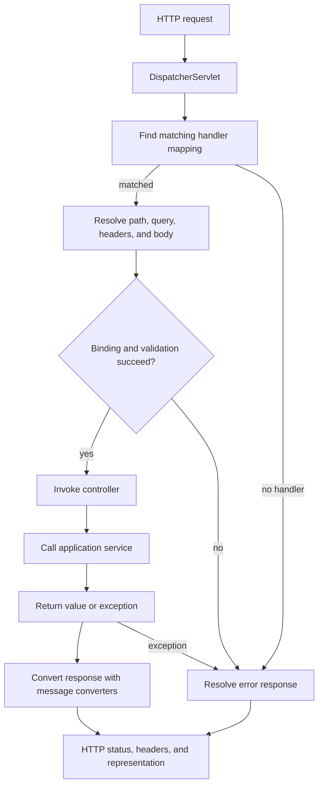

A web API is a contract between clients and a server. A good REST-style API makes that contract visible in resource names, HTTP methods, status codes, representations, and links, rather than hiding every action behind a custom remote procedure call. Spring MVC handles the HTTP boundary; your application services and domain model should still own business rules.

This lesson uses Java 21 examples with Spring Framework 7.0.10 and Spring Boot 4.1.2 documentation. The repository does not include Spring dependencies, so examples are instructional and are not compiled as part of this site.

## Resources, representations, and HTTP

A **resource** is something the API lets clients identify and interact with, such as an order or invoice. A URI identifies the resource; a **representation** such as JSON carries a current view of its state. Keep URI paths noun-oriented and let HTTP methods express the operation:

| Request | Typical meaning | Common successful response |
|---|---|---|
| `GET /orders/42` | Retrieve an order representation. | `200 OK` with the representation, or `404 Not Found`. |
| `POST /orders` | Create an order from submitted input. | `201 Created`, usually with a `Location` header. |
| `PUT /orders/42` | Replace the resource's state with the supplied representation. | `200 OK` with a representation, or `204 No Content`. |
| `PATCH /orders/42` | Apply a defined partial update. | `200 OK` or `204 No Content`. |
| `DELETE /orders/42` | Remove the resource. | `204 No Content`, or an appropriate not-found result. |

These are conventions, not a substitute for an explicit contract. `PUT` is defined as idempotent: repeating the same request has the same intended effect as making it once. `POST` is not generally idempotent. A `PATCH` format must define how omitted, null, and supplied fields behave; do not treat every JSON merge as self-explanatory.

Choose status codes based on the outcome: `400` for malformed or invalid client input, `401` for missing or invalid authentication, `403` for an authenticated caller who lacks permission, `404` when the target resource is not available, `409` for a state conflict, and `500` for an unexpected server failure. Do not return `200 OK` for every outcome and force clients to parse an application-specific error flag.

## Richardson Maturity Model

The Richardson Maturity Model is a way to discuss how much of REST's style an API uses. It is a heuristic, not a conformance test or a binary definition of whether an API is “RESTful”:

| Level | Main idea |
|---|---|
| 0 | One endpoint and a small set of HTTP behaviors act like a remote procedure call. |
| 1 | Requests identify multiple resources with distinct URIs. |
| 2 | HTTP methods and status codes express the semantics of operations. |
| 3 | Representations include hypermedia controls that help clients discover available next actions. |

Many production APIs deliberately stop at Level 2 and publish their contract through documentation or an API schema. Level 3 adds discoverability, but it also requires a consistent link/action format and clients that know how to use it. Pick the level that serves the clients and operational requirements; do not add decorative links and claim they provide meaningful hypermedia.

## Spring MVC request flow

Spring MVC uses the **front controller** pattern. The servlet container passes an HTTP request to `DispatcherServlet`, which coordinates handler mapping, argument resolution, invocation, response conversion, and exception resolution. The controller does not manually parse the socket or JSON:



In a Spring Boot servlet application, Boot configures the servlet infrastructure and registers `DispatcherServlet`. `@RestController` marks a controller whose handler results are written to the response body. `@RequestMapping` and its composed forms such as `@GetMapping` select requests by path, HTTP method, headers, and media type. `@PathVariable` binds URI template values; `@RequestBody` asks an HTTP message converter to deserialize the body.

## Define a resource contract with DTOs

Use request and response data-transfer objects (DTOs) as the external API boundary. Do not expose a persistence entity directly: entity fields and relationships are internal implementation details, and serialization can accidentally reveal data or traverse lazy relationships.

```java
package com.example.orders.api;

import jakarta.validation.constraints.NotBlank;
import jakarta.validation.constraints.Positive;

public record CreateOrderRequest(
        @NotBlank String customerId,
        @Positive int quantity) {
}

public record OrderResponse(
        String id,
        String customerId,
        int quantity,
        String status) {
}
```

With the required Jakarta Validation provider on the runtime classpath, `@Valid` on a request-body parameter causes its constraints to be checked after JSON binding. The controller delegates business work to an application service and selects HTTP-level behavior:

```java
package com.example.orders.api;

import java.net.URI;

import jakarta.validation.Valid;
import org.springframework.http.ResponseEntity;
import org.springframework.web.bind.annotation.GetMapping;
import org.springframework.web.bind.annotation.PathVariable;
import org.springframework.web.bind.annotation.PostMapping;
import org.springframework.web.bind.annotation.RequestBody;
import org.springframework.web.bind.annotation.RequestMapping;
import org.springframework.web.bind.annotation.RestController;
import org.springframework.web.servlet.support.ServletUriComponentsBuilder;

@RestController
@RequestMapping(path = "/orders", produces = "application/json")
class OrderController {
    private final OrderService orders;

    OrderController(OrderService orders) {
        this.orders = orders;
    }

    @PostMapping(consumes = "application/json")
    ResponseEntity<OrderResponse> create(
            @Valid @RequestBody CreateOrderRequest request) {
        OrderResponse created = orders.create(request);
        URI location = ServletUriComponentsBuilder.fromCurrentRequest()
                .path("/{id}")
                .buildAndExpand(created.id())
                .toUri();
        return ResponseEntity.created(location).body(created);
    }

    @GetMapping("/{id}")
    ResponseEntity<OrderResponse> find(@PathVariable String id) {
        return ResponseEntity.ok(orders.findById(id));
    }
}
```

`OrderService` is an application-layer interface supplied by the example application; its implementation validates business rules and loads/saves data. A missing order should be represented by a domain-specific not-found exception, not silently mapped to an empty success response. The example uses explicit `consumes` and `produces` constraints so unsupported request media types and unacceptable response media types can be reported by the framework.

`ResponseEntity` is useful when the handler must choose status or headers, as the create method does. For a simple successful read, returning `OrderResponse` directly is also valid; the framework writes it through a configured message converter. Return DTOs, not an ORM entity whose lazy fields or internal fields may change independently of the public contract.

## Validate at the HTTP boundary

Transport validation rejects structurally invalid input before it becomes application state. Constraints such as `@NotBlank` and `@Positive` describe local input invariants. Cross-field rules and business invariants, such as whether a customer is allowed to place an order, belong in the application/domain layer because they may depend on current state.

With `@Valid @RequestBody`, Spring MVC applies Bean Validation and reports invalid object input as a `400 Bad Request` by default. In Spring Framework 7, method validation can also apply when constraints are placed directly on controller method parameters or return values; in that case, Spring can raise `HandlerMethodValidationException` rather than `MethodArgumentNotValidException`. If the application customizes validation errors, account for both paths. A `BindingResult` or `Errors` parameter immediately following a validated object allows a controller to inspect errors locally; without that arrangement, the exception handling path is used.

Validation is not authorization and is not a reason to trust client-supplied identity, ownership, price, or status fields. Bind only fields the client is allowed to set, derive protected values on the server, and enforce permission checks separately.

## Consistent errors with Problem Details

RFC 9457 **Problem Details for HTTP APIs** defines a standard representation for explaining an HTTP error. Spring MVC supports `ProblemDetail`, `ErrorResponse`, and `ResponseEntityExceptionHandler` for this purpose. Problem Details fields include:

- `type`: a URI identifying the problem type (defaults to `about:blank` when not specified).
- `title`: a short summary of the problem type.
- `status`: the HTTP status associated with the response.
- `detail`: an occurrence-specific explanation safe for the API client.
- `instance`: a URI identifying this particular occurrence.

Applications can add extension properties for stable, documented error details. Avoid exposing stack traces, SQL, internal hostnames, tokens, or exception messages that contain private implementation data. Clients should branch on status and stable problem type/code, not parse human-oriented `detail` prose.

For an application-level not-found condition, a global advice can translate a specific exception without leaking internal details:

```java
package com.example.orders.api;

import java.net.URI;

import org.springframework.http.HttpStatus;
import org.springframework.http.ProblemDetail;
import org.springframework.web.bind.annotation.ExceptionHandler;
import org.springframework.web.bind.annotation.RestControllerAdvice;

@RestControllerAdvice
class ApiExceptionHandler {
    @ExceptionHandler(OrderNotFoundException.class)
    ProblemDetail handleOrderNotFound(OrderNotFoundException exception) {
        ProblemDetail problem = ProblemDetail.forStatusAndDetail(
                HttpStatus.NOT_FOUND, "The requested order does not exist.");
        problem.setType(URI.create("https://api.example.com/problems/order-not-found"));
        problem.setTitle("Order not found");
        problem.setProperty("code", "ORDER_NOT_FOUND");
        return problem;
    }
}
```

`OrderNotFoundException` is an application-defined exception, and imports for the application service/DTO types are omitted in the snippets. `@RestControllerAdvice` applies exception handling across controllers. Spring's built-in MVC exception support already handles many framework errors; if you need a uniform custom error shape for validation and binding failures as well, extend `ResponseEntityExceptionHandler` or add carefully scoped handlers for the framework's validation exceptions. Do not replace every exception with a generic `500` handler that erases meaningful status codes.

## Common design and debugging traps

- **Verb encoded in the URI:** Prefer resource paths such as `/orders/42` with an HTTP method that describes the operation.
- **Wrong update semantics:** Define whether `PUT` replaces and what `PATCH` means; a partial update is not automatically equivalent to deserializing a nullable DTO.
- **Entity returned as JSON:** Use DTOs to avoid exposing persistence internals, sensitive columns, or lazy-loading behavior.
- **Invalid input reaches business logic:** Check JSON deserialization, Bean Validation provider availability, `@Valid`, and controller method validation.
- **Every failure becomes `200`:** Map outcomes to HTTP status codes and a consistent error representation.
- **Error body leaks details:** Return safe client-facing descriptions and stable codes; log diagnostic detail on the server with appropriate redaction.
- **Advice does not handle an error:** Confirm the exception type thrown, controller/advice package scanning, and whether a more specific handler or framework resolver applies.
- **Resource creation has no location:** Return `201 Created` with a `Location` URI when the API creates a separately addressable resource.
- **Wrong handler or media type:** Verify route templates, HTTP method, `Content-Type`, `Accept`, and the `consumes`/`produces` declarations.

## Further reading

- Spring Framework 7.0.10, [DispatcherServlet](https://docs.spring.io/spring-framework/reference/web/webmvc/mvc-servlet.html)
- Spring Framework 7.0.10, [Mapping Requests](https://docs.spring.io/spring-framework/reference/web/webmvc/mvc-controller/ann-requestmapping.html)
- Spring Framework 7.0.10, [`@RequestBody`](https://docs.spring.io/spring-framework/reference/web/webmvc/mvc-controller/ann-methods/requestbody.html)
- Spring Framework 7.0.10, [Validation](https://docs.spring.io/spring-framework/reference/web/webmvc/mvc-controller/ann-validation.html)
- Spring Framework 7.0.10, [Exception Handling](https://docs.spring.io/spring-framework/reference/web/webmvc/mvc-controller/ann-exceptionhandler.html)
- Spring Framework 7.0.10, [REST API Error Responses](https://docs.spring.io/spring-framework/reference/web/webmvc/mvc-ann-rest-exceptions.html)
- IETF, [RFC 9457: Problem Details for HTTP APIs](https://www.rfc-editor.org/rfc/rfc9457)
- [Aspect-Oriented Programming (AOP)](./aspect-oriented-programming-aop)
