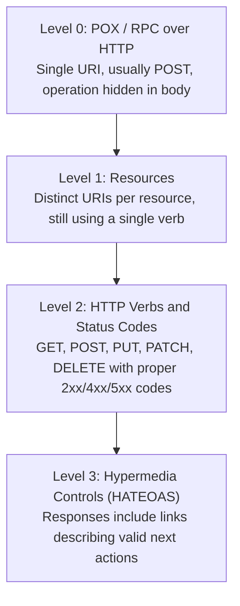
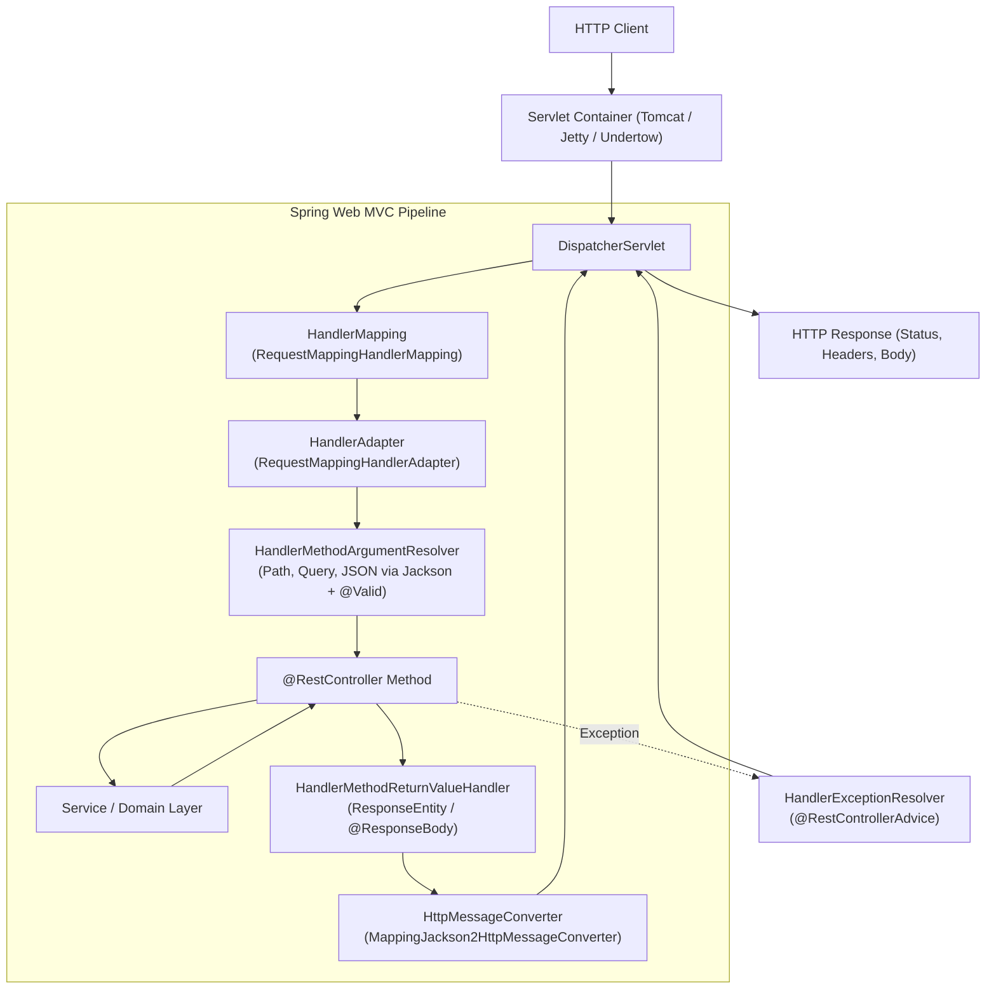

Anyone who has integrated with a service that returns `HTTP 200 OK` along with `{"success": false, "error": "NullPointerException at OrderService.java:142"}` has seen what happens when HTTP is treated as a dumb pipe for JSON. Monitoring dashboards stay green during outages, caches store error payloads as valid responses, and clients have to parse fragile ad-hoc strings just to figure out whether a call succeeded.

REST (Representational State Transfer) uses the semantics HTTP already provides: resource URIs, standard methods, meaningful status codes, content negotiation, and structured error payloads. Understanding how Spring Web MVC maps incoming HTTP requests onto Java controller methods, and where validation, serialization, and exception handling plug into that pipeline, lets you build APIs that are predictable for both clients and operations teams.

---

## The Richardson Maturity Model

Leonard Richardson's maturity model groups HTTP APIs into four levels based on how much of HTTP's native design they actually use. It is a useful vocabulary for design reviews without turning every conversation into an argument over purity.



### Level 0: Plain Old XML/JSON (RPC Tunneling)
All operations hit a single endpoint (such as `POST /api/service`) with the action buried in the payload:

```json
POST /api/service
{"action": "cancelOrder", "orderId": "ORD-1234"}
```

HTTP caches cannot tell reads from writes, API gateways cannot apply per-resource rate limits cleanly, and failures often come back as `200 OK`.

### Level 1: Resources
Each entity or collection gets its own URI (`/orders/ORD-1234`, `/customers/CUST-88`), though requests may still use `POST` for everything.

### Level 2: HTTP Verbs and Status Codes
Level 2 is where most production REST APIs land. Methods communicate safety and idempotency, and status codes communicate outcomes:
- `GET /api/v1/orders/ORD-1234`: Read a resource (safe, idempotent; `200 OK` or `404 Not Found`).
- `POST /api/v1/orders`: Create a new resource (non-idempotent; `201 Created` with a `Location` header).
- `PUT /api/v1/orders/ORD-1234`: Replace the entire resource state (idempotent; `200 OK` or `204 No Content`).
- `PATCH /api/v1/orders/ORD-1234`: Apply a partial update (`200 OK` or `204 No Content`).
- `DELETE /api/v1/orders/ORD-1234`: Remove the resource (idempotent; `204 No Content`).

### Level 3: Hypermedia Controls (HATEOAS)
With HATEOAS (Hypermedia As The Engine Of Application State), responses include links telling the client which state transitions are currently allowed:

```json
{
  "id": "ORD-1234",
  "status": "AWAITING_PAYMENT",
  "total": 149.50,
  "_links": {
    "self": { "href": "https://api.store.com/api/v1/orders/ORD-1234" },
    "cancel": { "href": "https://api.store.com/api/v1/orders/ORD-1234/cancellation" },
    "payment": { "href": "https://api.store.com/api/v1/orders/ORD-1234/payments" }
  }
}
```

> [!NOTE]
> Most teams intentionally stop at **Level 2** paired with an **OpenAPI 3.1** specification. Generating strongly typed clients from OpenAPI contracts is simpler for mobile and web teams than writing dynamic hypermedia link-following clients, so HATEOAS is typically reserved for public APIs with complex, evolving workflows.

---

## Spring Web MVC Architecture and `DispatcherServlet`

Spring Web MVC uses the **Front Controller** pattern. Every incoming HTTP request from the servlet container (Tomcat, Jetty, or Undertow) passes through a single central servlet: `DispatcherServlet`.



### Tracing a Request Step by Step

1. **Entry (`DispatcherServlet.doDispatch`)**: The servlet container hands the `HttpServletRequest` and `HttpServletResponse` to `DispatcherServlet`.
2. **Handler Lookup (`HandlerMapping`)**: `DispatcherServlet` queries its registered `HandlerMapping` beans, primarily **`RequestMappingHandlerMapping`**, to match the HTTP method, URI path, headers, and media types against `@RequestMapping` metadata indexed at startup.
3. **`HandlerExecutionChain`**: The lookup returns a `HandlerExecutionChain` containing the matched `HandlerMethod` (your controller method) along with any matching `HandlerInterceptor` instances.
4. **Adapter Selection (`HandlerAdapter`)**: `DispatcherServlet` finds the `HandlerAdapter` capable of invoking that handler. For annotated controllers, this is **`RequestMappingHandlerAdapter`**.
5. **Argument Resolution & Validation**: `RequestMappingHandlerAdapter` delegates each method parameter to a matching `HandlerMethodArgumentResolver`:
   - `@PathVariable` is handled by `PathVariableMethodArgumentResolver`.
   - `@RequestParam` is handled by `RequestParamMethodArgumentResolver`.
   - `@RequestBody` is handled by `RequestResponseBodyMethodProcessor`, which uses an `HttpMessageConverter` (typically `MappingJackson2HttpMessageConverter`) to deserialize JSON and invokes Jakarta Validation if `@Valid` or `@Validated` is present.
6. **Invocation and Return Value Handling**: The controller method runs. Because `@RestController` combines `@Controller` and `@ResponseBody`, `HandlerMethodReturnValueHandler` skips HTML view resolution and writes the return value through `HttpMessageConverter` directly to the HTTP response body.
7. **Exception Resolution**: If validation fails or an exception escapes the controller, `DispatcherServlet` catches it and delegates to `HandlerExceptionResolverComposite`, which routes it to your `@RestControllerAdvice` handlers.

---

## Separating API Contracts from JPA Entities

Returning or accepting JPA `@Entity` classes directly in controller methods is a frequent source of security and stability bugs:

```java
// Avoid: directly exposing a JPA entity at the HTTP boundary
@GetMapping("/users/{id}")
public User getUser(@PathVariable Long id) {
    return userRepository.findById(id).orElseThrow();
}
```

Exposing entities causes five concrete problems:
- **Mass assignment (over-posting)**: If `User` has a `role` or `accountBalance` field with a setter and you accept `User` as `@RequestBody`, a client can send `"role": "ADMIN"` and Jackson will bind it.
- **Serialization loops**: Bidirectional `@OneToMany` / `@ManyToOne` associations cause Jackson to recurse until the JVM throws `StackOverflowError`.
- **`LazyInitializationException`**: If Open-Session-in-View is disabled (as it should be in high-throughput APIs), serializing an uninitialized lazy collection outside a transaction throws a 500 error.
- **Accidental data leakage**: Internal columns such as password hashes, soft-delete flags, or internal audit fields can slip into responses after a schema change.
- **Tight schema coupling**: Renaming a database column or refactoring an entity breaks external API consumers.

### Immutable Record DTOs

Java records give you concise, immutable request and response contracts that explicitly allowlist what enters and leaves your service:

```java
package com.example.ecommerce.api.dto;

import jakarta.validation.Valid;
import jakarta.validation.constraints.DecimalMin;
import jakarta.validation.constraints.NotBlank;
import jakarta.validation.constraints.NotEmpty;
import jakarta.validation.constraints.Positive;

import java.math.BigDecimal;
import java.util.List;

public record CreateOrderRequest(
    @NotBlank(message = "Customer ID is required")
    String customerId,

    // @Valid on the list element cascades validation into each OrderItemRequest
    @NotEmpty(message = "Order must contain at least one item")
    List<@Valid OrderItemRequest> items
) {
    public record OrderItemRequest(
        @NotBlank(message = "SKU is required")
        String sku,

        @Positive(message = "Quantity must be greater than zero")
        int quantity,

        @DecimalMin(value = "0.01", message = "Unit price must be positive")
        BigDecimal unitPrice
    ) {}
}
```

```java
package com.example.ecommerce.api.dto;

import java.math.BigDecimal;
import java.time.Instant;
import java.util.List;
import java.util.UUID;

public record OrderResponse(
    UUID id,
    String customerId,
    String status,
    BigDecimal totalAmount,
    List<OrderItemResponse> items,
    Instant createdAt
) {
    public record OrderItemResponse(
        String sku,
        int quantity,
        BigDecimal unitPrice,
        BigDecimal subtotal
    ) {}
}
```

---

## Writing REST Controllers with Spring MVC

A clean controller stays thin: it maps HTTP inputs (`@PathVariable`, `@RequestParam`, `@RequestBody`), triggers validation with `@Valid`, delegates to a service, and builds an HTTP response with accurate status codes and headers.

```java
package com.example.ecommerce.api;

import com.example.ecommerce.api.dto.CreateOrderRequest;
import com.example.ecommerce.api.dto.OrderResponse;
import com.example.ecommerce.domain.OrderService;
import com.example.ecommerce.domain.OrderStatus;
import jakarta.validation.Valid;
import org.springframework.http.MediaType;
import org.springframework.http.ResponseEntity;
import org.springframework.web.bind.annotation.DeleteMapping;
import org.springframework.web.bind.annotation.GetMapping;
import org.springframework.web.bind.annotation.PathVariable;
import org.springframework.web.bind.annotation.PostMapping;
import org.springframework.web.bind.annotation.RequestBody;
import org.springframework.web.bind.annotation.RequestMapping;
import org.springframework.web.bind.annotation.RequestParam;
import org.springframework.web.bind.annotation.RestController;
import org.springframework.web.servlet.support.ServletUriComponentsBuilder;

import java.net.URI;
import java.util.List;
import java.util.UUID;

@RestController
@RequestMapping(path = "/api/v1/orders", produces = MediaType.APPLICATION_JSON_VALUE)
public class OrderController {

    private final OrderService orderService;

    public OrderController(OrderService orderService) {
        this.orderService = orderService;
    }

    @PostMapping(consumes = MediaType.APPLICATION_JSON_VALUE)
    public ResponseEntity<OrderResponse> createOrder(@Valid @RequestBody CreateOrderRequest request) {
        OrderResponse created = orderService.createOrder(request);

        URI location = ServletUriComponentsBuilder.fromCurrentRequest()
                .path("/{id}")
                .buildAndExpand(created.id())
                .toUri();

        return ResponseEntity.created(location).body(created);
    }

    @GetMapping("/{id}")
    public ResponseEntity<OrderResponse> getOrder(@PathVariable UUID id) {
        return ResponseEntity.ok(orderService.getOrderById(id));
    }

    @GetMapping
    public ResponseEntity<List<OrderResponse>> listOrders(
            @RequestParam(required = false) OrderStatus status) {
        return ResponseEntity.ok(orderService.listOrders(status));
    }

    @DeleteMapping("/{id}")
    public ResponseEntity<Void> cancelOrder(@PathVariable UUID id) {
        orderService.cancelOrder(id);
        return ResponseEntity.noContent().build();
    }
}
```

Two details here matter in real systems:
- **`201 Created` + `Location` header**: `ServletUriComponentsBuilder.fromCurrentRequest()` builds the canonical URL of the newly created resource (and respects `X-Forwarded-*` headers when `server.forward-headers-strategy=framework` is configured behind a reverse proxy).
- **`204 No Content` on delete**: Signals successful removal without sending an unnecessary empty body.

---

## Input Validation with Jakarta Validation

With `spring-boot-starter-validation` on the classpath, Spring integrates Hibernate Validator (the Jakarta Validation reference implementation) directly into request binding.

### Common Built-In Constraints

| Annotation | Behavior | Notes |
| :--- | :--- | :--- |
| `@NotNull` | Value is not `null` | Allows empty `""` or whitespace `"   "` |
| `@NotEmpty` | Not `null` and size/length > 0 | Works on `String`, `Collection`, `Map`, and arrays |
| `@NotBlank` | Not `null` and trimmed length > 0 | `String` only; best default for required text fields |
| `@Positive` / `@PositiveOrZero` | Numeric value > 0 or >= 0 | Good for quantities and counts |
| `@DecimalMin` / `@DecimalMax` | Exact decimal bounds | Preferred for `BigDecimal` monetary fields |
| `@Email` | Email syntax check | Format check only; does not verify deliverability |
| `@Pattern(regexp = "...")` | Regular expression match | Useful for SKUs, postal codes, or identifiers |
| `@Valid` | Cascades validation into nested objects/elements | Required on nested DTO fields and `List<@Valid T>` |

### Writing a Custom Constraint Validator

When built-in constraints are not enough (such as validating an ISO 4217 currency code), pair a custom `@Constraint` annotation with a `ConstraintValidator`:

```java
package com.example.ecommerce.validation;

import jakarta.validation.Constraint;
import jakarta.validation.Payload;
import java.lang.annotation.Documented;
import java.lang.annotation.ElementType;
import java.lang.annotation.Retention;
import java.lang.annotation.RetentionPolicy;
import java.lang.annotation.Target;

@Target({ElementType.FIELD, ElementType.PARAMETER, ElementType.TYPE_USE})
@Retention(RetentionPolicy.RUNTIME)
@Constraint(validatedBy = CurrencyCodeValidator.class)
@Documented
public @interface ValidCurrency {
    String message() default "Invalid ISO 4217 currency code";
    Class<?>[] groups() default {};
    Class<? extends Payload>[] payload() default {};
}
```

```java
package com.example.ecommerce.validation;

import jakarta.validation.ConstraintValidator;
import jakarta.validation.ConstraintValidatorContext;
import java.util.Currency;
import java.util.Set;
import java.util.stream.Collectors;

public class CurrencyCodeValidator implements ConstraintValidator<ValidCurrency, String> {

    private static final Set<String> VALID_CURRENCIES = Currency.getAvailableCurrencies()
            .stream()
            .map(Currency::getCurrencyCode)
            .collect(Collectors.toUnmodifiableSet());

    @Override
    public boolean isValid(String value, ConstraintValidatorContext context) {
        if (value == null) {
            // Convention: let @NotNull / @NotBlank handle nullability independently
            return true;
        }
        return VALID_CURRENCIES.contains(value.trim().toUpperCase());
    }
}
```

Returning `true` when `value == null` follows the Jakarta Validation convention so the constraint composes cleanly with optional fields (and pairs with `@NotBlank` when required).

---

## Global Exception Handling with `@RestControllerAdvice` and `ProblemDetail`

Instead of inventing a custom error envelope for every microservice, Spring Framework 6 and Spring Boot 3 provide first-class support for **RFC 9457 Problem Details for HTTP APIs** (which obsoleted RFC 7807) via `org.springframework.http.ProblemDetail` and the `application/problem+json` media type.

Enable RFC 9457 formatting for built-in Spring MVC exceptions in `application.properties`:

```properties
spring.mvc.problemdetails.enabled=true
```

Then centralize domain and validation error handling in a `@RestControllerAdvice` class extending `ResponseEntityExceptionHandler`:

```java
package com.example.ecommerce.api;

import com.example.ecommerce.domain.OrderNotFoundException;
import org.slf4j.Logger;
import org.slf4j.LoggerFactory;
import org.springframework.http.HttpHeaders;
import org.springframework.http.HttpStatus;
import org.springframework.http.HttpStatusCode;
import org.springframework.http.ProblemDetail;
import org.springframework.http.ResponseEntity;
import org.springframework.web.bind.MethodArgumentNotValidException;
import org.springframework.web.bind.annotation.ExceptionHandler;
import org.springframework.web.bind.annotation.RestControllerAdvice;
import org.springframework.web.context.request.WebRequest;
import org.springframework.web.servlet.mvc.method.annotation.ResponseEntityExceptionHandler;

import java.net.URI;
import java.time.Instant;
import java.util.List;
import java.util.Map;

@RestControllerAdvice
public class GlobalExceptionHandler extends ResponseEntityExceptionHandler {

    private static final Logger log = LoggerFactory.getLogger(GlobalExceptionHandler.class);

    @ExceptionHandler(OrderNotFoundException.class)
    public ProblemDetail handleOrderNotFound(OrderNotFoundException ex) {
        ProblemDetail problem = ProblemDetail.forStatusAndDetail(HttpStatus.NOT_FOUND, ex.getMessage());
        problem.setTitle("Order Not Found");
        problem.setType(URI.create("https://api.store.com/errors/order-not-found"));
        problem.setProperty("timestamp", Instant.now());
        problem.setProperty("errorCode", "ORDER_NOT_FOUND");
        return problem;
    }

    @Override
    protected ResponseEntity<Object> handleMethodArgumentNotValid(
            MethodArgumentNotValidException ex,
            HttpHeaders headers,
            HttpStatusCode status,
            WebRequest request) {

        ProblemDetail problem = ProblemDetail.forStatusAndDetail(
                HttpStatus.BAD_REQUEST,
                "One or more request fields failed validation."
        );
        problem.setTitle("Validation Failure");
        problem.setType(URI.create("https://api.store.com/errors/validation-error"));
        problem.setProperty("timestamp", Instant.now());

        List<Map<String, String>> invalidParams = ex.getBindingResult().getFieldErrors().stream()
                .map(error -> Map.of(
                        "field", error.getField(),
                        "rejectedValue", String.valueOf(error.getRejectedValue()),
                        "message", error.getDefaultMessage() != null ? error.getDefaultMessage() : "Invalid value"
                ))
                .toList();

        problem.setProperty("invalidParams", invalidParams);
        return ResponseEntity.status(status).headers(headers).body(problem);
    }

    @ExceptionHandler(Exception.class)
    public ProblemDetail handleUnexpected(Exception ex) {
        // Log full details internally; return only a safe generic message externally
        log.error("Unhandled exception while processing HTTP request", ex);

        ProblemDetail problem = ProblemDetail.forStatusAndDetail(
                HttpStatus.INTERNAL_SERVER_ERROR,
                "An unexpected error occurred. Please try again or contact support."
        );
        problem.setTitle("Internal Server Error");
        problem.setType(URI.create("https://api.store.com/errors/internal-error"));
        problem.setProperty("timestamp", Instant.now());
        return problem;
    }
}
```

When a client submits a blank `customerId` and a negative item quantity, Spring returns `400 Bad Request` with `Content-Type: application/problem+json`:

```json
{
  "type": "https://api.store.com/errors/validation-error",
  "title": "Validation Failure",
  "status": 400,
  "detail": "One or more request fields failed validation.",
  "timestamp": "2026-10-29T10:15:30.123Z",
  "invalidParams": [
    {
      "field": "customerId",
      "rejectedValue": "",
      "message": "Customer ID is required"
    },
    {
      "field": "items[0].quantity",
      "rejectedValue": "-5",
      "message": "Quantity must be greater than zero"
    }
  ]
}
```

---

## Common API Pitfalls

### Returning `200 OK` on Application Errors
If a service catches database failures and returns `200 OK` with `{"success": false}`, standard HTTP observability breaks immediately. Load balancers, Prometheus/Datadog 5xx alerts, and client retry policies all look at HTTP status codes. Reserve `2xx` for success, `4xx` for client errors (do not blindly retry), and `5xx` for server failures (alert on-call).

### Binding Directly to Entities on Update Endpoints
Accepting a `UserProfile` JPA entity in a `PUT` endpoint allows a client to add fields like `"role": "ADMIN"` or `"verified": true` to the JSON payload even if the UI form never sends them. Dedicated request DTO records ensure only explicitly allowed fields can be deserialized and mapped onto your domain model.

---

## Interview Questions

### What is the semantic difference between `PUT` and `PATCH`, and what makes `PATCH` tricky in Java?
`PUT` replaces the target resource in full and is idempotent: repeating the same request produces the same state, and omitted fields are reset. `PATCH` applies a partial update and is not guaranteed to be idempotent. In Java, a standard DTO cannot distinguish between `"nickname": null` (explicitly clear the field) and omitting `"nickname"` altogether (leave it unchanged), because both deserialize to `null`. Teams handle this with `JsonNullable<T>` (from OpenAPITools Jackson), RFC 6902 JSON Patch (`application/json-patch+json`), or explicit command endpoints for specific state changes.

### How does `DispatcherServlet` route an incoming HTTP request to the right controller method?
At startup, `RequestMappingHandlerMapping` scans `@Controller` and `@RestController` beans and builds a lookup registry of `RequestMappingInfo` entries (path patterns, HTTP methods, headers, `consumes`, and `produces`) mapped to `HandlerMethod` objects. When a request arrives, `DispatcherServlet` asks its `HandlerMapping` beans for a match, receives a `HandlerExecutionChain` (the `HandlerMethod` plus matching `HandlerInterceptor` instances), and delegates execution to `RequestMappingHandlerAdapter` to resolve arguments, validate inputs, invoke the method, and serialize the response.

### Why should `@RestControllerAdvice` extend `ResponseEntityExceptionHandler`?
Spring MVC raises many framework exceptions before your controller body runs, including `HttpRequestMethodNotSupportedException` (405), `HttpMediaTypeNotSupportedException` (415), `MethodArgumentNotValidException` (400), and `MissingServletRequestParameterException` (400). Extending `ResponseEntityExceptionHandler` gives you consistent RFC 9457 `ProblemDetail` responses and proper HTTP status codes for all of those automatically, while letting you override only the specific handlers you want to customize (such as adding field-level validation details).

### How does content negotiation work in Spring MVC, and what happens when no converter matches?
Spring's `ContentNegotiationManager` inspects the request's `Accept` header (and any `produces` constraint on `@RequestMapping`) to select a target media type. It then searches registered `HttpMessageConverter` beans (such as `MappingJackson2HttpMessageConverter` for JSON) for one that can write both the return type and the requested media type. If the client sends `Accept: application/xml` and no XML converter is configured, Spring throws `HttpMediaTypeNotAcceptableException`, producing an `HTTP 406 Not Acceptable` response.
