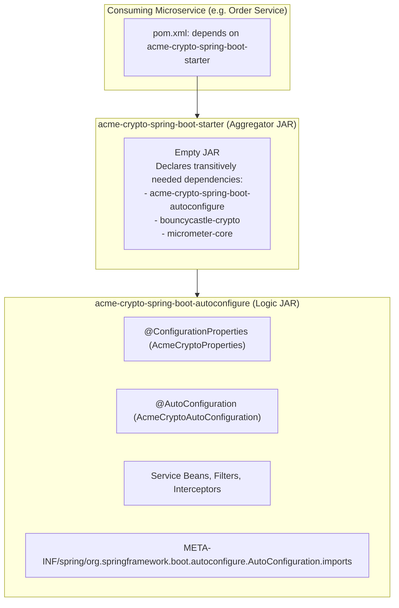
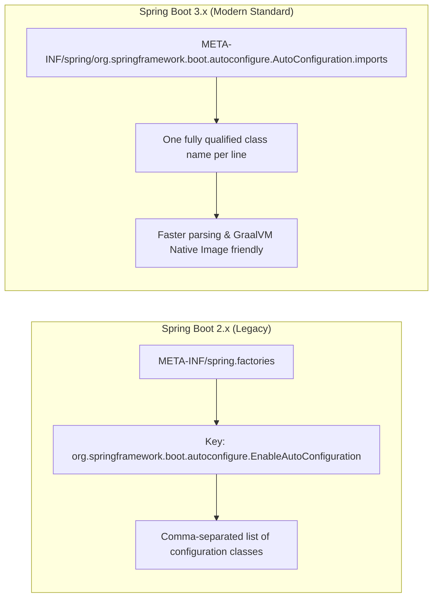
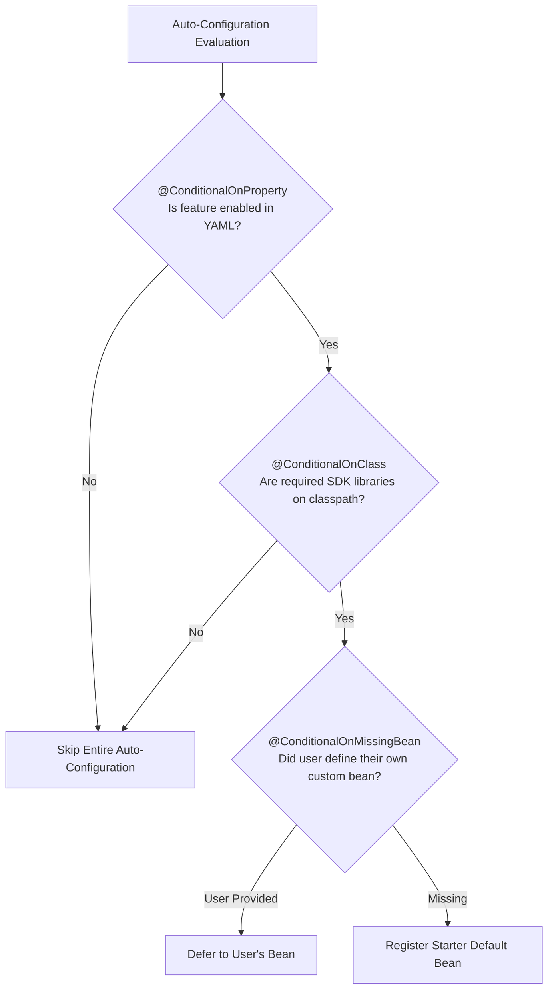
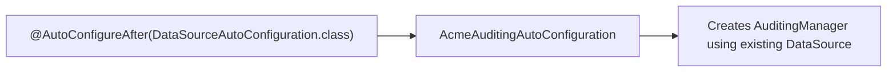

# Custom Spring Boot Starters and Auto-Configurations

In early-stage startups, copying and pasting a security configuration, an HTTP logging filter, or a Redis serializer across three microservices is a minor annoyance. In an enterprise engineering organization with 80 microservices, it is an architectural catastrophe.

When every team copies boilerplate, configurations diverge. One team configures an HTTP timeout of 2 seconds, another uses 60 seconds, and a third omits timeouts entirely. When an internal platform security vulnerability requires updating an authentication filter, engineers must create 80 pull requests across 80 repositories.

The solution is **Platform Engineering with Custom Spring Boot Starters**. A well-engineered custom starter packages company-wide cross-cutting concerns—auditing, multi-tenancy, rate limiting, and observability—into plug-and-play JARs that configure themselves automatically when added to a project's `pom.xml` or `build.gradle`.

In this guide, we will unpack how Spring Boot's auto-configuration engine evaluates beans, explore the modern Spring Boot 3 discovery mechanism, and build a production-grade enterprise starter from scratch.

---

## Anatomy of a Spring Boot Starter

The Spring Boot team recommends decoupling starter artifacts into two distinct modules:



### The Auto-Configure Module (`*-spring-boot-autoconfigure`)
Contains the actual executable code: configuration classes, `@ConfigurationProperties`, condition evaluators, beans, and the discovery metadata file.

### The Starter Module (`*-spring-boot-starter`)
An empty aggregator JAR with no Java code. Its only job is to provide a clean, unified dependency descriptor in Maven/Gradle that pulls in the auto-configure module and any necessary third-party libraries (e.g., BouncyCastle, AWS SDK, or Jackson modules).

> **Naming Convention Rule:**
> If you are building a custom starter outside the official Spring portfolio, never name it `spring-boot-starter-*`. That prefix is reserved for official Spring projects. Always name custom starters using the pattern: `yourproject-spring-boot-starter` (e.g., `acme-security-spring-boot-starter`).

---

## The Auto-Configuration SPI: Spring Boot 2 vs Spring Boot 3

Understanding how Spring Boot discovers auto-configuration classes on the classpath is critical for platform developers.



### The Death of `spring.factories`

In Spring Boot 1.x and 2.x, auto-configurations were declared in `META-INF/spring.factories`:

```properties
# DEPRECATED in Spring Boot 2.7, REMOVED in Spring Boot 3.0
org.springframework.boot.autoconfigure.EnableAutoConfiguration=\
  com.acme.starter.audit.AuditAutoConfiguration,\
  com.acme.starter.crypto.CryptoAutoConfiguration
```

This file was a monolithic property list used for multiple framework capabilities (listeners, context initializers, auto-configurations). Parsing this large file during application bootstrap caused unnecessary startup latency and complicated ahead-of-time (AOT) reflection analysis for GraalVM native images.

### The Modern Standard: `AutoConfiguration.imports`

Starting with Spring Boot 2.7 and enforced strictly in Spring Boot 3.x, auto-configuration classes are registered in a dedicated file located at:

```text
META-INF/spring/org.springframework.boot.autoconfigure.AutoConfiguration.imports
```

This file contains plain, newline-delimited class names without property keys:

```text
com.acme.starter.audit.AuditAutoConfiguration
com.acme.starter.crypto.CryptoAutoConfiguration
```

### The `@AutoConfiguration` Annotation

In Spring Boot 3, configuration classes designed for auto-configuration should be annotated with `@AutoConfiguration` instead of standard `@Configuration`:

- `@AutoConfiguration` includes `@Configuration(proxyBeanMethods = false)`, ensuring that CGLIB method interception is disabled by default for faster startup and smaller memory footprint.
- It provides built-in attributes for controlling order relative to other auto-configurations: `before`, `after`, and `beforeName`.

---

## The Arsenal of `@Conditional` Annotations

An auto-configuration class must never force its beans onto an application indiscriminately. It must act defensively: configuring beans only when prerequisite classes exist, when the user hasn't supplied their own implementation, or when specific configuration flags are enabled.



### Class Conditions: `@ConditionalOnClass` and `@ConditionalOnMissingClass`

Verifies that specific classes are present on the application's runtime classpath:

```java
@AutoConfiguration
@ConditionalOnClass(name = "com.fasterxml.jackson.databind.ObjectMapper")
public class JsonAuditingAutoConfiguration {
    // Only instantiated if Jackson is on the application's classpath
}
```

> **Bytecode Safety:** Always prefer using the class literal `@ConditionalOnClass(ObjectMapper.class)`. However, if the target class might not exist at compile time within your starter module, pass the String representation `name = "com.foo.Bar"` to avoid `NoClassDefFoundError` during class loading.

### Bean Conditions: `@ConditionalOnMissingBean` and `@ConditionalOnBean`

The cornerstone of extensibility. It tells Spring: *"Provide this default bean only if the consuming developer hasn't created their own `@Bean` of this type."*

```java
@Bean
@ConditionalOnMissingBean(AuditLogPublisher.class)
public AuditLogPublisher defaultAuditLogPublisher() {
    return new Slf4jAuditLogPublisher();
}
```

If a developer writing a microservice defines their own `@Bean public AuditLogPublisher kafkaPublisher()`, Spring Boot detects it and silently suppresses `defaultAuditLogPublisher()`.

### Property Conditions: `@ConditionalOnProperty`

Controls activation via `application.yml` or `application.properties`:

```java
@AutoConfiguration
@ConditionalOnProperty(
    prefix = "acme.audit",
    name = "enabled",
    havingValue = "true",
    matchIfMissing = true // Active by default unless explicitly disabled
)
public class AuditAutoConfiguration { ... }
```

### Web Application Conditions: `@ConditionalOnWebApplication`

Ensures web-specific beans (like HTTP filters) are only registered inside actual web servers, not command-line batch jobs or CLI tools:

```java
@AutoConfiguration
@ConditionalOnWebApplication(type = ConditionalOnWebApplication.Type.SERVLET)
public class WebTraceFilterAutoConfiguration { ... }
```

---

## Building a Production Starter: Enterprise Request Tracing

Let's build a complete, real-world enterprise starter: **`acme-tracing-spring-boot-starter`**.

**Business Requirement:** Automatically generate a unique `X-Correlation-ID` for every inbound HTTP request, attach it to SLF4J MDC (Mapped Diagnostic Context) for structured logging, record request execution duration, and return the ID in the HTTP response headers.

### Step 1: Define the Configuration Properties

```java
package com.acme.starter.tracing.properties;

import org.springframework.boot.context.properties.ConfigurationProperties;

@ConfigurationProperties(prefix = "acme.tracing")
public class AcmeTracingProperties {

    /**
     * Whether request tracing and MDC correlation are enabled.
     */
    private boolean enabled = true;

    /**
     * The HTTP header name used to propagate correlation IDs across services.
     */
    private String headerName = "X-Correlation-ID";

    /**
     * Whether to log slow requests that exceed a latency threshold.
     */
    private boolean logSlowRequests = true;

    /**
     * Threshold in milliseconds after which a request is logged as a warning.
     */
    private long slowRequestThresholdMs = 2000L;

    // Getters and Setters
    public boolean isEnabled() { return enabled; }
    public void setEnabled(boolean enabled) { this.enabled = enabled; }

    public String getHeaderName() { return headerName; }
    public void setHeaderName(String headerName) { this.headerName = headerName; }

    public boolean isLogSlowRequests() { return logSlowRequests; }
    public void setLogSlowRequests(boolean logSlowRequests) { this.logSlowRequests = logSlowRequests; }

    public long getSlowRequestThresholdMs() { return slowRequestThresholdMs; }
    public void setSlowRequestThresholdMs(long slowRequestThresholdMs) { this.slowRequestThresholdMs = slowRequestThresholdMs; }
}
```

### Step 2: The Core Domain Filter

```java
package com.acme.starter.tracing.filter;

import com.acme.starter.tracing.properties.AcmeTracingProperties;
import jakarta.servlet.FilterChain;
import jakarta.servlet.ServletException;
import jakarta.servlet.http.HttpServletRequest;
import jakarta.servlet.http.HttpServletResponse;
import org.slf4j.Logger;
import org.slf4j.LoggerFactory;
import org.slf4j.MDC;
import org.springframework.web.filter.OncePerRequestFilter;

import java.io.IOException;
import java.util.UUID;

public class CorrelationIdFilter extends OncePerRequestFilter {

    private static final Logger log = LoggerFactory.getLogger(CorrelationIdFilter.class);
    private final AcmeTracingProperties properties;

    public CorrelationIdFilter(AcmeTracingProperties properties) {
        this.properties = properties;
    }

    @Override
    protected void doFilterInternal(HttpServletRequest request,
                                    HttpServletResponse response,
                                    FilterChain filterChain) throws ServletException, IOException {
        String headerName = properties.getHeaderName();
        String correlationId = request.getHeader(headerName);

        if (correlationId == null || correlationId.isBlank()) {
            correlationId = UUID.randomUUID().toString();
        }

        long startTime = System.currentTimeMillis();

        // 1. Inject into SLF4J MDC so all logs in this thread automatically print [correlationId]
        MDC.put("correlationId", correlationId);
        response.setHeader(headerName, correlationId);

        try {
            filterChain.doFilter(request, response);
        } finally {
            long duration = System.currentTimeMillis() - startTime;

            if (properties.isLogSlowRequests() && duration > properties.getSlowRequestThresholdMs()) {
                log.warn("SLOW REQUEST: {} {} took {}ms (threshold: {}ms)",
                        request.getMethod(), request.getRequestURI(), duration, properties.getSlowRequestThresholdMs());
            }

            // 2. CRITICAL: Prevent memory leaks and cross-request contamination in pooled threads
            MDC.remove("correlationId");
        }
    }
}
```

### Step 3: The Auto-Configuration Class

```java
package com.acme.starter.tracing.autoconfigure;

import com.acme.starter.tracing.filter.CorrelationIdFilter;
import com.acme.starter.tracing.properties.AcmeTracingProperties;
import jakarta.servlet.Filter;
import org.springframework.boot.autoconfigure.AutoConfiguration;
import org.springframework.boot.autoconfigure.condition.ConditionalOnClass;
import org.springframework.boot.autoconfigure.condition.ConditionalOnMissingBean;
import org.springframework.boot.autoconfigure.condition.ConditionalOnProperty;
import org.springframework.boot.autoconfigure.condition.ConditionalOnWebApplication;
import org.springframework.boot.context.properties.EnableConfigurationProperties;
import org.springframework.boot.web.servlet.FilterRegistrationBean;
import org.springframework.context.annotation.Bean;
import org.springframework.core.Ordered;

@AutoConfiguration
@ConditionalOnWebApplication(type = ConditionalOnWebApplication.Type.SERVLET)
@ConditionalOnClass({ Filter.class, CorrelationIdFilter.class })
@ConditionalOnProperty(prefix = "acme.tracing", name = "enabled", havingValue = "true", matchIfMissing = true)
@EnableConfigurationProperties(AcmeTracingProperties.class)
public class AcmeTracingAutoConfiguration {

    @Bean
    @ConditionalOnMissingBean(name = "correlationIdFilterRegistration")
    public FilterRegistrationBean<CorrelationIdFilter> correlationIdFilterRegistration(AcmeTracingProperties properties) {
        FilterRegistrationBean<CorrelationIdFilter> registrationBean = new FilterRegistrationBean<>();
        registrationBean.setFilter(new CorrelationIdFilter(properties));
        
        // Execute before any security or business filters to ensure MDC is populated
        registrationBean.setOrder(Ordered.HIGHEST_PRECEDENCE);
        registrationBean.addUrlPatterns("/*");
        
        return registrationBean;
    }
}
```

### Step 4: Register via `AutoConfiguration.imports`

Create the file in `src/main/resources/META-INF/spring/org.springframework.boot.autoconfigure.AutoConfiguration.imports`:

```text
com.acme.starter.tracing.autoconfigure.AcmeTracingAutoConfiguration
```

### Step 5: IDE Configuration Metadata

To give developers rich autocompletion, type validation, and documentation hints inside IntelliJ IDEA or VS Code when writing `application.yml`, include the `spring-boot-configuration-processor`:

```xml
<dependency>
    <groupId>org.springframework.boot</groupId>
    <artifactId>spring-boot-configuration-processor</artifactId>
    <optional>true</optional>
</dependency>
```

During compilation, this processor reads `@ConfigurationProperties` and generates `META-INF/spring-configuration-metadata.json` automatically.

---

## Auto-Configuration Ordering and Conflicts

When developing multiple starters, configuration ordering becomes critical. For instance, an auditing auto-configuration might depend on a database `DataSource` or a `SecurityFilterChain` bean.



Use these annotations to orchestrate execution:
- `@AutoConfigureAfter(DataSourceAutoConfiguration.class)`: Runs after the specified auto-configuration.
- `@AutoConfigureBefore(SecurityAutoConfiguration.class)`: Runs before the specified auto-configuration.
- `@AutoConfigureOrder(Ordered.LOWEST_PRECEDENCE)`: Direct priority ordering.

> **Crucial Warning:** `@AutoConfigureBefore` and `@AutoConfigureAfter` only apply to auto-configuration classes loaded via `AutoConfiguration.imports`. They have zero effect on regular `@Configuration` classes scanned via `@ComponentScan`.

---

## Diagnosing Auto-Configuration: The Conditions Evaluation Report

When a bean is unexpectedly missing or an auto-configuration fails to trigger, how do you debug it?

Never guess. Run the application with the `--debug` flag:

```bash
java -jar order-service.jar --debug
```

Or configure logging in `application.yml`:

```yaml
logging:
  level:
    org.springframework.boot.autoconfigure: DEBUG
```

During startup, Spring Boot generates an exhaustive **Conditions Evaluation Report**:

```text
============================
CONDITIONS EVALUATION REPORT
============================

Positive matches:
-----------------
   AcmeTracingAutoConfiguration matched:
      - @ConditionalOnWebApplication (required: SERVLET) matched (OnWebApplicationCondition)
      - @ConditionalOnProperty (acme.tracing.enabled=true) matched (OnPropertyCondition)
      - @ConditionalOnClass found required classes: jakarta.servlet.Filter (OnClassCondition)

Negative matches:
-----------------
   MongoAuditingAutoConfiguration:
      Did not match:
         - @ConditionalOnClass did not find required class 'com.mongodb.client.MongoClient' (OnClassCondition)

Exclusions:
-----------
   None

Unconditional classes:
----------------------
   org.springframework.boot.autoconfigure.context.PropertyPlaceholderAutoConfiguration
```

The report categorizes every auto-configuration on the classpath into **Positive matches** (why it ran) and **Negative matches** (the exact condition that caused it to be skipped).

---

## Senior Engineer Interview Crucible

### How did Spring Boot 3 fundamentally change the auto-configuration registration mechanism compared to Spring Boot 2.x, and why was this change made?

In Spring Boot 1.x and 2.x, auto-configuration classes were registered in `META-INF/spring.factories` under the key `org.springframework.boot.autoconfigure.EnableAutoConfiguration`. 

Spring Boot 3 deprecated and removed this mechanism for auto-configurations, replacing it with a dedicated file: `META-INF/spring/org.springframework.boot.autoconfigure.AutoConfiguration.imports`. This file contains a simple, newline-separated list of fully qualified class names.

The change was made for two key reasons:
1. **Performance:** `spring.factories` was an overloaded property file storing listeners, initializers, and auto-configurations. Separating auto-configurations into a standalone text file eliminates multi-key parsing and reduces application startup latency.
2. **Ahead-of-Time (AOT) and GraalVM Native Image Support:** The dedicated file enables Spring's AOT engine to discover auto-configuration classes during build time, compute reachability metadata, and register native reflection hints without requiring expensive classpath scanning at runtime.

---

### Why is the two-module architecture (`acme-spring-boot-starter` and `acme-spring-boot-autoconfigure`) recommended for custom starters instead of a single monolithic JAR?

The two-module separation strictly decouples **configuration logic** from **dependency management**:

1. **The Autoconfigure Module:** Contains only the auto-configuration classes, `@Conditional` definitions, and properties. It declares third-party libraries (like BouncyCastle, Kafka clients, or Netty) as `optional` or `provided`.
2. **The Starter Module:** An empty aggregator JAR with no Java code. Its sole purpose is to declare transitive dependencies so consuming microservices can add one dependency without managing complex dependency trees.

This separation prevents dependency pollution. If an advanced consumer wants to use your auto-configuration classes but wants to manage their own specific versions of underlying libraries (or use an alternative logging provider), they can depend directly on the autoconfigure module without inheriting unnecessary transitive starter dependencies.

---

### What is the exact execution order of `@ConditionalOnBean` vs `@ConditionalOnMissingBean`, and why does placing `@ConditionalOnMissingBean` on an auto-configuration class require careful ordering?

`@ConditionalOnBean` and `@ConditionalOnMissingBean` depend entirely on the order in which bean definitions are registered in the `ApplicationContext`. 

Spring evaluates user-defined `@Configuration` classes discovered via `@ComponentScan` **before** it processes external auto-configuration classes. Because user configurations run first, an auto-configuration using `@ConditionalOnMissingBean` can accurately detect whether the user has defined their own bean.

However, if two separate auto-configuration classes both declare `@ConditionalOnMissingBean` for the same type, their execution order becomes non-deterministic unless explicitly controlled with `@AutoConfigureBefore` or `@AutoConfigureAfter`. Without explicit ordering, whichever auto-configuration happens to be parsed first registers its bean, causing the second to be skipped.

---

### How does Spring Boot inspect `@ConditionalOnClass` without throwing `ClassNotFoundException` or `NoClassDefFoundError` when an optional dependency is missing from the consumer's classpath?

Spring Boot avoids class loading errors by reading bytecode metadata directly using the **ASM library** and Java reflection metadata readers, rather than invoking `Class.forName()`.

When Spring scans candidate configuration classes during bootstrap, its `OnClassCondition` evaluator inspects the constant pool and class annotations using a low-level `MetadataReader` (backed by ASM). It checks for the existence of the class name in the JVM's `ClassLoader` without resolving or linking the class bytecode into memory. If the class cannot be located by the class loader, the condition evaluates to `false` and the configuration class is excluded before the JVM ever attempts to link missing class definitions.
