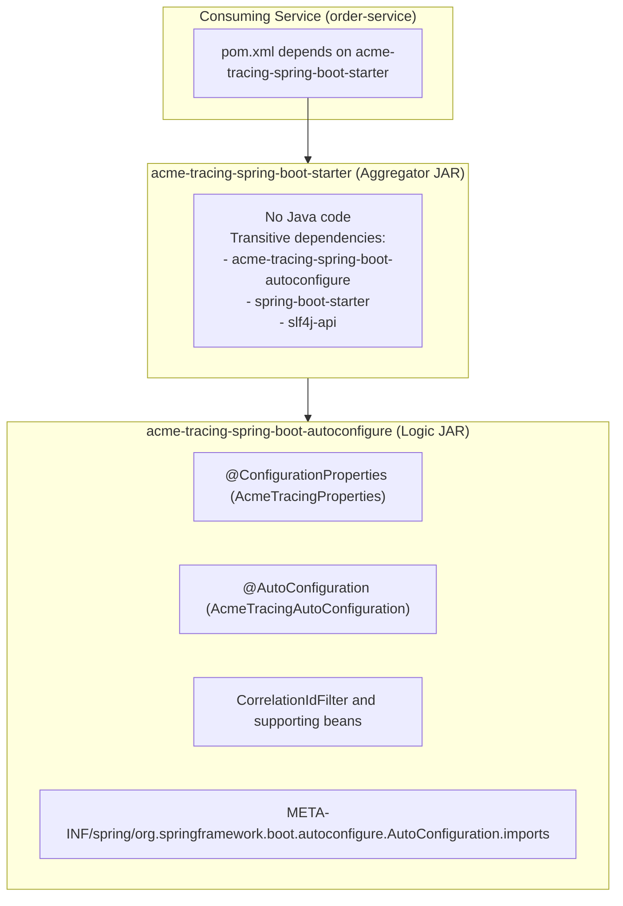
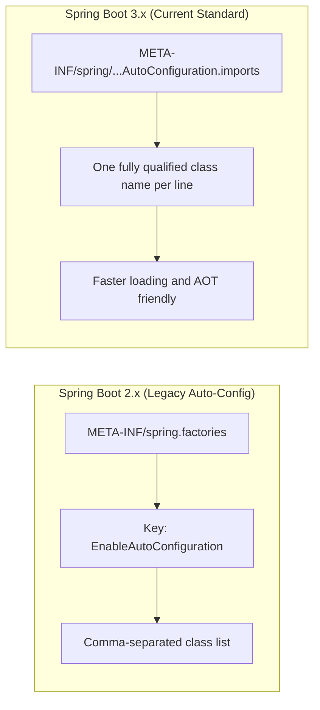
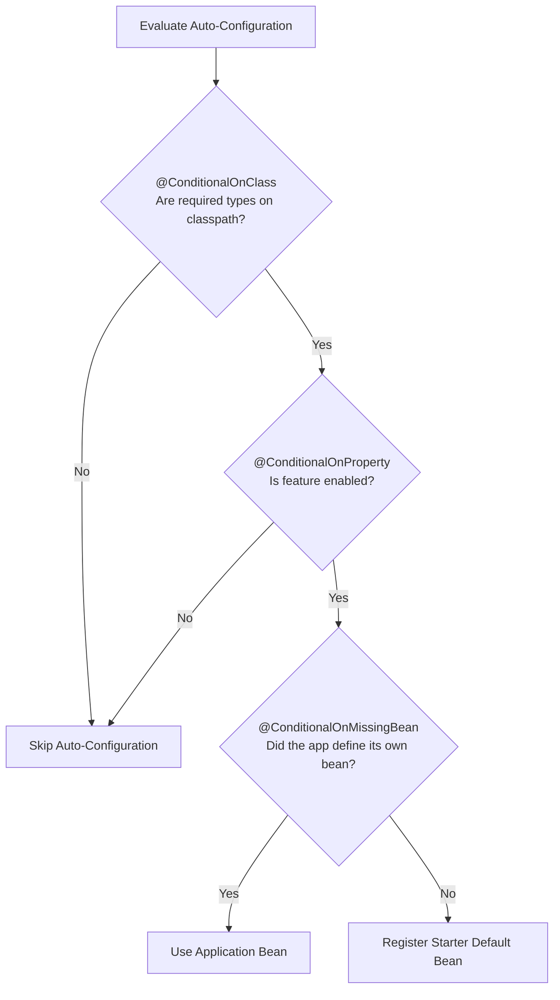

Copying an HTTP correlation filter, a Jackson configuration, or a company-standard security setup into two or three services is manageable. Copying the same boilerplate across forty services creates slow drift. One service sets an HTTP client timeout to 2 seconds, another sets it to 30 seconds, and a third forgets timeouts altogether. When a platform library needs a security patch or a new header convention, every team has to open a separate pull request.

Custom Spring Boot starters solve this by packaging shared infrastructure as versioned Maven or Gradle dependencies. A consuming team adds a single dependency, optionally overrides a few properties in `application.yml`, and gets consistent defaults without wiring beans by hand.

## Anatomy of a Custom Starter

The Spring Boot documentation recommends splitting a custom starter into two modules instead of shipping everything in one JAR:

1. **The autoconfigure module (`<name>-spring-boot-autoconfigure`)**: Holds the actual Java code, including `@AutoConfiguration` classes, `@ConfigurationProperties` types, filters, service beans, and the `AutoConfiguration.imports` metadata file. Optional third-party libraries (for example, Jackson, Servlet API, or Micrometer) are declared with `<optional>true</optional>` in Maven or `compileOnly` in Gradle so they do not pollute consumers that do not need them.
2. **The starter module (`<name>-spring-boot-starter`)**: Contains no Java code at all. It is an empty aggregator JAR whose `pom.xml` (or `build.gradle`) pulls in the autoconfigure module alongside the standard transitive dependencies required for that feature to work out of the box.



This split pays off when an advanced consumer wants your auto-configuration logic but needs to swap out or exclude one of the transitive dependencies. They can depend directly on `acme-tracing-spring-boot-autoconfigure` and supply their own versions of the underlying libraries.

### Starter Naming Conventions

The Spring team reserves the `spring-boot-starter-<name>` prefix exclusively for official Spring projects (such as `spring-boot-starter-web` or `spring-boot-starter-data-jpa`). Internal platform teams and open-source libraries should put their own name first:

- **Third-party / internal starter**: `<name>-spring-boot-starter` (for example, `acme-tracing-spring-boot-starter`)
- **Third-party / internal autoconfigure module**: `<name>-spring-boot-autoconfigure` (for example, `acme-tracing-spring-boot-autoconfigure`)

In the starter module's `pom.xml`, the dependency block stays minimal:

```xml
<!-- acme-tracing-spring-boot-starter/pom.xml -->
<dependencies>
    <dependency>
        <groupId>com.acme.platform</groupId>
        <artifactId>acme-tracing-spring-boot-autoconfigure</artifactId>
        <version>${project.version}</version>
    </dependency>
    <dependency>
        <groupId>org.springframework.boot</groupId>
        <artifactId>spring-boot-starter</artifactId>
    </dependency>
</dependencies>
```

Meanwhile, the autoconfigure module marks framework integrations that may or may not be present in every consumer (such as web servlet APIs or validation) as optional:

```xml
<!-- acme-tracing-spring-boot-autoconfigure/pom.xml -->
<dependencies>
    <dependency>
        <groupId>org.springframework.boot</groupId>
        <artifactId>spring-boot-autoconfigure</artifactId>
    </dependency>
    <dependency>
        <groupId>org.springframework.boot</groupId>
        <artifactId>spring-boot-starter-web</artifactId>
        <optional>true</optional>
    </dependency>
    <dependency>
        <groupId>org.springframework.boot</groupId>
        <artifactId>spring-boot-starter-validation</artifactId>
        <optional>true</optional>
    </dependency>
    <dependency>
        <groupId>org.springframework.boot</groupId>
        <artifactId>spring-boot-configuration-processor</artifactId>
        <optional>true</optional>
    </dependency>
</dependencies>
```

## Auto-Configuration Registration in Spring Boot 3

Spring Boot loads auto-configuration classes through a classpath SPI rather than relying on `@ComponentScan`. In fact, auto-configuration classes should live in a package outside the consuming application's base scan package so `@ComponentScan` does not accidentally register them unconditionally as normal `@Configuration` classes.



### Moving from `spring.factories` to `AutoConfiguration.imports`

In Spring Boot 1.x and 2.x, auto-configurations were registered in `META-INF/spring.factories` under the `org.springframework.boot.autoconfigure.EnableAutoConfiguration` key:

```properties
# Deprecated in Spring Boot 2.7; no longer loaded for auto-configurations in Spring Boot 3.0+
org.springframework.boot.autoconfigure.EnableAutoConfiguration=\
  com.acme.starter.tracing.autoconfigure.AcmeTracingAutoConfiguration,\
  com.acme.starter.audit.autoconfigure.AcmeAuditAutoConfiguration
```

Spring Boot 2.7 introduced a dedicated imports file, and Spring Boot 3.0 removed `EnableAutoConfiguration` support from `spring.factories` altogether. (Note that `spring.factories` is still used for certain other SPI hooks like `EnvironmentPostProcessor` or `ApplicationListener`, just not for auto-configuration classes.)

In Spring Boot 3, place your auto-configuration class names in:

```text
src/main/resources/META-INF/spring/org.springframework.boot.autoconfigure.AutoConfiguration.imports
```

The file contains one fully qualified class name per line, with `#` supported for comments:

```text
com.acme.starter.tracing.autoconfigure.AcmeTracingAutoConfiguration
```

Separating auto-configurations into this plain imports file avoids parsing an unrelated multi-purpose properties file at startup and makes build-time discovery much simpler for Spring's Ahead-of-Time (AOT) processing and GraalVM native images.

### Using `@AutoConfiguration`

Spring Boot 2.7 also introduced `@AutoConfiguration` to replace plain `@Configuration` on top-level auto-configuration classes. Using it gives you two practical benefits:

- It meta-annotates `@Configuration(proxyBeanMethods = false)`, which skips generating CGLIB subclasses for the configuration class and avoids unnecessary proxy overhead during startup. Because `proxyBeanMethods` is `false`, do not invoke one `@Bean` method directly from another inside the class; inject dependent beans as method parameters instead.
- It provides `before`, `beforeName`, `after`, and `afterName` attributes directly on the annotation, replacing separate `@AutoConfigureBefore` and `@AutoConfigureAfter` annotations in most cases.

```java
@AutoConfiguration(after = DataSourceAutoConfiguration.class)
public class AcmeAuditAutoConfiguration {
    // Bean definitions here
}
```

> [!IMPORTANT]
> Ordering attributes (`before`, `after`, `@AutoConfigureBefore`, `@AutoConfigureAfter`) only control ordering relative to other auto-configuration classes loaded through `AutoConfiguration.imports`. They do not affect regular `@Configuration` classes picked up by `@ComponentScan`.

## Conditional Annotations

A well-behaved starter stays out of the way when its prerequisites are missing or when the application wants custom behavior. Spring Boot evaluates `@Conditional*` annotations before creating any beans.



### `@ConditionalOnClass` and `@ConditionalOnMissingClass`

These annotations guard against missing optional dependencies on the runtime classpath:

```java
@AutoConfiguration
@ConditionalOnClass(name = "com.fasterxml.jackson.databind.ObjectMapper")
public class JsonAuditAutoConfiguration {
    // Loaded only when Jackson is present
}
```

You can pass a class literal (`@ConditionalOnClass(Filter.class)`) when the class is on your module's compile classpath. Spring Boot evaluates `@ConditionalOnClass` by inspecting bytecode metadata via ASM (`MetadataReader`) rather than calling `Class.forName()`, so a missing class on the consumer's classpath evaluates cleanly to `false` instead of throwing `NoClassDefFoundError`.

There is one subtle caveat: if you put `@ConditionalOnClass(SomeOptionalType.class)` on a `@Bean` method whose **return type** or **parameter type** also references `SomeOptionalType`, the JVM may still try to resolve that method signature when introspecting the enclosing `@AutoConfiguration` class. Keeping optional-library beans inside a dedicated static nested `@Configuration(proxyBeanMethods = false)` class annotated with `@ConditionalOnClass` avoids accidental `TypeNotPresentException` failures.

### `@ConditionalOnProperty`

Property conditions let teams toggle features from `application.yml` or environment variables:

```java
@AutoConfiguration
@ConditionalOnProperty(
    prefix = "acme.tracing",
    name = "enabled",
    havingValue = "true",
    matchIfMissing = true
)
public class AcmeTracingAutoConfiguration {
    // Active by default; set acme.tracing.enabled=false to disable
}
```

Setting `matchIfMissing = true` makes the starter active as soon as a service adds the dependency, while still giving teams a clean kill switch (`acme.tracing.enabled=false`) for specific environments or tests. For high-impact or opt-in features (like chaos injection or verbose body logging), leave `matchIfMissing = false` (the default).

### `@ConditionalOnMissingBean` and `@ConditionalOnBean`

`@ConditionalOnMissingBean` is what makes Spring Boot starters customizable. Because Spring processes user-defined `@Configuration` classes from `@ComponentScan` before external auto-configurations, placing `@ConditionalOnMissingBean` on a starter's `@Bean` method guarantees that any bean declared by the consuming application wins automatically:

```java
@Bean
@ConditionalOnMissingBean
public CorrelationIdGenerator correlationIdGenerator() {
    return () -> UUID.randomUUID().toString();
}
```

When placed on a `@Bean` method without arguments, `@ConditionalOnMissingBean` checks the method's return type (`CorrelationIdGenerator`). If a consuming service declares its own `CorrelationIdGenerator` bean that produces ULIDs or reads from a custom gateway header, Spring Boot skips the starter's default without throwing a duplicate-bean error.

### `@ConditionalOnWebApplication`

If your starter registers a Servlet `Filter` or `HandlerInterceptor`, restrict it to servlet web applications so it does not break reactive WebFlux apps or non-web Spring Batch jobs:

```java
@AutoConfiguration
@ConditionalOnWebApplication(type = ConditionalOnWebApplication.Type.SERVLET)
public class AcmeTracingAutoConfiguration {
    // Only applies to Servlet-based web apps
}
```

## Validated `@ConfigurationProperties`

Hardcoding `@Value("${acme.tracing.header-name:X-Correlation-ID}")` across multiple beans scatters defaults and provides no type safety or validation. `@ConfigurationProperties` binds a whole prefix into a strongly typed object and integrates with Jakarta Bean Validation.

In Spring Boot 3, Java `record` types work cleanly with `@ConfigurationProperties`. Because a record has a single canonical constructor, Spring Boot automatically uses constructor binding without requiring `@ConstructorBinding`. Pairing the record with `@Validated` and `@DefaultValue` gives you immutable configuration that fails fast at startup when a value is invalid:

```java
package com.acme.starter.tracing.properties;

import jakarta.validation.constraints.Max;
import jakarta.validation.constraints.Min;
import jakarta.validation.constraints.NotBlank;
import org.springframework.boot.context.properties.ConfigurationProperties;
import org.springframework.boot.context.properties.bind.DefaultValue;
import org.springframework.validation.annotation.Validated;

@Validated
@ConfigurationProperties(prefix = "acme.tracing")
public record AcmeTracingProperties(
    @DefaultValue("true")
    boolean enabled,

    @NotBlank
    @DefaultValue("X-Correlation-ID")
    String headerName,

    @DefaultValue("true")
    boolean logSlowRequests,

    @Min(50)
    @Max(60_000)
    @DefaultValue("2000")
    long slowRequestThresholdMs
) {}
```

If someone accidentally configures `acme.tracing.slow-request-threshold-ms: -10` or `acme.tracing.header-name: ""`, Spring Boot aborts startup with a `BindValidationException` pointing directly to the offending property instead of failing hours later on live traffic.

> [!NOTE]
> `@Validated` only runs constraint checks if a Jakarta Bean Validation implementation (such as Hibernate Validator, pulled in via `spring-boot-starter-validation`) is present on the classpath. Without it, Spring Boot skips validation silently. If strict startup validation is required for your starter, declare `spring-boot-starter-validation` as a non-optional dependency in your starter aggregator module.

### Generating IDE Autocomplete Metadata

Adding `spring-boot-configuration-processor` as an optional dependency (or annotation processor in Gradle) generates `META-INF/spring-configuration-metadata.json` at compile time. IntelliJ IDEA and VS Code read this file from your JAR and give consuming developers property autocomplete, default values, Javadoc descriptions, and deprecation warnings directly inside `application.yml`.

## Putting It Together: A Request Tracing Starter

To see all pieces working together, suppose we are building `acme-tracing-spring-boot-starter`. Every inbound Servlet HTTP request should receive a correlation ID (read from an incoming header or generated if absent), place it into SLF4J's `MDC` for logging, echo it back in the response header, and log a warning if the request exceeds a latency threshold.

First, define a small functional interface so consumers can swap out the ID generation strategy if needed:

```java
package com.acme.starter.tracing;

@FunctionalInterface
public interface CorrelationIdGenerator {
    String generate();
}
```

Next, write the servlet filter. Note the `finally` block: servlet containers reuse worker threads across requests, so forgetting `MDC.remove(...)` leaks one customer's correlation ID into the next request's logs.

```java
package com.acme.starter.tracing.filter;

import com.acme.starter.tracing.CorrelationIdGenerator;
import com.acme.starter.tracing.properties.AcmeTracingProperties;
import jakarta.servlet.FilterChain;
import jakarta.servlet.ServletException;
import jakarta.servlet.http.HttpServletRequest;
import jakarta.servlet.http.HttpServletResponse;
import org.slf4j.Logger;
import org.slf4j.LoggerFactory;
import org.slf4j.MDC;
import org.springframework.web.filter.OncePerRequestFilter;

import java.io.IOException;
import java.util.concurrent.TimeUnit;

public class CorrelationIdFilter extends OncePerRequestFilter {

    private static final Logger log = LoggerFactory.getLogger(CorrelationIdFilter.class);
    private static final String MDC_KEY = "correlationId";

    private final AcmeTracingProperties properties;
    private final CorrelationIdGenerator idGenerator;

    public CorrelationIdFilter(AcmeTracingProperties properties,
                               CorrelationIdGenerator idGenerator) {
        this.properties = properties;
        this.idGenerator = idGenerator;
    }

    @Override
    protected void doFilterInternal(HttpServletRequest request,
                                    HttpServletResponse response,
                                    FilterChain filterChain) throws ServletException, IOException {
        String headerName = properties.headerName();
        String correlationId = request.getHeader(headerName);

        if (correlationId == null || correlationId.isBlank()) {
            correlationId = idGenerator.generate();
        }

        long startNanos = System.nanoTime();
        MDC.put(MDC_KEY, correlationId);
        response.setHeader(headerName, correlationId);

        try {
            filterChain.doFilter(request, response);
        } finally {
            long durationMs = TimeUnit.NANOSECONDS.toMillis(System.nanoTime() - startNanos);
            if (properties.logSlowRequests() && durationMs > properties.slowRequestThresholdMs()) {
                log.warn("Slow request: {} {} took {}ms (threshold: {}ms)",
                        request.getMethod(), request.getRequestURI(),
                        durationMs, properties.slowRequestThresholdMs());
            }
            MDC.remove(MDC_KEY);
        }
    }
}
```

Now wire the filter and default generator in the `@AutoConfiguration` class:

```java
package com.acme.starter.tracing.autoconfigure;

import com.acme.starter.tracing.CorrelationIdGenerator;
import com.acme.starter.tracing.filter.CorrelationIdFilter;
import com.acme.starter.tracing.properties.AcmeTracingProperties;
import jakarta.servlet.Filter;
import org.springframework.boot.autoconfigure.AutoConfiguration;
import org.springframework.boot.autoconfigure.condition.ConditionalOnClass;
import org.springframework.boot.autoconfigure.condition.ConditionalOnMissingBean;
import org.springframework.boot.autoconfigure.condition.ConditionalOnProperty;
import org.springframework.boot.autoconfigure.condition.ConditionalOnWebApplication;
import org.springframework.boot.context.properties.EnableConfigurationProperties;
import org.springframework.boot.web.servlet.FilterRegistrationBean;
import org.springframework.context.annotation.Bean;
import org.springframework.core.Ordered;

import java.util.UUID;

@AutoConfiguration
@ConditionalOnWebApplication(type = ConditionalOnWebApplication.Type.SERVLET)
@ConditionalOnClass({ Filter.class, OncePerRequestFilter.class })
@ConditionalOnProperty(
    prefix = "acme.tracing",
    name = "enabled",
    havingValue = "true",
    matchIfMissing = true
)
@EnableConfigurationProperties(AcmeTracingProperties.class)
public class AcmeTracingAutoConfiguration {

    @Bean
    @ConditionalOnMissingBean
    public CorrelationIdGenerator correlationIdGenerator() {
        return () -> UUID.randomUUID().toString();
    }

    @Bean
    @ConditionalOnMissingBean(name = "correlationIdFilterRegistration")
    public FilterRegistrationBean<CorrelationIdFilter> correlationIdFilterRegistration(
            AcmeTracingProperties properties,
            CorrelationIdGenerator idGenerator) {
        FilterRegistrationBean<CorrelationIdFilter> registration = new FilterRegistrationBean<>();
        registration.setFilter(new CorrelationIdFilter(properties, idGenerator));
        // Run before security and business filters so early logs already carry the correlation ID
        registration.setOrder(Ordered.HIGHEST_PRECEDENCE);
        registration.addUrlPatterns("/*");
        return registration;
    }
}
```

Finally, register the class in `src/main/resources/META-INF/spring/org.springframework.boot.autoconfigure.AutoConfiguration.imports`:

```text
com.acme.starter.tracing.autoconfigure.AcmeTracingAutoConfiguration
```

## Testing Auto-Configurations with `ApplicationContextRunner`

Never rely on manual smoke testing in a separate demo project to verify a starter. Spring Boot provides `ApplicationContextRunner` (for non-web contexts), `WebApplicationContextRunner` (for Servlet contexts), and `ReactiveWebApplicationContextRunner` (for WebFlux contexts).

These runners create lightweight test contexts in milliseconds and let you test every conditional branch: default behavior, disabled properties, custom user beans, missing classes via `FilteredClassLoader`, and validation failures.

```java
package com.acme.starter.tracing.autoconfigure;

import com.acme.starter.tracing.CorrelationIdGenerator;
import org.junit.jupiter.api.Test;
import org.springframework.boot.autoconfigure.AutoConfigurations;
import org.springframework.boot.autoconfigure.validation.ValidationAutoConfiguration;
import org.springframework.boot.context.properties.bind.validation.BindValidationException;
import org.springframework.boot.test.context.FilteredClassLoader;
import org.springframework.boot.test.context.runner.ApplicationContextRunner;
import org.springframework.boot.test.context.runner.WebApplicationContextRunner;
import org.springframework.boot.web.servlet.FilterRegistrationBean;
import org.springframework.context.annotation.Bean;
import org.springframework.context.annotation.Configuration;

import static org.assertj.core.api.Assertions.assertThat;

class AcmeTracingAutoConfigurationTest {

    private final WebApplicationContextRunner webRunner = new WebApplicationContextRunner()
            .withConfiguration(AutoConfigurations.of(
                    ValidationAutoConfiguration.class,
                    AcmeTracingAutoConfiguration.class
            ));

    @Test
    void registersFilterAndDefaultGeneratorInServletWebApp() {
        webRunner.run(context -> {
            assertThat(context).hasSingleBean(CorrelationIdGenerator.class);
            assertThat(context).hasBean("correlationIdFilterRegistration");
            assertThat(context.getBean("correlationIdFilterRegistration"))
                    .isInstanceOf(FilterRegistrationBean.class);
        });
    }

    @Test
    void backsOffWhenDisabledByProperty() {
        webRunner.withPropertyValues("acme.tracing.enabled=false")
                .run(context -> {
                    assertThat(context).doesNotHaveBean(CorrelationIdGenerator.class);
                    assertThat(context).doesNotHaveBean("correlationIdFilterRegistration");
                });
    }

    @Test
    void defersToUserDefinedGeneratorBean() {
        webRunner.withUserConfiguration(CustomGeneratorConfig.class)
                .run(context -> {
                    assertThat(context).hasSingleBean(CorrelationIdGenerator.class);
                    assertThat(context.getBean(CorrelationIdGenerator.class).generate())
                            .isEqualTo("custom-id");
                });
    }

    @Test
    void skipsRegistrationInNonWebApplication() {
        new ApplicationContextRunner()
                .withConfiguration(AutoConfigurations.of(AcmeTracingAutoConfiguration.class))
                .run(context -> assertThat(context).doesNotHaveBean("correlationIdFilterRegistration"));
    }

    @Test
    void skipsWhenServletApiIsMissingFromClasspath() {
        webRunner.withClassLoader(new FilteredClassLoader(jakarta.servlet.Filter.class))
                .run(context -> assertThat(context).doesNotHaveBean("correlationIdFilterRegistration"));
    }

    @Test
    void failsStartupWhenPropertiesAreInvalid() {
        webRunner.withPropertyValues("acme.tracing.slow-request-threshold-ms=10")
                .run(context -> {
                    assertThat(context).hasFailed();
                    assertThat(context.getStartupFailure())
                            .hasRootCauseInstanceOf(BindValidationException.class);
                });
    }

    @Configuration(proxyBeanMethods = false)
    static class CustomGeneratorConfig {
        @Bean
        CorrelationIdGenerator customGenerator() {
            return () -> "custom-id";
        }
    }
}
```

Notice how `AutoConfigurations.of(...)` ensures Spring Boot processes `AcmeTracingAutoConfiguration` *after* `CustomGeneratorConfig`, reproducing the real evaluation order of a consuming application.

## Diagnosing Auto-Configuration with the Conditions Evaluation Report

When a starter does not activate as expected (or activates when it should have backed off), start the service with `--debug` or set `logging.level.org.springframework.boot.autoconfigure=DEBUG`:

```bash
java -jar order-service.jar --debug
```

Spring Boot prints the **Conditions Evaluation Report** on startup, showing every auto-configuration class that matched and every class that did not, along with the exact condition that decided the outcome:

```text
============================
CONDITIONS EVALUATION REPORT
============================

Positive matches:
-----------------
   AcmeTracingAutoConfiguration matched:
      - @ConditionalOnWebApplication (required: SERVLET) matched (OnWebApplicationCondition)
      - @ConditionalOnClass found required classes 'jakarta.servlet.Filter', 'org.springframework.web.filter.OncePerRequestFilter' (OnClassCondition)
      - @ConditionalOnProperty (acme.tracing.enabled=true) matched (OnPropertyCondition)

Negative matches:
-----------------
   AcmeTracingAutoConfiguration#correlationIdGenerator:
      Did not match:
         - @ConditionalOnMissingBean (types: com.acme.starter.tracing.CorrelationIdGenerator; SearchStrategy: all) found beans of type 'com.acme.starter.tracing.CorrelationIdGenerator' customGenerator (OnBeanCondition)
```

In production services with Spring Boot Actuator enabled, the same report is exposed through the `/actuator/conditions` endpoint, which is often the fastest way to verify why a bean was or was not wired in a deployed environment.

## Practical Questions

### Why did Spring Boot 3 replace `spring.factories` with `AutoConfiguration.imports` for auto-configurations?

`META-INF/spring.factories` was originally a catch-all properties file holding listeners, context initializers, failure analyzers, and auto-configuration classes under different keys. Moving auto-configurations into `META-INF/spring/org.springframework.boot.autoconfigure.AutoConfiguration.imports` gave Spring Boot a dedicated, newline-delimited list that loads faster and integrates cleanly with Spring 6's Ahead-of-Time (AOT) processing for GraalVM native images.

### Why should a custom starter be split into an `autoconfigure` module and a `starter` module?

Splitting the two separates configuration logic from dependency aggregation. The `autoconfigure` module holds the code and marks optional integrations as `optional` (Maven) or `compileOnly` (Gradle), while the `starter` module is an empty POM/JAR that declares the standard transitive dependencies for most consumers. Teams that need custom library versions or want to exclude a transitive dependency can depend on `autoconfigure` directly without fighting dependency exclusions.

### Why does `@ConditionalOnMissingBean` work reliably for user beans, and when can it go wrong?

Spring Boot registers user `@Configuration` beans discovered via `@ComponentScan` before evaluating auto-configurations from `AutoConfiguration.imports`. As a result, `@ConditionalOnMissingBean` in an auto-configuration reliably sees beans defined by the consuming application. Things go wrong when two different *auto-configuration* classes both use `@ConditionalOnMissingBean` for the same type without explicit ordering (`@AutoConfiguration(after = ...)` or `before = ...`), or when someone mistakenly places `@ConditionalOnMissingBean` inside a regular component-scanned `@Configuration` class where registration order is not guaranteed.

### How does `@ConditionalOnClass` check for missing libraries without throwing `NoClassDefFoundError`?

Spring Boot's `OnClassCondition` reads class and annotation metadata using ASM (`MetadataReader`) rather than loading the referenced class directly through the JVM verifier. If the class is absent from the classpath, the condition evaluates to `false` before the configuration class is instantiated. To avoid subtle `TypeNotPresentException` issues, avoid returning or accepting an optional third-party type directly on `@Bean` methods inside the top-level auto-configuration class; isolate those methods in a nested `@Configuration(proxyBeanMethods = false)` class guarded by `@ConditionalOnClass`.
