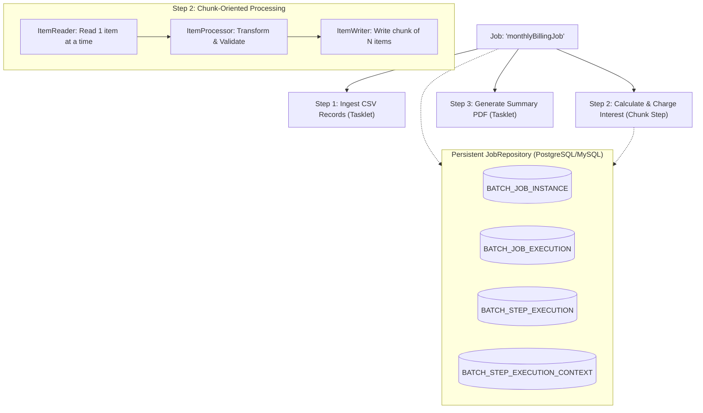
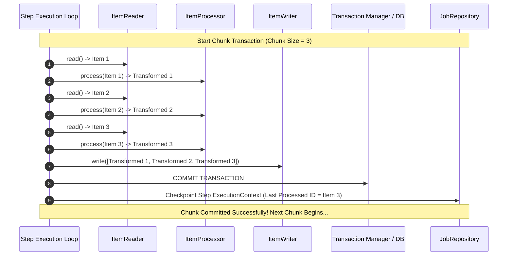
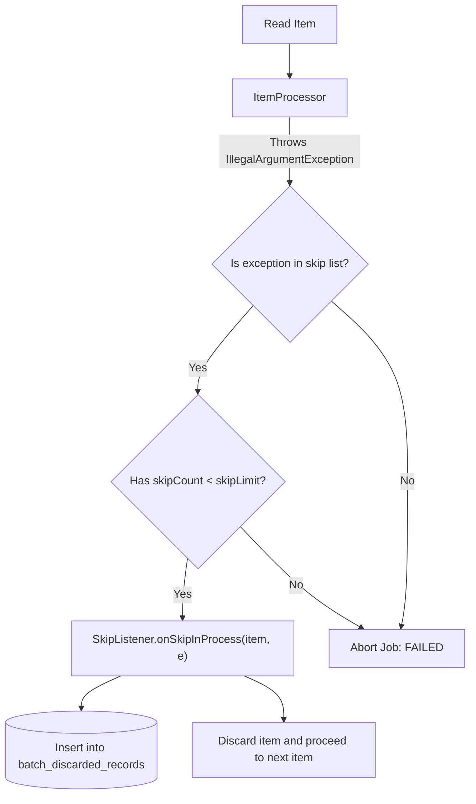
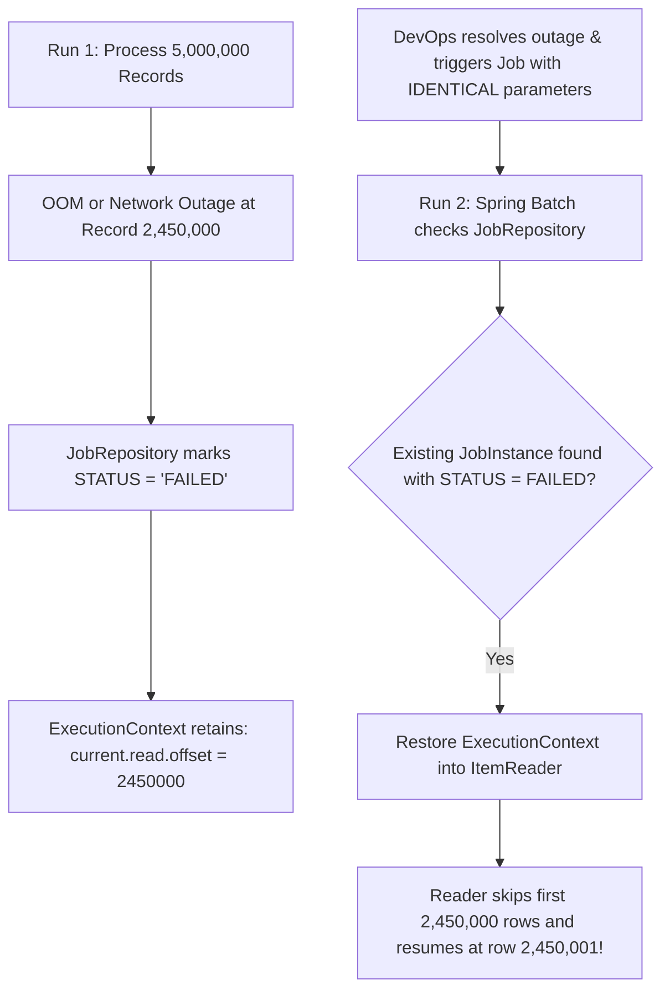

# Spring Batch: Chunk Processing

Every developer has written a script that looks like this:

```java
// DANGEROUS: The naive approach to batch processing
List<Transaction> transactions = transactionRepository.findAll();
for (Transaction tx : transactions) {
    calculateInterest(tx);
    transactionRepository.save(tx);
}
```

On a developer workstation with 200 records, this code runs in 300 milliseconds. But in an enterprise financial application processing 40 million end-of-month records, this code is a disaster:
1. `findAll()` attempts to load 40 million rows into the JVM heap simultaneously, triggering an immediate `java.lang.OutOfMemoryError: Java heap space`.
2. Running the operation in a single `@Transactional` method opens a database transaction that lasts for hours, saturating the database rollback segment and locking table pages.
3. If the process encounters a network blip or a malformed record at record 39,999,999, the entire transaction rolls back to zero. You have wasted 6 hours of CPU time and must start from the very beginning with no way to resume.

Enterprise batch processing requires a specialized architectural framework designed for **chunking, streaming, checkpointing, skipping, and restarting**. In the Java ecosystem, that standard is **Spring Batch**.

---

## The Core Domain Model of Spring Batch

Spring Batch models high-volume workflows using a strict hierarchy of domain concepts:



### The Architectural Hierarchy

- **Job:** An explicit, end-to-end batch workflow (e.g., `payrollJob` or `inventoryReconciliationJob`).
- **Step:** An independent, sequential phase of a Job. A Job can have one or many Steps executed sequentially or conditionally.
- **Tasklet vs Chunk Step:**
  - **Tasklet:** A simple execution block that performs a single task (e.g., cleaning up a temp directory, unzipping an SFTP archive).
  - **Chunk Step:** An item-oriented streaming pipeline designed to process millions of records in bounded memory.
- **JobRepository:** The operational brain of Spring Batch. A relational database schema that tracks the lifecycle, execution status, commit offsets, and parameters of every job and step execution.

---

## The Chunk-Oriented Processing Model

Chunk-oriented processing is the core pattern that prevents OutOfMemory errors and guarantees restartability:



### The Three Pipeline Stages

1. **`ItemReader<I>` (Read One by One):** The reader streams records from a source (a paginated SQL query, a Kafka topic, or a flat CSV file) one item at a time. It keeps memory usage strictly bounded, reading only what is needed for the current chunk.
2. **`ItemProcessor<I, O>` (Transform and Filter):** Receives a single input item and transforms it into the output representation. If the processor returns `null`, Spring Batch silently discards that item from the current chunk (a clean filtering pattern).
3. **`ItemWriter<O>` (Write in Batches):** Once the reader and processor accumulate items equal to the configured **chunk size** (commit interval), the writer receives the entire batch (`Chunk<? extends O>`) and persists it in a single database batch insert or API call.
4. **Transaction Boundary:** Spring Batch wraps the entire chunk in a single database transaction. When the writer succeeds, the transaction commits, and the `JobRepository` records a checkpoint.

---

## Modern Spring Batch 5 and Spring Boot 3 Configuration

Spring Batch 5 (included in Spring Boot 3) removed the legacy `JobBuilderFactory` and `StepBuilderFactory`. In modern Spring Boot, builders are instantiated directly with references to the `JobRepository` and `PlatformTransactionManager`.

### Maven Dependencies

```xml
<dependency>
    <groupId>org.springframework.boot</groupId>
    <artifactId>spring-boot-starter-batch</artifactId>
</dependency>
<dependency>
    <groupId>org.springframework.boot</groupId>
    <artifactId>spring-boot-starter-jdbc</artifactId>
</dependency>
```

### The Domain Entities

```java
package com.javahub.batch.domain;

import java.math.BigDecimal;

public record TransactionInput(
    String transactionId,
    String accountId,
    BigDecimal amount,
    String type
) {}

public record ProcessedTransaction(
    String transactionId,
    String accountId,
    BigDecimal originalAmount,
    BigDecimal feeAmount,
    BigDecimal netAmount
) {}
```

### Building the Chunk Pipeline

```java
package com.javahub.batch.config;

import com.javahub.batch.domain.ProcessedTransaction;
import com.javahub.batch.domain.TransactionInput;
import org.springframework.batch.core.Job;
import org.springframework.batch.core.Step;
import org.springframework.batch.core.job.builder.JobBuilder;
import org.springframework.batch.core.launch.support.RunIdIncrementer;
import org.springframework.batch.core.repository.JobRepository;
import org.springframework.batch.core.step.builder.StepBuilder;
import org.springframework.batch.item.ItemProcessor;
import org.springframework.batch.item.database.JdbcBatchItemWriter;
import org.springframework.batch.item.database.JdbcPagingItemReader;
import org.springframework.batch.item.database.Order;
import org.springframework.batch.item.database.builder.JdbcBatchItemWriterBuilder;
import org.springframework.batch.item.database.builder.JdbcPagingItemReaderBuilder;
import org.springframework.batch.item.database.support.PostgresPagingQueryProvider;
import org.springframework.context.annotation.Bean;
import org.springframework.context.annotation.Configuration;
import org.springframework.dao.TransientDataAccessException;
import org.springframework.transaction.PlatformTransactionManager;

import javax.sql.DataSource;
import java.math.BigDecimal;
import java.math.RoundingMode;
import java.util.Map;

@Configuration
public class TransactionBatchConfiguration {

    private static final int CHUNK_SIZE = 1000;

    // 1. Streaming Paging Item Reader (Thread-Safe)
    @Bean
    public JdbcPagingItemReader<TransactionInput> transactionReader(DataSource dataSource) {
        PostgresPagingQueryProvider queryProvider = new PostgresPagingQueryProvider();
        queryProvider.setSelectClause("SELECT id, account_id, amount, tx_type");
        queryProvider.setFromClause("FROM raw_transactions");
        queryProvider.setWhereClause("WHERE status = 'PENDING'");
        queryProvider.setSortKeys(Map.of("id", Order.ASCENDING));

        return new JdbcPagingItemReaderBuilder<TransactionInput>()
                .name("transactionReader")
                .dataSource(dataSource)
                .pageSize(CHUNK_SIZE)
                .queryProvider(queryProvider)
                .rowMapper((rs, rowNum) -> new TransactionInput(
                        rs.getString("id"),
                        rs.getString("account_id"),
                        rs.getBigDecimal("amount"),
                        rs.getString("tx_type")
                ))
                .build();
    }

    // 2. Business Logic Processor
    @Bean
    public ItemProcessor<TransactionInput, ProcessedTransaction> transactionProcessor() {
        return input -> {
            // Business rule: Filter out micro-transactions below 1.00
            if (input.amount().compareTo(BigDecimal.ONE) <= 0) {
                return null; // Return null to skip item from writer batch
            }

            // Calculate 1.5% transaction processing fee
            BigDecimal fee = input.amount()
                    .multiply(new BigDecimal("0.015"))
                    .setScale(2, RoundingMode.HALF_UP);
            BigDecimal net = input.amount().subtract(fee);

            return new ProcessedTransaction(
                    input.transactionId(),
                    input.accountId(),
                    input.amount(),
                    fee,
                    net
            );
        };
    }

    // 3. High-Performance SQL Batch Writer
    @Bean
    public JdbcBatchItemWriter<ProcessedTransaction> transactionWriter(DataSource dataSource) {
        return new JdbcBatchItemWriterBuilder<ProcessedTransaction>()
                .dataSource(dataSource)
                .sql("""
                    INSERT INTO processed_transactions 
                    (transaction_id, account_id, original_amount, fee_amount, net_amount, processed_at)
                    VALUES (:transactionId, :accountId, :originalAmount, :feeAmount, :netAmount, NOW())
                """)
                .beanMapped()
                .build();
    }

    // 4. Fault-Tolerant Step Definition
    @Bean
    public Step processTransactionsStep(JobRepository jobRepository,
                                        PlatformTransactionManager transactionManager,
                                        JdbcPagingItemReader<TransactionInput> reader,
                                        ItemProcessor<TransactionInput, ProcessedTransaction> processor,
                                        JdbcBatchItemWriter<ProcessedTransaction> writer) {
        return new StepBuilder("processTransactionsStep", jobRepository)
                .<TransactionInput, ProcessedTransaction>chunk(CHUNK_SIZE, transactionManager)
                .reader(reader)
                .processor(processor)
                .writer(writer)
                // Fault Tolerance and Resilience
                .faultTolerant()
                .skip(IllegalArgumentException.class) // Skip corrupted record data
                .skipLimit(100)                      // Allow up to 100 corrupt rows before aborting
                .retry(TransientDataAccessException.class) // Retry transient network/deadlock errors
                .retryLimit(3)                       // Attempt up to 3 retries per chunk
                .build();
    }

    // 5. Job Definition
    @Bean
    public Job processTransactionsJob(JobRepository jobRepository, Step processTransactionsStep) {
        return new JobBuilder("processTransactionsJob", jobRepository)
                .incrementer(new RunIdIncrementer())
                .start(processTransactionsStep)
                .build();
    }
}
```

---

## Fault Tolerance: Skipping, Retrying, and Dead-Letter Auditing

In real-world batch workloads, data is rarely clean. A 5-million-row CSV export from a partner will inevitably contain null dates, unexpected currencies, or malformed strings. If a single bad row causes your entire job to crash after running for three hours, your batch architecture is fragile.

Spring Batch provides declarative **Skip** and **Retry** semantics.



### Implementing a `SkipListener` for Auditing

When you skip bad records, you must never lose them silently. Use a `SkipListener` to write discarded records to a dead-letter audit table:

```java
package com.javahub.batch.listener;

import com.javahub.batch.domain.TransactionInput;
import org.slf4j.Logger;
import org.slf4j.LoggerFactory;
import org.springframework.batch.core.SkipListener;
import org.springframework.jdbc.core.simple.JdbcClient;
import org.springframework.stereotype.Component;

@Component
public class TransactionSkipListener implements SkipListener<TransactionInput, Object> {

    private static final Logger log = LoggerFactory.getLogger(TransactionSkipListener.class);
    private final JdbcClient jdbcClient;

    public TransactionSkipListener(JdbcClient jdbcClient) {
        this.jdbcClient = jdbcClient;
    }

    @Override
    public void onSkipInRead(Throwable t) {
        log.error("Failed to read record from source: {}", t.getMessage());
    }

    @Override
    public void onSkipInProcess(TransactionInput item, Throwable t) {
        log.warn("Discarding malformed transaction ID {}: {}", item.transactionId(), t.getMessage());
        
        // Persist to dead-letter audit table for operational review
        jdbcClient.sql("""
            INSERT INTO batch_discarded_records (record_id, payload, failure_reason, discarded_at)
            VALUES (?, ?, ?, NOW())
        """)
        .params(item.transactionId(), item.toString(), t.getMessage())
        .update();
    }

    @Override
    public void onSkipInWrite(Object item, Throwable t) {
        log.error("Database constraint violation during batch write: {}", t.getMessage());
    }
}
```

Attach the listener to the step:
```java
.faultTolerant()
.skip(IllegalArgumentException.class)
.skipLimit(100)
.listener(skipListener)
```

---

## State Persistence and Job Restarts via `JobRepository`

Spring Batch's most powerful enterprise capability is its ability to **resume failed executions exactly where they left off**.

When configured, Spring Batch initializes its operational metadata tables in your database:

```text
BATCH_JOB_INSTANCE           <-- Represents the logical job + parameters
BATCH_JOB_EXECUTION          <-- Represents a single run attempt (START_TIME, END_TIME, STATUS)
BATCH_JOB_EXECUTION_PARAMS   <-- Key-value parameters passed to the job
BATCH_STEP_EXECUTION         <-- Step execution metrics (COMMIT_COUNT, READ_COUNT, WRITE_COUNT)
BATCH_STEP_EXECUTION_CONTEXT <-- Key-value operational state (Reader offset, current line number)
```

### How Restart Works Under the Hood



1. **First Execution:** The job starts processing 5,000,000 records with a chunk size of 1,000. Every 1,000 records, the transaction commits, and the reader updates `BATCH_STEP_EXECUTION_CONTEXT` with its current offset.
2. **The Failure:** At record 2,450,000, the network cable to the primary database is severed. The Step fails. `JobRepository` marks the `JobExecution` status as `FAILED`.
3. **The Restart:** Once the database returns online, the job scheduler triggers the job again with the **exact same `JobParameters`**.
4. **Resumption:** Spring Batch discovers the existing `JobInstance` in `FAILED` state. It injects the saved `ExecutionContext` back into the reader. The reader skips the 2,450,000 already committed records and resumes processing from record 2,450,001. No duplicate payments are made, and no previous work is wasted.

---

## Cursor vs Paging Readers: Concurrency and Memory Trade-Offs

When reading millions of rows from a relational database, you must choose between two reader implementations:

| Strategy | Implementation | Connection Usage | Thread Safety | Performance Profile |
| :--- | :--- | :--- | :--- | :--- |
| **Cursor-Based** | `JdbcCursorItemReader` | Holds 1 JDBC connection open for the entire multi-hour step. | **NOT** thread-safe (cannot be shared across worker threads). | High throughput; zero offset overhead. Risk of connection timeouts. |
| **Paging-Based** | `JdbcPagingItemReader` | Borrows connection only during page fetch; releases it back to pool. | **Thread-safe** (supports multi-threaded step execution). | Highly resilient; slightly higher SQL query overhead per page. |

> **Architectural Recommendation:** In modern cloud-native environments (Kubernetes, AWS RDS, PgBouncer), long-lived open database connections are often aggressively terminated by firewalls or proxies. Prefer **`JdbcPagingItemReader`** with an explicit `ORDER BY` clause. It supports thread-safe parallel processing and plays well with connection pool limits.

---

## Senior Engineer Interview Crucible

### Why did Spring Batch 5 / Spring Boot 3 deprecate `JobBuilderFactory` and `StepBuilderFactory`, and how are jobs constructed now?

In earlier Spring Batch versions, `JobBuilderFactory` and `StepBuilderFactory` were convenience beans injected into configuration classes to hide boilerplate references to `JobRepository`. However, they created hidden state and complicated ahead-of-time (AOT) reflection analysis for GraalVM native images.

In Spring Batch 5, both factory classes were deprecated in favor of constructing `JobBuilder` and `StepBuilder` directly, explicitly passing the required `JobRepository` and `PlatformTransactionManager`:

```java
// Modern Spring Batch 5 Step Builder
Step step = new StepBuilder("myStep", jobRepository)
        .<Input, Output>chunk(1000, transactionManager)
        .reader(reader)
        .writer(writer)
        .build();
```

This explicit design makes dependencies transparent, simplifies testing without Spring context, and aligns with modern Spring Boot standards.

---

### Contrast `JdbcCursorItemReader` vs `JdbcPagingItemReader`. Which one is thread-safe for multi-threaded steps, and why?

`JdbcCursorItemReader` opens a single persistent JDBC connection and navigates the database cursor row by row using `ResultSet.next()`. Because a JDBC `ResultSet` maintains internal state tied to a single physical socket, it is **not thread-safe**. Sharing it across concurrent worker threads causes race conditions and driver exceptions.

`JdbcPagingItemReader` breaks the dataset into discrete pages using SQL limit/offset or key-set pagination. Each page fetch is executed as an isolated query that borrows a connection from the pool and immediately closes it upon reading the page into memory. Because state is maintained by an atomic page counter rather than an active cursor, `JdbcPagingItemReader` is **thread-safe** and can be safely shared across concurrent worker threads in a multi-threaded Step.

---

### Walk through the exact rollback and retry mechanics of chunk processing when an exception occurs inside the `ItemWriter`.

When an exception occurs during the execution of an `ItemWriter`:

1. The underlying database transaction manager intercepts the exception and immediately **rolls back** the current chunk's transaction.
2. If the exception is configured in the `.retry()` policy, Spring Batch initiates chunk scanning: it sets the commit interval to 1 and re-runs the items in the failing chunk **one by one**.
3. Processing items individually isolates the single poisoned record causing the failure (e.g., an integrity constraint violation or dead letter), allowing the remaining valid items in that chunk to be committed successfully.
4. If a retry limit is reached without success, or the exception is not retryable, Spring Batch checks its `.skip()` policy. If the exception is skippable, the failing item is discarded, registered with any `SkipListener`, and the step proceeds to the next item.

---

### Explain the difference between `JobInstance` and `JobExecution`. How does passing `JobParameters` determine whether a job can be run again?

- **`JobInstance`:** Represents the logical definition of a job execution tied to a specific set of identifying `JobParameters`. For example, `endOfDayReconciliation` with parameter `date=2026-10-29` defines a single unique `JobInstance`.
- **`JobExecution`:** Represents a single physical run attempt of a `JobInstance`. If a `JobInstance` fails, it can be launched again. That subsequent run attempt is a new `JobExecution` associated with the same `JobInstance`.

Spring Batch enforces that a `JobInstance` can only run to `COMPLETED` status once. If you attempt to launch a job with identical parameters that has already completed successfully, Spring Batch rejects it with `JobInstanceAlreadyCompleteException`. To execute the job again on demand, you must introduce a differentiating parameter (such as `run.id=System.currentTimeMillis()`), typically configured using a `RunIdIncrementer`.

