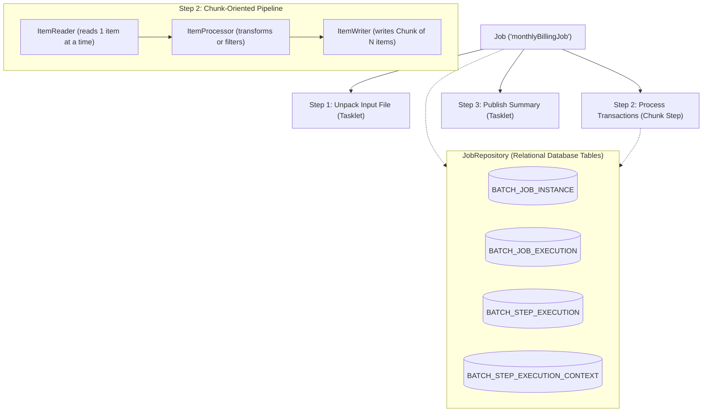
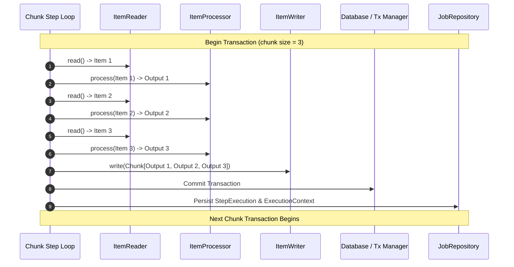
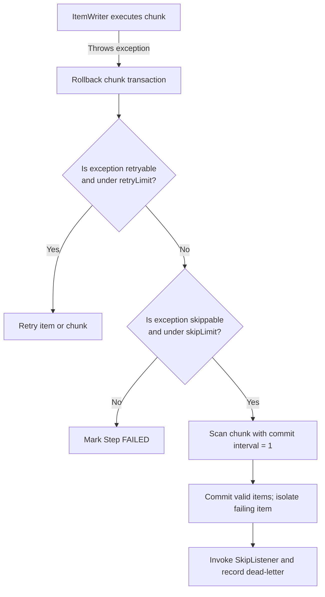
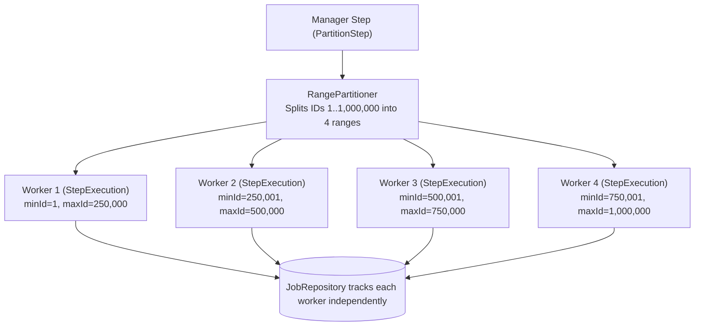

Many batch jobs start out as a quick scheduled method:

```java
// Works for 200 rows; breaks down at 20 million rows
List<Transaction> transactions = transactionRepository.findAll();
for (Transaction tx : transactions) {
    calculateFee(tx);
    transactionRepository.save(tx);
}
```

With a few hundred rows on a laptop, this finishes in under a second. Against tens of millions of rows in production, three problems appear immediately:

1. `findAll()` pulls the entire table into the JVM heap, triggering `OutOfMemoryError`.
2. Wrapping the loop in a single `@Transactional` boundary holds locks and bloats the database's undo/WAL logs for hours.
3. A single malformed row or brief network drop near the end rolls back hours of work, leaving you with no record of what already succeeded and no safe way to resume.

Spring Batch solves these problems with streaming readers, bounded transactional chunks, persistent execution metadata, declarative skip/retry rules, and horizontal step scaling.

## Batch Architecture: `JobRepository`, `Job`, and `Step`

Spring Batch separates *what* a batch workflow does from *how* its state is tracked across runs:



- **`Job`**: The top-level workflow composed of one or more steps executed sequentially or conditionally via deciders.
- **`Step`**: An independent phase of a job. A step is either a **Tasklet** (a single custom unit of work, such as archiving files or calling a stored procedure) or a **Chunk-Oriented Step** (a streaming read-process-write loop).
- **`JobRepository`**: Persists metadata about every job and step execution in a small set of relational tables (`BATCH_JOB_INSTANCE`, `BATCH_JOB_EXECUTION`, `BATCH_STEP_EXECUTION`, and their `*_EXECUTION_CONTEXT` tables). That persisted state is what enables auditing, metrics, and restartability.

### `JobInstance` vs. `JobExecution`

Understanding the distinction between these two concepts prevents most restart surprises:

- A **`JobInstance`** is a logical run defined by a job name plus its **identifying `JobParameters`** (for example, `monthlyBillingJob` with `billingDate=2026-10-31`).
- A **`JobExecution`** is a single attempt to run a `JobInstance`. If the first attempt fails halfway through, relaunching the job with the exact same identifying parameters creates a *second* `JobExecution` attached to the *same* `JobInstance`.

Once a `JobInstance` reaches `COMPLETED`, Spring Batch refuses to run it again with the same identifying parameters (throwing `JobInstanceAlreadyCompleteException`). This prevents accidental duplicate billing runs. If a job is meant to run repeatedly on demand without business parameters, attach a `RunIdIncrementer`—just be aware that incrementing `run.id` creates a brand-new `JobInstance` on every launch, which bypasses restart-from-checkpoint semantics unless you explicitly pass the failed run's original parameters.

## Chunk-Oriented Processing

In a chunk step, Spring Batch reads items one at a time, passes each through an optional processor, accumulates outputs until the configured **commit interval** (chunk size) is reached, and hands the whole chunk to the writer inside a single transaction.



The three core interfaces work together as follows:

1. **`ItemReader<I>`**: Returns the next item on each `read()` call and returns `null` to signal the end of input. Memory stays bounded to the current page or buffer rather than the whole dataset.
2. **`ItemProcessor<I, O>`**: Validates, enriches, or transforms one item at a time. Returning `null` filters that item out cleanly without treating it as an error.
3. **`ItemWriter<O>`**: Receives a `Chunk<? extends O>` containing up to `N` processed items and writes them together (for example, as a single JDBC batch insert).

### Choosing a Commit Interval

The chunk size is a tuning trade-off, not a fixed constant:

- **Too small (for example, 1 or 10)**: You pay database transaction commit overhead and `JobRepository` metadata update overhead on nearly every record, which bottlenecks throughput.
- **Too large (for example, 50,000)**: Memory usage climbs, database transactions stay open longer, and a rollback forces a much larger set of items to be re-processed or scanned.

For typical relational database workloads, starting between 250 and 1,000 items per chunk and measuring throughput, lock contention, and heap pressure is a sensible baseline.

## Spring Batch 5 Configuration in Spring Boot 3

Spring Batch 5 (shipped with Spring Boot 3) changed several long-standing APIs from Spring Batch 4:

- `JobBuilderFactory` and `StepBuilderFactory` were deprecated in Spring Batch 5.0 and removed in 5.2. You construct `JobBuilder` and `StepBuilder` directly, passing `JobRepository` and `PlatformTransactionManager` explicitly.
- `ItemWriter.write(...)` now accepts `Chunk<? extends T>` instead of `List<? extends T>`.
- In Spring Boot 3, **do not add `@EnableBatchProcessing`** unless you want to disable Spring Boot's batch auto-configuration (such as automatic schema initialization and `JobLauncherApplicationRunner`). Spring Boot 3 auto-configures the batch infrastructure automatically when `spring-boot-starter-batch` is on the classpath.

### Domain Records and a Custom Spring Batch 5 `ItemWriter`

Suppose we read pending transactions from PostgreSQL, filter out tiny test records, compute a processing fee, and write the result:

```java
package com.javahub.batch.domain;

import java.math.BigDecimal;

public record TransactionInput(
    long id,
    String accountId,
    BigDecimal amount,
    String txType
) {}

public record ProcessedTransaction(
    long transactionId,
    String accountId,
    BigDecimal originalAmount,
    BigDecimal feeAmount,
    BigDecimal netAmount
) {}
```

When writing a custom `ItemWriter` in Spring Batch 5, override `write(Chunk<? extends T> chunk)`:

```java
package com.javahub.batch.writer;

import com.javahub.batch.domain.ProcessedTransaction;
import org.slf4j.Logger;
import org.slf4j.LoggerFactory;
import org.springframework.batch.item.Chunk;
import org.springframework.batch.item.ItemWriter;

public class LoggingTransactionWriter implements ItemWriter<ProcessedTransaction> {

    private static final Logger log = LoggerFactory.getLogger(LoggingTransactionWriter.class);

    @Override
    public void write(Chunk<? extends ProcessedTransaction> chunk) {
        log.info("Writing batch of {} processed transactions", chunk.size());
        for (ProcessedTransaction tx : chunk.getItems()) {
            log.debug("Transaction {} net amount: {}", tx.transactionId(), tx.netAmount());
        }
    }
}
```

### Wiring the Complete Chunk Pipeline

For database writes, `JdbcBatchItemWriter` sends the entire chunk using JDBC batching. Note one practical detail when using Java `record` types: `JdbcBatchItemWriterBuilder.beanMapped()` relies on standard JavaBean getter naming (`getTransactionId()`), which records do not have. Using `itemSqlParameterSourceProvider` with `MapSqlParameterSource` (or `itemPreparedStatementSetter`) works cleanly with records and avoids reflection surprises.

```java
package com.javahub.batch.config;

import com.javahub.batch.domain.ProcessedTransaction;
import com.javahub.batch.domain.TransactionInput;
import org.springframework.batch.core.Job;
import org.springframework.batch.core.Step;
import org.springframework.batch.core.job.builder.JobBuilder;
import org.springframework.batch.core.repository.JobRepository;
import org.springframework.batch.core.step.builder.StepBuilder;
import org.springframework.batch.item.ItemProcessor;
import org.springframework.batch.item.database.JdbcBatchItemWriter;
import org.springframework.batch.item.database.JdbcPagingItemReader;
import org.springframework.batch.item.database.Order;
import org.springframework.batch.item.database.builder.JdbcBatchItemWriterBuilder;
import org.springframework.batch.item.database.builder.JdbcPagingItemReaderBuilder;
import org.springframework.batch.item.database.support.PostgresPagingQueryProvider;
import org.springframework.context.annotation.Bean;
import org.springframework.context.annotation.Configuration;
import org.springframework.dao.TransientDataAccessException;
import org.springframework.jdbc.core.namedparam.MapSqlParameterSource;
import org.springframework.transaction.PlatformTransactionManager;

import javax.sql.DataSource;
import java.math.BigDecimal;
import java.math.RoundingMode;
import java.util.Map;

@Configuration
public class TransactionBatchConfiguration {

    private static final int CHUNK_SIZE = 500;

    @Bean
    public JdbcPagingItemReader<TransactionInput> transactionReader(DataSource dataSource) {
        PostgresPagingQueryProvider queryProvider = new PostgresPagingQueryProvider();
        queryProvider.setSelectClause("SELECT id, account_id, amount, tx_type");
        queryProvider.setFromClause("FROM raw_transactions");
        queryProvider.setWhereClause("WHERE status = 'PENDING'");
        queryProvider.setSortKeys(Map.of("id", Order.ASCENDING));

        return new JdbcPagingItemReaderBuilder<TransactionInput>()
                .name("transactionReader")
                .dataSource(dataSource)
                .pageSize(CHUNK_SIZE)
                .queryProvider(queryProvider)
                .rowMapper((rs, rowNum) -> new TransactionInput(
                        rs.getLong("id"),
                        rs.getString("account_id"),
                        rs.getBigDecimal("amount"),
                        rs.getString("tx_type")
                ))
                .build();
    }

    @Bean
    public ItemProcessor<TransactionInput, ProcessedTransaction> transactionProcessor() {
        return input -> {
            if (input.amount() == null || input.amount().signum() < 0) {
                throw new IllegalArgumentException("Negative or missing amount for tx " + input.id());
            }
            // Filter out sub-unit test transactions without marking them as failures
            if (input.amount().compareTo(BigDecimal.ONE) < 0) {
                return null;
            }

            BigDecimal fee = input.amount()
                    .multiply(new BigDecimal("0.015"))
                    .setScale(2, RoundingMode.HALF_UP);
            BigDecimal net = input.amount().subtract(fee);

            return new ProcessedTransaction(
                    input.id(),
                    input.accountId(),
                    input.amount(),
                    fee,
                    net
            );
        };
    }

    @Bean
    public JdbcBatchItemWriter<ProcessedTransaction> transactionWriter(DataSource dataSource) {
        return new JdbcBatchItemWriterBuilder<ProcessedTransaction>()
                .dataSource(dataSource)
                .sql("""
                    INSERT INTO processed_transactions
                        (transaction_id, account_id, original_amount, fee_amount, net_amount, processed_at)
                    VALUES
                        (:transactionId, :accountId, :originalAmount, :feeAmount, :netAmount, NOW())
                """)
                .itemSqlParameterSourceProvider(tx -> new MapSqlParameterSource()
                        .addValue("transactionId", tx.transactionId())
                        .addValue("accountId", tx.accountId())
                        .addValue("originalAmount", tx.originalAmount())
                        .addValue("feeAmount", tx.feeAmount())
                        .addValue("netAmount", tx.netAmount()))
                .build();
    }

    @Bean
    public Step processTransactionsStep(JobRepository jobRepository,
                                        PlatformTransactionManager transactionManager,
                                        JdbcPagingItemReader<TransactionInput> reader,
                                        ItemProcessor<TransactionInput, ProcessedTransaction> processor,
                                        JdbcBatchItemWriter<ProcessedTransaction> writer,
                                        TransactionSkipListener skipListener) {
        return new StepBuilder("processTransactionsStep", jobRepository)
                .<TransactionInput, ProcessedTransaction>chunk(CHUNK_SIZE, transactionManager)
                .reader(reader)
                .processor(processor)
                .writer(writer)
                .faultTolerant()
                .retry(TransientDataAccessException.class)
                .retryLimit(3)
                .skip(IllegalArgumentException.class)
                .skipLimit(100)
                .listener(skipListener)
                .build();
    }

    @Bean
    public Job processTransactionsJob(JobRepository jobRepository, Step processTransactionsStep) {
        return new JobBuilder("processTransactionsJob", jobRepository)
                .start(processTransactionsStep)
                .build();
    }
}
```

## Fault Tolerance: Skip, Retry, and Rollback Mechanics

Real input feeds contain bad dates, negative amounts, and duplicate IDs, and databases occasionally throw transient deadlock or connection errors. Calling `.faultTolerant()` enables declarative **retry** and **skip** policies:

- **Retry** is for transient infrastructure errors (`TransientDataAccessException`, `CannotAcquireLockException`, temporary timeouts). Retrying a bad CSV row or `IllegalArgumentException` wastes time because it will fail every time.
- **Skip** is for bad data records (`FlatFileParseException`, validation exceptions) up to a bounded `skipLimit`. Exceeding `skipLimit` aborts the step so a broken upstream schema change does not silently discard an entire file.



### How Rollback and Chunk Scanning Interact

When a skippable or retryable exception happens inside the `ItemProcessor` or `ItemWriter`, Spring Batch does not just swallow the exception and continue inside the same database transaction, because the transaction may already be marked rollback-only by the database or JPA provider.

Instead, Spring Batch rolls back the chunk transaction and switches into **scanning mode** for that chunk:

1. Cached input items from the rolled-back chunk are re-submitted one by one (effective commit interval of 1).
2. Each valid item succeeds and commits individually.
3. When the poisoned item fails again, Spring Batch applies the retry policy first (if configured for that exception) and then the skip policy.
4. Once skipped, the item is passed to any registered `SkipListener`, and normal chunking resumes on the next chunk.

Because items in a rolled-back chunk are re-processed during scanning, make sure your `ItemProcessor` does not produce uncompensated external side effects (such as sending emails or charging cards directly inside `process()`).

### Recording Skipped Items Safely with `SkipListener`

Never skip data silently. Persist skipped items to a dead-letter table so operations teams can inspect and replay them. Use `Propagation.REQUIRES_NEW` on the audit insert (or a separate `TransactionTemplate`) so the dead-letter record commits independently and is never lost if a later exception rolls back the surrounding step transaction:

```java
package com.javahub.batch.listener;

import com.javahub.batch.domain.ProcessedTransaction;
import com.javahub.batch.domain.TransactionInput;
import org.slf4j.Logger;
import org.slf4j.LoggerFactory;
import org.springframework.batch.core.SkipListener;
import org.springframework.jdbc.core.simple.JdbcClient;
import org.springframework.stereotype.Component;
import org.springframework.transaction.annotation.Propagation;
import org.springframework.transaction.annotation.Transactional;

@Component
public class TransactionSkipListener implements SkipListener<TransactionInput, ProcessedTransaction> {

    private static final Logger log = LoggerFactory.getLogger(TransactionSkipListener.class);
    private final JdbcClient jdbcClient;

    public TransactionSkipListener(JdbcClient jdbcClient) {
        this.jdbcClient = jdbcClient;
    }

    @Override
    public void onSkipInRead(Throwable t) {
        log.error("Skipped unreadable record: {}", t.getMessage());
    }

    @Override
    @Transactional(propagation = Propagation.REQUIRES_NEW)
    public void onSkipInProcess(TransactionInput item, Throwable t) {
        log.warn("Skipping transaction {}: {}", item.id(), t.getMessage());
        jdbcClient.sql("""
            INSERT INTO batch_discarded_records (record_id, payload, failure_reason, discarded_at)
            VALUES (?, ?, ?, NOW())
        """)
        .params(String.valueOf(item.id()), item.toString(), t.getMessage())
        .update();
    }

    @Override
    @Transactional(propagation = Propagation.REQUIRES_NEW)
    public void onSkipInWrite(ProcessedTransaction item, Throwable t) {
        log.error("Skipping transaction {} on write: {}", item.transactionId(), t.getMessage());
        jdbcClient.sql("""
            INSERT INTO batch_discarded_records (record_id, payload, failure_reason, discarded_at)
            VALUES (?, ?, ?, NOW())
        """)
        .params(String.valueOf(item.transactionId()), item.toString(), t.getMessage())
        .update();
    }
}
```

## Restartability and `ExecutionContext`

Every `ItemStreamReader` (including `FlatFileItemReader`, `JdbcCursorItemReader`, and `JdbcPagingItemReader`) participates in checkpointing through `ExecutionContext`. After each chunk commits, Spring Batch calls `ItemStream.update(ExecutionContext)` and saves the updated key-value map into `BATCH_STEP_EXECUTION_CONTEXT` as part of the chunk commit lifecycle.

If the process crashes after committing 2,450 chunks of 1,000 rows:

1. `BATCH_JOB_EXECUTION` and `BATCH_STEP_EXECUTION` reflect the failure (`FAILED`, or `STARTED`/`UNKNOWN` if the JVM was killed with `SIGKILL`, which requires marking the abandoned execution failed before restart).
2. `BATCH_STEP_EXECUTION_CONTEXT` still holds the last committed read count and paging keys (for example, `transactionReader.read.count = 2450000`).
3. When you relaunch the job with the same identifying `JobParameters`, Spring Batch finds the failed `JobInstance`, loads the saved `ExecutionContext` into `reader.open(executionContext)`, and resumes right after the last committed chunk.

One subtle trap with `JdbcPagingItemReader` restarts: if your `WHERE` clause filters on `status = 'PENDING'` and your writer updates those same rows to `status = 'PROCESSED'`, the result set shrinks as you process it. On the next page query, offset-based paging skips rows! Either use a dedicated target table (as in our example above), keep the source rows immutable during the run, or drive pagination strictly by a monotonically increasing primary key (`WHERE id > :lastProcessedId`) rather than shifting status flags.

## Cursor vs. Paging Readers

| Dimension | `JdbcCursorItemReader` | `JdbcPagingItemReader` |
| :--- | :--- | :--- |
| **Database connection** | Keeps one JDBC connection and cursor open for the entire step | Borrows a connection per page query, then returns it to the pool |
| **Thread safety** | Not thread-safe (backed by a single stateful `ResultSet`) | Thread-safe (synchronized page fetches) |
| **Throughput** | Fast linear scan with minimal query planning overhead | Slightly more SQL overhead per page; requires deterministic `sortKeys` |
| **Cloud resilience** | Vulnerable to idle proxy/firewall timeouts on multi-hour jobs | Resilient behind HikariCP, PgBouncer, and managed RDS proxies |

For single-threaded jobs against an internal database with stable connections, `JdbcCursorItemReader` is simple and fast. In cloud environments or any parallel step, `JdbcPagingItemReader` with indexed `sortKeys` (such as a primary key `id`) is usually the safer choice. Note that `PostgresPagingQueryProvider` uses keyset-style predicates based on `sortKeys` rather than raw `OFFSET`, which avoids the classic `OFFSET N` performance cliff on large tables.

## Partitioning and Scaling Parallel Batch Steps

When a single thread cannot finish within the nightly batch window, Spring Batch offers two main ways to parallelize a step locally:

1. **Multi-threaded Step**: Attach a `TaskExecutor` directly to a chunk step so multiple threads process chunks concurrently from the *same* reader. The downside is that stateful `ItemStreamReader` restartability breaks when multiple threads advance a shared read counter out of order, so you normally have to set `saveState(false)`.
2. **Partitioning (Preferred for Restartable Scaling)**: A **manager step** divides the dataset into independent logical slices (such as ID ranges, date buckets, or separate files) using a `Partitioner`. Each slice runs as its own **worker `StepExecution`** with its own `ExecutionContext`, reader instance, and transaction boundary.



Because every partition has its own `StepExecution` in `JobRepository`, if partitions 1, 2, and 4 complete and partition 3 fails due to a transient timeout, restarting the job skips partitions 1, 2, and 4 completely and resumes *only* partition 3 from its last committed chunk.

### Implementing a Range `Partitioner`

```java
package com.javahub.batch.partition;

import org.springframework.batch.core.partition.support.Partitioner;
import org.springframework.batch.item.ExecutionContext;
import org.springframework.jdbc.core.simple.JdbcClient;

import java.util.HashMap;
import java.util.Map;

public class TransactionRangePartitioner implements Partitioner {

    private final JdbcClient jdbcClient;

    public TransactionRangePartitioner(JdbcClient jdbcClient) {
        this.jdbcClient = jdbcClient;
    }

    @Override
    public Map<String, ExecutionContext> partition(int gridSize) {
        Long minId = jdbcClient.sql("SELECT MIN(id) FROM raw_transactions WHERE status = 'PENDING'")
                .query(Long.class).single();
        Long maxId = jdbcClient.sql("SELECT MAX(id) FROM raw_transactions WHERE status = 'PENDING'")
                .query(Long.class).single();

        Map<String, ExecutionContext> partitions = new HashMap<>();
        if (minId == null || maxId == null) {
            return partitions;
        }

        long targetSize = Math.max(1, (maxId - minId) / gridSize + 1);
        long start = minId;
        int partitionIndex = 0;

        while (start <= maxId) {
            long end = Math.min(start + targetSize - 1, maxId);
            ExecutionContext context = new ExecutionContext();
            context.putLong("minId", start);
            context.putLong("maxId", end);
            partitions.put("partition-" + partitionIndex, context);

            start = end + 1;
            partitionIndex++;
        }

        return partitions;
    }
}
```

### Wiring `@StepScope` Reader and the Manager Step

Each worker thread needs its own reader instance parameterized with that partition's `minId` and `maxId`. Annotating the reader with `@StepScope` tells Spring Batch to instantiate a fresh proxy per `StepExecution` and resolve SpEL expressions from `stepExecutionContext`:

```java
@Bean
@StepScope
public JdbcPagingItemReader<TransactionInput> partitionedTransactionReader(
        DataSource dataSource,
        @Value("#{stepExecutionContext['minId']}") Long minId,
        @Value("#{stepExecutionContext['maxId']}") Long maxId) {

    PostgresPagingQueryProvider queryProvider = new PostgresPagingQueryProvider();
    queryProvider.setSelectClause("SELECT id, account_id, amount, tx_type");
    queryProvider.setFromClause("FROM raw_transactions");
    queryProvider.setWhereClause("WHERE status = 'PENDING' AND id >= :minId AND id <= :maxId");
    queryProvider.setSortKeys(Map.of("id", Order.ASCENDING));

    return new JdbcPagingItemReaderBuilder<TransactionInput>()
            .name("partitionedTransactionReader")
            .dataSource(dataSource)
            .pageSize(500)
            .queryProvider(queryProvider)
            .parameterValues(Map.of("minId", minId, "maxId", maxId))
            .rowMapper((rs, rowNum) -> new TransactionInput(
                    rs.getLong("id"),
                    rs.getString("account_id"),
                    rs.getBigDecimal("amount"),
                    rs.getString("tx_type")
            ))
            .build();
}

@Bean
public TaskExecutor batchTaskExecutor() {
    ThreadPoolTaskExecutor executor = new ThreadPoolTaskExecutor();
    executor.setCorePoolSize(4);
    executor.setMaxPoolSize(4);
    executor.setThreadNamePrefix("batch-worker-");
    executor.initialize();
    return executor;
}

@Bean
public Step managerStep(JobRepository jobRepository,
                        Step workerStep,
                        TransactionRangePartitioner partitioner,
                        TaskExecutor batchTaskExecutor) {
    return new StepBuilder("transactionManagerStep", jobRepository)
            .partitioner("workerStep", partitioner)
            .step(workerStep)
            .gridSize(4)
            .taskExecutor(batchTaskExecutor)
            .build();
}
```

Keep `gridSize`, `batchTaskExecutor` pool size, and your HikariCP `maximum-pool-size` aligned. Running 16 parallel partitions against a connection pool of 10 connections will cause workers to stall waiting for connections (and remember that `JobRepository` updates also need connections during chunk commits). When a single JVM runs out of CPU or memory, the same `Partitioner` design scales across multiple machines by swapping `TaskExecutorPartitionHandler` for Spring Batch Integration's remote partitioning over Kafka or RabbitMQ.

## Interview Questions

### What changed in Spring Batch 5 / Spring Boot 3 regarding `JobBuilderFactory`, `StepBuilderFactory`, and `@EnableBatchProcessing`?

Spring Batch 5 deprecated (and later removed) `JobBuilderFactory` and `StepBuilderFactory`. You now instantiate `new JobBuilder("name", jobRepository)` and `new StepBuilder("name", jobRepository)` directly, passing `PlatformTransactionManager` to `.chunk(size, transactionManager)`. Equally important in Spring Boot 3: adding `@EnableBatchProcessing` opts you *out* of Spring Boot's batch auto-configuration, so standard Boot 3 applications should omit `@EnableBatchProcessing` unless customizing the core batch infrastructure manually.

### Why is partitioning generally preferred over a multi-threaded step for scaling database batch jobs?

A multi-threaded step shares one `StepExecution` and one `ItemReader` across multiple threads. Because chunks commit out of order, the reader's `ExecutionContext` offset no longer represents a clean contiguous high-water mark, forcing you to disable state saving (`saveState(false)`) and give up exact restartability. Partitioning gives each worker thread a disjoint data slice and its own `StepExecution` and `ExecutionContext`, preserving full restartability per partition and eliminating reader contention.

### What happens step by step when an `ItemWriter` throws a skippable exception on a chunk of 500 items?

First, the transaction manager rolls back the entire 500-item chunk transaction. Because the step is fault-tolerant and the exception is skippable (or retryable), Spring Batch enters chunk-scanning mode: it takes the cached items from that chunk and processes/writes them one item per transaction (commit interval of 1). The 499 valid items commit individually, the single failing item triggers the skip limit check and `SkipListener` callback, and once the chunk finishes scanning, Spring Batch returns to normal 500-item chunks.

### What happens if you update the same column in your `ItemWriter` that your `JdbcPagingItemReader` filters on in its `WHERE` clause?

Your pages will skip rows. For example, if the reader queries `WHERE status = 'PENDING'` and the writer flips processed rows to `'DONE'`, the remaining pending rows shift forward after every commit while the paging reader advances to page 2, leaving rows unprocessed. Avoid this by either writing to a separate target table, marking rows only after reading via an immutable key range (`id >= :minId AND id <= :maxId`), or driving the reader with a keyset query that does not depend on the mutated status column.
