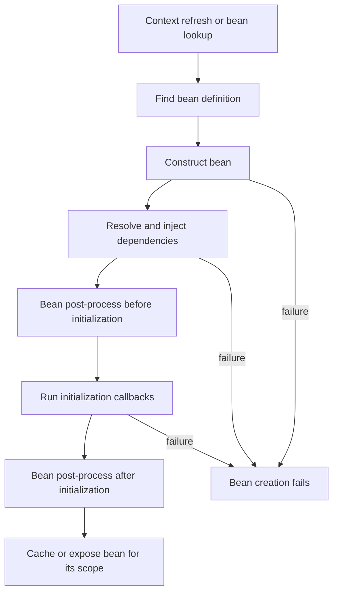

Spring applications are made of ordinary Java objects, but the framework takes responsibility for assembling many of them and managing their lifecycles. Understanding that boundary explains where injected dependencies come from, why a bean is shared or recreated, and what Spring Boot configures when an application starts.

This lesson uses Java 21 examples and the Spring Framework 7.0.10 / Spring Boot 4.1.2 documentation available while writing. The repository does not declare Spring as an application dependency, so these examples are instructional rather than compiled as part of this site.

After this lesson, you should be able to trace a dependency from its definition to the object that receives it, distinguish bean scopes, explain the main lifecycle callbacks, and investigate an auto-configuration decision.

## Inversion of Control and dependency injection

Without a container, a class often constructs its collaborators directly:

```java
class CheckoutService {
    private final PaymentGateway gateway = new HttpPaymentGateway();
}
```

Now `CheckoutService` chooses the concrete gateway, its configuration, and when to create it. Tests that need a fake gateway must work around that construction choice.

**Inversion of Control (IoC)** means an object gives up control over some part of its creation or coordination to another component. **Dependency Injection (DI)** is the common IoC technique in which dependencies are provided to an object rather than looked up or constructed by that object. The object can remain a plain Java object; Spring's container supplies the collaborators.

```java
interface PaymentGateway {
    void charge(String orderId);
}

@Service
class CheckoutService {
    private final PaymentGateway gateway;

    CheckoutService(PaymentGateway gateway) {
        this.gateway = gateway;
    }

    void checkout(String orderId) {
        gateway.charge(orderId);
    }
}

@Component
class SandboxPaymentGateway implements PaymentGateway {
    @Override
    public void charge(String orderId) {
        System.out.println("Charged order " + orderId);
    }
}
```

Imports are omitted; treat the types as separate source files in the application's scanned package.

When these types are registered as beans, Spring finds a `PaymentGateway` and passes it to `CheckoutService`'s constructor. The service depends on the abstraction, not on how the gateway is created. Keeping the field `final` makes the required dependency explicit and prevents the service from being constructed in a partially configured state.

## The container and bean definitions

A **bean** is an object that Spring's IoC container instantiates, assembles, and manages. A **bean definition** is the recipe and metadata Spring uses to create such an object; it is not the object instance itself. Definitions can come from component scanning, Java configuration, imported configuration, XML, and framework integrations.

`BeanFactory` provides the core container contract. `ApplicationContext` builds on it and adds application-oriented facilities such as event publication, message-resource handling, and integration with Spring AOP. Most application code uses an `ApplicationContext` indirectly through dependency injection instead of calling `getBean()` everywhere.

Two common registration styles are:

```java
@Configuration
class PaymentConfiguration {
    @Bean
    PaymentGateway paymentGateway() {
        return new SandboxPaymentGateway();
    }
}
```

```java
@Component
class SandboxPaymentGateway implements PaymentGateway {
    // implementation
}
```

`@Bean` registers the object returned by a configuration method. Stereotype annotations such as `@Component` and `@Service` mark classes for component scanning. Scanning only covers configured packages: with Spring Boot, `@SpringBootApplication` normally starts scanning from the package containing the application class and its descendants. Put the application class in a suitable root package, or explicitly import/configure components in other packages.

An object created with `new` by application code is not automatically a Spring bean. It will not receive injected dependencies or container lifecycle callbacks unless the application explicitly connects it to Spring. Conversely, do not call `applicationContext.getBean()` as a routine substitute for DI: it hides dependencies behind a service-locator lookup.

## Constructor injection versus field injection

Spring supports constructor, setter, and field injection. Constructor injection is a strong default for required dependencies:

```java
@Service
class CheckoutService {
    private final PaymentGateway gateway;

    CheckoutService(PaymentGateway gateway) {
        this.gateway = gateway;
    }
}
```

With one constructor, Spring does not require `@Autowired` on it. The constructor documents what is required, supports direct unit tests, and allows immutable fields. If there are multiple candidate implementations of an interface, use an explicit qualifier or primary-bean choice rather than relying on accidental scan order.

Field injection is supported, but makes the dependency less visible to callers and prevents the field from being `final`:

```java
@Service
class CheckoutService {
    @Autowired
    private PaymentGateway gateway;
}
```

This object can be created outside Spring with `gateway == null`, so a plain unit test cannot construct it in a valid state. Constructor injection makes that invalid state harder to express. Setter injection remains useful for genuinely optional or replaceable dependencies, but do not use it to disguise required collaborators.

Constructor cycles are a design warning: if service A needs B to construct and B needs A to construct, neither object can be completed first. Break the cycle by extracting a shared responsibility or changing the collaboration boundary rather than adding lookups to the application context.

## Bean creation and lifecycle

For a typical singleton, the container reads its definition, creates the object, supplies dependencies, runs initialization callbacks, and makes the initialized instance available. Eager singletons are generally created during context startup; lazy or non-singleton beans are created when first requested. A `BeanPostProcessor` can customize an instance before and after initialization, and may return a wrapper such as a proxy.

The diagram shows the simplified creation path. A failure during construction, dependency resolution, or initialization is surfaced to the refresh or lookup that triggered creation; the bean is not published as successfully initialized.



For a bean with configured callbacks, the usual initialization order is:

1. Dependencies are supplied.
2. `@PostConstruct` runs.
3. `InitializingBean.afterPropertiesSet()` runs, if implemented.
4. A configured custom init method runs.
5. Post-processors complete processing, potentially returning a wrapped object.

Prefer `@PostConstruct`, `@PreDestroy`, or configured methods over Spring-specific lifecycle interfaces when you do not need the interface. Use initialization callbacks to validate configuration or prepare local state, not to perform long-running external work or reach back into other beans while singleton creation is in progress.

On an orderly context shutdown, managed singleton beans can receive destruction callbacks, including `@PreDestroy` or a configured destroy method. A prototype bean is different: Spring creates and configures it, then hands it to the caller; Spring does not automatically invoke its destruction callbacks. The code that owns a prototype instance must release its resources.

## Bean scopes

Scope controls how instances created from a bean definition are shared:

| Scope | Instance behavior | Important boundary |
|---|---|---|
| `singleton` | One instance per bean definition per Spring container; the default. | Not one instance per JVM or per class. Shared mutable state still needs thread-safety. |
| `prototype` | A new instance for each container request for that bean. | Spring does not manage its full destruction lifecycle. |
| `request` | One instance for an HTTP request. | Requires a web-aware application context and an active request. |
| `session` | One instance for an HTTP session. | Requires a web-aware application context. |

Spring's singleton is not the Gang of Four Singleton pattern. Its identity is scoped to a bean definition in one container: two containers can each have an instance of the same class. Since a singleton service is typically shared by concurrent requests, keep request-specific data in method-local variables or request-scoped objects rather than mutable singleton fields.

Scope mismatches are a common trap. If a prototype bean is injected directly into a singleton, that dependency is resolved when the singleton is created; the singleton then keeps that one prototype instance. To obtain a fresh instance when needed, inject an `ObjectProvider<T>` and call `getObject()` at the point of use, or use an appropriate scoped proxy for a web scope. A request-scoped object cannot be used meaningfully when there is no active request.

## Spring Boot auto-configuration

`@SpringBootApplication` is a convenient composition of:

- `@SpringBootConfiguration`, which marks the application configuration.
- `@ComponentScan`, which discovers application components from the application package.
- `@EnableAutoConfiguration`, which enables Boot's auto-configuration mechanism.

Auto-configuration uses the libraries on the classpath and application conditions to offer sensible bean definitions. For example, a database driver can make database-related configuration eligible, while an application-defined `DataSource` can cause Boot's default to back off. This is conditional configuration, not a guarantee that every dependency creates a bean or that Boot replaces explicit application choices.

Treat auto-configuration as registered defaults that can be inspected and selectively replaced. If an unexpected configuration is active, start the application with `--debug` and inspect the conditions report. Exclude an auto-configuration only when there is a specific conflict or unwanted behavior; prefer providing the intended bean or configuration when that is enough.

## Common failure modes and misconceptions

- **A bean is missing.** Check whether its package is inside component scanning, whether the class is eligible for scanning, and whether the relevant configuration was imported.
- **Spring reports an ambiguous dependency.** More than one bean matches the injection type. Add a qualifier or select a primary bean intentionally.
- **The dependency is unexpectedly null.** The object may have been created with `new` outside the container, or its package may not have been scanned.
- **State leaks between requests.** A mutable field on a singleton is shared. Move request data to method-local state or the correct web scope.
- **A prototype does not refresh on each method call.** Direct injection into a singleton happens once at singleton construction; use a provider or suitable scoped indirection.
- **A startup default does not appear.** Check the classpath, user-defined beans, configuration properties, package placement, and Boot's conditions report before assuming the auto-configuration failed.
- **A prototype resource is not closed.** The caller that receives it owns cleanup; the container does not automatically run its destroy callback.

## Further reading

- Spring Framework 7.0.10, [Introduction to the IoC Container and Beans](https://docs.spring.io/spring-framework/reference/core/beans/introduction.html)
- Spring Framework 7.0.10, [Dependency Injection](https://docs.spring.io/spring-framework/reference/core/beans/dependencies/factory-collaborators.html)
- Spring Framework 7.0.10, [Using `@Autowired`](https://docs.spring.io/spring-framework/reference/core/beans/annotation-config/autowired.html)
- Spring Framework 7.0.10, [Bean Scopes](https://docs.spring.io/spring-framework/reference/core/beans/factory-scopes.html)
- Spring Framework 7.0.10, [Bean Lifecycle Callbacks](https://docs.spring.io/spring-framework/reference/core/beans/factory-nature.html)
- Spring Boot 4.1.2, [Using the `@SpringBootApplication` Annotation](https://docs.spring.io/spring-boot/reference/using/using-the-springbootapplication-annotation.html)
- Spring Boot 4.1.2, [Auto-configuration](https://docs.spring.io/spring-boot/reference/using/auto-configuration.html)
- [Build Tools](./build-tools)
