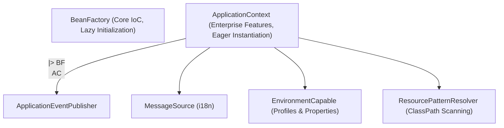
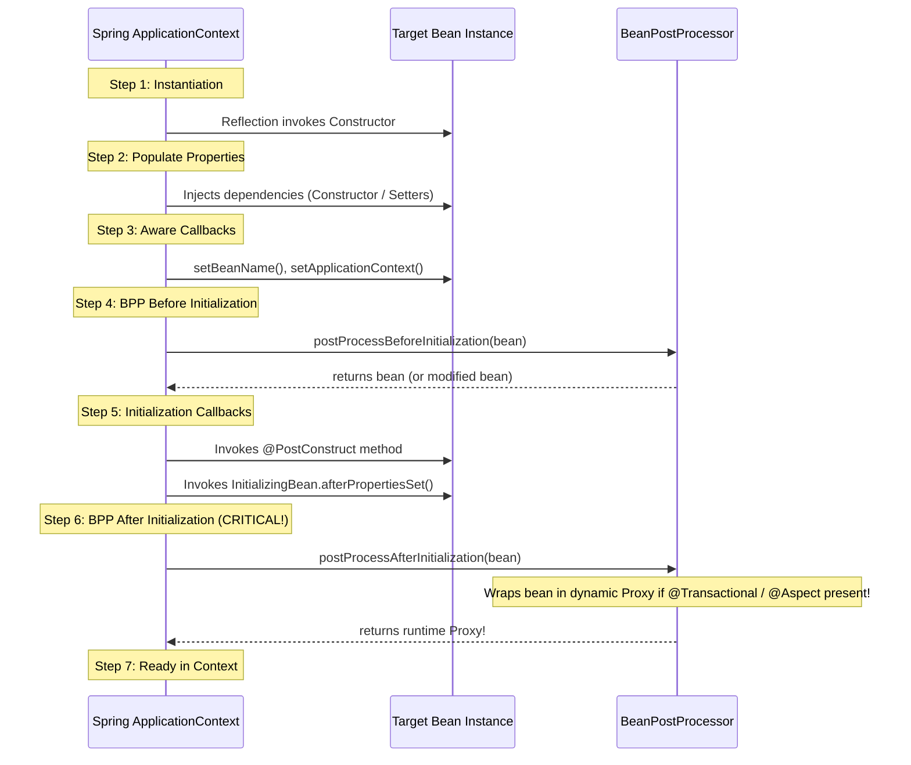

To a junior developer, Spring Boot feels like magic. 

You annotate a class with `@SpringBootApplication`, write a `@RestController`, and suddenly a web server starts on port 8080. A database connection pool connects automatically, transactions commit and roll back silently, and JSON serializes without a line of configuration.

Then, something breaks. 

A circular dependency prevents your application from booting. A field-injected service throws `NullPointerException` inside a unit test. A prototype-scoped bean fails to refresh, leaking stale state across HTTP requests. Or an auto-configured database driver refuses to load.

Spring is not magic; it is a **deterministic, reflection-driven Inversion of Control (IoC) container and proxy orchestration engine**. 

To build resilient enterprise microservices, you must understand what happens under the hood: how the `ApplicationContext` reads bean definitions, how the 7-step bean lifecycle manufactures runtime proxies, and how Spring Boot's condition evaluation engine configures your application.

```mermaid
flowchart TD
    subgraph "Spring IoC Container Architecture"
        Scan["Component Scanning (@Component, @Configuration)"] --> Defs["BeanDefinitionRegistry (In-Memory Recipes)"]
        
        Defs --> Factory["BeanFactory / ApplicationContext"]
        
        Factory --> Instantiate["1. Instantiate Bean (Reflection / Constructor)"]
        Instantiate --> Populate["2. Populate Dependencies (DI)"]
        Populate --> Aware["3. Aware Interfaces (BeanName, Context)"]
        Aware --> PreInit["4. BeanPostProcessor.postProcessBeforeInitialization"]
        PreInit --> Init["5. @PostConstruct / afterPropertiesSet()"]
        Init --> PostInit["6. BeanPostProcessor.postProcessAfterInitialization"]
        
        PostInit --> Proxy{"Is Bean Proxied? (@Transactional, AOP)"}
        Proxy -->|"Yes"| Wrap["Wrap in CGLIB / JDK Dynamic Proxy"]
        Proxy -->|"No"| Raw["Expose Raw Instance"]
        
        Wrap --> Ready["7. Expose in ApplicationContext (Ready for Service)"]
        Raw --> Ready
    end
```



---

## Inversion of Control and Dependency Injection

In traditional procedural code, a class controls its own dependencies:

```java
// RIGID COUPLING:
public class CheckoutService {
    // CheckoutService chooses, configures, and instantiates its collaborator
    private final PaymentGateway gateway = new StripePaymentGateway("sk_live_123");
}
```

This pattern introduces three major architectural flaws:
1. **Zero Testability**: You cannot unit-test `CheckoutService` in isolation without hitting live Stripe network endpoints or modifying source code.
2. **Violates Single Responsibility**: `CheckoutService` must know how to build and configure a `StripePaymentGateway` in addition to processing checkouts.
3. **Hardcoded Infrastructure**: Swapping Stripe for PayPal requires opening, editing, and recompiling core business classes.

**Inversion of Control (IoC)** inverts this control flow: an object gives up the responsibility of creating its collaborators to an external coordinator (the Spring container).

**Dependency Injection (DI)** is the mechanism used to fulfill IoC: the container instantiates the dependencies and injects them into the dependent object at runtime.

### The Three Injection Strategies

Spring supports three primary styles of dependency injection:

#### Constructor Injection (The Enterprise Gold Standard)
```java
@Service
public class CheckoutService {
    private final PaymentGateway gateway;
    private final OrderRepository repository;

    // In modern Spring, @Autowired is completely optional on single constructors!
    public CheckoutService(PaymentGateway gateway, OrderRepository repository) {
        this.gateway = Objects.requireNonNull(gateway, "gateway must not be null");
        this.repository = Objects.requireNonNull(repository, "repository must not be null");
    }
}
```
- **Immutability**: Dependencies can be declared `final`, guaranteeing that the bean's state cannot be modified or corrupted after initialization.
- **Fail-Fast Safety**: The compiler physically prevents the object from being instantiated in an invalid, half-configured state.
- **Pure Unit Testing**: You can test `CheckoutService` in a pure JUnit test using `new CheckoutService(mockGateway, mockRepo)` without starting Spring or using reflection.

#### Setter Injection (For Optional Dependencies)
```java
@Service
public class AuditService {
    private NotificationChannel channel;

    @Autowired(required = false)
    public void setNotificationChannel(NotificationChannel channel) {
        this.channel = channel;
    }
}
```
Use setter injection exclusively for truly optional dependencies that have sensible fallback defaults.

#### Field Injection (The Anti-Pattern)
```java
// BANNED IN PROFESSIONAL CODEBASES:
@Service
public class CheckoutService {
    @Autowired
    private PaymentGateway gateway; // Field injection
}
```

> [!CAUTION]
> **Why Senior Teams Ban Field Injection**:
> 1. **Encourages Hidden Dependencies**: It is easy to add 12 field-injected dependencies without noticing the class violates SRP. A constructor with 12 parameters immediately signals an architectural defect.
> 2. **Prevents Immutability**: Fields cannot be declared `final`.
> 3. **Breaks Plain Unit Tests**: Instantiating `new CheckoutService()` in a unit test leaves `gateway == null`, forcing you to use reflection hacks (`ReflectionTestUtils.setField`) or spin up a heavyweight Spring test context.

---

## BeanFactory vs ApplicationContext

At the heart of the Spring framework are two core interfaces:

- **`BeanFactory`**: The root interface providing the raw configuration framework and basic IoC capabilities (`getBean()`). It uses **Lazy Initialization** (beans are instantiated only when explicitly requested). It is designed for lightweight memory-constrained devices.
- **`ApplicationContext`**: The enterprise superset of `BeanFactory`. It adds:
  - **Eager Pre-Instantiation**: All singleton beans are constructed and verified at application startup, catching configuration errors and missing dependencies immediately.
  - **Spring AOP Integration**: Transparent proxy creation for `@Transactional` and custom aspects.
  - **Event Publication**: Integrated application event broadcasting (`ApplicationEventPublisher`).
  - **Internationalization (i18n)**: Message source resolution for multilingual applications.



---

## The Complete 7-Step Bean Lifecycle

Understanding the lifecycle of a Spring bean is the difference between writing fragile code and mastering enterprise architecture.

When Spring starts up, every singleton bean undergoes a rigorous 7-step pipeline:



### Deep Dive into the Lifecycle Steps

1. **Instantiation**: The container reads the `BeanDefinition` metadata and invokes the appropriate constructor using Java reflection.
2. **Populate Properties**: Dependencies are resolved and injected into the bean instance.
3. **Aware Interfaces**: If the bean implements Spring `Aware` interfaces, the container injects container infrastructure:
   - `BeanNameAware`: Injects the bean's registered ID string.
   - `ApplicationContextAware`: Injects the enclosing `ApplicationContext`.
4. **BeanPostProcessor (Before Initialization)**: Custom interceptors inspect or mutate the newly created instance. Spring's `CommonAnnotationBeanPostProcessor` identifies methods marked with `@PostConstruct`.
5. **Initialization Callbacks**:
   - Methods annotated with `@PostConstruct` execute.
   - If the bean implements `InitializingBean`, `afterPropertiesSet()` runs.
   - Any custom `initMethod` defined in `@Bean(initMethod = "start")` executes.
6. **BeanPostProcessor (After Initialization - The Proxy Factory)**:
   - **This is the most critical phase in Spring.**
   - Infrastructure post-processors (such as `AnnotationAwareAspectJAutoProxyCreator`) inspect the bean's class and methods.
   - If the bean contains `@Transactional`, `@Async`, `@Cacheable`, or custom AOP annotations, **the post-processor wraps the raw bean inside a dynamic CGLIB/ByteBuddy proxy!**
   - The proxy is returned to the container, and the raw instance is hidden.
7. **Destruction Callbacks**: When the container shuts down gracefully:
   - Methods marked with `@PreDestroy` execute.
   - `DisposableBean.destroy()` runs.

---

## Bean Scopes and the Prototype-in-Singleton Dilemma

Spring supports six bean scopes:

| Scope | Lifetime | Creation Trigger | Destruction Handling |
| :--- | :--- | :--- | :--- |
| **`singleton`** (Default) | Entire lifetime of the `ApplicationContext`. | Once during context startup (eager). | Cleaned up via `@PreDestroy` on shutdown. |
| **`prototype`** | Per-request / lookup. | New instance created every time requested. | **NOT managed by Spring** after creation! |
| **`request`** | Single HTTP request. | Created when HTTP request arrives. | Destroyed when HTTP request finishes. |
| **`session`** | Single HTTP session. | Created per user session. | Destroyed when HTTP session expires. |
| **`application`** | Lifetime of `ServletContext`. | Web application startup. | ServletContext shutdown. |
| **`websocket`** | Lifetime of WebSocket session. | WebSocket connection open. | WebSocket connection close. |

### The Prototype-in-Singleton Dilemma

What happens when you inject a `@Scope("prototype")` bean into a standard `@Scope("singleton")` bean?

```java
@Component
@Scope("prototype")
public class CryptoTokenGenerator {
    private final String token = UUID.randomUUID().toString();
    public String getToken() { return token; }
}

@Service // Singleton (Default)
public class AuthenticationService {
    private final CryptoTokenGenerator tokenGenerator;

    public AuthenticationService(CryptoTokenGenerator tokenGenerator) {
        this.tokenGenerator = tokenGenerator;
    }

    public String generateAuthResponse() {
        // BUG! Returns the EXACT SAME TOKEN on every request!
        return tokenGenerator.getToken(); 
    }
}
```

### Why It Fails
The `AuthenticationService` is an eager singleton. It is instantiated **exactly once** during application startup.

When Spring resolves its constructor, it asks the container for a `CryptoTokenGenerator`. Spring creates a fresh prototype instance and injects it. 

After that initial construction, `AuthenticationService` never queries the container again! It holds onto that single prototype instance forever. The prototype bean behaves like a singleton.

### The Remedy: ObjectProvider or Scoped Proxies

To obtain a brand-new prototype instance on every method invocation, use Spring's **`ObjectProvider<T>`**:

```java
@Service
public class AuthenticationService {
    // Inject the provider, not the instance directly
    private final ObjectProvider<CryptoTokenGenerator> tokenProvider;

    public AuthenticationService(ObjectProvider<CryptoTokenGenerator> tokenProvider) {
        this.tokenProvider = tokenProvider;
    }

    public String generateAuthResponse() {
        // Calls getObject() on demand; Spring creates a brand-new prototype every time!
        CryptoTokenGenerator freshGenerator = tokenProvider.getObject();
        return freshGenerator.getToken();
    }
}
```

---

## Spring Boot Auto-Configuration Demystified

What makes Spring Boot revolutionary is **Auto-Configuration**.

When you add `spring-boot-starter-data-jpa` and `postgresql` to your dependencies, Spring Boot automatically configures a HikariCP `DataSource`, creates an `EntityManagerFactory`, wires a `PlatformTransactionManager`, and configures OpenEntityManagerInView.

How does it know to do this without a single line of XML or Java configuration?

### The Mechanics of @EnableAutoConfiguration

`@SpringBootApplication` is a meta-annotation composed of:
1. `@SpringBootConfiguration`: Marks the class as a configuration source.
2. `@ComponentScan`: Scans components in the current package and sub-packages.
3. **`@EnableAutoConfiguration`**: Activates Spring Boot's automatic bean registration engine.

Under the hood, `@EnableAutoConfiguration` reads a standardized descriptor file located in the classpath:
```
META-INF/spring/org.springframework.boot.autoconfigure.AutoConfiguration.imports
```

This file lists hundreds of fully qualified configuration classes (e.g., `DataSourceAutoConfiguration`, `HibernateJpaAutoConfiguration`, `JacksonAutoConfiguration`).

### Conditional Annotations: The Intelligent Gatekeepers

Spring Boot does not blindly instantiate all listed configurations. Every auto-configuration class is guarded by **Conditional Annotations** from `org.springframework.boot.autoconfigure.condition`:

```java
@AutoConfiguration
// 1. Only run if HikariDataSource is present on the physical classpath:
@ConditionalOnClass({ DataSource.class, HikariDataSource.class })
// 2. Only run if the user has NOT declared their own DataSource bean:
@ConditionalOnMissingBean(DataSource.class)
// 3. Only run if spring.datasource.url or type property is present:
@ConditionalOnProperty(prefix = "spring.datasource", name = "url")
public class DataSourceAutoConfiguration {
    
    @Bean
    public HikariDataSource dataSource(DataSourceProperties properties) {
        return properties.initializeDataSourceBuilder().type(HikariDataSource.class).build();
    }
}
```

### The Power of @ConditionalOnMissingBean

The `@ConditionalOnMissingBean` annotation is the cornerstone of Spring Boot's developer experience:
- If you provide **zero configuration**, Spring Boot activates its default `HikariDataSource`.
- The moment you define your own custom `@Bean public DataSource myCustomDataSource()`, the `@ConditionalOnMissingBean` check evaluates to **`false`**. 
- Spring Boot's auto-configuration gracefully backs off and yields control to your custom bean!

> [!TIP]
> **How to Debug Auto-Configuration**:
> If you wonder why a bean was or was not auto-configured, start your application with the `--debug` flag:
> `java -jar app.jar --debug`
> Spring Boot will print the complete **ConditionEvaluationReport**, detailing every auto-configuration class that matched or failed its conditions.

---

## Senior Engineer Interview Crucible

### Why is Field Injection (@Autowired private MyService myService;) widely considered an antipattern, and why is Constructor Injection the modern standard?
Field injection uses reflection to inject dependencies directly into private fields after object instantiation. It is an antipattern because:
1. **Prevents Immutability**: Fields cannot be declared `final`.
2. **Hides Architectural Bloat**: It obscures the Single Responsibility Principle; adding 10 field injections looks clean, whereas a 10-parameter constructor immediately exposes tight coupling.
3. **Fragile Outside Container**: In pure unit tests, instantiating `new Service()` leaves fields `null`, requiring reflection utilities or full container boots.

Constructor injection is the enterprise standard because:
1. Fields can be marked `final`, ensuring thread-safe immutability.
2. The compiler guarantees that an object cannot be constructed in an incomplete or invalid state.
3. Unit tests can instantiate the class cleanly using mock constructors without Spring dependencies.

### Walk through the exact phase in the Spring Bean lifecycle where AOP and @Transactional proxies are created.
AOP and `@Transactional` proxies are created during **Step 6: `BeanPostProcessor.postProcessAfterInitialization()`**.

During this phase, Spring's infrastructure post-processors (specifically `AnnotationAwareAspectJAutoProxyCreator`) inspect the newly initialized bean instance. If the bean or any of its methods are annotated with `@Transactional`, `@Async`, `@Cacheable`, or custom AspectJ pointcuts, the post-processor does not return the raw bean. 

Instead, it dynamically generates a runtime proxy (using CGLIB/ByteBuddy or JDK dynamic proxies) that wraps the target instance. The proxy is registered in the `ApplicationContext`, ensuring that all external calls pass through the proxy's interceptor chain to manage transactions and advice before delegating to the real target object.

### What happens when a @Scope("prototype") bean is injected into a default @Scope("singleton") bean, and how do you ensure a new prototype instance is retrieved on every invocation?
Because the singleton bean is instantiated only once during application startup, its dependencies are resolved and injected exactly once. The prototype bean is created at that startup moment and permanently stored in the singleton's field. Subsequent method calls on the singleton continue reusing that exact same prototype instance, effectively converting it into a singleton.

To ensure a new prototype instance is fetched on every invocation:
1. **`ObjectProvider<T>`**: Inject `ObjectProvider<MyPrototype>` into the singleton and call `provider.getObject()` on each method execution.
2. **`@Lookup` Method Injection**: Declare an abstract or stub method annotated with `@Lookup` on the singleton; Spring overrides the method at runtime using CGLIB to perform a fresh container lookup on each call.
3. **Scoped Proxy**: Configure the prototype bean with `@Scope(value = "prototype", proxyMode = ScopedProxyMode.TARGET_CLASS)`, injecting a proxy that delegates dynamically to a fresh instance on each access.

### How does Spring Boot's @ConditionalOnMissingBean enable auto-configuration while still allowing developer overrides?
`@ConditionalOnMissingBean` is evaluated during Spring Boot's auto-configuration phase after user-defined configuration classes are scanned. 

If the application developer declares an explicit `@Bean` of that type (e.g., a custom `SecurityFilterChain` or `DataSource`), Spring registers the developer's bean definition first. 

When the auto-configuration class is evaluated, `@ConditionalOnMissingBean` checks the `BeanFactory`. Seeing that a bean of that type already exists, the condition evaluates to `false`. Spring Boot skips executing the default auto-configuration method, seamlessly allowing the developer's custom bean to take precedence without requiring configuration flags or manual exclusions.
