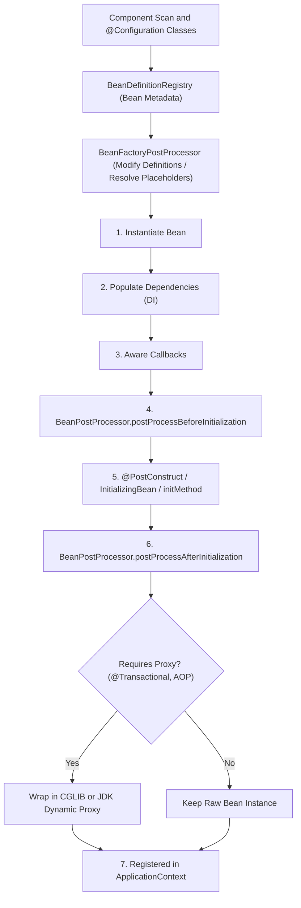
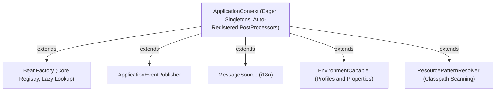
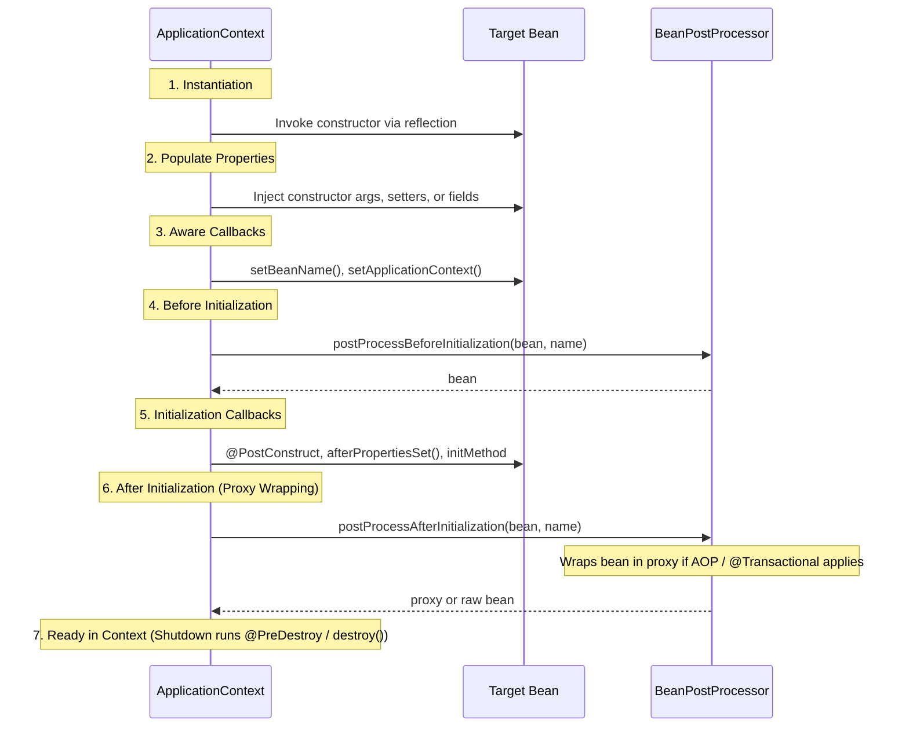

When a Spring Boot service starts cleanly, it is easy to take the container for granted. You add `@SpringBootApplication` and `@RestController`, and an embedded server starts listening, a connection pool initializes, and transactions commit on method exit.

That comfort disappears the moment something goes wrong: startup fails with `BeanCurrentlyInCreationException`, a prototype bean keeps returning the same state across requests, a `@Transactional` annotation is ignored, or an auto-configured `DataSource` conflicts with your custom one. Debugging these issues requires a clear mental model of how the Spring container reads bean metadata, instantiates and post-processes beans, manages scopes, and evaluates auto-configuration conditions.



---

## Inversion of Control and Dependency Injection

Without a container, objects instantiate and configure their own collaborators directly:

```java
public class CheckoutService {
    private final PaymentGateway gateway = new StripePaymentGateway("sk_live_123");
}
```

This creates three practical problems:
- **Hard to test**: You cannot test `CheckoutService` in isolation without hitting Stripe or rewriting the class.
- **Mixed responsibilities**: `CheckoutService` now owns payment business logic *and* gateway construction and credential lookup.
- **Tight coupling**: Switching to another gateway implementation requires editing and recompiling `CheckoutService`.

**Inversion of Control (IoC)** shifts responsibility for creating and assembling collaborators away from the business class to an external container. **Dependency Injection (DI)** is the specific mechanism Spring uses to supply those collaborators when constructing the object.

### Constructor vs. Setter vs. Field Injection

Spring supports three injection styles, and choosing the right one has direct consequences for immutability, testability, and startup safety.

#### Constructor Injection (Default Choice)

```java
@Service
public class CheckoutService {
    private final PaymentGateway gateway;
    private final OrderRepository repository;

    // @Autowired is optional when a bean has a single constructor
    public CheckoutService(PaymentGateway gateway, OrderRepository repository) {
        this.gateway = Objects.requireNonNull(gateway, "gateway must not be null");
        this.repository = Objects.requireNonNull(repository, "repository must not be null");
    }
}
```

Constructor injection works well for required dependencies because:
- Fields can be `final`, guaranteeing safe publication across threads once construction finishes.
- The compiler prevents instantiating `CheckoutService` in a partially initialized state.
- Unit tests can call `new CheckoutService(mockGateway, mockRepo)` directly without starting Spring or using reflection.
- Growing constructor parameter lists immediately make it visible when a class is taking on too many responsibilities.

#### Setter Injection (For Optional Dependencies)

```java
@Service
public class AuditService {
    private NotificationChannel channel = NotificationChannel.noop();

    @Autowired(required = false)
    public void setNotificationChannel(NotificationChannel channel) {
        this.channel = channel;
    }
}
```

Use setter injection only when a dependency is genuinely optional and the bean has a sensible default without it.

#### Field Injection (Avoid in Application Code)

```java
// Avoid in production services
@Service
public class CheckoutService {
    @Autowired
    private PaymentGateway gateway;
}
```

Field injection uses reflection to populate private fields after construction. Fields cannot be `final`, plain unit tests have to use reflection helpers (`ReflectionTestUtils`) or boot a Spring context, and a class can quietly accumulate a dozen injected dependencies without anyone noticing.

### Circular Dependencies

What happens when `OrderService` depends on `CustomerService`, and `CustomerService` depends back on `OrderService`?

```java
@Service
public class OrderService {
    private final CustomerService customerService;

    public OrderService(CustomerService customerService) {
        this.customerService = customerService;
    }
}

@Service
public class CustomerService {
    private final OrderService orderService;

    public CustomerService(OrderService orderService) {
        this.orderService = orderService;
    }
}
```

With constructor injection, Spring cannot instantiate either bean first and fails immediately on startup with `BeanCurrentlyInCreationException`. Starting with **Spring Boot 2.6**, circular references are disabled by default even for setter and field injection (`spring.main.allow-circular-references=false`).

That fail-fast behavior is helpful. A cycle usually signals that two services share a responsibility that belongs in a third component:
1. **Extract a shared collaborator** (preferred): Move the common logic into a third service (for example, `CustomerOrderLookup`) that both depend on.
2. **Decouple with domain events**: Publish an `ApplicationEvent` instead of calling back into the upstream service synchronously.
3. **Break the cycle lazily** (last resort for legacy code): Inject `ObjectProvider<CustomerService>` or annotate one constructor parameter with `@Lazy` so Spring injects a lazy proxy instead of forcing eager construction.

---

## `BeanFactory` vs. `ApplicationContext`

Two interfaces sit at the core of the Spring container:

- **`BeanFactory`**: The minimal root container (`getBean`, `containsBean`, dependency resolution). It instantiates beans lazily on first lookup and requires manual registration of post-processors.
- **`ApplicationContext`**: Extends `BeanFactory` and adds the capabilities real applications rely on:
  - **Eager singleton pre-instantiation**: Singletons are created and wired during startup, surfacing missing beans and invalid configuration before the service accepts traffic.
  - **Automatic post-processor registration**: Discovers and applies `BeanFactoryPostProcessor` and `BeanPostProcessor` beans automatically (which powers `@Autowired`, `@Value`, `@PostConstruct`, and AOP proxies).
  - **Application events**: Extends `ApplicationEventPublisher`.
  - **Environment and profiles**: Extends `EnvironmentCapable` for property sources and active profiles.
  - **Resources and i18n**: Extends `ResourcePatternResolver` and `MessageSource`.



In Spring Boot applications, you almost always work with an `ApplicationContext` implementation such as `AnnotationConfigServletWebServerApplicationContext`.

---

## The Application Context and Bean Lifecycle

Before any bean is instantiated, Spring parses `@Configuration` classes, `@ComponentScan` results, and auto-configuration imports into `BeanDefinition` metadata objects. Any registered `BeanFactoryPostProcessor` (such as `PropertySourcesPlaceholderConfigurer`) runs first to inspect or adjust those definitions.

Once definitions are finalized, every singleton bean moves through a predictable lifecycle:



### What Happens at Each Step

1. **Instantiation**: The container allocates the object by invoking the resolved constructor (or `@Bean` factory method).
2. **Dependency population**: Dependencies and `@Value` properties are injected.
3. **Aware callbacks**: If the bean implements `BeanNameAware`, `BeanFactoryAware`, or `ApplicationContextAware`, Spring passes those references in. (Prefer normal dependency injection over `Aware` interfaces in application code.)
4. **`BeanPostProcessor.postProcessBeforeInitialization`**: Post-processors can inspect or transform the bean before its init callbacks run. Notably, `InitDestroyAnnotationBeanPostProcessor` (via `CommonAnnotationBeanPostProcessor`) triggers `@PostConstruct` at the boundary of this phase.
5. **Initialization callbacks**: `@PostConstruct`, `InitializingBean.afterPropertiesSet()`, and any custom `@Bean(initMethod = "...")` run in that order.
6. **`BeanPostProcessor.postProcessAfterInitialization`**: This is where Spring's proxy infrastructure (`AbstractAutoProxyCreator` / `AnnotationAwareAspectJAutoProxyCreator`) inspects the bean. If any advisor matches (`@Transactional`, `@Async`, `@Cacheable`, or a custom `@Aspect`), the post-processor returns a **dynamic proxy** wrapping the raw target bean. The container registers that proxy, not the raw instance.
7. **Destruction on shutdown**: When the `ApplicationContext` closes gracefully, Spring invokes `@PreDestroy`, `DisposableBean.destroy()`, and any custom `@Bean(destroyMethod = "...")` for singleton beans.

### Seeing Lifecycle Hooks and a Custom `BeanPostProcessor` in Code

```java
@Component
public class CacheWarmupClient {
    private static final Logger log = LoggerFactory.getLogger(CacheWarmupClient.class);

    @PostConstruct
    public void warmUp() {
        log.info("Dependencies are injected; loading initial reference entries");
    }

    @PreDestroy
    public void closeResources() {
        log.info("Context shutting down; releasing client buffers");
    }
}
```

```java
@Component
public class SlowInitDetectorPostProcessor implements BeanPostProcessor {
    private static final Logger log = LoggerFactory.getLogger(SlowInitDetectorPostProcessor.class);
    private final Map<String, Long> startNanos = new ConcurrentHashMap<>();

    @Override
    public Object postProcessBeforeInitialization(Object bean, String beanName) {
        startNanos.put(beanName, System.nanoTime());
        return bean;
    }

    @Override
    public Object postProcessAfterInitialization(Object bean, String beanName) {
        Long started = startNanos.remove(beanName);
        if (started != null) {
            long elapsedMs = (System.nanoTime() - started) / 1_000_000;
            if (elapsedMs > 200) {
                log.warn("Bean '{}' took {} ms to initialize", beanName, elapsedMs);
            }
        }
        return bean;
    }
}
```

> [!NOTE]
> Returning a proxy during `postProcessAfterInitialization` means that methods called inside `@PostConstruct` run on the raw target object *before* the proxy exists. Do not expect `@Transactional` on a `@PostConstruct` method to start a transaction; use `ApplicationReadyEvent` or `CommandLineRunner` if startup logic needs transactional proxies.

---

## Bean Scopes: Singleton, Prototype, and Request

A bean's **scope** controls how many instances the container creates and how long each instance lives.

| Scope | Lifetime | Creation Trigger | Destruction Managed by Spring? |
| :--- | :--- | :--- | :--- |
| **`singleton`** (default) | One instance per `ApplicationContext` | Eagerly at context startup (unless `@Lazy`) | Yes (`@PreDestroy` on context close) |
| **`prototype`** | New instance per container lookup | On each `getBean()` / `ObjectProvider.getObject()` call | **No** (caller owns cleanup) |
| **`request`** | One instance per HTTP request | When an HTTP request starts | Yes (when the HTTP request completes) |
| **`session`** | One instance per HTTP session | First access within a user session | Yes (when the session expires or invalidates) |
| **`application`** | One instance per `ServletContext` | First access in web context | Yes (on `ServletContext` shutdown) |
| **`websocket`** | One instance per WebSocket session | WebSocket session lifecycle | Yes (when WebSocket closes) |

A Spring singleton is scoped per `ApplicationContext`, not per JVM classloader (unlike the GoF Singleton pattern). Because singleton beans are shared across all concurrent request threads, they must remain stateless or use thread-safe structures.

### Request-Scoped Beans in Web Applications

A `@RequestScope` bean (`@Scope(value = WebApplicationContext.SCOPE_REQUEST, proxyMode = ScopedProxyMode.TARGET_CLASS)`) lets you hold per-request state such as a parsed tenant ID or correlation metadata without passing it through every method parameter:

```java
@Component
@RequestScope
public class RequestContext {
    private String correlationId;
    private String tenantId;

    public String getCorrelationId() { return correlationId; }
    public void setCorrelationId(String correlationId) { this.correlationId = correlationId; }

    public String getTenantId() { return tenantId; }
    public void setTenantId(String tenantId) { this.tenantId = tenantId; }
}
```

Because `@RequestScope` enables `ScopedProxyMode.TARGET_CLASS` by default, you can safely inject `RequestContext` into a singleton `@RestController` or `@Service`. Spring injects a CGLIB proxy that looks up the current thread's `RequestAttributes` on every method call and delegates to that request's dedicated instance.

### The Prototype-in-Singleton Trap

Injecting a plain `@Scope("prototype")` bean directly into a singleton bean produces a subtle bug:

```java
@Component
@Scope("prototype")
public class CryptoTokenGenerator {
    private final String token = UUID.randomUUID().toString();
    public String getToken() { return token; }
}

@Service // singleton
public class AuthenticationService {
    private final CryptoTokenGenerator tokenGenerator;

    public AuthenticationService(CryptoTokenGenerator tokenGenerator) {
        this.tokenGenerator = tokenGenerator;
    }

    public String generateAuthToken() {
        // Bug: returns the exact same token on every call
        return tokenGenerator.getToken();
    }
}
```

`AuthenticationService` is instantiated once at startup. Spring asks the container for a `CryptoTokenGenerator`, creates one prototype instance, and passes it into the constructor. `AuthenticationService` holds that same reference for the lifetime of the application, so the prototype effectively behaves like a singleton.

### Fixing Prototype Lookup with `ObjectProvider<T>`

To obtain a fresh prototype instance on every invocation, inject `ObjectProvider<T>` instead of the prototype itself:

```java
@Service
public class AuthenticationService {
    private final ObjectProvider<CryptoTokenGenerator> tokenProvider;

    public AuthenticationService(ObjectProvider<CryptoTokenGenerator> tokenProvider) {
        this.tokenProvider = tokenProvider;
    }

    public String generateAuthToken() {
        // Requests a brand-new prototype bean from the container each time
        return tokenProvider.getObject().getToken();
    }
}
```

Two alternatives exist: `@Lookup` method injection (Spring overrides a stub method with CGLIB to look up a new bean) and `@Scope(value = "prototype", proxyMode = ScopedProxyMode.TARGET_CLASS)` (which creates a new instance on *every* method call on the proxy, not just once per operation, so be careful if you call multiple methods on it). In most codebases, `ObjectProvider<T>` is the clearest choice because the per-call creation is explicit in Java code.

> [!WARNING]
> Spring does **not** track prototype beans after handing them out, so `@PreDestroy` methods on prototype beans are never called. If a prototype holds an external resource (like a file handle or socket), the caller must close it explicitly.

---

## Spring Boot Auto-Configuration

Adding `spring-boot-starter-data-jpa` and the PostgreSQL driver to a project automatically configures a HikariCP `DataSource`, an `EntityManagerFactory`, and a `JpaTransactionManager`. Nothing hidden or non-deterministic is happening; Spring Boot simply runs a well-defined conditional registration pass.

### How `@SpringBootApplication` Enables Auto-Configuration

`@SpringBootApplication` is a meta-annotation combining three annotations:
1. `@SpringBootConfiguration`: Marks the main class as a `@Configuration` source.
2. `@ComponentScan`: Scans the main class's package and sub-packages for `@Component`, `@Service`, `@Repository`, and `@Controller`.
3. `@EnableAutoConfiguration`: Triggers Spring Boot's auto-configuration import selector (`AutoConfigurationImportSelector`).

In **Spring Boot 3**, `AutoConfigurationImportSelector` loads candidate configuration classes from every JAR on the classpath containing:

```text
META-INF/spring/org.springframework.boot.autoconfigure.AutoConfiguration.imports
```

(This file replaced the legacy `org.springframework.boot.autoconfigure.EnableAutoConfiguration` entry in `META-INF/spring.factories` used in Spring Boot 2.x.)

Each line in `AutoConfiguration.imports` is a fully qualified `@AutoConfiguration` class name such as `org.springframework.boot.autoconfigure.jdbc.DataSourceAutoConfiguration` or `org.springframework.boot.autoconfigure.jackson.JacksonAutoConfiguration`.

### Conditional Annotations and `@ConditionalOnMissingBean`

Spring Boot filters those candidates using `@Conditional` annotations from `org.springframework.boot.autoconfigure.condition`:

```java
@AutoConfiguration
@ConditionalOnClass({ DataSource.class, HikariDataSource.class })
@ConditionalOnProperty(prefix = "spring.datasource", name = "url")
public class CustomDataSourceAutoConfiguration {

    @Bean
    @ConditionalOnMissingBean(DataSource.class)
    public HikariDataSource dataSource(DataSourceProperties properties) {
        return properties.initializeDataSourceBuilder()
                .type(HikariDataSource.class)
                .build();
    }
}
```

Auto-configuration classes are processed **after** your own `@Configuration` classes are registered. That ordering makes `@ConditionalOnMissingBean` work cleanly:
- If you have not declared a `DataSource` bean, `@ConditionalOnMissingBean(DataSource.class)` evaluates to `true`, and Spring Boot registers its default `HikariDataSource`.
- The moment you declare your own `@Bean public DataSource primaryDataSource()`, the condition evaluates to `false` and Spring Boot backs off automatically without requiring you to exclude the auto-configuration class manually.

### Inspecting Auto-Configuration Decisions

When a bean does not appear or an unexpected one gets wired, start the application with `--debug`:

```bash
java -jar target/order-service.jar --debug
```

Spring Boot prints the **ConditionEvaluationReport**, listing Positive Matches (why a configuration activated), Negative Matches (which `@Conditional` check failed), and Exclusions. In running applications with Spring Boot Actuator enabled, the `/actuator/conditions` endpoint exposes the same report in JSON.

---

## Interview Questions

### Why is constructor injection preferred over field injection, and how does it relate to circular dependencies?
Constructor injection allows dependencies to be `final`, guarantees an object cannot be instantiated without its required collaborators, makes unit tests trivial without reflection or a Spring context, and exposes bloated classes immediately through long parameter lists. It also fails fast at startup (`BeanCurrentlyInCreationException`) if two beans form a circular dependency. Instead of hiding cycles with field injection, you fix the architecture by extracting shared logic into a third bean or decoupling via events.

### At what exact stage of the bean lifecycle does Spring create AOP and `@Transactional` proxies?
Spring creates AOP and `@Transactional` proxies during `BeanPostProcessor.postProcessAfterInitialization()`, which runs after dependencies are injected and `@PostConstruct` / `InitializingBean.afterPropertiesSet()` callbacks complete. `AnnotationAwareAspectJAutoProxyCreator` inspects the initialized bean for matching advisors and returns a CGLIB or JDK dynamic proxy wrapping the target bean. Because the proxy is created after `@PostConstruct`, annotations like `@Transactional` on `@PostConstruct` methods do not take effect.

### What goes wrong when you inject a `@Scope("prototype")` bean into a singleton, and how do you fix it?
A singleton is created once at startup, so Spring resolves its constructor arguments once and injects a single prototype instance that lives inside the singleton forever. To get a fresh prototype per operation, inject `ObjectProvider<MyPrototype>` and call `provider.getObject()` on demand (or use `@Lookup` method injection). Also remember that Spring does not invoke `@PreDestroy` on prototype beans; the caller is responsible for releasing any resources they hold.

### How does Spring Boot 3 discover auto-configurations, and why does `@ConditionalOnMissingBean` allow effortless overrides?
`@EnableAutoConfiguration` reads candidate `@AutoConfiguration` classes from `META-INF/spring/org.springframework.boot.autoconfigure.AutoConfiguration.imports` across classpath JARs. Spring evaluates user-defined `@Configuration` classes first, registering any custom `@Bean` definitions in the `BeanFactory`. When auto-configuration runs afterward, `@ConditionalOnMissingBean` sees that a bean of that type already exists, evaluates to `false`, and skips registering the default bean.
