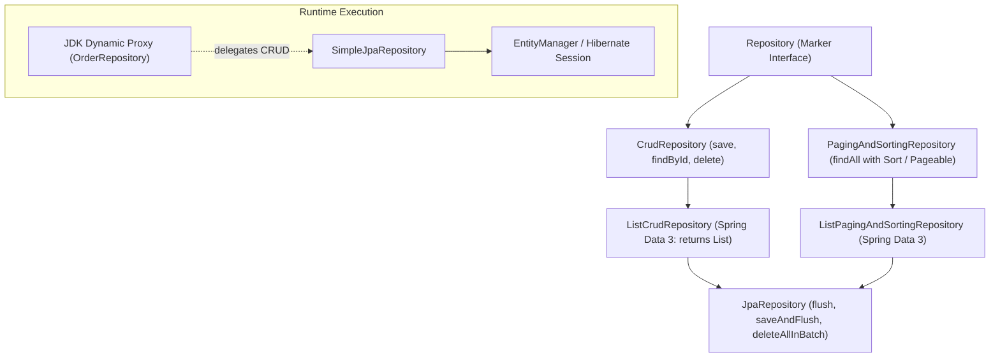
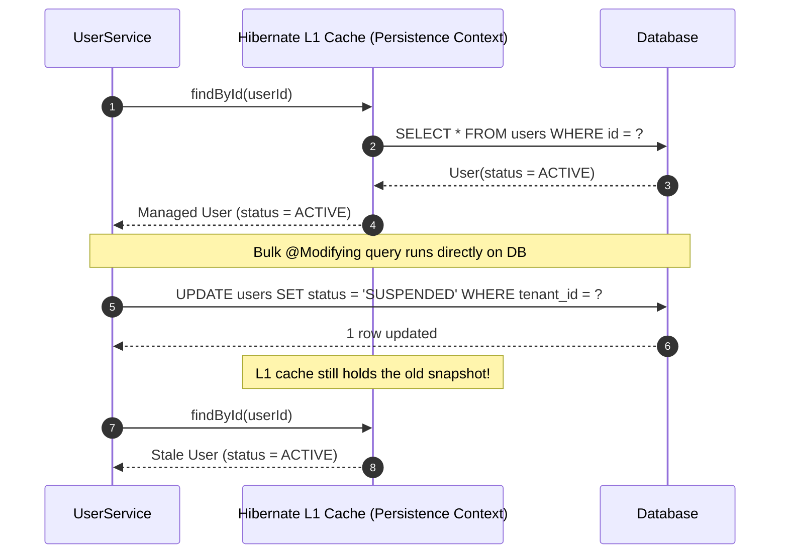

Declaring `List<Order> findByCustomerIdAndStatus(UUID customerId, OrderStatus status);` on an empty Java interface and getting a working database query feels effortless. That convenience has a trade-off: if you treat Spring Data JPA as a black box, innocent-looking repository methods can silently trigger N+1 queries, full-table `COUNT(*)` scans, or stale reads from Hibernate's first-level cache.

Under the hood, Spring Data JPA combines JDK dynamic proxies, `SimpleJpaRepository`, and Hibernate's `EntityManager`. Knowing how those layers interact makes it straightforward to write repositories that stay fast as tables grow into the tens of millions of rows.

---

## Repository Interfaces and Runtime Proxies

Spring Data does not generate `.class` files on disk for your repositories. At startup, `JpaRepositoriesRegistrar` scans for interfaces extending `Repository<T, ID>` and registers a `JpaRepositoryFactoryBean` for each one. At runtime, Spring creates a **JDK Dynamic Proxy** (`java.lang.reflect.Proxy`) backed by `SimpleJpaRepository` and an interceptor chain (`QueryExecutorMethodInterceptor`) that dispatches standard CRUD calls to `SimpleJpaRepository` and custom methods to parsed `RepositoryQuery` implementations.



### Choosing the Right Base Interface

- **`Repository<T, ID>`**: Pure marker interface with zero methods. Useful in Domain-Driven Design when you want to expose only the exact operations a domain aggregate needs (for example, `findById` and `save`, without exposing `deleteAll()`).
- **`CrudRepository<T, ID>`**: Basic persistence (`save`, `findById`, `existsById`, `deleteById`). Collection methods like `findAll()` return `Iterable<T>`.
- **`ListCrudRepository<T, ID>`** *(introduced in Spring Data 3.0)*: Extends `CrudRepository` and narrows `findAll()` / `saveAll()` return types from `Iterable<T>` to `List<T>`, removing awkward stream conversions.
- **`PagingAndSortingRepository<T, ID>`** (and `ListPagingAndSortingRepository`): Adds `findAll(Sort)` and `findAll(Pageable)`.
- **`JpaRepository<T, ID>`**: Combines `ListCrudRepository` and `ListPagingAndSortingRepository` with JPA-specific methods like `flush()`, `saveAndFlush()`, `getReferenceById()`, and `deleteAllInBatch()`.

---

## Query Derivation from Method Names

For any repository method without `@Query`, Spring Data parses the method name at startup using `PartTree`:

```text
findByCustomerEmailAndStatusOrderByCreatedAtDesc
  |         |          |          |
Prefix   Property   Property   Sort Clause
```

Because parsing happens during application startup, a typo in an entity property name (for example, `findByCustmerEmail`) fails immediately when the context boots rather than waiting for a production request.

### Useful Derived Query Keywords
- **Filtering**: `Is`, `Equals`, `Between`, `LessThan`, `GreaterThanEqual`, `In`, `IsNull`, `IsNotNull`
- **Strings**: `StartingWith`, `EndingWith`, `Containing`, `IgnoreCase`
- **Booleans**: `True`, `False`
- **Limiting & Existence**: `findFirst5ByOrderByCreatedAtDesc`, `findTop10ByStatus`, `existsByEmail`, `countByStatus`

### Disambiguating Nested Property Paths

When traversing nested properties, ambiguous names can confuse the parser. Suppose `Order` has a `customerAddress` embeddable with a `zipCode` field, and also a `customer` association. Use an underscore `_` to mark the property boundary explicitly:

```java
public interface OrderRepository extends JpaRepository<Order, UUID> {
    // Explicit path: Order -> customerAddress -> zipCode
    List<Order> findByCustomerAddress_ZipCode(String zipCode);
}
```

Once a derived method needs more than two or three predicates, or requires a `JOIN FETCH`, switch to an explicit `@Query` with a short, readable method name.

---

## Custom Queries: JPQL vs. Native SQL

### JPQL Queries

JPQL targets your **Java entity classes and fields**, not physical database table or column names. Hibernate translates JPQL into the configured SQL dialect at runtime:

```java
package com.example.ecommerce.repository;

import com.example.ecommerce.entity.Order;
import com.example.ecommerce.entity.OrderStatus;
import org.springframework.data.jpa.repository.JpaRepository;
import org.springframework.data.jpa.repository.Query;
import org.springframework.data.repository.query.Param;

import java.time.Instant;
import java.util.List;
import java.util.UUID;

public interface OrderRepository extends JpaRepository<Order, UUID> {

    @Query("""
        SELECT DISTINCT o FROM Order o
        JOIN FETCH o.items
        WHERE o.status = :status
          AND o.createdAt >= :cutoff
        ORDER BY o.createdAt DESC
    """)
    List<Order> findRecentOrdersWithItems(
            @Param("status") OrderStatus status,
            @Param("cutoff") Instant cutoff
    );
}
```

### Native SQL Queries

Set `nativeQuery = true` when you need database-specific syntax that JPQL does not support, such as PostgreSQL `JSONB` operators, full-text search (`to_tsvector`), CTEs (`WITH ...`), window functions, or `INSERT ... ON CONFLICT DO UPDATE`:

```java
    @Query(
        value = """
            SELECT * FROM customer_orders
            WHERE status = :status
              AND metadata ->> 'tier' = 'ENTERPRISE'
            ORDER BY created_at DESC
        """,
        countQuery = """
            SELECT COUNT(*) FROM customer_orders
            WHERE status = :status
              AND metadata ->> 'tier' = 'ENTERPRISE'
        """,
        nativeQuery = true
    )
    Page<Order> findEnterpriseOrdersNative(
            @Param("status") String status,
            Pageable pageable
    );
```

Notice the explicit `countQuery` attribute: when combining `nativeQuery = true` with a `Page<T>` return type, supplying a clean `countQuery` prevents Spring Data from failing to rewrite complex SQL (such as CTEs or `GROUP BY`) into a valid count statement.

---

## Bulk `@Modifying` Queries and L1 Cache Desynchronization

Bulk `UPDATE` and `DELETE` queries require `@Modifying` alongside `@Query` (and must execute within a `@Transactional` boundary). The catch is that bulk JPQL and native queries execute directly against the database and **bypass Hibernate's First-Level Cache (Persistence Context)**.



### Fixing Cache Desync with `flushAutomatically` and `clearAutomatically`

Configure both flags on `@Modifying` whenever managed entities may exist in the same transaction:

```java
public interface UserRepository extends JpaRepository<User, UUID> {

    @Modifying(flushAutomatically = true, clearAutomatically = true)
    @Query("UPDATE User u SET u.status = :status WHERE u.tenantId = :tenantId")
    int bulkUpdateStatus(
            @Param("status") UserStatus status,
            @Param("tenantId") UUID tenantId
    );
}
```

- **`flushAutomatically = true`**: Flushes any pending in-memory dirty changes to the database *before* the bulk statement runs, preventing the bulk `UPDATE` from overwriting unsaved entity changes or seeing stale rows.
- **`clearAutomatically = true`**: Clears the `EntityManager` persistence context immediately *after* the query executes, so subsequent reads in the same transaction fetch the updated state from the database instead of returning stale L1 cache instances.

Keep in mind that clearing the persistence context detaches any other entity references already held in local variables inside that transaction.

---

## Interface and Record Projections

Loading a full managed JPA entity for a read-only summary screen wastes both database I/O and JVM heap: Hibernate fetches every column, instantiates the entity, copies every field into a snapshot array for dirty checking, and tracks it in the L1 cache for the duration of the transaction.

**Projections** select only the required columns and skip managed entity tracking.

### Interface-Based (Closed) Projections

Define a lightweight interface whose getter names match entity properties. Spring Data rewrites the `SELECT` clause to fetch only those columns:

```java
public interface OrderSummaryView {
    UUID getId();
    String getStatus();
    BigDecimal getTotalAmount();
}

public interface OrderRepository extends JpaRepository<Order, UUID> {
    List<OrderSummaryView> findByCustomerId(UUID customerId);
}
```

Closed interface projections work directly with derived query methods and native queries (matching column aliases), though Spring backs each row with a dynamic proxy.

### Record (Class-Based) DTO Projections

For maximum clarity and zero proxy overhead, project directly into a Java record using a JPQL constructor expression (or directly in a derived method when property names match record components):

```java
package com.example.ecommerce.dto;

import java.math.BigDecimal;
import java.util.UUID;

public record OrderSummaryDto(
    UUID orderId,
    String customerEmail,
    BigDecimal totalAmount
) {}
```

```java
public interface OrderRepository extends JpaRepository<Order, UUID> {

    @Query("""
        SELECT new com.example.ecommerce.dto.OrderSummaryDto(
            o.id,
            o.customer.email,
            o.totalAmount
        )
        FROM Order o
        WHERE o.status = :status
    """)
    List<OrderSummaryDto> findSummariesByStatus(@Param("status") OrderStatus status);
}
```

Hibernate reads the JDBC `ResultSet` straight into `OrderSummaryDto` instances without creating managed entities or dirty-checking snapshots, which measurably lowers memory allocation and latency on wide tables.

---

## Pagination and Sorting: `Page<T>` vs. `Slice<T>`

Spring Data accepts `Pageable` (constructed via `PageRequest.of(page, size, Sort.by(...))`) and `Sort` parameters on both derived and `@Query` methods. Choosing the return type has a big impact on database load.

### `Page<T>` and the Hidden Count Query

Returning `Page<T>` tells the caller `totalElements` and `totalPages`. To compute those numbers, Spring Data runs **two queries**:
1. The page query: `SELECT ... FROM orders WHERE customer_id = ? ORDER BY created_at DESC LIMIT 20 OFFSET 0`
2. The count query: `SELECT COUNT(*) FROM orders WHERE customer_id = ?`

On tables with tens of millions of rows and selective filters, that `COUNT(*)` query can become far slower than fetching the 20 rows themselves.

### `Slice<T>` Skips the Count Query

If the UI only needs "Load more" or "Next / Previous" navigation (no total page count), return `Slice<T>`:

```java
public interface OrderRepository extends JpaRepository<Order, UUID> {
    // Executes a single query with LIMIT (size + 1); never runs SELECT COUNT(*)
    Slice<Order> findByCustomerId(UUID customerId, Pageable pageable);
}
```

When you request `PageRequest.of(0, 20)`, Spring Data queries `LIMIT 21`. If 21 rows come back, it drops the extra row and sets `slice.hasNext()` to `true`; if 20 or fewer come back, `hasNext()` is `false`.

> [!NOTE]
> `Slice<T>` still uses `OFFSET` under the hood. When users paginate very deep (for example, `OFFSET 500000`), the database still has to scan and discard 500,000 rows. For deep feeds or batch exports, switch to **keyset (cursor) pagination** (`WHERE (created_at, id) < (:lastCreatedAt, :lastId) ORDER BY created_at DESC, id DESC LIMIT 20`), which uses an index seek in constant time regardless of depth.

### Allowlisting Sort Fields from HTTP Requests

Never pass an unsanitized `Pageable` directly from a controller to a repository without restricting sortable columns:

```java
private static final Set<String> ALLOWED_SORT_FIELDS = Set.of("createdAt", "totalAmount", "status");

public Slice<OrderSummaryDto> listOrders(UUID customerId, int page, int size, String sortBy) {
    String safeSort = ALLOWED_SORT_FIELDS.contains(sortBy) ? sortBy : "createdAt";
    int boundedSize = Math.min(Math.max(size, 1), 100);
    Pageable pageable = PageRequest.of(Math.max(page, 0), boundedSize, Sort.by(Sort.Direction.DESC, safeSort));
    return orderRepository.findSummariesByCustomerId(customerId, pageable);
}
```

Bounding `size` also prevents a caller from requesting `?size=1000000` and exhausting heap memory.

---

## Entity Auditing with `@EnableJpaAuditing`

Tracking creation timestamps, modification timestamps, and acting users is standard across enterprise domains. Spring Data JPA automates these fields using JPA entity lifecycle listeners.

### Enabling Auditing and Providing `AuditorAware`

```java
package com.example.ecommerce.config;

import org.springframework.context.annotation.Bean;
import org.springframework.context.annotation.Configuration;
import org.springframework.data.domain.AuditorAware;
import org.springframework.data.jpa.repository.config.EnableJpaAuditing;
import org.springframework.security.core.Authentication;
import org.springframework.security.core.context.SecurityContextHolder;

import java.util.Optional;

@Configuration
@EnableJpaAuditing(auditorAwareRef = "auditorProvider")
public class JpaAuditConfig {

    @Bean
    public AuditorAware<String> auditorProvider() {
        return () -> Optional.ofNullable(SecurityContextHolder.getContext().getAuthentication())
                .filter(Authentication::isAuthenticated)
                .map(Authentication::getName)
                .or(() -> Optional.of("SYSTEM"));
    }
}
```

### Reusable `@MappedSuperclass` Base Entity

```java
package com.example.ecommerce.entity;

import jakarta.persistence.Column;
import jakarta.persistence.EntityListeners;
import jakarta.persistence.MappedSuperclass;
import org.springframework.data.annotation.CreatedBy;
import org.springframework.data.annotation.CreatedDate;
import org.springframework.data.annotation.LastModifiedBy;
import org.springframework.data.annotation.LastModifiedDate;
import org.springframework.data.jpa.domain.support.AuditingEntityListener;

import java.time.Instant;

@MappedSuperclass
@EntityListeners(AuditingEntityListener.class)
public abstract class AuditableEntity {

    @CreatedDate
    @Column(name = "created_at", nullable = false, updatable = false)
    private Instant createdAt;

    @LastModifiedDate
    @Column(name = "last_modified_at", nullable = false)
    private Instant lastModifiedAt;

    @CreatedBy
    @Column(name = "created_by", nullable = false, updatable = false)
    private String createdBy;

    @LastModifiedBy
    @Column(name = "last_modified_by", nullable = false)
    private String lastModifiedBy;

    public Instant getCreatedAt() { return createdAt; }
    public Instant getLastModifiedAt() { return lastModifiedAt; }
    public String getCreatedBy() { return createdBy; }
    public String getLastModifiedBy() { return lastModifiedBy; }
}
```

Two practical caveats to keep in mind:
- **Bulk `@Modifying` queries bypass `AuditingEntityListener`**: If you run a JPQL `UPDATE`, `@LastModifiedDate` and `@LastModifiedBy` will not update automatically, so set those columns explicitly inside the `UPDATE` query.
- **Test slices**: `@DataJpaTest` does not load your main `@SpringBootApplication` class's auditing config if `@EnableJpaAuditing` is placed on the application class itself. Keeping `@EnableJpaAuditing` in a dedicated `JpaAuditConfig` class lets you `@Import(JpaAuditConfig.class)` selectively in repository tests.

---

## Common Production Pitfalls

### Count-Query Saturation Under Concurrent Traffic
When a busy dashboard endpoint returns `Page<AuditLog>` over a 40-million-row table, dozens of concurrent users refreshing the page fire dozens of overlapping `SELECT COUNT(*)` scans. CPU climbs, query queues grow, and HikariCP pools time out across pods. Switching the endpoint to `Slice<AuditLog>` removes the count query completely and keeps query cost proportional to the page size.

### Redundant `save()` Calls Inside `@Transactional` Methods

```java
@Transactional
public void updateEmail(UUID userId, String newEmail) {
    User user = userRepository.findById(userId).orElseThrow();
    user.setEmail(newEmail);
    // Calling userRepository.save(user) here is redundant for a managed entity
}
```

Inside an active transaction, `user` is already managed by the persistence context. Hibernate tracks dirty fields automatically and flushes the `UPDATE` statement at commit time. Calling `save()` on an already-managed entity is harmless in `SimpleJpaRepository` (it calls `merge`), but understanding dirty checking prevents confusion about *when* SQL actually executes and avoids accidental mutations of managed entities you only meant to read (mark read-only service methods `@Transactional(readOnly = true)` to skip dirty-checking snapshots altogether).

---

## Interview Questions

### How does Spring Data JPA provide implementations for repository interfaces you never implement?
During context initialization, `JpaRepositoriesRegistrar` detects interfaces extending `Repository` and registers a `JpaRepositoryFactoryBean` for each. The factory builds a JDK Dynamic Proxy backed by `SimpleJpaRepository` for built-in CRUD operations and attaches a `QueryExecutorMethodInterceptor` that parses derived names (`PartTreeJpaQuery`) or `@Query` annotations (`SimpleJpaQuery`) into executable queries against the `EntityManager`.

### What causes the N+1 query problem in Spring Data JPA, and what are three ways to fix it?
N+1 happens when a query loads `N` parent entities (1 query) and subsequent code iterates over a `LAZY` collection on each parent, triggering `N` extra queries. You can fix it by:
1. Using `JOIN FETCH` in a JPQL `@Query` to load the association in a single SQL join.
2. Adding `@EntityGraph(attributePaths = {"items"})` on the repository method to override the fetch plan declaratively.
3. Switching to a DTO or interface projection that selects only the exact columns needed.

### What is the difference between `save()` and `saveAndFlush()` on `JpaRepository`?
`save()` delegates to `EntityManager.persist()` (for new entities) or `merge()` (for detached entities), placing the entity in the persistence context without necessarily sending SQL yet; Hibernate normally defers SQL execution until transaction commit or before a dependent query. `saveAndFlush()` calls `save()` and immediately invokes `EntityManager.flush()`, sending the `INSERT` or `UPDATE` to the database right away within the current transaction (useful when you need database-generated constraints or triggers evaluated immediately, though the transaction itself is still not committed until the `@Transactional` method finishes).

### Why should you avoid binding raw `Pageable` and `Sort` parameters from untrusted HTTP query strings?
Passing raw `sort` parameters straight to a repository lets clients sort by sensitive entity fields (such as `passwordHash` or internal scores), risking information leakage, and can throw `PropertyReferenceException` or break native SQL queries if the property name does not map cleanly. Always validate sort property names against an explicit allowlist and clamp page sizes to a safe maximum before constructing `PageRequest`.
