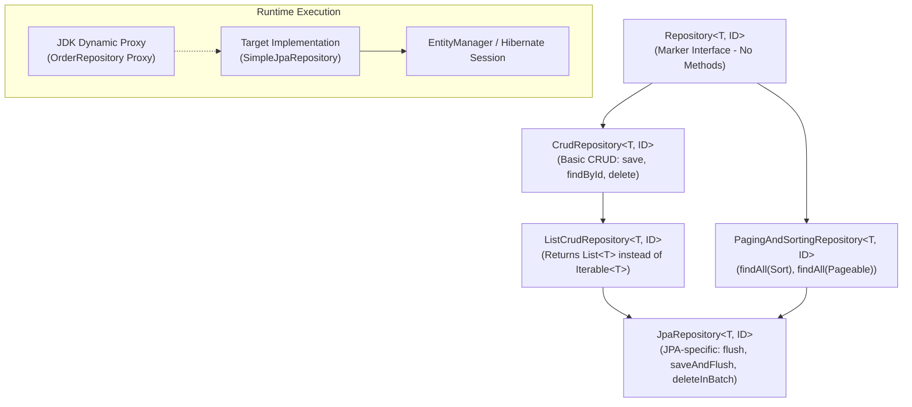
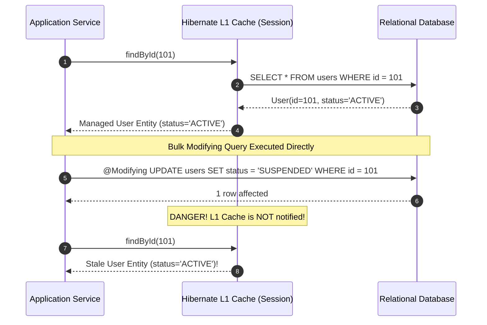

Every Java engineer remembers the first time they typed `List<User> findByEmailAndStatus(String email, Status status);` into an empty interface, ran their application, and watched Spring Data synthesize a fully functional database query out of thin air. It feels like pure wizardry.

However, treating Spring Data JPA as a magical black box is one of the quickest paths to catastrophic production performance. Underneath the declarative syntax lies the Java Dynamic Proxy mechanism, Hibernate's first-level cache, entity state transitions, and JDBC execution plans. When you do not understand how Spring translates interface methods into SQL, innocent-looking repository calls can issue un-indexed table scans, duplicate count queries, and trigger silent cache desynchronization.

In this guide, we will peel back the proxy layer of Spring Data JPA, master high-performance querying patterns, evaluate `Slice` versus `Page`, and learn how to write enterprise data access code that scales gracefully to millions of records.

---

## The Repository Hierarchy and Dynamic Proxies

Spring Data does not generate bytecode files on disk. Instead, when your application context boots up, Spring scans for interfaces extending `Repository<T, ID>` and uses JDK Dynamic Proxies (`java.lang.reflect.Proxy`) to synthesize runtime implementations backed by `SimpleJpaRepository`.



### The Interface Layers
- **`Repository<T, ID>`**: A pure marker interface with zero methods. It flags the interface for Spring Data's component scanner.
- **`CrudRepository<T, ID>`**: Provides standard persistence methods (`save`, `findById`, `existsById`, `deleteById`). In older Spring versions, methods like `findAll()` returned `Iterable<T>`.
- **`ListCrudRepository<T, ID>`**: Introduced in Spring Data 3.0 to replace `Iterable<T>` return types with standard `List<T>`, eliminating awkward manual casting and stream collectors.
- **`PagingAndSortingRepository<T, ID>`**: Isolates pagination and sorting concerns (`findAll(Pageable)`, `findAll(Sort)`).
- **`JpaRepository<T, ID>`**: The full-featured JPA interface extending `ListCrudRepository` and `PagingAndSortingRepository`. It adds JPA-specific flush methods (`flush()`, `saveAndFlush()`) and batch operations (`deleteAllInBatch()`).

> [!TIP]
> **Should every repository extend `JpaRepository`?**  
> No. In Clean Architecture or Domain-Driven Design (DDD), you want to minimize database leaks into your domain. Extending `Repository<T, ID>` and explicitly declaring only the 3 or 4 methods your application actually uses (e.g., `findById` and `save`) prevents developers from accidentally calling `deleteAll()` or triggering unconstrained queries.

---

## How Derived Queries Work: The PartTree Parser

When Spring Data initializes, it creates a `PartTree` for every repository method that does not have an explicit `@Query` annotation. It breaks down the method name using regex tokens:

```
findByCustomerEmailAndStatusOrderByCreatedAtDesc
  │         │          │     │          │
Prefix   Property   Keyword Property OrderClause
```

### Supported Keywords and Property Paths
- **Comparisons**: `Is`, `Equals`, `Between`, `LessThan`, `GreaterThan`, `IsNull`, `IsNotNull`.
- **String matching**: `Like`, `StartingWith`, `EndingWith`, `Containing`, `IgnoreCase`.
- **Booleans**: `True`, `False`.
- **Limiting**: `findFirst5ByOrderByScoreDesc`, `findTop10ByStatus`.

### Disambiguating Nested Properties with Underscores
Suppose your `Order` entity has a nested property `customerAddress` containing a `zipCode`, and also has a property named `customer` with an `addressZipCode`. 

If you write `findByCustomerAddressZipCode(String zip)`:
Spring Data first tries to match `customerAddressZipCode` on `Order`. If that fails, it splits from right to left: `customerAddress` and `zipCode`. 
To avoid ambiguity and startup parsing bugs, use an explicit underscore `_` to demarcate the property traversal boundary:

```java
public interface OrderRepository extends JpaRepository<Order, UUID> {
    // Explicit traversal: Order -> customerAddress -> zipCode
    List<Order> findByCustomerAddress_ZipCode(String zipCode);
}
```

---

## Declarative Queries: JPQL vs Native SQL

When method names become unwieldy (e.g., `findByStatusAndRegionAndCreatedAtAfterAndDeletedFalseOrderByPriorityDesc`), derived queries become unreadable. Use `@Query`.

### Java Persistence Query Language (JPQL)
JPQL queries operate on the **Entity object graph**, referencing Java class names and entity field attributes rather than physical table and column names:

```java
package com.example.ecommerce.repository;

import com.example.ecommerce.entity.Order;
import com.example.ecommerce.entity.OrderStatus;
import org.springframework.data.jpa.repository.JpaRepository;
import org.springframework.data.jpa.repository.Query;
import org.springframework.data.repository.query.Param;

import java.time.Instant;
import java.util.List;
import java.util.UUID;

public interface OrderRepository extends JpaRepository<Order, UUID> {

    @Query("""
        SELECT o FROM Order o
        JOIN FETCH o.items i
        WHERE o.status = :status
          AND o.createdAt >= :cutoffDate
        ORDER BY o.createdAt DESC
    """)
    List<Order> findRecentOrdersWithItems(
            @Param("status") OrderStatus status,
            @Param("cutoffDate") Instant cutoffDate
    );
}
```

### Native SQL
Native queries talk directly to the underlying database engine using physical table names and database-specific SQL dialect:

```java
    @Query(value = """
        SELECT * FROM customer_orders
        WHERE status = :status
          AND metadata->>'tier' = 'ENTERPRISE'
        ORDER BY created_at DESC
    """, nativeQuery = true)
    List<Order> findEnterpriseOrdersNative(@Param("status") String status);
```

### When to Choose Native SQL over JPQL
1. **Database-specific operators**: Querying PostgreSQL `JSONB` columns using `->>` or full-text search operators (`to_tsvector`).
2. **Window functions and CTEs**: Using `ROW_NUMBER() OVER (PARTITION BY ...)` or Common Table Expressions (`WITH recursive_cte AS ...`).
3. **Complex bulk inserts/upserts**: `INSERT INTO ... ON CONFLICT DO UPDATE`.

---

## The Modifying Query Trap: Hibernate L1 Cache Desynchronization

When you execute an update or delete query using `@Query`, you must annotate the method with `@Modifying`. However, bulk modifying queries bypass the Hibernate First-Level Cache (the `EntityManager` persistence context) and execute directly against the database!



### The Fix: `clearAutomatically` and `flushAutomatically`
If you do not clear the persistence context, subsequent reads in the same transaction will return stale, un-updated entity instances from the L1 cache.

```java
package com.example.ecommerce.repository;

import org.springframework.data.jpa.repository.JpaRepository;
import org.springframework.data.jpa.repository.Modifying;
import org.springframework.data.jpa.repository.Query;
import org.springframework.data.repository.query.Param;

import java.util.UUID;

public interface UserRepository extends JpaRepository<User, UUID> {

    @Modifying(flushAutomatically = true, clearAutomatically = true)
    @Query("UPDATE User u SET u.status = :status WHERE u.tenantId = :tenantId")
    int bulkUpdateStatus(
            @Param("status") UserStatus status,
            @Param("tenantId") UUID tenantId
    );
}
```
- **`flushAutomatically = true`**: Flushes any pending dirty entity changes from memory to the database before executing the bulk SQL query.
- **`clearAutomatically = true`**: Evicts all managed entities from the Hibernate L1 cache immediately after the query runs, forcing subsequent reads to fetch fresh data from the database.

---

## High-Performance Projections: Skipping the Hibernate Overhead

When an API endpoint only needs 3 fields from a 40-column table (e.g., displaying a summary list in a UI table), fetching the entire managed entity is a massive waste of CPU, memory, and database bandwidth. 

Hibernate must allocate entity snapshots in the Persistence Context, track dirty state for every field, and resolve associations. **DTO Projections** bypass entity management entirely and populate lightweight data carriers directly.

### Class-Based (Record) Projections with JPQL Constructor Expressions
Java 21 records make the cleanest, highest-performance projections:

```java
package com.example.ecommerce.dto;

import java.math.BigDecimal;
import java.util.UUID;

public record OrderSummaryDto(
    UUID orderId,
    String customerEmail,
    BigDecimal totalAmount
) {}
```

```java
package com.example.ecommerce.repository;

import com.example.ecommerce.dto.OrderSummaryDto;
import com.example.ecommerce.entity.Order;
import org.springframework.data.jpa.repository.JpaRepository;
import org.springframework.data.jpa.repository.Query;

import java.util.List;
import java.util.UUID;

public interface OrderRepository extends JpaRepository<Order, UUID> {

    @Query("""
        SELECT new com.example.ecommerce.dto.OrderSummaryDto(
            o.id,
            o.customer.email,
            o.totalAmount
        )
        FROM Order o
        WHERE o.status = 'COMPLETED'
    """)
    List<OrderSummaryDto> findCompletedOrderSummaries();
}
```

> [!NOTE]
> **Performance Benchmark Impact**  
> DTO projections frequently achieve a 5x to 10x throughput improvement over entity queries for read-heavy operations because Hibernate maps JDBC `ResultSet` columns directly into the constructor, avoiding entity instantiation, proxy wrapping, and L1 cache management.

---

## Pagination: `Page<T>` vs `Slice<T>` vs Keyset Pagination

When serving paginated endpoints, developers default to accepting a `Pageable` and returning `Page<T>`. On large tables, this is a ticking latency bomb.

### The Hidden Penalty of `Page<T>`
To return a `Page<T>`, Spring Data must know the total number of pages and elements. Therefore, it executes **two queries**:
1. The data query: `SELECT * FROM orders WHERE ... LIMIT 20 OFFSET 100000;`
2. The count query: `SELECT COUNT(*) FROM orders WHERE ...;`

On a table with 20 million rows, running `SELECT COUNT(*)` on an un-indexed or filtered query forces the database to scan millions of index blocks or rows. The count query alone can take 10 to 30 seconds!

### The Solution: `Slice<T>`
If your frontend uses an "infinite scroll" or a simple "Next / Previous" UI rather than explicit numbered page buttons (e.g., `Page 1, 2, 3... 450`), use `Slice<T>`:

```java
package com.example.ecommerce.repository;

import com.example.ecommerce.entity.Order;
import org.springframework.data.domain.Pageable;
import org.springframework.data.domain.Slice;
import org.springframework.data.jpa.repository.JpaRepository;

import java.util.UUID;

public interface OrderRepository extends JpaRepository<Order, UUID> {
    // Zero count query overhead!
    Slice<Order> findByCustomerId(UUID customerId, Pageable pageable);
}
```

### How `Slice` Eliminates the Count Query
When you request `PageRequest.of(0, 20)`, `Slice` requests `LIMIT 21` from the database. 
- If the database returns 21 records, Spring discards the 21st record and sets `slice.hasNext() = true`.
- If the database returns 20 or fewer records, Spring sets `slice.hasNext() = false`.
The expensive `SELECT COUNT(*)` query is never executed!

---

## Entity Auditing with `@EnableJpaAuditing`

Tracking when a record was created, who created it, and when it was last modified is a universal requirement for audit compliance (SOC2, HIPAA, PCI-DSS).

### Step 1: Enable Auditing and Define AuditorAware
Spring Data integrates seamlessly with Spring Security to capture the authenticated username:

```java
package com.example.ecommerce.config;

import org.springframework.context.annotation.Bean;
import org.springframework.context.annotation.Configuration;
import org.springframework.data.domain.AuditorAware;
import org.springframework.data.jpa.repository.config.EnableJpaAuditing;
import org.springframework.security.core.Authentication;
import org.springframework.security.core.context.SecurityContextHolder;

import java.util.Optional;

@Configuration
@EnableJpaAuditing(auditorAwareRef = "auditorProvider")
public class JpaAuditConfig {

    @Bean
    public AuditorAware<String> auditorProvider() {
        return () -> Optional.ofNullable(SecurityContextHolder.getContext().getAuthentication())
                .filter(Authentication::isAuthenticated)
                .map(Authentication::getName)
                .or(() -> Optional.of("SYSTEM_AUTOMATION"));
    }
}
```

### Step 2: Create a Reusable Auditable Base Entity

```java
package com.example.ecommerce.entity;

import jakarta.persistence.Column;
import jakarta.persistence.EntityListeners;
import jakarta.persistence.MappedSuperclass;
import org.springframework.data.annotation.CreatedBy;
import org.springframework.data.annotation.CreatedDate;
import org.springframework.data.annotation.LastModifiedBy;
import org.springframework.data.annotation.LastModifiedDate;
import org.springframework.data.jpa.domain.support.AuditingEntityListener;

import java.time.Instant;

@MappedSuperclass
@EntityListeners(AuditingEntityListener.class)
public abstract class AuditableBaseEntity {

    @CreatedDate
    @Column(name = "created_at", nullable = false, updatable = false)
    private Instant createdAt;

    @LastModifiedDate
    @Column(name = "last_modified_at", nullable = false)
    private Instant lastModifiedAt;

    @CreatedBy
    @Column(name = "created_by", nullable = false, updatable = false)
    private String createdBy;

    @LastModifiedBy
    @Column(name = "last_modified_by", nullable = false)
    private String lastModifiedBy;

    // Getters and Setters omitted for brevity
}
```

---

## Architectural Traps and Real-World Outages

### The "COUNT(*) Table Lock" Meltdown
A banking application displayed an audit log dashboard for compliance officers. The repository method was defined as:
```java
Page<AuditLog> findByTenantId(UUID tenantId, Pageable pageable);
```
During a high-traffic morning peak, 50 compliance auditors refreshed their dashboards simultaneously. The `audit_logs` table contained 45 million rows. PostgreSQL fired 50 concurrent `SELECT COUNT(*) FROM audit_logs WHERE tenant_id = ...` queries. 

The CPU spiked to 100%, query queues backed up, and HikariCP connection pools in all web pods exhausted within 90 seconds, causing a complete cascading outage. The fix was migrating the endpoint to `Slice<AuditLog>`, instantly dropping database CPU utilization from 100% to 12%.

### The Silent Dirty Checking Bug with Explicit `save()`
Many developers write code like this inside a `@Transactional` service:
```java
@Transactional
public void updateEmail(UUID userId, String newEmail) {
    User user = userRepository.findById(userId).orElseThrow();
    user.setEmail(newEmail);
    userRepository.save(user); // Redundant!
}
```
While calling `userRepository.save(user)` is technically harmless here, understanding that Hibernate's Persistence Context automatically performs **dirty checking** at transaction commit time is fundamental. When you realize that any mutation on a managed entity is automatically flushed to the database, you avoid unnecessary intermediate saves, unexpected triggers, and mental confusion about entity lifecycle boundaries.

---

## Senior Interview Questions

### Question 1: How does Spring Data JPA implement repository interfaces without any concrete implementation classes written by the developer?
**Answer:**  
Spring Data JPA uses JDK Dynamic Proxies (`java.lang.reflect.Proxy`). During application initialization:
1. `JpaRepositoriesRegistrar` scans for interfaces extending `Repository`.
2. For each interface, Spring registers a `JpaRepositoryFactoryBean`.
3. The factory initializes a `RepositoryFactorySupport` (specifically `JpaRepositoryFactory`), which configures a dynamic proxy interceptor chain (`QueryExecutorMethodInterceptor`).
4. Any default CRUD method (`save`, `findById`) is routed to a target implementation class, `SimpleJpaRepository`.
5. Any derived or annotated query method (`@Query`, `findBy...`) is parsed into a `RepositoryQuery` instance (such as `PartTreeJpaQuery` or `SimpleJpaQuery`) and executed against the `EntityManager`.

### Question 2: What is the N+1 query problem in Spring Data JPA, and what are three distinct ways to solve it?
**Answer:**  
The N+1 query problem occurs when an application loads an entity (1 query) and then accesses a lazy association across N entity instances in a loop, causing Hibernate to execute N additional queries to fetch the associated records.

Three distinct solutions:
1. **`JOIN FETCH` in JPQL**: Force the query to eagerly retrieve the association in a single SQL inner or left join: `SELECT o FROM Order o JOIN FETCH o.items`.
2. **`@EntityGraph`**: Declaratively override the entity's fetch plan on a repository method:
   ```java
   @EntityGraph(attributePaths = {"items", "items.product"})
   List<Order> findByStatus(OrderStatus status);
   ```
3. **DTO Constructor Projections**: Bypass entities entirely by selecting only the specific fields needed into an immutable record DTO.

### Question 3: What is the difference between `save()` and `saveAndFlush()` in `JpaRepository`?
**Answer:**  
- `save()` passes the entity to `EntityManager.persist()` (if new) or `EntityManager.merge()` (if detached). It attaches the entity to the Persistence Context (L1 cache), but **does not immediately execute an SQL INSERT or UPDATE statement**. The SQL is deferred until Hibernate's dirty-check flush phase (usually when the surrounding `@Transactional` boundary commits).
- `saveAndFlush()` performs `save()` and then immediately calls `EntityManager.flush()`. This forces Hibernate to translate all pending in-memory entity changes into SQL statements and execute them against the database transaction buffer immediately. Note that this does *not* commit the database transaction—it merely sends the SQL so database triggers or foreign key checks evaluate immediately.

### Question 4: Why should you avoid using `Pageable` and `Sort` with un-sanitized user input from a REST controller?
**Answer:**  
If a REST controller accepts a `Pageable` directly from query parameters (e.g., `?sort=passwordHash,asc`), Spring Data's sort parser attempts to map the property name against entity attributes. 
1. **Information Leakage**: If an attacker sorts by a private or hashed field (`passwordHash`), they can infer data values by measuring sorting order or timing side channels.
2. **SQL Injection in Native Queries**: While JPQL validates sort properties against entity metadata, passing a dynamic `Sort` into a native SQL query (`nativeQuery = true`) can lead to SQL syntax errors or SQL injection if the property cannot be safely bound as a parameter.
Always validate and map external sort parameters against an explicit allowlist before passing them to the repository layer.
