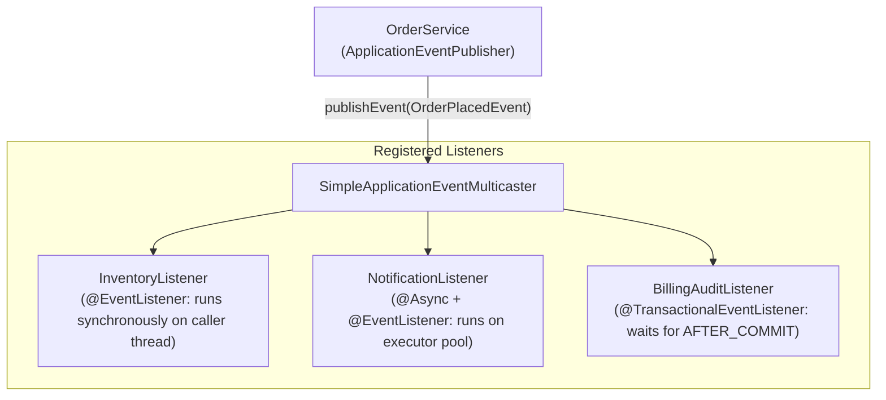
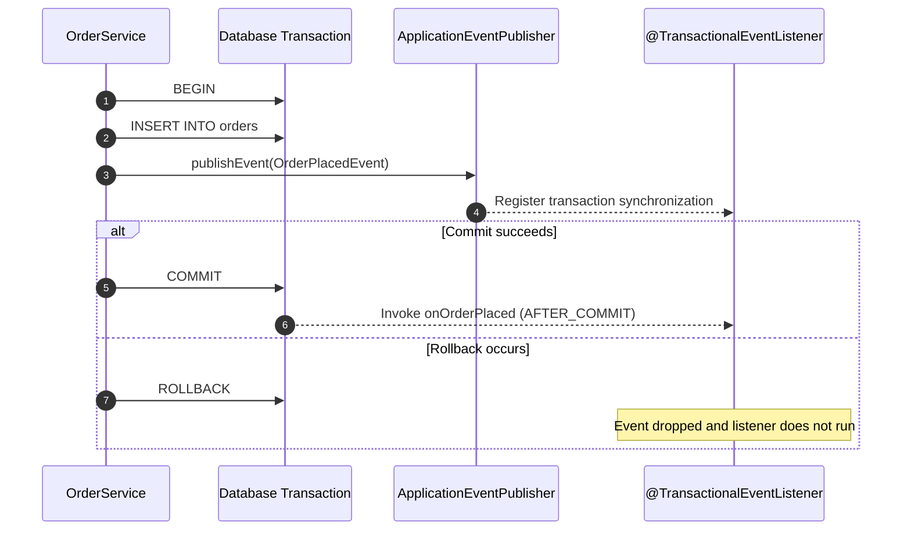
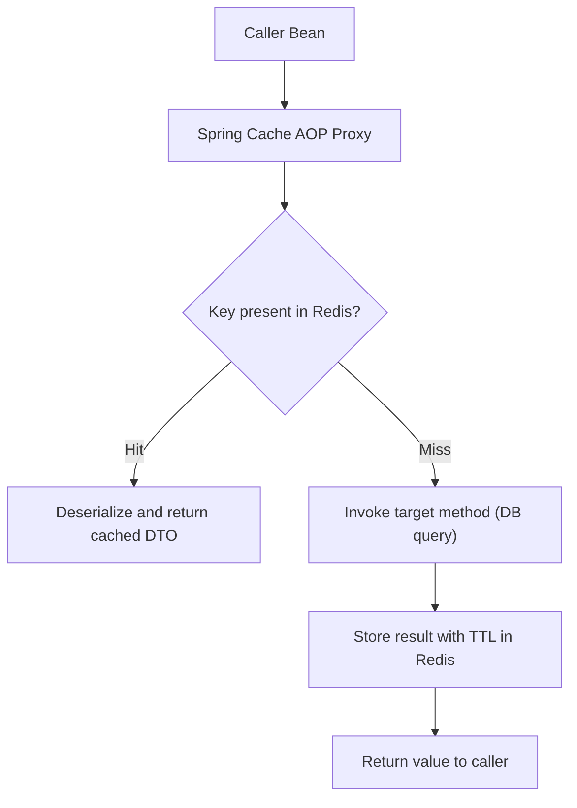
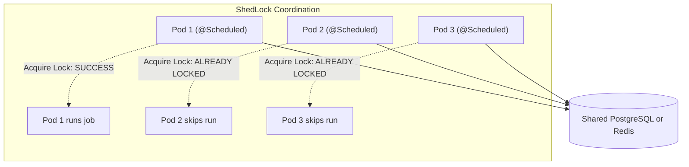

Not every side effect belongs inline inside an HTTP request handler. Sending a welcome email does not need to hold an API response open, hot product catalog reads do not need to hit PostgreSQL thousands of times a second, and nightly reconciliation jobs need to run on a schedule without firing on every Kubernetes pod at once.

Spring ships built-in abstractions for all three: **Application Events**, **Declarative Caching**, and **Task Scheduling**. Each looks simple on the surface because it takes only one or two annotations to turn on, yet each carries thread-pool, transaction-boundary, proxy, and multi-instance behaviors that cause real production bugs when overlooked.

## Decoupling Workflows with `ApplicationEventPublisher`

When an `OrderService` creates an order, it should not need direct constructor dependencies on `EmailService`, `MetricsService`, and `AuditService`. Publishing a domain event through `ApplicationEventPublisher` lets downstream components react without coupling the publisher to every side effect.

Since Spring 4.2, events do not need to extend `ApplicationEvent`; an immutable Java `record` works cleanly:

```java
package com.example.ecommerce.event;

import java.math.BigDecimal;
import java.time.Instant;
import java.util.UUID;

public record OrderPlacedEvent(
    UUID orderId,
    String customerEmail,
    BigDecimal totalAmount,
    Instant occurredAt
) {}
```

```java
@Service
public class OrderService {

    private final OrderRepository orderRepository;
    private final ApplicationEventPublisher eventPublisher;

    public OrderService(OrderRepository orderRepository,
                        ApplicationEventPublisher eventPublisher) {
        this.orderRepository = orderRepository;
        this.eventPublisher = eventPublisher;
    }

    @Transactional
    public Order createOrder(CreateOrderCommand command) {
        Order saved = orderRepository.save(Order.from(command));
        eventPublisher.publishEvent(new OrderPlacedEvent(
                saved.getId(), saved.getCustomerEmail(), saved.getTotalAmount(), Instant.now()));
        return saved;
    }
}
```



### Synchronous Execution by Default

Out of the box, Spring's `SimpleApplicationEventMulticaster` invokes every `@EventListener` **synchronously on the publisher's thread** and inside the publisher's active transaction. That has two immediate consequences:

1. If an email listener blocks for 3 seconds talking to an SMTP relay, the HTTP response waits those 3 seconds.
2. If the listener throws an unchecked exception, it propagates straight back into `OrderService.createOrder()` and marks the caller's database transaction for rollback.

When a listener performs slow I/O that should not delay the caller, enable `@EnableAsync`, configure a bounded `TaskExecutor` (never rely on Spring's default unbounded `SimpleAsyncTaskExecutor` in production), and combine `@Async` with `@EventListener`:

```java
package com.example.ecommerce.event;

import org.slf4j.Logger;
import org.slf4j.LoggerFactory;
import org.springframework.context.event.EventListener;
import org.springframework.scheduling.annotation.Async;
import org.springframework.stereotype.Component;

@Component
public class CustomerNotificationListener {

    private static final Logger log = LoggerFactory.getLogger(CustomerNotificationListener.class);

    @Async("notificationTaskExecutor")
    @EventListener
    public void onOrderPlaced(OrderPlacedEvent event) {
        log.info("Sending confirmation email for order {}", event.orderId());
        // Outbound SMTP or push notification call
    }
}
```

> [!WARNING]
> Spring application events live strictly in JVM memory. If a pod restarts or crashes while an `@Async` listener is queued, that event is lost. Use Spring events for in-process decoupling and non-critical side effects; for durable cross-service workflows (payments, fulfillment, billing), write to a transactional outbox table and relay through Kafka or RabbitMQ.

## Binding Events to Transactions with `@TransactionalEventListener`

Publishing an event inside a `@Transactional` method creates a subtle race condition when paired with `@Async` or external calls: if `createOrder()` publishes `OrderPlacedEvent` and then fails on commit (for instance, due to a deferred constraint violation or another operation later in the method), a normal `@EventListener` has already fired for an order that was rolled back and never persisted.

`@TransactionalEventListener` solves this by registering a callback with Spring's `TransactionSynchronizationManager` so the listener only fires once the surrounding transaction reaches the requested phase:



The available `TransactionPhase` values are:

- `AFTER_COMMIT` (default): Runs only after the transaction commits cleanly. Best for emails, webhooks, cache evictions, and notifications.
- `BEFORE_COMMIT`: Runs right before commit inside the still-open transaction.
- `AFTER_ROLLBACK`: Runs only if the transaction rolls back (useful for alerting or cleanup).
- `AFTER_COMPLETION`: Runs after either commit or rollback.

One detail that trips teams up: if an event is published when **no transaction is active**, a `@TransactionalEventListener` silently ignores the event by default. If the event might be fired both inside and outside transactions and should still run in the non-transactional case, set `fallbackExecution = true`.

### Writing to the Database Inside `AFTER_COMMIT`

A classic Spring bug occurs when a developer tries to save a JPA entity inside an `AFTER_COMMIT` listener:

```java
@Component
public class AuditLogListener {

    private final AuditRepository auditRepository;

    public AuditLogListener(AuditRepository auditRepository) {
        this.auditRepository = auditRepository;
    }

    // Bug: the original transaction has already committed!
    @TransactionalEventListener(phase = TransactionPhase.AFTER_COMMIT)
    public void recordAuditBroken(OrderPlacedEvent event) {
        auditRepository.save(new AuditRecord(event.orderId()));
    }
}
```

At `AFTER_COMMIT` time, the transaction resources from `OrderService` have already been committed, even though the synchronization is still winding down on the same thread. With default `Propagation.REQUIRED`, Spring sees the lingering transaction context and will not start a fresh commit, so the JPA `save()` is never flushed to the database (or throws an exception depending on the resource manager).

To perform database writes inside an `AFTER_COMMIT` listener, explicitly open a brand-new transaction with `Propagation.REQUIRES_NEW` (or combine it with `@Async`, which runs on a separate thread without the old transaction context):

```java
@Transactional(propagation = Propagation.REQUIRES_NEW)
@TransactionalEventListener(phase = TransactionPhase.AFTER_COMMIT)
public void recordAudit(OrderPlacedEvent event) {
    auditRepository.save(new AuditRecord(event.orderId()));
}
```

## Declarative Caching with `@Cacheable` and Redis

Spring's cache abstraction (`@EnableCaching`) wraps annotated beans in an AOP proxy. Before invoking the method, the proxy computes a cache key and checks the configured `CacheManager`. On a hit, it returns the cached object directly; on a miss, it executes the method, stores the result, and returns it.



### Configuring `RedisCacheManager` for Production

Relying on Spring Boot's default `RedisCacheConfiguration` causes two production headaches:

1. **JDK serialization by default**: Spring's default Redis serializer uses `JdkSerializationRedisSerializer`, which forces cached types to implement `Serializable`, produces unreadable binary blobs in Redis, and breaks deserialization whenever a class changes without matching `serialVersionUID`.
2. **No default TTL**: Keys live in Redis indefinitely until eviction memory pressure kicks in.

Configure a custom `RedisCacheManagerBuilderCustomizer` (or `RedisCacheManager` bean) with JSON serialization, a sensible default TTL, and per-cache TTL overrides:

```java
package com.example.ecommerce.config;

import org.springframework.boot.autoconfigure.cache.RedisCacheManagerBuilderCustomizer;
import org.springframework.cache.annotation.EnableCaching;
import org.springframework.context.annotation.Bean;
import org.springframework.context.annotation.Configuration;
import org.springframework.data.redis.cache.RedisCacheConfiguration;
import org.springframework.data.redis.serializer.GenericJackson2JsonRedisSerializer;
import org.springframework.data.redis.serializer.RedisSerializationContext;

import java.time.Duration;

@Configuration
@EnableCaching
public class CacheConfig {

    @Bean
    public RedisCacheConfiguration defaultRedisCacheConfiguration() {
        return RedisCacheConfiguration.defaultCacheConfig()
                .entryTtl(Duration.ofMinutes(15))
                .disableCachingNullValues()
                .serializeValuesWith(
                        RedisSerializationContext.SerializationPair.fromSerializer(
                                new GenericJackson2JsonRedisSerializer()
                        )
                );
    }

    @Bean
    public RedisCacheManagerBuilderCustomizer redisCacheManagerBuilderCustomizer(
            RedisCacheConfiguration defaultConfig) {
        return builder -> builder
                .withCacheConfiguration("products", defaultConfig.entryTtl(Duration.ofMinutes(10)))
                .withCacheConfiguration("exchangeRates", defaultConfig.entryTtl(Duration.ofMinutes(2)));
    }
}
```

Always cache clean DTOs or Java records rather than JPA `@Entity` objects. Caching Hibernate entities risks serializing lazy-loading proxies or stale persistence state.

### `@Cacheable`, `@CachePut`, `@CacheEvict`, and Stampede Protection

```java
package com.example.ecommerce.service;

import com.example.ecommerce.dto.ProductDto;
import com.example.ecommerce.entity.Product;
import com.example.ecommerce.repository.ProductRepository;
import org.springframework.cache.annotation.CacheEvict;
import org.springframework.cache.annotation.CachePut;
import org.springframework.cache.annotation.Cacheable;
import org.springframework.stereotype.Service;

import java.util.UUID;

@Service
public class ProductService {

    private final ProductRepository productRepository;

    public ProductService(ProductRepository productRepository) {
        this.productRepository = productRepository;
    }

    @Cacheable(cacheNames = "products", key = "#productId", sync = true)
    public ProductDto getProductById(UUID productId) {
        Product product = productRepository.findById(productId)
                .orElseThrow(() -> new IllegalArgumentException("Product not found: " + productId));
        return new ProductDto(product.getId(), product.getName(), product.getPrice());
    }

    @CachePut(cacheNames = "products", key = "#result.id()")
    public ProductDto updateProduct(ProductDto updateDto) {
        Product updated = productRepository.save(Product.from(updateDto));
        return new ProductDto(updated.getId(), updated.getName(), updated.getPrice());
    }

    @CacheEvict(cacheNames = "products", key = "#productId")
    public void deleteProduct(UUID productId) {
        productRepository.deleteById(productId);
    }
}
```

When a hot key expires under heavy traffic, hundreds of concurrent requests can miss the cache simultaneously and hit the database at the same moment (a **cache stampede** or thundering herd). Setting `sync = true` on `@Cacheable` instructs the cache implementation to lock on the missing key so only one thread loads from the database while the other threads wait for that result.

Keep one important boundary in mind: in Spring Data Redis, `sync = true` synchronizes threads **within a single JVM instance** (using local synchronization in `RedisCache`), not across the entire cluster. In a 10-pod Kubernetes deployment, it reduces a 5,000-thread stampede down to at most 10 database queries (one per pod), which is usually enough to protect the database. Note also that `sync = true` cannot be combined with `unless` on the same `@Cacheable` annotation.

### Local Caffeine vs. Distributed Redis

Local in-memory caches like Caffeine offer sub-millisecond reads with zero network hops, making them ideal for immutable or slowly changing reference data (like country codes). For mutable data across multiple application pods, a local-only cache serves inconsistent values because an eviction on Pod A does not clear Pod B's heap. Using Redis centralizes invalidation across pods; when ultra-low read latency is also required, teams occasionally pair an L1 Caffeine cache with Redis L2 and broadcast eviction messages over Redis Pub/Sub.

### The Self-Invocation Proxy Bypass

Because Spring caching relies on AOP proxies, calling a `@Cacheable` method through `this` inside the same bean bypasses the proxy completely:

```java
@Service
public class CatalogService {

    public ProductDto getProduct(UUID id) {
        // Bypasses the Spring proxy: @Cacheable is never intercepted
        return this.loadFromDb(id);
    }

    @Cacheable(cacheNames = "products", key = "#id")
    public ProductDto loadFromDb(UUID id) {
        return productRepo.findById(id).map(this::toDto).orElseThrow();
    }
}
```

Always place `@Cacheable`, `@CachePut`, and `@CacheEvict` on methods invoked across a bean boundary (or extract the cached loader into a dedicated collaborator bean).

## Scheduling Background Work with `@Scheduled`

Enabling `@EnableScheduling` lets any Spring bean run recurring methods via `@Scheduled`. Choosing the right trigger mode depends on whether overlapping work matters:

- **`fixedDelay` (or `fixedDelayString = "PT5S"`)**: Waits the configured duration *after the previous execution finishes* before starting the next one. Safe when execution time varies.
- **`fixedRate` (or `fixedRateString = "PT5S"`)**: Measures the interval from the *start* time of the previous execution. On Spring's standard `TaskScheduler`, a single `@Scheduled` method still will not overlap itself; if a run exceeds the rate, the next execution starts immediately after completion rather than concurrently (unless you also add `@Async`).
- **`cron`**: Fires on calendar schedules.

### Spring's Six-Field Cron Expression

Standard Unix cron uses 5 fields (starting with minutes). Spring cron uses **6 fields**, starting with seconds:

```text
 ┌───────────── second (0-59)
 │ ┌───────────── minute (0-59)
 │ │ ┌───────────── hour (0-23)
 │ │ │ ┌───────────── day of month (1-31)
 │ │ │ │ ┌───────────── month (1-12 or JAN-DEC)
 │ │ │ │ │ ┌───────────── day of week (0-7 or MON-SUN; 0 and 7 are SUN)
 │ │ │ │ │ │
 * * * * * *
```

Common examples:
- `"0 0 2 * * *"`: Every day at 02:00:00.
- `"0 */15 * * * *"`: Every 15 minutes at second 0.
- `"0 0 0 1 * *"`: Midnight on the first day of every month.
- `"@daily"` or `"@hourly"`: Built-in Spring 5.3+ cron macros for readable schedules.

> [!IMPORTANT]
> Always set the `zone` attribute explicitly on cron triggers (for example, `@Scheduled(cron = "0 0 0 * * *", zone = "America/New_York")` or `zone = "UTC"`). Without `zone`, Spring uses the container's default JVM timezone, which frequently differs between developer laptops and UTC cloud pods.

### Fixing the Single-Threaded Scheduler Bottleneck

By default, Spring Boot creates a `ThreadPoolTaskScheduler` with a pool size of **1** (`spring.task.scheduling.pool.size=1`). If you have two scheduled tasks and Task A hangs for 60 seconds waiting on a slow downstream HTTP call, Task B is completely starved until Task A returns.

Configure a dedicated scheduler pool, either via `spring.task.scheduling.pool.size=4` in `application.yml` or with an explicit `ThreadPoolTaskScheduler` bean that handles graceful shutdown:

```java
package com.example.ecommerce.config;

import org.springframework.context.annotation.Bean;
import org.springframework.context.annotation.Configuration;
import org.springframework.scheduling.annotation.EnableScheduling;
import org.springframework.scheduling.concurrent.ThreadPoolTaskScheduler;

@Configuration
@EnableScheduling
public class SchedulingConfig {

    @Bean
    public ThreadPoolTaskScheduler taskScheduler() {
        ThreadPoolTaskScheduler scheduler = new ThreadPoolTaskScheduler();
        scheduler.setPoolSize(4);
        scheduler.setThreadNamePrefix("scheduled-task-");
        scheduler.setWaitForTasksToCompleteOnShutdown(true);
        scheduler.setAwaitTerminationSeconds(30);
        scheduler.initialize();
        return scheduler;
    }
}
```

### Coordinating Multi-Instance Schedules with ShedLock

`@Scheduled` is completely local to each JVM. If you deploy 5 replicas of a service behind a load balancer and one bean has `@Scheduled(cron = "0 0 0 1 * *")` to charge monthly subscriptions, all 5 pods wake up at midnight and run the billing job simultaneously.

For simple clustered coordination without adopting a full distributed scheduler like Quartz or JobRunr, **ShedLock** acquires a shared lock in PostgreSQL, MySQL, Redis, or MongoDB before executing the method. Only the pod that acquires the lock runs the job; the other pods skip it quietly.



With the JDBC provider (`shedlock-spring` + `shedlock-provider-jdbc-template`), create the lock table once via Flyway or Liquibase:

```sql
CREATE TABLE shedlock (
    name       VARCHAR(64)  NOT NULL,
    lock_until TIMESTAMP    NOT NULL,
    locked_at  TIMESTAMP    NOT NULL,
    locked_by  VARCHAR(255) NOT NULL,
    PRIMARY KEY (name)
);
```

Register the `LockProvider` using `.usingDbTime()` so clock drift between Kubernetes nodes cannot break lock expiry calculations:

```java
package com.example.ecommerce.config;

import net.javacrumbs.shedlock.core.LockProvider;
import net.javacrumbs.shedlock.provider.jdbctemplate.JdbcTemplateLockProvider;
import net.javacrumbs.shedlock.spring.annotation.EnableSchedulerLock;
import org.springframework.context.annotation.Bean;
import org.springframework.context.annotation.Configuration;
import org.springframework.jdbc.core.JdbcTemplate;

import javax.sql.DataSource;

@Configuration
@EnableSchedulerLock(defaultLockAtMostFor = "10m")
public class ShedLockConfig {

    @Bean
    public LockProvider lockProvider(DataSource dataSource) {
        return new JdbcTemplateLockProvider(
            JdbcTemplateLockProvider.Configuration.builder()
                .withJdbcTemplate(new JdbcTemplate(dataSource))
                .usingDbTime()
                .build()
        );
    }
}
```

Then guard the scheduled method with `@SchedulerLock`:

```java
package com.example.ecommerce.job;

import net.javacrumbs.shedlock.spring.annotation.SchedulerLock;
import org.springframework.scheduling.annotation.Scheduled;
import org.springframework.stereotype.Component;

@Component
public class MonthlyBillingJob {

    @Scheduled(cron = "0 0 0 1 * *", zone = "UTC")
    @SchedulerLock(
        name = "MonthlyBillingJob_billSubscriptions",
        lockAtLeastFor = "2m",
        lockAtMostFor = "30m"
    )
    public void billSubscriptions() {
        // Executed by at most one instance across the cluster
    }
}
```

Both lock bounds serve a distinct purpose:

- **`lockAtLeastFor`**: Keeps the lock held for a short minimum duration even if the job finishes in 200ms, preventing a second pod whose clock triggered a fraction of a second later from running the same schedule again.
- **`lockAtMostFor`**: Acts as a safety lease so if the winning pod crashes or loses network connectivity mid-run, the lock expires automatically rather than blocking all future runs. Set it comfortably longer than the job's expected runtime, and still make the underlying billing logic idempotent.

## Interview Questions

### What is the difference between `@EventListener` and `@TransactionalEventListener`, and what happens if no transaction is active?

`@EventListener` fires immediately on the calling thread during `publishEvent()`, inside the caller's transaction if one exists. `@TransactionalEventListener` defers execution until the active transaction hits the configured `TransactionPhase` (by default `AFTER_COMMIT`), preventing side effects from firing on rolled-back data. If no transaction is active when the event is published, `@TransactionalEventListener` does not execute at all unless `fallbackExecution = true` is explicitly set.

### Why do database writes inside an `AFTER_COMMIT` `@TransactionalEventListener` often fail to persist, and how do you fix it?

When `AFTER_COMMIT` runs, the originating transaction has already committed, so a repository call using default `Propagation.REQUIRED` participates in a completed transaction synchronization instead of starting a new transaction and committing changes. Annotating the listener with `@Transactional(propagation = Propagation.REQUIRES_NEW)` forces Spring to open and commit a fresh transaction (or running the listener on an `@Async` thread starts cleanly outside the original transaction context).

### What are the trade-offs of caching `null` values in Spring Cache?

Caching `null` results (which Spring allows by default unless `disableCachingNullValues()` is configured on `RedisCacheConfiguration`) protects the database against **cache penetration**, where repeated lookups for non-existent IDs would otherwise bypass the cache every time. The downside is that a transient failure returning `null`, or a newly created record whose ID was previously queried, can stay stuck as a cached `null` until TTL expiry or explicit eviction. For selective control, use `@Cacheable(..., unless = "#result == null")` (when `sync = true` is not set) or configure short TTLs alongside `@CacheEvict` on writes.

### Why is ShedLock not a replacement for idempotent job design?

ShedLock guarantees **at-most-once locking** under normal conditions, not distributed exactly-once execution. If a pod pauses for a long GC cycle or takes longer than `lockAtMostFor`, the lock can expire while the original job is still running, allowing another pod to start a second run. Pairing ShedLock with idempotent database updates (such as unique billing period keys or status transitions) ensures duplicate runs cannot double-charge customers.
