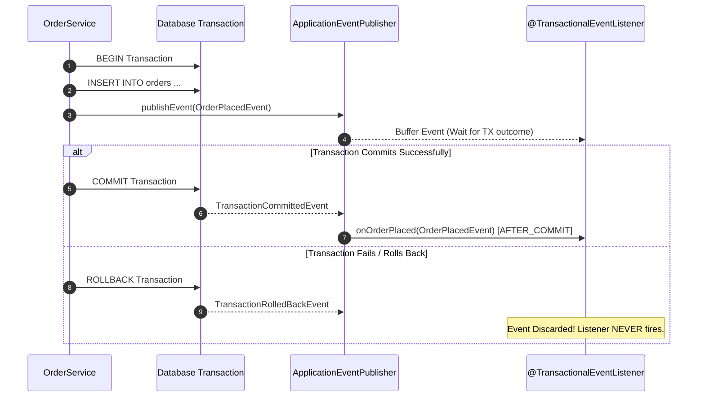
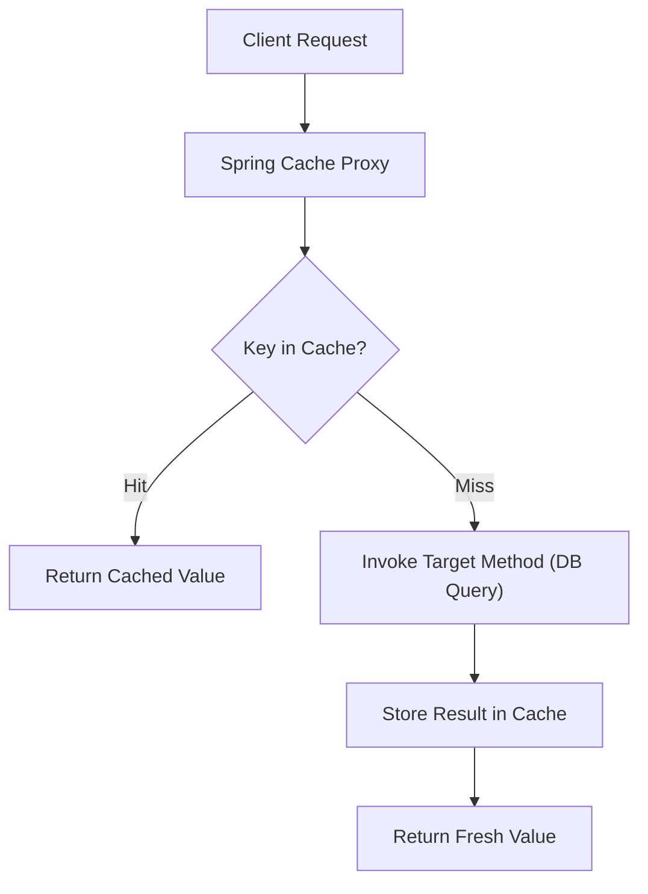
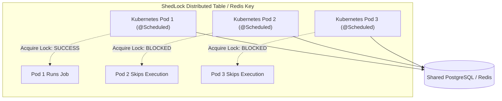

When building enterprise applications, not every operation belongs in the main HTTP request-response thread. Sending a customer welcome email does not need to block the user registration API. Calculating expensive pricing rules does not need to re-query the database 500 times a second. And generating monthly account statements should happen automatically at midnight while your team sleeps.

Spring provides three powerful abstractions to solve these challenges: **Application Events**, **Declarative Caching**, and **Task Scheduling**. 

However, treating these utilities like simple convenience annotations is dangerous. If you do not understand the underlying thread pools, proxy interceptors, and clustering constraints, you risk locking transaction threads, serving stale data across nodes, or accidentally billing your entire customer base five times on a Friday night.

In this guide, we will dive deep into how these mechanisms work at the JVM and cluster level, identify their subtlest failure modes, and build production-hardened implementations.

---

## Decoupling with Spring Application Events

The `ApplicationEventPublisher` interface allows Spring beans to publish domain occurrences without coupling the publisher to downstream side effects (auditing, notifications, search indexing, metrics).

```mermaid
flowchart TD
    Service["OrderService
(ApplicationEventPublisher)"] -->|publishEvent(OrderPlacedEvent)| Multicaster["SimpleApplicationEventMulticaster"]

    subgraph Listeners ["Registered Listeners"]
        Multicaster --> L1["InventoryListener
(@EventListener - Sync on HTTP thread)"]
        Multicaster --> L2["EmailNotificationListener
(@Async @EventListener - Separate ThreadPool)"]
        Multicaster --> L3["BillingAuditListener
(@TransactionalEventListener - AFTER_COMMIT)"]
    end
```

### The Synchronous Default Trap
By default, Spring's `SimpleApplicationEventMulticaster` invokes listeners **synchronously on the publisher's thread**. 
If your controller calls `orderService.createOrder()`, and the `EmailListener` takes 3 seconds to communicate with SendGrid over SMTP, your HTTP response is delayed by 3 seconds. Furthermore, if the email listener throws an uncaught `RuntimeException`, the caller's transaction rolls back!

### Making Listeners Asynchronous
To run event processing on a background thread pool without stalling the HTTP caller, combine `@EventListener` with `@Async`:

```java
package com.example.ecommerce.event;

import org.slf4j.Logger;
import org.slf4j.LoggerFactory;
import org.springframework.context.event.EventListener;
import org.springframework.scheduling.annotation.Async;
import org.springframework.stereotype.Component;

@Component
public class CustomerNotificationListener {

    private static final Logger log = LoggerFactory.getLogger(CustomerNotificationListener.class);

    @Async("notificationTaskExecutor")
    @EventListener
    public void onOrderPlaced(OrderPlacedEvent event) {
        log.info("Processing asynchronous notification for order: {}", event.orderId());
        // Slow SMTP email dispatch or push notification logic
    }
}
```

> [!WARNING]
> **In-Memory Events Are Not Durable Messages!**  
> Spring Application Events live inside the JVM heap. If your application crashes or the Kubernetes pod is restarted before an `@Async` listener processes an event, the event is lost forever. For mission-critical workflows (e.g., payment capture, order fulfillment), use a durable message broker like RabbitMQ or Apache Kafka with the Transactional Outbox Pattern.

---

## Transactional Events: `@TransactionalEventListener`

Suppose an order creation method writes a row to the database and publishes an `OrderPlacedEvent`. A listener consumes that event and immediately calls a warehouse fulfillment microservice. 

What happens if the local database transaction rolls back *after* the event is published (e.g., due to a database constraint violation on commit)? The warehouse ships the physical goods, but the order never actually existed in your database!

To prevent this nightmare, Spring provides `@TransactionalEventListener`:



### Configuring Transaction Phases
`@TransactionalEventListener` binds event execution to the transaction lifecycle:
- `AFTER_COMMIT` (Default): Executes only after the database transaction has successfully committed.
- `AFTER_ROLLBACK`: Useful for compensatory logic or alerting on failed operations.
- `AFTER_COMPLETION`: Runs regardless of whether the transaction committed or rolled back.
- `BEFORE_COMMIT`: Executes right before the database commit takes place.

### The Read-Only / Connection Closed Trap in `AFTER_COMMIT`
A common senior trap: what happens if your `AFTER_COMMIT` listener tries to write to the database using a repository?
```java
@Component
public class AuditLogListener {

    private final AuditRepository auditRepository;

    public AuditLogListener(AuditRepository auditRepository) {
        this.auditRepository = auditRepository;
    }

    @TransactionalEventListener(phase = TransactionPhase.AFTER_COMMIT)
    public void recordAudit(OrderPlacedEvent event) {
        // DANGER: The original database transaction has already committed!
        // Calling save() here either fails or executes in autocommit mode without a transaction.
        auditRepository.save(new AuditRecord(event.orderId()));
    }
}
```

Because the surrounding transaction is already closed, attempting to mutate entities will fail or behave unpredictably. To execute database mutations in an `AFTER_COMMIT` listener, you must spawn a fresh, independent transaction using `Propagation.REQUIRES_NEW`:

```java
    @Transactional(propagation = Propagation.REQUIRES_NEW)
    @TransactionalEventListener(phase = TransactionPhase.AFTER_COMMIT)
    public void recordAudit(OrderPlacedEvent event) {
        auditRepository.save(new AuditRecord(event.orderId()));
    }
```

---

## Declarative Caching with `@Cacheable`

Spring's cache abstraction wraps methods with an around-advice interceptor. If a value exists in the cache, the target method is never executed. If the key is missing, the method executes and its return value is stored.



### Production Cache Configuration: Caffeine (Local) vs Redis (Distributed)
```java
package com.example.ecommerce.service;

import com.example.ecommerce.dto.ProductDto;
import com.example.ecommerce.entity.Product;
import com.example.ecommerce.repository.ProductRepository;
import org.springframework.cache.annotation.CacheEvict;
import org.springframework.cache.annotation.CachePut;
import org.springframework.cache.annotation.Cacheable;
import org.springframework.stereotype.Service;

import java.util.UUID;

@Service
public class ProductService {

    private final ProductRepository productRepository;

    public ProductService(ProductRepository productRepository) {
        this.productRepository = productRepository;
    }

    // sync = true prevents cache stampede / thundering herd problem
    @Cacheable(cacheNames = "products", key = "#productId", sync = true)
    public ProductDto getProductById(UUID productId) {
        Product p = productRepository.findById(productId)
                .orElseThrow(() -> new IllegalArgumentException("Product not found: " + productId));
        return new ProductDto(p.getId(), p.getName(), p.getPrice());
    }

    // CachePut updates the cache entry with the new return value
    @CachePut(cacheNames = "products", key = "#result.id()")
    public ProductDto updateProduct(ProductDto updateDto) {
        Product updated = productRepository.save(Product.from(updateDto));
        return new ProductDto(updated.getId(), updated.getName(), updated.getPrice());
    }

    // CacheEvict purges the key from cache on deletion
    @CacheEvict(cacheNames = "products", key = "#productId")
    public void deleteProduct(UUID productId) {
        productRepository.deleteById(productId);
    }
}
```

### The Thundering Herd / Cache Stampede Problem
When a hot cache key expires in a system handling 5,000 requests/second, 5,000 threads simultaneously find a cache miss and execute the underlying database query at the exact same millisecond. This "thundering herd" frequently crashes database connection pools.

Setting `sync = true` inside `@Cacheable(cacheNames = "products", key = "#id", sync = true)` forces the underlying `CacheManager` to synchronize access. Only **one** thread is allowed to query the database, while the remaining 4,999 threads block and wait to receive the cached value once populated.

---

## Scheduling Tasks: `@Scheduled` and Cron Expressions

Spring provides `@Scheduled` for running recurring background jobs without heavy external frameworks.

### Fixed Rate vs Fixed Delay
- **`fixedRate`**: Measures the interval from the **start** time of the previous execution. If task A starts at 12:00:00 with `fixedRate = 5000` (5s), task B attempts to start at 12:00:05 regardless of whether task A has finished.
- **`fixedDelay`**: Measures the interval from the **completion** time of the previous execution. If task A takes 10s to run, task B will only start 5s after task A completely finishes.

### The Six-Field Spring Cron Expression
Standard Linux cron has 5 fields (minute, hour, dom, month, dow). Spring cron expressions have **6 fields**:

```
 ┌───────────── second (0-59)
 │ ┌───────────── minute (0-59)
 │ │ ┌───────────── hour (0-23)
 │ │ │ ┌───────────── day of month (1-31)
 │ │ │ │ ┌───────────── month (1-12 or JAN-DEC)
 │ │ │ │ │ ┌───────────── day of week (0-7 or MON-SUN, 0 and 7 = SUN)
 │ │ │ │ │ │
 * * * * * *
```

Examples:
- `"0 0 2 * * *"`: Every morning at 02:00:00 AM.
- `"0 */15 * * * *"`: Every 15 minutes.
- `"0 0 0 1 * *"`: Midnight on the first day of every month.

> [!IMPORTANT]
> **Always Specify the Timezone!**  
> If you write `@Scheduled(cron = "0 0 0 * * *")`, Spring uses the JVM host's default timezone. If your cloud containers run in UTC while your business operations are in US/Eastern (`America/New_York`), your billing job will run at 7:00 PM EST! Always provide `zone`:
> ```java
> @Scheduled(cron = "0 0 0 * * *", zone = "America/New_York")
> ```

---

## The Default Single-Thread Scheduler Bottleneck

Out of the box, Spring Boot configures a `ThreadPoolTaskScheduler` with a pool size of **1**!

If you have two scheduled methods:
1. `JobA`: Runs every 10 seconds, but gets stuck waiting for a 60-second database socket timeout.
2. `JobB`: Runs every second to monitor health metrics.

Because the pool only has 1 thread, `JobA` completely blocks `JobB` from ever running! 
Always configure a custom task scheduler bean in production:

```java
package com.example.ecommerce.config;

import org.springframework.context.annotation.Bean;
import org.springframework.context.annotation.Configuration;
import org.springframework.scheduling.annotation.EnableScheduling;
import org.springframework.scheduling.concurrent.ThreadPoolTaskScheduler;

@Configuration
@EnableScheduling
public class SchedulingConfig {

    @Bean
    public ThreadPoolTaskScheduler taskScheduler() {
        ThreadPoolTaskScheduler scheduler = new ThreadPoolTaskScheduler();
        scheduler.setPoolSize(Runtime.getRuntime().availableProcessors() * 2);
        scheduler.setThreadNamePrefix("scheduled-task-");
        scheduler.setWaitForTasksToCompleteOnShutdown(true);
        scheduler.setAwaitTerminationSeconds(30);
        scheduler.initialize();
        return scheduler;
    }
}
```

---

## The Multi-Replica Distributed Scheduling Crisis: ShedLock

In modern cloud environments, you rarely run a single instance of your Spring Boot app. You run 3, 5, or 10 Kubernetes pods.

If you write `@Scheduled(cron = "0 0 0 * * *")` to bill subscription renewals, **all 10 pods will execute the billing job simultaneously at midnight**, causing 10x duplicate charges and massive database deadlocks!



### Implementing ShedLock with a Distributed Database Lock

Add the ShedLock dependency (`shedlock-spring` + `shedlock-provider-jdbc-template` or `shedlock-provider-redis-spring`) and configure lock coordination:

```java
package com.example.ecommerce.config;

import net.javacrumbs.shedlock.core.LockProvider;
import net.javacrumbs.shedlock.provider.jdbctemplate.JdbcTemplateLockProvider;
import net.javacrumbs.shedlock.spring.annotation.EnableSchedulerLock;
import org.springframework.context.annotation.Bean;
import org.springframework.context.annotation.Configuration;

import javax.sql.DataSource;

@Configuration
@EnableSchedulerLock(defaultLockAtMostFor = "10m")
public class ShedLockConfig {

    @Bean
    public LockProvider lockProvider(DataSource dataSource) {
        return new JdbcTemplateLockProvider(
            JdbcTemplateLockProvider.Configuration.builder()
                .withJdbcTemplate(new org.springframework.jdbc.core.JdbcTemplate(dataSource))
                .usingDbTime() // Prevent clock skew issues between server nodes!
                .build()
        );
    }
}
```

Now annotate your scheduled task with `@SchedulerLock`:

```java
package com.example.ecommerce.job;

import net.javacrumbs.shedlock.spring.annotation.SchedulerLock;
import org.springframework.scheduling.annotation.Scheduled;
import org.springframework.stereotype.Component;

@Component
public class MonthlyBillingJob {

    @Scheduled(cron = "0 0 0 1 * *", zone = "UTC")
    @SchedulerLock(
        name = "MonthlyBillingJob_run",
        lockAtLeastFor = "5m", // Prevents other pods from taking over if this pod finishes in 2 seconds
        lockAtMostFor = "30m"   // Releases lock automatically if this node crashes mid-execution
    )
    public void billSubscriptions() {
        // Safe to execute across 50 Kubernetes pods: exactly one pod will run this!
    }
}
```

---

## Architectural Traps and Real-World Outages

### The "5x Midnight Billing" Disaster
A SaaS subscription startup scaled their backend service from 1 to 5 replicas ahead of a marketing campaign. They had a nightly job configured with `@Scheduled(cron = "0 0 0 * * *")` that iterated through delinquent accounts and attempted credit card charges via Stripe. 

At midnight, all 5 instances awoke, queried the same database rows, and charged customers up to 5 times each. Over 2,400 customers received duplicate debit alerts within 3 minutes, triggering a wave of chargebacks and temporary suspension of the company's Stripe account. The fix was introducing ShedLock with PostgreSQL table-level locking.

### The Self-Invocation Cache Bypass Trap
A developer noticed that caching was not working on a high-throughput endpoint:

```java
@Service
public class CatalogService {

    public ProductDto getProduct(UUID id) {
        // Direct internal call bypasses the Spring CGLIB proxy!
        return this.loadFromDb(id);
    }

    @Cacheable(cacheNames = "products", key = "#id")
    public ProductDto loadFromDb(UUID id) {
        return productRepo.findById(id).map(this::toDto).orElseThrow();
    }
}
```
Because `getProduct` called `loadFromDb` using the direct `this` reference, the invocation never crossed the Spring CGLIB proxy. The `@Cacheable` interceptor was completely bypassed, and every request hammered the database. Caching annotations must always be called across bean boundaries.

---

## Senior Interview Questions

### Question 1: What is the difference between `@EventListener` and `@TransactionalEventListener`, and what happens if a transactional event is published outside an active transaction?
**Answer:**  
- `@EventListener` is executed immediately and synchronously when `applicationEventPublisher.publishEvent()` is called, within the current execution thread and transaction scope.
- `@TransactionalEventListener` inspects the transaction status via `TransactionSynchronizationManager`. It defers listener execution until the transaction completes a specific phase (most commonly `AFTER_COMMIT`).
- If an event is published and there is **no active transaction**, `@TransactionalEventListener` is **silently ignored** and will not execute at all by default. If you want the listener to fire even when no transaction exists, you must explicitly configure `fallbackExecution = true`:
  ```java
  @TransactionalEventListener(phase = TransactionPhase.AFTER_COMMIT, fallbackExecution = true)
  ```

### Question 2: How does Spring's cache abstraction handle null return values, and why can this cause cache penetration vulnerabilities?
**Answer:**  
By default, Spring's cache abstraction caches `null` values as a `NullValue` sentinel object. While this protects against **Cache Penetration** (where an attacker queries non-existent IDs repeatedly to force constant database hits), it can be dangerous if the method returns `null` due to a transient failure or network timeout.

To prevent caching `null` results conditionally, use the `unless` SpEL attribute:
```java
@Cacheable(cacheNames = "users", key = "#id", unless = "#result == null")
```
This ensures that only non-null, successful results are written to the cache.

### Question 3: How does `@Scheduled` behave when using `fixedRate` if a task takes longer to execute than the configured rate period?
**Answer:**  
By default, Spring `@Scheduled` tasks are executed sequentially per method trigger. If a task is scheduled with `fixedRate = 5000` (every 5 seconds) but an invocation takes 12 seconds to complete, the next invocation will **not** execute concurrently on another thread. Instead, it will be queued and execute immediately as soon as the first invocation finishes. 

However, if the scheduled method is also annotated with `@Async`, the scheduler spawns subsequent runs concurrently on the async executor thread pool regardless of whether previous executions have completed, potentially causing uncontrolled thread pool exhaustion and database connection starvation.

### Question 4: In a clustered environment, why is local in-memory caching (like Caffeine) dangerous for mutable state, and how do you achieve consistency?
**Answer:**  
In a multi-node cluster, each JVM pod maintains its own isolated heap memory. If Pod A updates a user record and evicts the key from its local Caffeine cache, Pod B and Pod C have no awareness of this eviction and continue serving stale data from their local heaps until their TTL expires.

To achieve consistency in clustered architectures:
1. **Centralized Distributed Cache**: Use Redis or Memcached so all application pods share a single source of cached truth.
2. **Two-Level Caching with Cache Invalidation Pub/Sub**: Maintain a local L1 Caffeine cache in each pod for microsecond response times, backed by Redis as L2. When any pod mutates state, it publishes an eviction message to a Redis Pub/Sub topic, which triggers all other pods to purge their local L1 Caffeine entry.
